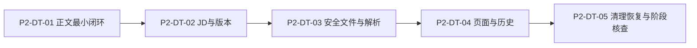

# P2 资料与版本开发任务

版本：实施登记 v3｜日期：2026-10-31｜状态：P2-DT-01/02 已合并；P2-DT-03 本地实现与适用验证完成、待审阅/CI/复审；P2-DT-04/05 未实施

依据：[P2 详细设计](<P2 资料与版本详细设计.md>)、[开发计划](开发计划.md)、[验收标准](验收标准.docx)、[实现证明计划](实现证明计划.md)。`P2-DT-*` 是本阶段的开发任务编号，不替换原 `DT-01～07`、`TD`、`ACC/DACC` 或 `PF/VP` 编号。每项单独分支与 PR，按实际证据登记完成状态；不因 CI 通过就推断真实 PG、文件、浏览器或产品验收通过。

## 1. 进入条件与开发顺序

设计开始时 PR #9 已合并、本地 `main` 与 `origin/main` 一致且工作区干净。实施每项任务前重新核对分支/工作区/上游、前一项 PR 与迁移状态；若主线变化，先更新基线，不在旧版本上改业务代码。P1 身份会话作为资源归属依据；DT-02 尚缺的跨用户所有者/符号链接与数据库读回故障证据单独追踪，不能用 P2 资料隔离测试替代 DT-02 特有的受控开通证据。

每项任务开始前都应重读对应需求和当前实现。下列文件位置为**预期修改范围**，不是要求预建空类；以实际代码所有权与审查结果为准。任务之间不共用一个长期功能分支。迁移仅追加，不修改已应用 V1/V2。

## 2. 独立任务

### P2-DT-01 粘贴简历的最小私有闭环

**当前状态（2026-10-31 核实）**：原始切片及后续修复经 PR #10/#11 合入主线，当前基线 `931a622`。此前未合并描述为历史阶段，真实验证及失败历史仍见[实现与验证记录](<P2-DT-01 粘贴简历私有闭环：实现与验证记录.md>)；P2、完整 ACC/PF 仍开放。

- **目标/最小范围**：本人在受保护工作区粘贴简历正文，确认后得到一个逻辑简历和不可变 V1；能列出/查看自己的该版本；二次确认后删除整份简历，立即禁访并清理当前正文/版本。此任务创建第一个私有对象，因此归属校验、删除屏障、重复请求核实和当前正文的真实清理同 PR 落地。页面只需足以操作和观察上述闭环的最小入口，不做完整 PG-02/08 布局。
- **依赖**：P1 已有登录/Session/CSRF/当前身份，隔离 PG16 和受控测试目录可用；审阅本阶段表/契约建议。若当前账号身份无法可靠核实，不能通过开放未认证接口赶进度。
- **预期修改**：M-02 最小根、正文版本、删除请求/清理项及用例、Spring JDBC 仓储、追加 V3 Flyway 迁移、输入/列表/详情/删除接口；前端请求适配、最小表单和列表；隔离 PG/HTTP/浏览器验证脚本与记录。不得修改 M-01 账号所有权事实。
- **来源**：PRD-01/02/09/10；ACC-01-02、ACC-02-03/06/07、ACC-09-01/04、ACC-10-01～03/05 适用部分；M-02、CB-VERSION/DELETE/CLEAN、PF-01/02/05/08 适用部分；PG-02/08、OV-06。
- **必须验证**：100 与 20,000 码点可接受，99/20,001 拒绝且无截断；匿名/B/仅维护者对 A 的创建后读写/删除直接请求被拒；A 重登可查看；重复确认与响应丢失查询仅有 V1；删除与新版本竞争后无新写，删除后正文不可见，B 不变；真实 PG/HTTP/Chrome 及清理前后数据证据。无法实现即时禁访或清理续做时标部分完成，不进入下一项声称 P2 已有安全基础。
- **完成条件**：单个可操作端到端切片可审阅；至少本人粘贴、确认、读、删、禁访和当前数据清理均有独立真实介质证据；迁移首次/重复执行正常；不宣称文件上传、JD 或全部 ACC/PF 完成。

### P2-DT-02 JD 确认与资料版本

**原实施登记（2026-10-31，PR #12 合并前的历史）**：代码与本地验证完成，独立分支 `codex/p2-dt-02-jd-versions`，待提交、CI、独立审查及合并。新增 V4，扩展原脚本的 15 项真实 PG16/HTTP/Chrome 检查通过，基础测试 6/6、前端 check 通过；开发库仍 V1/V2。见[本任务记录](<P2-DT-02 JD确认与资料版本：实现与验证记录.md>)。

- **目标/最小范围**：对同一逻辑简历确认 JD V1，之后编辑简历或 JD 只追加 V2；历史详情可读旧版，后续计划可引用明确的简历版本 ID 与 JD 版本 ID。不得加入计划生成或 AI 岗位语义评价。
- **依赖**：P2-DT-01 已合并且删除屏障可作用于新增版本；沿用其请求身份与结果核实机制。
- **预期修改**：M-02 JD 版本、V4 增量迁移及索引、追加简历/JD 版本用例和接口、最小编辑/版本选择 UI、固定数据夹具与验证记录。
- **来源**：PRD-02/03/09；ACC-02-05 的资料部分、ACC-03-01～04 的资料部分、ACC-09-02 的资料部分；FL-03、CB-VERSION、SC-10、TD-03、PF-02/08。
- **必须验证**：JD 49/50/10,000/10,001 码点及换行；空白拒绝；V1/V2 原文、ID、顺序不变；同一逻辑请求只追加一次；删除竞争后新 JD/简历版拒绝，旧版禁访；匿名/B/仅维护者的直接版本访问拒绝。语义矛盾、低匹配与非 Java 后端的计划继续规则登记为 P4 待验证，不用简单正则冒充岗位判断。
- **完成条件**：本人可确认并查看简历与 JD 的历史版本，固定引用可供后续模块使用；真实 PG/HTTP/浏览器及跨账号证据齐备；不关闭旧面试版本验收。

### P2-DT-03 受控 PDF/DOCX 文件与解析

**当前状态（2026-10-31）**：独立分支已完成上传、解析、确认、鉴权原文件和最低必要恢复；9项基础/文件、23项真实PG/HTTP/Chrome、6项持久化回归及前端check通过，见[本任务记录](<P2-DT-03 受控文件与解析：实现与验证记录.md>)。尚未提交、推送或创建PR；P2阶段未验收。

- **目标/最小范围**：本人上传合规 PDF/DOCX，文件私有暂存与限时解析；成功后核对/编辑正文再确认版本；损坏、加密、扫描或解析失败可粘贴正文继续；原文件由鉴权端点读取。文件发布、数据库确认、孤儿清理和删除须按可恢复协议执行。
- **依赖**：P2-DT-02 的版本/归属/屏障；已核实所选解析库、临时/持久目录权限及资源上限。任何真实文件写入都必须已有删除可追踪路径。
- **预期修改**：M-02 上传意图/文件登记/受控存储适配、PDF/DOCX 解析器、上传和结果/原文件接口、V5 增量迁移、页面上传分支、真实文件与 PG 验证脚本。文件系统之外的数据库事实仍由 M-02 写入。
- **来源**：PRD-02/10；ACC-02-01/02/04/06/08、ACC-10-02/03；FL-02、PG-02、CB-DELETE/CLEAN、TD-05、PF-01/05/08。
- **必须验证**：10,000,000/10,000,001 字节、PDF 20/21 页、DOCX 多页不因等效页数拒绝；实际格式签名、损坏/加密/扫描/恶意文件、30 秒截止；解析失败仍可粘贴且不发布假版本；B/仅维护者/匿名不能下载 A 文件；数据库提交/文件移动间故障不产生可读的半成品；删除后文件不再可读；真实文件目录/PG/HTTP 证据。
- **完成条件**：上传、解析、确认、私有读取和失败退路可在真实目录运行；孤儿/半成品有持久核实和清理机制；不声称所有解析内容语义正确。

### P2-DT-04 页面、历史与删除影响

- **目标/最小范围**：将 PG-02/PG-08 与 OV-06 的 MVP 信息层级落到桌面网页，完成正文/上传两种输入、JD 确认、版本列表/详情、删除二次确认、加载/空/失败/未知状态。界面显示真实阶段范围及进度，不展示不存在的面试/报告计数。
- **依赖**：P2-DT-01～03 的服务端契约和状态可观测；现有会话恢复、CSRF、Pinia 与路由复用。
- **预期修改**：`frontend/src/api`、`stores`、`views`、`router`、必要样式和真实浏览器夹具；只为本阶段使用到的接口补后端最小展示字段。保留后端独立校验。
- **来源**：PRD-02/03/09/10；ACC-02/03/09/10 适用部分；FL-02/03/08、PG-02/08、OV-06、IX-01/03、PF-01。
- **必须验证**：从登录到保存/重登查看/追加新版本/删除的真实 Chrome 闭环；解析中、失败转粘贴、未保存离开提醒、重复点击/回包丢失核实、无权直接导航、删除中/清理失败可观察且无恢复按钮；双窗口账号切换后旧私有正文不残留在新账号界面。
- **完成条件**：P2 已实现能力在桌面网页有完整可理解入口/出口，所有状态有下一步；前端 `npm run check` 和隔离 PG+真实浏览器案例通过，不用禁用按钮代替服务端防重。

### P2-DT-05 当前资料清理恢复与阶段证据核查

- **目标/最小范围**：对 P2 已存在的正文、JD 版本、原文件及暂存/副本做系统性删除核查；真实文件清理失败、重启、重复执行及删除与上传/确认竞争的恢复证明；核对 24 小时在线清理能力，整理本阶段通过/未执行证据和 P8 扩展契约。
- **依赖**：P2-DT-01～04 已合并；可控故障与隔离 PG16/真实受控目录。备份演练若缺条件明确未执行，不用模拟替代。
- **预期修改**：必要的 M-02 清理恢复修复、验证夹具/脚本、P2 实现与证据记录、README/开发计划状态；不实现未来计划/面试/额度对象。
- **来源**：PRD-10；ACC-10-01～05/07 适用部分；DACC-01-05/02-05 的未来接入约束；CB-DELETE/CLEAN/BACKUP、SC-06/08、TD-05、PF-01/05。
- **必须验证**：屏障与清理意图共同提交；迟到上传结果/重复删除不复活文件或版本；清理失败与应用重启后续做并核实文件摘要/数量；B 资料保持不变；24 小时期限的任务调度与证据；隔离旧备份恢复若具备真实能力则验证删除记录先于访问，否则明确开放项。
- **完成条件**：当前 P2 对象的在线删除、禁访和恢复在真实 PG/文件介质可重复证明；整理逐条 ACC/PF 的通过、部分、未执行，不把备份/全关联/额度/供应商留存误标为完成。P2 阶段能否关闭按证据判断，而非任务编号全部提交即自动关闭。

## 3. 每个 PR 的共同检查

1. 先确认 `main` 已包含前置 PR，检查 `git status` 并保留用户改动；只提交当前任务文件，审查 Flyway 历史与目标 `app` schema。
2. 写明新增表/接口/状态的拥有者和需求编号；新私有对象必须同时有服务端归属与删除屏障。参数化 SQL、会话/CSRF、秘密和正文不进日志。
3. 使用隔离真实 PG16；涉及文件使用真实私有目录，涉及 Cookie/页面使用真实浏览器。记录失败注入顺序、前后状态、数量、命令和证据位置。CI 基础构建通过只算一层证明。
4. Codex/独立审查意见逐条复现或说明不可复现、修复、补回归并复审；所有评论解决且最新提交的 CI 通过后再考虑合并。保留未执行项与恢复条件，不把 P2 部分通过写成完整 MVP 通过。

## 4. 当前审阅与下一任务

PR #12 已于 2026-10-31 合并，当前主线 2c2d80e；P2-DT-02 原验证记录和待 PR 描述保留为历史。当前先审阅 P2-DT-03 的[实现与证据](<P2-DT-03 受控文件与解析：实现与验证记录.md>)，通过 CI 与独立复审、合并后再进入 P2-DT-04。
