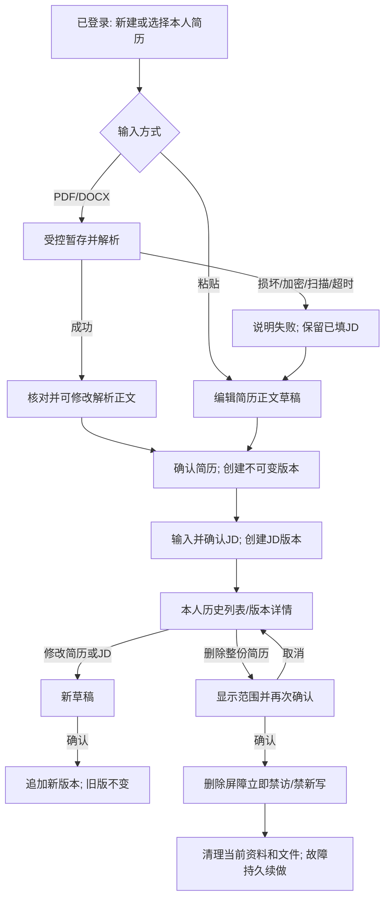
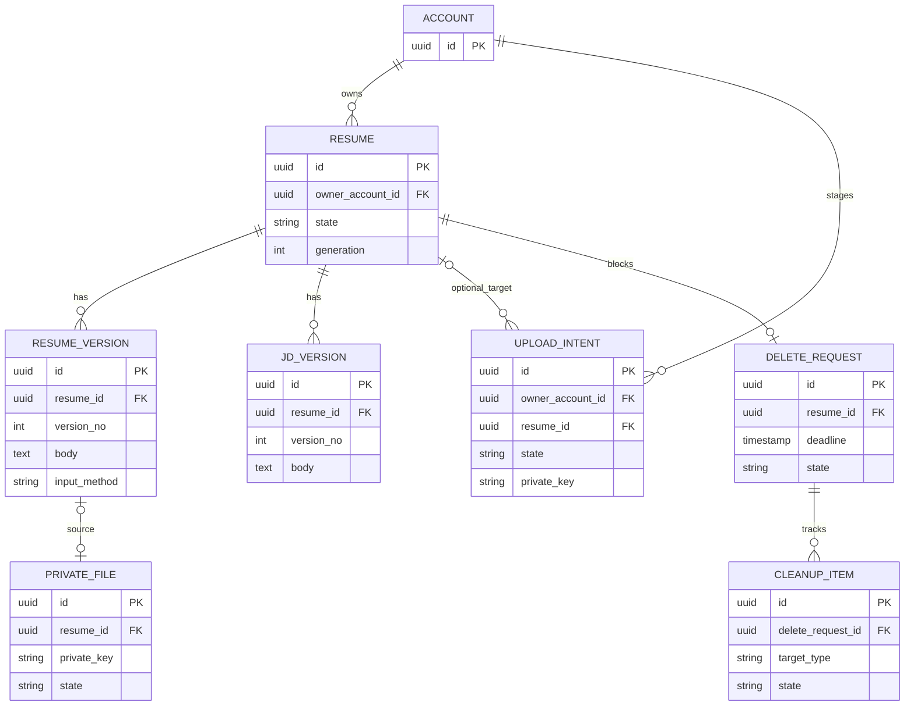

# P2 资料与版本详细设计

当前实施补记（2026-10-31，P2-DT-05）：PR #14 已合并至主线 `035652a`，P2-DT-01～04 及审查修复均在本轮基线内。清理实现/实证见[资料清理恢复与阶段核查](<P2-DT-05 资料清理恢复与阶段核查.md>)，本地实施与适用验证完成、待审阅；下文各阶段候选结构和待合并描述保留原时点，不替代当前状态。

清理增量差异：V6 在现有 `material_upload` 上记录 `cleanup_attempted_at`、`cleanup_error_code` 并按最久未尝试轮转；外部文件实删后，同一完成事务更新上传、清理项及请求。原受理时间+24小时不变，超期只记录/告警，不恢复访问或重置期限。未新增业务接口；备份30天、独立最新删除账本和旧备份开放门禁仍待真实演练，不由本次在线资料清理替代。

当前状态补记（2026-10-31）：PR #13 已合并，主线 `c4e12ec` 包含 P2-DT-01～03 及解析规范化审查修复；P2-DT-04 的[页面历史与删除影响实现记录](<P2-DT-04 页面历史与删除影响：实现与验证记录.md>)登记本轮实现和适用验证，尚待审阅。下文初稿、候选结构和历史验证状态不改写为本轮通过。

页面实施差异：复用现有接口，以双栏提供简历/JD编辑和版本历史，资料列表/版本详情具有加载、失败和只读标识；无新增表或后端业务接口。前端遇旧未决版本404先查本人删除回执，不凭404清掉原操作。删除回执显示服务端PENDING/CLEANED及期限；仅以标签页中账号绑定的目标ID恢复刷新查询，不保存正文或凭据，不承诺跨设备草稿同步。数量缺失明确失败，不虚构尚不存在的计划、面试或报告统计。

当前实施入口（2026-10-31）：P2-DT-02 已由 PR #12 合并；文件切片见[P2-DT-03 实现与验证](<P2-DT-03 受控文件与解析：实现与验证记录.md>)。下文原设计计划不改写为已验证事实。

实施差异：V5 将一上传一原文件的意图与登记合并为 `material_upload`，固定初始目标与确认后实际根分别记录；版本绑定仍与正文共同提交。文件先私有发布，再人工核对确认。两个有界 JVM、30秒截止与失效代次控制结果接收；全部临时文件纳入受控目录和清理。当前页面只提供最小上传/核对/恢复入口，不替代 P2-DT-04 的完整布局和 P2-DT-05 的清理、时限与备份证明。

版本：设计初稿 v1（实施登记更新）｜日期：2026-10-31｜状态：P2-DT-01 已合并；P2-DT-02 本地验证完成、待 PR；P2 阶段未验收

实施记录：[P2-DT-01 粘贴简历私有闭环](<P2-DT-01 粘贴简历私有闭环：实现与验证记录.md>)、[P2-DT-02 JD确认与资料版本](<P2-DT-02 JD确认与资料版本：实现与验证记录.md>)。JD 与正文历史版本已有本地证据；PDF/DOCX、文件清理及完整页面仍属于后续任务。

实施契约登记（2026-10-31）：采用 V4 的 `material_jd_version`；简历/JD 分别维护同根版本序列，新增两类版本列表和 `/jd-operations/{operationId}` 原结果查询。删除影响保留 `versionCount` 并新增 `jdVersionCount`，同一事务扩展 JD 清理。具体接口、错误码与证据以 P2-DT-02 记录为准；下文候选设计不覆盖已固定契约。

依据：[开发计划](开发计划.md)、[PRD](产品需求.docx)、[范围](交付范围.docx)、[验收](验收标准.docx)、[产品流程](产品流程与状态设计.md)、[交互设计](页面与交互设计.md)、[领域模型](轻量领域模型与模块职责.md)、[一致性边界](业务协作与一致性边界.md)、[技术方案](技术方案设计.md)、[技术决策](技术决策记录.md)、[证明计划](实现证明计划.md)。任务见[P2 开发任务](<P2 资料与版本开发任务.md>)。

## 1. 基线、范围和追溯

- **已确认**：Git 的 PR #9 已合并，本地 `main` 与 `origin/main` 一致，设计开始时工作区干净。P2 依赖 P1 已有身份/会话，M-02 拥有本人资料、版本及删除屏障；维护者身份不附带私有资料读取权。
- **已确认**：PDF/DOCX 或粘贴正文、JD 粘贴、确认后保存新版本、本人历史、受控私有文件、删除屏障与当前资料清理属于 P2。计划、RAG、问答、报告、额度、语音、Agent 均不属于 P2。
- **设计建议**：一个逻辑简历是删除根；其 JD 修订归在该根下。相同 JD 用于另一简历时形成另一资料关系，避免删除一个简历牵连另一份。每次确认产生不可覆盖的版本，草稿只在本次页面会话中暂存。
- **待实施核实**：解析库对加密/扫描件、恶意 ZIP/PDF 和超时的实际表现；所选受控文件介质的权限、原子移动及故障恢复；PG16 与真实浏览器中的并发和权限证据。以上不是业务待决项。

| 本阶段场景 | 来源 | P2 可以证明 | P2 不关闭的验收 |
| --- | --- | --- | --- |
| 本人简历上传、正文确认及边界 | PRD-02；ACC-02-01～04、06～08；FL-02、PG-02；PF-08/VP-08-B 适用部分 | 类型/字节/页数/码点、解析失败转粘贴、无截断、当前版本与私有文件 | ACC-02-05 中旧面试仍用原版；AI 内容质量 |
| JD 输入与版本 | PRD-03；ACC-03-01～04 适用部分；FL-03；CB-VERSION、TD-03、PF-02 | 空值及 49/50/10000/10001 边界、确认后新版本、旧版本不变 | ACC-03-05/06 的岗位语义、矛盾优先级、低匹配确认、计划生成及旧面试绑定，留待 P4/P6 |
| 历史与私有访问 | PRD-01/09；ACC-01-02、ACC-09-01/02/04 适用部分；PF-01/VP-01-A/B | 本人列表/详情/原文件；匿名、其他账号和仅维护者直接访问被拒绝；重新登录仍可查看 | 计划、问答、报告的历史与全链路 PF-01 |
| 删除与真实介质 | PRD-10；ACC-10-01～05/07 适用部分；CB-DELETE/CLEAN/BACKUP、SC-06/08 适用部分；TD-05、PF-05/VP-05-A/B | 当前资料禁访、并发写入拒绝、正文/版本/文件清理及重启续做；另一用户不受影响 | 关联面试终止、额度释放/已结算不退、全部副本与旧备份恢复及供应商留存，留待 P8 等阶段 |

设计追溯到 DACC-01-05、DACC-02-05：它们描述未来面试回答与删除竞态，P2 只建立可复用的删除屏障，不声称已执行这些案例。`SC-10` 的固定资料版本只验证当前资料部分；后续场次快照仍需 P4/P6 证明。

## 2. 用户流程、状态与版本

| 对象/状态 | 进入条件与可执行操作 | 数据事实与失败出口 |
| --- | --- | --- |
| 页面草稿 | 输入或编辑尚未确认的正文/JD；可离开并提示未保存 | 不宣称已跨设备保存；校验失败保留本页输入。系统失联时查询原操作，不擅自再建版本 |
| 文件暂存/解析中 | 完成类型和大小初检，文件只进入私有暂存区；等待、取消本次解析 | 30 秒单次解析截止；解析失败可重试/更换文件/粘贴正文，不生成已确认简历版本 |
| 已确认版本 | 服务端成功接受确认；可读、继续输入 JD 或基于旧版编辑 | 每次修改确认追加版本；原正文、文件引用和时间固定；旧版绝不原位改写 |
| 待确认 JD / 已确认 JD | JD 粘贴校验后由本人确认 | 已确认 JD 修订追加且关联逻辑简历；计划阶段必须再检查岗位语义、矛盾与匹配情况，不能把“已保存”当成“可直接生成计划” |
| 删除中/禁访 | 本人二次确认后，短事务建立删除屏障和清理意图 | 立即拒绝资料列表详情、正文/文件读取、新写及旧操作回写；仅允许本人查询不含私有正文的最小删除状态；失败待续做，不恢复为可访问 |
| 在线清理完成 | 文件及正文/版本核实清除 | 保留最小删除凭据以防旧请求和备份复活；备份清除/恢复门禁按既定 30 天规则继续追踪 |

**输入规则（已确认）**：文件最多 10,000,000 字节（1 MB = 1,000,000 字节），PDF 最多 20 页；DOCX 不设等效页数限制。简历正文为 100～20,000 个 Unicode 码点，JD 为 50～10,000 个码点；先统一换行并修剪首尾空白，再计数，正文中的空格、标点和换行计入；不截断。对扫描/加密/破损文件不承诺 OCR。空白、乱码、纯重复输入须纠正；明显非 Java 后端 JD 或相互矛盾要求要提示，但其岗位语义裁决与继续制定计划属于 P4，不在 P2 伪做模型判断。

资料确认前可编辑。确认后编辑生成新资料版本；若后续计划已生成，必须生成新计划，旧面试保留原资料版本。P2 不建立计划或面试记录，只保证版本可被后续稳定引用。删除针对整份逻辑简历而非单个版本；不提供单版本删除入口。

## 3. 模块职责与建议数据模型

M-01 提供当前受认证的账号 ID、会话有效性和角色事实；M-02 对资源所有权、版本、文件资格及删除屏障作最终裁决。入口不能只靠前端隐藏按钮；所有列表、详情、原文件、创建、修改、删除都要在服务端验证身份、所属账号和未删除状态。仅维护者也必须是资料所有者才可访问其个人资料。M-02 不直接改 M-01 账号或会话事实。

图中 `ACCOUNT` 是现有 M-01 账号表的概念引用，不要求新建账号表。表名为**推荐逻辑命名**，详细列型由实施任务确认；此处不执行 DDL。

| 建议结构 | 主要字段/约束 | 查询与写入所有权 |
| --- | --- | --- |
| 逻辑简历根 | ID、owner_account_id、状态、失效代次、创建/更新时刻；账号外键；状态只允许有效→删除中→清理完成 | M-02；按 owner+状态+时间查本人列表；以同用户锁及根行资格重查阻止删除与新版本竞争 |
| 简历版本 | ID、root ID、递增版本号、固定正文、输入方式、原文件 ID（可空）、确认时刻、请求幂等标识；`(root, version_no)` 和逻辑请求唯一 | M-02；只追加；按 root+version 查详情，禁止 UPDATE 正文 |
| JD 版本 | ID、root ID、递增版本号、固定 JD 正文、确认时刻、请求幂等标识；同根版本号唯一 | M-02；只追加；后续计划引用明确的简历版本 ID 与 JD 版本 ID |
| 上传意图 | ID、owner_account_id、可空的目标 root ID、受控暂存 key、解析状态/截止、请求标识；目标根若存在必须属于同一账号 | M-02；新建简历时还没有 root，先由账号拥有暂存；确认、取消、超时和删除都能定位并清理该文件 |
| 私有文件登记 | ID、root ID、随机生成的受控相对 key、原始显示名、声明/检测类型、字节数、摘要、状态、关联版本 ID（可空） | M-02；key 唯一，不接受客户端路径；文件下载必须经所属根鉴权 |
| 删除请求与清理项 | 删除根唯一、受理时刻、24 小时在线清理期限、状态/尝试信息；每个文件和持久对象清理项有唯一目标键 | M-02；屏障与请求共同提交；重复删除返回原请求；清理项允许重试并记录故障，不含私有正文 |

**Flyway 建议**：在已应用 V1/V2 后，P2-DT-01 追加 V3（逻辑根、简历正文版本、删除请求和清理项）；P2-DT-02 追加 V4（JD 版本）；P2-DT-03 追加 V5（上传意图和文件登记），仅在对象真正使用的任务增加结构。迁移失败禁止应用带部分结构启动；不改 V1/V2 校验和，不自动 baseline/clean/repair。新迁移用中文注释解释非显然约束。迁移前确认目标 schema 为 `app`、版本和历史；隔离 PG16 首迁/重启重复迁移后再评估开发库。表级约束只支撑不变量，归属与删除资格还须在同一事务中判断。

## 4. 最小接口与页面协作建议

以下是 P2 的**候选契约**，供任务逐项审阅；不把它写成已确认的完整 OpenAPI。已有 Cookie Session 与 CSRF 继续适用，写请求有一次性逻辑请求标识；服务端核实重复请求的原结果。

| 能力/页面 | 候选操作 | 成功结果、异常与前端状态 |
| --- | --- | --- |
| 本人简历列表 PG-08 | `GET /api/materials/resumes` | 仅本人有效根及摘要、当前版本号；空列表有新建入口；身份未知先核实 `me` |
| 粘贴正文 PG-02 | `POST /api/materials/resumes`；`POST /api/materials/resumes/{id}/versions` | 返回根/版本 ID、确认时刻、统计；输入不合法 `INVALID_INPUT`，重复原操作返回同一结果；删除中 `RESOURCE_UNAVAILABLE` |
| PDF/DOCX 上传/解析 PG-02 | `POST /api/materials/resumes/uploads`；`GET /api/materials/resumes/uploads/{id}`；确认正文时带有效上传 ID | 受控暂存，解析中/成功/失败可观察；失败给粘贴或更换入口；上传 ID 归属检查与截止核实；解析成功仍须用户确认，不自动发布版本 |
| JD 确认 PG-02 | `POST /api/materials/resumes/{id}/jd-versions` | 返回新 JD 版本 ID、计数；旧版不变；缺少简历根/删除中或无归属拒绝 |
| 历史详情与私有文件 PG-08 | `GET .../{id}`、`GET .../{id}/versions/{versionId}`、`GET .../{id}/jd-versions/{versionId}`、`GET .../{id}/files/{fileId}` | 只给本人且属于该根的对象；文件由鉴权端点按受控流返回，禁直接静态 URL；匿名 401，非本人/已删除统一不泄露资源是否存在的响应 |
| 删除确认与状态 OV-06 | `GET .../{id}/deletion-impact`、`DELETE .../{id}`、`GET .../{id}/deletion` | 展示本阶段真实关联版本/文件数及删除影响；确认后立即禁访并显示清理进度；失败重试由服务端持续执行，用户只可查看状态，不提供恢复删除按钮 |

建议沿用现有统一 JSON 错误封装，区分 `INVALID_INPUT`、`UNAUTHENTICATED`、`FORBIDDEN`（只用于不泄漏对象存在性的权限响应）、`RESOURCE_UNAVAILABLE`、`OPERATION_IN_PROGRESS`、`RESULT_UNKNOWN`、`PARSER_FAILED`、`SERVICE_UNAVAILABLE`；最终具体名称在首个实现任务固定。HTTP 401 表示未认证，403 表示已认证但无所需能力；对私有对象的“他人或不存在”需用相同可观察结果避免枚举。解析失败不等于请求结构不合法，亦不等于后端系统不可用。回包丢失先查询原逻辑请求状态，禁止盲重交产生两个版本。

PG-02 采用参考图的信息层级，但主操作是“确认并保存资料”；未保存输入离开时提示。解析成功显示可编辑正文、来源与字节/页数/码点；失败保留可恢复的 JD 草稿。PG-08 列出本人逻辑简历和每份资料的版本，版本详情标注“历史版本”；删除二次确认真实影响范围，尚未实现的计划/面试不展示虚构的 0 条计数。

## 5. 文件、解析与故障安全

1. 上传前后均核对字节数、扩展名、MIME 声明与实际文件签名；解析器使用受限资源、单次 30 秒截止与恶意文档防护。PDF 核页数；DOCX 不使用等效页数门槛。文件名只作安全显示，不能作为存储路径；禁止绝对路径、`..`、符号链接/Junction 越界、ZIP 膨胀和任意外部引用读取。
2. 原文件位于受控持久私有目录，绝不位于 `frontend/public`、`dist` 或可直访静态目录；仅鉴权后按服务器生成 key 读取。日志和错误正文不含完整简历、JD 或原始文件路径。解析文本作为不可信输入，不能执行其中的指令。
3. 建议采用“记录归属账号的上传意图→受控暂存→解析/用户核对→在受控目录内发布到服务器生成的稳定 key→短事务确认版本、文件登记并核销上传意图”的协议；未入库的文件没有下载入口。文件系统和 PG 不能原子提交：数据库提交结果未知时先按逻辑请求 ID/上传意图核实，再决定文件是否为孤儿；若已确认入库则不得清理。文件已发布而数据库确定未提交时，意图记录及受控目录核对负责清理，不能从用户文件名猜测归属。发布与确认间若删除屏障生效，版本提交被拒绝，文件按孤儿处理。故障注入必须验证这几个先后，而不能宣称跨介质原子性。
4. 用户取消、超时和解析失败时，本次暂存文件应按已确认资料生命周期清理；重试同一上传/确认操作先查已保存结果。文件读取失败给明确错误和重试入口，不回退为其他用户文件或未经确认的解析正文。

## 6. 删除一致性与范围

本人确认后，M-02 在同一短本地事务中重查账号/所属根、锁定资格、设置根删除屏障和失效代次、记录删除请求及全部当前对象清理意图；提交时刻起资料正文、版本及文件对所有请求禁访，旧请求也不能追加，仅本人可查询最小删除状态。并发创建新版本只能排在屏障前（纳入清理清单）或屏障后被拒绝，不能出现遗漏。重复删除核实原请求，不重建第二次清理任务。清理文件等慢操作放在事务外，失败仍保持禁访，持久任务在重启后续做；在线资料及文件须在受理后 24 小时内完成并可核实。别人的根、版本和文件完全不受影响。

P2 现有对象只有简历/JD/原文件及其暂存/副本，必须逐项核实清理；后续 P3～P8 新增的计划、候选、问答、报告和权益必须接入同一根屏障，并在各阶段扩展删除清单与共同提交边界。备份 30 天清理与恢复旧备份前先应用删除记录是总体规则；P2 设计保留删除凭据和恢复门禁接口，**不因在线清理通过就宣称旧备份演练、全关联删除或外部供应商清除通过**。若备份清除/恢复能力未具备，应明确标记未验证，不删除屏障记录后开放访问。

## 7. 验证设计与证据门槛

所有下列案例为**计划**，本轮未执行。用新建隔离 PG16 库、真实受控私有目录、合成 A/B/仅维护者账号及测试 PDF/DOCX，记录迁移历史、数据库前后数量、文件清单/摘要、HTTP 状态与不含正文的日志；浏览器案例另留真实 Cookie/CSRF 证据。

| 验证组 | 操作和故障顺序 | 预期事实与证据来源 |
| --- | --- | --- |
| V-P2-01 归属 | A 创建，B/仅维护者/匿名逐个直访列表、版本、文件、创建/修改/删除 | A 可见；B 和维护者不可读写 A，匿名 401；跨账号不泄漏存在性；真实 HTTP+PG+文件访问记录；ACC-01/09、PF-01 |
| V-P2-02 输入 | 10,000,000/10,000,001 字节，PDF 20/21 页，DOCX 多页，正文 99/100/20000/20001，JD 49/50/10000/10001，换行与补充字符 | 按确认规则接受/拒绝，不截断；返回码点/字节统计与独立预期一致；ACC-02/03、PF-08 |
| V-P2-03 解析 | 有效、损坏、扫描、加密、恶意路径/压缩包、超时；失败后改粘贴 | 失败不发布确认版本，JD 草稿可保留；粘贴成功追加版；无文件越界或正文外泄；ACC-02、FL-02 |
| V-P2-04 固定版/重复 | 同一确认请求重复、响应丢失后查询、V1 后编辑 V2 | 每个逻辑操作至多一版，V1 内容及文件引用不变；真实 PG 唯一约束和详情；CB-VERSION、PF-02 |
| V-P2-05 删除竞态 | A 创建/读文件与删除交错；B 并发访问；重复删除；旧请求迟到 | 屏障后 A/B/旧操作均不能访问或新增，清理包含屏障前已提交对象；B 自己资料不变；PG 事务/并发证据；CB-DELETE、PF-05 |
| V-P2-06 文件失败/重启 | 数据库确认与文件发布之间中断；清理文件失败后重启；暂存孤儿 | 不出现可访问却无文件的“成功”状态；禁访持续，恢复后每个目标清理一次可核对；真实文件目录/PG/任务证据；CB-CLEAN、PF-05 |
| V-P2-07 时限与备份 | 以真实时间/可控任务调度核对在线 24 小时；隔离旧备份恢复演练 | 在线 24 小时及备份 30 天/恢复门禁分别记证；未具备备份能力时列未执行，不从替身推断通过；ACC-10、VP-05-B |

**设计检查**：M-02 独占版本/屏障写入；所有接口有归属与禁访核实；已确认版无原位更新；文件发布/清理可恢复；P2 不把计划或报告计入已有对象。未发现必须先追问的业务规则冲突。待在实现任务中核实的技术事项：文件发布与 PG 提交结果未知的恢复协议、解析器资源限制、受控目录/备份恢复能力。若这些核实暴露业务规则无法满足，应停在相关任务并提交明确取舍，不静默放宽期限或删除范围。
