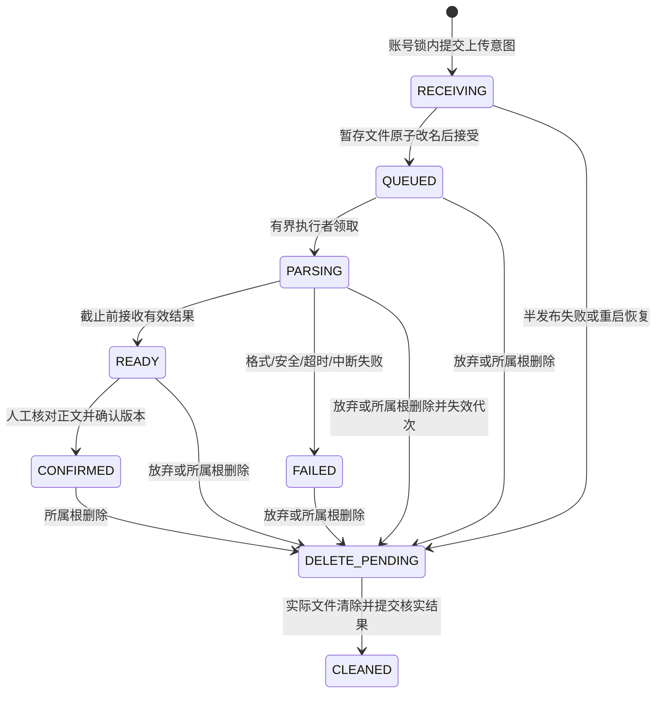

# P2-DT-03 受控文件与解析：实现与验证记录

后续基线核实（2026-10-31）：PR #13 已合并，含第8节修复提交 `6745c63`，主线为 `c4e12ec`。本文件下文未提交/待PR/CI文字保留为历史；P2-DT-04 的当前实施见[后续记录](<P2-DT-04 页面历史与删除影响：实现与验证记录.md>)，不改写原测试结果。

日期：2026-10-31。状态：P2-DT-03 本地实现与适用验证完成，待审阅、CI 和独立复审。范围：M-02 的受控 PDF/DOCX 上传、解析、核对确认、私有读取和最低必要恢复。不代表 P2、完整 ACC 或 PF/VP 验收完成。

补充状态：PR #13 已创建，提交 `07c2bea` 的 CI 已通过；本次 P2 码点边界审查修复及其验证见第 8 节。以下第 1～7 节保留初次实施时点的记录，不代表当前仍未提交或未创建 PR。

## 1. 基线、依据与实施范围

工作分支 `codex/p2-dt-03-file-upload-parsing`，开始时工作区干净，HEAD/main/origin/main 均为 `2c2d80ea5763727bdab3a19c88b87939844f0476`。Git 命令的远端访问受本机失效代理阻碍；改用 GitHub 连接器实时读取 main 和 PR #12，确认 PR 已合并且远端 main 为上述提交，未修改全局代理。前置文档中的历史“待 PR”保留，当前状态另行同步。

依据：[P2 任务](<P2 资料与版本开发任务.md>)、[P2 详细设计](<P2 资料与版本详细设计.md>)、[产品需求](产品需求.docx)、[验收标准](验收标准.docx)、[技术方案](技术方案设计.md)、[业务一致性](业务协作与一致性边界.md)、[证明计划](实现证明计划.md)。覆盖 PRD-02/10、ACC-02-01/02/04/06/08、ACC-10-02/03 当前资料部分，FL-02、PG-02、CB-VERSION/DELETE/CLEAN、TD-05、PF-01/02/05/08 的适用片段。

复用已合并的账号、Session/CSRF、`AccountWriteGuard`、简历/JD 不可变版本、归属校验、原操作核实和根删除屏障。未创建计划、面试、报告、额度或 RAG 能力，未调用模型或付费服务。

| 修改位置 | 职责 |
| --- | --- |
| `backend/pom.xml` | 明确声明已选 PDFBox/POI 依赖，其他依赖继续由 Boot 管理 |
| `material/UploadApi.java` | 上传、操作核实、未完成列表、确认/放弃及鉴权原文件入口；只输出契约字段 |
| `material/UploadService.java`、`UploadRepository.java` | M-02 登记、固定操作、短事务、结果裁决、调度与清理恢复 |
| `material/PrivateFiles.java` | 随机 key、受控目录/权限、原子改名、完整性读取、受限清理 |
| `material/DocumentParser.java`、`ParserWorker.java` | 两个并发、独立 JVM、30 秒停止及格式/安全限制 |
| `InterviewCoachApplication.java` | 打包 JAR 的解析子进程入口，在 Spring 初始化前分派，不连接数据库 |
| `identity/AccountWriteGuard.java` | 向已接受后台任务提供当前账号锁事实；用户写入仍必须比较原凭证代次 |
| 既有 `Resume*` | 扩展文件删除影响、屏障与清理意图、错误契约；不修改旧版本 |
| V5、local 配置、`.env.example` | 登记结构、私有 multipart 路径及受控目录配置；V1～V4 不变 |
| `frontend/src/api/materials.ts`、`stores/materials.ts`、`views/MaterialUploadPanel.vue` | 统一身份预检、文件交互、Pinia 草稿和原操作恢复 |
| `WorkspacePage.vue`、`MaterialVersionsPanel.vue` | 避免上传与其他未决写互相清除，展示真实文件删除范围 |
| `ResumeMaterialIT`、`UploadCommitFaults`、`PrivateFileTest`、`PersistenceFoundationIT` | 真实介质、HTTP/浏览器、提交故障及基础回归；提交包装器只存在于测试装配 |
| `Verify-P2Upload.ps1`、`Verify-P2Resume.ps1`/`Verify-P2ResumeBrowser.mjs`、`Verify-Persistence.ps1` | 扩展既有隔离框架、限定各自集合并归档证据，不另建仓储替身框架 |
| README、AGENTS、P2任务/详细设计、前置DT02记录 | 当前入口、基线、实施差异和后续状态；历史测试不改写 |

## 2. 实际协议与接口

V5 新增 `material_upload`，合并“上传意图”和“一次上传的文件登记”：每次上传只有一个受控原文件 key，生命周期相同，故不拆两套重复事实。`operation_id` 和 `target_resume_id` 固定原请求；`resume_id` 可以在新建确认时绑定实际根。`version_id` 唯一，原文件不能后补到已经由其他操作创建的旧版本。重放上传/确认不会跟随最新版本。

失败解析不创建已确认版本，失败原文件在解析执行结束保护期后清理，失败状态保留供本人查看/放弃。已受理的后台解析不依赖旧 Session 存活；其结果仍须按账号→根的锁顺序核实当前权限、状态、代次和截止。确认、上传、放弃及删除等用户写请求必须重新核实凭证代次和预期账号，旧 Session 不因后台任务可继续而恢复资格。

| 方法与路径 | 请求/结果与规则 |
| --- | --- |
| `POST /api/materials/uploads` | multipart `file`，可选 `resumeId`；`X-Operation-Id`、`X-Expected-Account-Id`、CSRF 必需；原名只作展示，不作路径 |
| `GET /api/materials/uploads` | 本人尚未完成上传列表，过滤已删除根；支持刷新/重登后恢复核对或放弃 |
| `GET /api/materials/uploads/operations/{id}` | 原上传核实，包括本人最小放弃/删除回执；终态不含原名、正文、版本 ID；不把 404 或网络失败当作此前未提交的证明 |
| `GET /api/materials/uploads/{id}` | 本人解析状态、失败类别和待核对正文；不暴露文件路径、摘要、账号内部事实 |
| `POST /api/materials/uploads/{id}/confirmation` | `{body}`，固定确认操作 ID；只在 READY 接受；正文版本与文件绑定同一 REQUIRED 本地事务提交 |
| `DELETE /api/materials/uploads/{id}` | 放弃未确认上传，推进代次并登记物理清理；已确认原文件须随整份简历删除 |
| `GET /api/materials/uploads/versions/{versionId}` | 本人固定版本对应的文件登记；粘贴版本没有原文件时 404 |
| `GET /api/materials/uploads/{id}/original` | 再查归属/禁访、长度和 SHA-256，attachment、no-store、nosniff；原文件不是静态资源 |

保留既有 400 `INVALID_INPUT`、401、403、404 `RESOURCE_UNAVAILABLE`、409 `ACCOUNT_CHANGED`/`OPERATION_CONFLICT` 和 503 `RESULT_UNKNOWN`。新增 413 `FILE_TOO_LARGE`、409 `UPLOAD_NOT_READY`；确定原文件不可读且尚未接受版本时返回 503 `FILE_UNAVAILABLE`。multipart 超限在选定 Controller 前也能得到 413，避免错误转发变成 403。

## 3. 文件、安全与一致性

- 最大 10,000,000 字节，PDF 20 页；DOCX 没有等效页数限制。正文沿用原有统一换行、首尾空白和 100～20,000 码点规则，绝不截断后冒充完整简历。
- 默认在 backend 工作目录下使用 `../.local-data/private`；根 `.env` 可设置 `PRIVATE_FILE_ROOT`。新建私有根只授予拥有者访问，检查已有目录 ACL/POSIX 权限；不修改项目根目录 ACL。仅信任拥有者与操作系统管理员的本机维护边界。
- 根及祖先、目标文件拒绝符号链接和 Windows Junction；key 为服务端 UUID。上传原名限制长度、扩展名、控制字符和路径分隔符；PDF/ZIP 实际签名独立校验。
- `RECEIVING` 先持久化，再写 `.part` 并同目录原子改名为 `.bin`。进程内发布许可避免清理活跃写入；队列接受未知时通过登记和文件摘要核实；重启将未完成接收登记转清理。没有文件系统/PG 跨介质原子提交承诺。
- 合法 multipart 文件先在大小受限的内存中接收，业务持久意图提交后才写私有介质；发布前强制刷新文件内容。HTTP 容器异常残留仍只位于受控 multipart 目录，按单活动应用的启动核查清理，不作为已接受业务文件。
- 两个解析线程，每个只有一个实际子进程；128 MiB heap、32 MiB direct-memory 限制。父进程最多等待 30 秒后强制停止并等待 OS 退出，子进程另有 30 秒 watchdog。数据库在领取时固定截止并再次裁决，迟到结果不发布。JVM 启动、结果等待或取消等待均不代表业务成功。
- 父进程把绝对截止传给子进程，子进程在读取与写出结果前再次检查；父进程已退出、子进程延迟启动时也不会在过期后重新生成文件。实际过期子进程入口验证返回124且没有生成输出。测试观察允许运行器调度容差，业务结果接收仍按数据库的30秒截止裁决。
- 子进程不继承数据库/模型秘密环境；临时目录、用户缓存与错误文件均放到登记 ID 的 `.work` 下，退出后清理。multipart 异常退出残留在单活动应用启动前核查清理。
- DOCX 实际解包读取计数，不向文件系统解压；限制 1000 项、单项 20 MB、总展开 40 MB 和膨胀比例，拒绝路径穿越、重复项、外部关系和 DTD/实体。资源限制属于恶意/复杂文件的解析防护，可能使部分合法复杂文件解析失败；明确给出粘贴退路，不改变业务字节口径或增设 DOCX 页数限制。
- 子进程隔离不是操作系统沙箱，也不承诺限制全部 native 内存或抵御拥有本机账户/管理员权限的攻击者。库升级、OS 级进一步隔离须另行评估，未偷偷引入容器/新组件。
- 整份删除在同一短事务清正文/JD、设置根屏障、失效上传代次、清解析正文和登记所有文件目标。物理清理在事务外；文件未核实清完时回执保持 PENDING。活跃解析截止另留 5 秒退出保护，防止清理后旧子进程重建临时输出；这不是业务删除时限变更。
- 清理失败只记录登记 ID 和类别，持续禁访，重复执行 `deleteIfExists`；物理删除成功但数据库提交未知也可安全再核实。最终清除文件名和文件摘要，保留最小操作/删除凭据。真实 24 小时连续可用性、备份 30 天和旧备份恢复门禁仍属后续证明。

## 4. 版本与官方资料核实

2026-10-31 实际 JDK Oracle 21.0.12，Boot 4.1.2，Maven Wrapper，PG 16.15。JAR 清单实际包含 PDFBox/pdfbox-io 3.0.8、POI/poi-ooxml/poi-ooxml-lite 6.0.0、XMLBeans 5.4.1、commons-compress 1.28.0、commons-io 2.22.0；Flyway 12.4.0、PG JDBC 42.7.14、Spring JDBC 7.0.10、Session JDBC 4.1.1 继续由 Boot 管理，无手工覆盖。

官方核实来源（2026-10-31）：[PDFBox 下载与 Java 要求](https://pdfbox.apache.org/download.cgi)、[PDFBox 3 Loader/文件读取说明](https://pdfbox.apache.org/3.0/migration.html)、[POI 6.0.0 变更及 JDK 17 下限](https://poi.apache.org/changes.html)、[POI 安全指导](https://poi.apache.org/security.html)、[ZipSecureFile 防膨胀参数](https://poi.apache.org/apidocs/6.0/org/apache/poi/openxml4j/util/ZipSecureFile.html)。实际 JDK21 构建、真实样例和打包入口另以运行验证，不从官方最低版本推断全部文件兼容。

## 5. 实际验证与证据

命令执行前在项目根运行 `& './scripts/Use-LocalTools.ps1'`。日志、manifest、合成资料和测试库保留在忽略范围；没有真实资料、凭证或完整 Session/CSRF 纳入文档。

| 检查 | 目录/命令 | 结果与证据 |
| --- | --- | --- |
| 构建/基础/真实子进程与路径 | backend：`./mvnw.cmd '-Dmaven.repo.local=../.cache/maven-repository' -B -ntp verify`；最终统一脚本也执行该生命周期 | 9 项通过：原6项＋真实30秒进程终止、路径/Junction、过期子进程禁止写出三项；最终 `.cache/p2dt01_verify_b218573b431c4248.log` 与其 `-reports/unit/`；早期8项记录仍在 `.cache/p2dt03-final-build.log` |
| PG/HTTP/文件/Chrome | 根：`& './scripts/Verify-P2Upload.ps1'`，委托原 `Verify-P2Resume.ps1` | 最终 23 项通过，0失败/0错误/0跳过；库 `p2dt01_verify_b218573b431c4248`；同名 `.cache/*.log`、`.json`、`-reports/TEST-dev.interviewcoach.identity.ResumeMaterialIT.xml` |
| 持久化基础回归 | 根：`& './scripts/Verify-Persistence.ps1'` | 6项通过；库 `dt01_verify_8bc81f747b914d62`；同名 `.cache/*.log`、`.json`、`-reports/TEST-dev.interviewcoach.PersistenceFoundationIT.xml`；V5下更新清单和隔离夹具，不改正式V1～V4 |
| 前端 | frontend：`npm.cmd run check` | ESLint、Prettier、TypeScript 和 Vite build 通过；`.cache/p2dt03-frontend.log` |
| 打包解析入口 | backend：`java -Xmx128m -jar target/interview-coach-backend-0.0.1-SNAPSHOT.jar --parser-worker <合成输入绝对路径> <受控输出> <受控结果> DOCX` | READY，251 码点，不初始化 Spring/数据库；`.cache/packaged-parser-proof/` |
| 开发库只读核查 | `docker compose exec -T postgres ... psql`，只查询版本/迁移和数量 | `interview_coach` PG16.15，V1/V2，2 个账号，0 张 material 表；未在开发库执行 V3～V5 |

最终脚本完整执行9项基础、打包和23项集成；每次保留自己的 XML 报告，不依赖之后可能覆盖的 target 目录。最终 V5 SHA-256 为 `E2598B836C39C13B60DD81B00E514830D77472BDBEC1C89D482B0BD4B7B27D2B`，解析器源文件摘要随 manifest 留存。最终 JAR SHA-256 为 `5A8F7BABA8E2891EB8C377B19A339DF7EE0BE64545FDDD04C555BFCF84327CF8`，已再次运行打包解析入口得到 READY。前端 check 日志、125个当前文档相对链接检查及 `git diff --check` 均通过；V1～V4 无差异。

23 项集合沿用原 15 项正文/JD/身份/乱序回归，再增加 8 项方法（每项可含多场景）：

| 验证/故障顺序 | 实际断言 | 来源 |
| --- | --- | --- |
| DOCX 上传→READY→编辑确认；追加 V2→重放 V1 上传/确认 | 上传不自动建版本；固定原版本/文件；同操作不重复；粘贴新版本不替换 V1 文件 | ACC-02-01/05 资料部分，CB-VERSION、PF-02 |
| 10,000,000/10,000,001 字节、PDF20/21页 | 前者接受、后者明确拒绝/失败；无截断版本；扫描图片、随机凭证加密、损坏 PDF 失败 | ACC-02-02/04/06/08、PF-08 |
| 25 页 DOCX；路径 ZIP、外部关系、XXE、膨胀 ZIP | 多页成功；恶意结构失败；真实本机接收端外部请求数为 0 | ACC-02-02/08、PF-01 |
| A 原文件，B/匿名/仅维护者直接请求 | A attachment/no-store；B404、匿名401、仅维护者403；路径不外露 | ACC-01、PF-01 |
| 在文件绑定 UPDATE 注入失败 | 新版本和绑定共同回滚，上传仍 READY；删除后确认及新上传拒绝 | CB-VERSION/DELETE、PF-05 |
| 真实 PG commit 完成后连接包装器抛提交确认丢失 | HTTP503但数据库 CONFIRMED；先读原状态后重放，版本仅一份、文件仍存在；包装器仅在测试装配，未替换 PG | PF-02/05、TD-04 |
| 账号锁阻塞→重置提交→旧上传/确认取得锁 | 401，无迟到登记/确认版本；账号/凭证复核复用 M-01 | FS-C02、PF-01 |
| 账号锁排队，确认/删除分别先到 | 删除先：确认404；确认先：接受后删除纳入清理；两种顺序均无正文/文件复活 | CB-DELETE、SC-06、PF-05 |
| 服务关闭后留下 `.part`/`.bin`、PARSING、不可删除目录→重启 | 半发布清除；旧解析 FAILED且无正文；清理失败保持禁访/持久状态，移除受控阻碍后续做成功 | CB-CLEAN、TD-05、PF-05 |
| 真实 Chrome 选文件→刷新恢复→核对→同账号切窗→确认200正文流丢失→原操作重试；另一窗口先确认；失败转粘贴 | 草稿/操作保留，确认只产生一份；另一窗口确认后可打开该固定版本并退出核对，不能覆盖；解析失败转粘贴且 JD 草稿保留；原跨账号/CSRF/乱序场景同时回归 | PG-02、FL-02、PF-01/02 |

失败历史不删除：`9153a951048e4480` 首轮有超限错误被改写为403，以及测试数字类型预期不匹配；修复全局 multipart 错误入口并修正独立预期。`64eb99c00ad24062` 清理断言仅等10秒，短于合法的解析退出保护；改为按保护窗口观察实际清理。`5ca86ddb6ace4a19` 的 Chrome 后续 CSRF 被前一个竞态夹具永久挂起，故在该案例后刷新页面隔离夹具；不将这个夹具问题描述为产品缺陷。`78cf0a877af44e6c` 后续20项通过，`8da67f970a4a4ee9` 23项通过；这些是对应时点的历史证据，最终树验证另记，不替代它。

持久化回归首次 `dt01_verify_736da6a0cb8d492d`：自身6项通过，但旧脚本同时启动其他需独立隔离库的 IT，6个环境保护拒绝导致总体失败。保留该日志；限定 `PersistenceFoundationIT` 后独立新库6项通过，未放宽隔离条件或跳过本套件案例。中间补强后的多次通过记录也保留，不累计成更多验收案例。

## 6. 限制、完成判断与后续

本任务是文件最小可操作闭环，完整 PG-02/PG-08 排版、未保存离开提示及系统性页面状态留在 P2-DT-04；24 小时长期调度、30 天备份和恢复门禁、全部未来关联对象清理留在 P2-DT-05/P8。无供应商/AI 质量验收。

前置独立复审曾指出“其他窗口删除后旧的简历/JD 未决版本入口”问题，属于既有版本面板，不用本次文件测试宣称该旧项已关闭。本次上传的原操作核实可查询本人删除回执并终止失效上传；前置问题继续单独登记审阅。

P2-DT-03 本地实现、适用验证和文档已完成。下一步是本分支提交前审阅、CI 和独立复审；合并后才具备进入 P2-DT-04 的基线条件。本轮未提交、推送、创建 PR 或继续下一任务。

## 7. PR 草稿

标题：`feat(materials): 实现 P2-DT-03 受控文件上传与解析`

描述：本人可上传 PDF/DOCX，查看解析状态并编辑确认不可变简历版本，原文件通过鉴权下载；失败可放弃后粘贴正文。新增 V5 上传/文件登记，保持 V1～V4 不变。解析在有界子进程中执行，落实30秒截止、格式与 ZIP 安全校验；文件发布、数据库确认、删除屏障和清理以持久登记核实恢复，不宣称跨介质原子提交。

验证：9项基础/真实文件与进程检查、23项隔离PG/HTTP/Chrome检查、6项持久化回归、前端check与diff检查通过。覆盖边界、越权、确认回滚/提交未知、双向删除竞争、重启清理、刷新恢复和多窗口确认；证据及失败历史见本记录。开发库未迁移，本轮只修改隔离测试库和私有合成文件。P2-DT-04/05、完整P2、PF/VP和MVP验收不在本PR完成范围。

## 8. P2 审查修复：解析正文先规范化后计数

日期：2026-10-31。修复基线：`07c2bea`，分支 `codex/p2-dt-03-file-upload-parsing`。[PR #13 审查意见](https://github.com/huangxiao999/ai-interview/pull/13#discussion_r4430507458)指出，提取器添加的尾部换行或原文 CRLF/首尾空白会使规范化后合法的 20,000 码点文件误报 `TEXT_TOO_LONG`。

`ResumeText.normalizeWhitespace` 提供既有的 CRLF/CR→LF 和首尾 `strip` 规则，人工确认和 `ParserWorker` 共同复用。解析先规范化，再判断空白和 20,000 码点上限，并输出规范化正文；不把确认时的 100 码点下限提前到解析阶段，仍允许用户核对补全短正文。真正超限仍失败，不截断、不输出可确认正文。

- `ParserWorkerTest` 新增 8 个真实 DOCX/PDF＋独立 JVM 案例：恰好 20,000 码点、首尾空白/尾部换行、内部 CRLF、内部 CR、补充字符、规范化后 20,001 码点和空白文件。固定夹具独立给出预期正文，不调用生产规范化方法生成预期。
- `ResumeMaterialIT` 新增 1 项真实 PG/HTTP 闭环，包含三种合法边界 DOCX 的上传→READY→确认→数据库原文核实，以及超限 FAILED、无正文/无新版本且确认返回409。
- 先在未修复生产代码上运行 DOCX 的6项新回归，4个合法边界场景均复现 `TEXT_TOO_LONG`；超限和空白行为原本正常。证据：`.cache/p2dt03-normalization-before.log`。后续加入 PDF 时的夹具断言首次遗漏 Windows 提取器的 CRLF，修正平台换行预期；保留 `.cache/p2dt03-normalization-targeted.log`，不描述为新增产品缺陷。

实际修复验证：根目录 `& './scripts/Verify-P2Upload.ps1'` 在新隔离库 `p2dt01_verify_970c30a0a4c94c2c` 通过17项基础/真实文件/进程检查（原9项＋新增8项）、打包及24项真实PG/HTTP/Chrome检查（原23项＋新增1项），0失败/0错误/0跳过。证据为同名 `.cache/*.log`、`.json` 和 `-reports/` 下归档 XML（基础报告位于 `unit/`）；原始入口日志为 `.cache/p2dt03-normalization-suite.log`。当前修复不改 V1～V5、前端或数据库协议，前置6项持久化回归和前端check仍为第5节历史证据，本次未重跑；未迁移开发库，未进入 P2-DT-04。

提交 `07c2bea` 的 CI 成功只适用于修复前提交，不能作为本次未提交修改的 CI 证明。本次尚未提交、推送或关闭审查评论，需后续 CI 与独立复审，不关闭完整 P2/ACC/PF/VP、24小时长期清理或备份证明。
