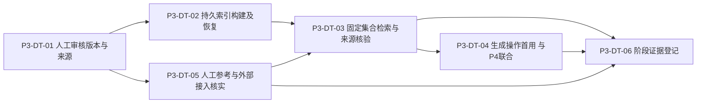

# P3 持久操作与审核知识开发任务

版本：v1.2（索引构建实施补记）｜日期：2026-10-31｜状态：P3-DT-01已合并但有独立P2待修；P3-DT-02本地实现及15项索引隔离验证完成，相关回归见记录，待代码审阅；P3-DT-03～06未实施，不自动继续。

当前实施补记（2026-10-31）：P3-DT-01已由PR #17合并（`3f96075`），CI成功，机器人有一项未解决P2，尚无正式人工批准/安全专项审查记录。用户已确认详细设计第15节的P3-DT-02策略及技术边界，授权在 `p3-dt-02-knowledge-index` 实施并进行相关隔离验证；下文旧“待确认/未合并”等保留历史，实际结果见[P3-DT-02记录](<P3-DT-02 知识索引构建与恢复：实现与验证记录.md>)。

当前证据：[P3-DT-01实现与验证记录](<P3-DT-01 知识版本审核与来源：实现与验证记录.md>)。未找到单独的设计审阅确认文件，采用本轮用户明确指定首切片实施的授权；不声称整个 P3 设计已正式批准。下文初稿的“工作区干净/未实施/脚本不存在”等是设计时点，本轮已保留原有未提交设计及入口修改；当前契约见详细设计第14节和实施记录。

依据：[P3详细设计](<P3 持久操作与审核知识详细设计.md>)、[开发计划](开发计划.md)、[PRD](产品需求.docx)、[范围](交付范围.docx)、[验收](验收标准.docx)、[领域职责](轻量领域模型与模块职责.md)、[一致性边界](业务协作与一致性边界.md)、[技术决策](技术决策记录.md)、[证明计划](实现证明计划.md)、[设计追溯](需求与设计追溯.md)。本轮开始分支 `p3-01`、工作区干净，本地HEAD与GitHub实时main均为 `9f593352ec7333a9b809d6f6dbcc24df027c0739`；P2/DT-02开放项沿用，不以新任务覆盖历史。

`P3-DT-*` 是开发任务，不替换DT/TD/ACC/DACC/PF/VP，不增加原100例人工评审数量。下文文件和命令均是建议的未来修改/执行范围，当前不存在的脚本不作为已可运行命令。

## 1. 顺序与首切片建议

推荐首项 **P3-DT-01 维护者知识版本审核与来源闭环**。它提供真实可操作结果：登录知识维护者提交公共技术版本、人工审核、固定来源读取、修改后旧版不变；可直接使用实际M-01身份和M-06生产规则验证，不依赖付费服务，也不需要先制造计划/场次/评分。它为后续索引操作提供真实输入，避免先建无消费者的调度框架。

P3-DT-02承载持久操作/尝试/候选和重启协议的首个实际用例，但embedding策略不同于生成四次预算。P3-DT-04必须与P4首个真实计划生成任务联合实施，不能单独建空生成平台后标完成；此为待审阅的开发顺序建议，不改原P3/P4业务范围或提前实现完整计划。若暂缓联合接入，阶段登记只能说明P3知识/构建范围完成，生成证明仍开放。

每项实施前重新核对规则、主线/前置PR、工作区和实际最高迁移；使用独立任务分支与可审阅PR，不将本轮设计当连续开发授权。保持单活动执行者，不改变全局环境或清理既有数据。

## 2. P3-DT-01 维护者知识版本审核与来源闭环

**DT-01实施时状态（历史）**：本地闭环与适用验证完成，尚未提交、推送、创建PR或运行当次CI，待审阅。后来由PR #17合并，当前核实见顶部。实际生产用例/PG/HTTP/Chrome证据、V7升级及输入限额见[实现记录](<P3-DT-01 知识版本审核与来源：实现与验证记录.md>)；下列原计划保留为追溯。未经真实知识人工评审，不将合成资料批准当知识质量通过。

- **可观察结果**：知识维护者通过最小维护页粘贴正文与来源/技术条件，得到待审不可变版本；核对原文后明确批准或拒绝；可查原操作及审核事实；只有批准版本可由生产来源能力读取，编辑追加新版本，旧版与来源不变。
- **依赖**：现有登录/Session/CSRF及 `KNOWLEDGE_MAINTAINER`；本设计首切片和候选契约审阅；隔离合成维护/普通账号。没有维护账号时走既有受控准备，不新增自授角色/公开注册。
- **最小范围/拥有者**：新增M-06 `knowledge` 包中的实际入口、用例/规则及JDBC；仅必要版本/审核DTO；建议追加V7知识根/版本/审核表及唯一约束；最小Vue维护页、Pinia状态与统一api适配。只有创建/追加/查看/审核/原操作查询，不做文件上传、索引调度、embedding或完整后台。
- **契约**：固定设计第10节的路径、字段、输入保护值与错误码；来源URL只存取校验，不联网获取。采用expectedAccountId、请求UUID、版本摘要和审核决定的幂等/冲突语义。所有写入以 `requireCurrent` 复核当前凭证/角色，不使用后台锁接口绕过旧会话。
- **来源**：PRD-01/06/09，SCP-01/07/10；ACC-01-04、ACC-06-01/04/07/08；CF-04、M-06/BR-01/07、CB-VERSION、TD-03/07、VP-01-A/B/C/D及VP-08-C的适用片段。
- **必要验证计划**：新隔离PG16首次/重复迁移；匿名/普通用户审核被拒，维护者不能读A私有资料；待审/拒绝来源不返回；同请求重发及不同输入冲突；旧摘要审核拒绝、两维护者相反审核竞争只生效一次；提交或审核真实提交后丢响应查原事实；重置先提交后旧审核等待锁不得晚写。真实Chrome从维护登录到提交/审核/查询/追加V2/回看V1，含未知结果与切账号旧响应；危险协议/HTML不执行。使用真实生产用例，不在测试中直接写APPROVED代替首切片业务行为。
- **完成条件**：实际页面闭环及直接HTTP拒绝、唯一事实/旧版不可变的PG证据可复核；前后端相关基础检查及文档追溯适用通过。仅证明版本/审核/来源门禁，不证明相似度召回或知识语义正确。
- **停止条件**：实际角色核实不能复用，或发现来源/权限无法可靠校验，先处理该问题；输入工程保护值在实施时依据资源限制明确并记录，不自行改变业务规则或截断。审核契约按审阅版执行，不自动向量化或继续P3-DT-02。新增迁移不得修改V1～V6。

## 3. P3-DT-02 持久知识索引构建与候选恢复

本轮范围：已确认的60秒/批、20秒排队、每批3次且无自动外调、单外调许可、原候选恢复和逐次未知费用确认；生产服务保持未就绪，只用实际生产规则+本机可控HTTP替身做工程验证。新增V8，不实现集合发布/检索或停用入口，不修补前置PR #17的独立P2；独立索引页的预检失败不保存未知回执。状态以实现记录为准，以下原计划保留追溯。

- **可观察结果**：维护者为批准版本提交一次构建；能看到排队/处理/批次候选/接收/失败或外部未知状态，重启从原构建及已存批次续做，重复请求不另建构建；部分向量不形成可检索集合。
- **依赖**：P3-DT-01已合并；按设计明确embedding单批截止、默认无自动重试、未知成本确认及租约参数；未有真实调用授权时适配层保持未就绪，测试可用可控embedding服务替身，不提供真实运行的假向量回退。
- **最小范围/拥有者**：M-06构建operation/attempt/候选批次、分块及版本身份；追加当时下一Flyway迁移；单活动调度与有界外调适配；构建/原操作查询和最小维护状态显示。调度只执行当前知识构建用例，不新增通用工作流DSL/反射任务/跨模块万能业务表。
- **来源**：PRD-06/12，SCP-07/13；TD-03/04/06/07、CB-VERSION；ACC-06-04/08、ACC-11-12、ACC-12-04/05/08/10/11适用部分；VP-02-B/C/E及VP-08-D/E。生成四次预算的ACC-12-07不由embedding构建证明。
- **必要验证计划**：真实PG条件领取和同构建竞争；尝试意图提交未知时不直接外发；候选持久后进程中断、接收事务失败、接收提交后丢响应均复用原批次且外调数不增；候选前丢响应标外部未知、旧代次迟到拒绝；错维/错序/部分/非法向量不发布；排队超20秒未调用不伪报耗尽；未配置适配器明确失败，HTTP隐藏重试关闭。费用未知不填0；审查持锁边界，不持数据库锁等网络。
- **完成条件**：实际M-06构建用例在PG与进程重启下满足独立预期；有完整尝试/代次/调用次数/候选证据。替身只证明恢复、结构和协议，不能关闭真实embedding可用性、召回或收费事实。
- **停止条件**：专属embedding截止/重试政策未定，无法区分构建与生成预算，或本地未知被误判未执行则不通过；不默认开启真实调用、换模型或重建全部知识。

## 4. P3-DT-03 不可变集合发布与适用证据检索

- **可观察结果**：构建齐全后维护者发布一个固定集合；按明确技术条件探测，得到实际审核来源/片段或不足/冲突；新集合切换不改变旧集合，服务错误与无依据分开。
- **依赖**：P3-DT-01/02；P3-DT-05准备的真实知识及检索参考；工程故障验证可先用明确合成向量，真实检索效果必须在真实embedding授权和账号核实后另行验证。分块/重叠/Top-K/阈值/token预算须以评审定标，未定标不能声称检索质量可用。
- **最小范围/拥有者**：M-06片段/向量/集合与原子发布、精确向量查询、证据结果DTO和维护探测入口；必要后续迁移。先不加HNSW/外部向量库，不加普通用户个人知识上传。维护探测只接受公共/合成查询，不读任意用户简历。
- **来源**：PRD-06，SCP-07；ACC-06-01～09、ACC-11-12，DACC-03-05；M-06/BR-07、TD-03/07、PF-08/VP-08-C/D；FL-07与IX-08/09。
- **必要验证计划**：真实pgvector验证审核/适用过滤及固定集合精确检索、清单不齐不能发布、批次发布回滚和并发切换；集合旧片段/锚点不漂移，升级不混模型/维度；版本差异不误判冲突，同条件冲突/条件未知/未审/不支持来源给正确缺口；无实时搜索和工具执行。真实20例检索/引用参考逐项人工复核，结果不以相似度/模型标签代替支持关系。
- **完成条件**：工程事实与真实效果分别登记。真实知识/embedding/人工评审未具备时可提交工程范围结果，但不能标真实检索或完整ACC-06通过；API有明确未就绪状态，不能开放未经评审集合用于真实评分。
- **停止条件**：审核集合半发布、来源无法追溯、混配置或实际引用不支持结论必须修复；不靠模型记忆/临时联网兜底，不自动进入计划/评分实现。

## 5. P3-DT-04 生成持久协议的首用接入与私有删除联合证明

本项为 **与P4首个真实计划生成任务联合交付的依赖任务**，不能在没有真实业务消费者时单独实现一套通用生成表或测试状态机后标完成。P3内先审阅本项契约，具体代码到P4授权首用时落地；M-04/M-05后续各自按同一规则核实，不能把M-03证据当报告/额度全部证明。

- **可观察结果**：本人对指定资料版本发起计划生成，等待/失败/未知可核实，原候选可复用，成功仅有一份原业务结果；删除立即禁访，候选和私有查询副本可追踪清理。实际计划生成/接收规则属于M-03/P4，本项仅列与恢复、输入、删除有关的联合交付条件。
- **依赖**：P3-DT-03提供生产知识能力；P4详细设计明确计划契约及合法性校验；M-02窄公开事实/删除协调能力审阅；真实生成调用另行授权，工程故障替身只替代供应商。不得为了做本项提前造假场次或日权益。
- **最小范围/拥有者**：M-03计划操作/尝试/私有候选；最小共享执行值类型仅按真实重复抽取；M-02公开资格、删除协调扩展及清理目标CHECK/汇总；前端原操作恢复。迁移随实际对象追加，不提前一次建M-04/05未来表。
- **来源**：PRD-04/06/09/10/12；ACC-12-01～08/10/11适用部分、ACC-10-01～05；CB-VERSION/DELETE/CLEAN、TD-02～06、SC-03/04/07/10、VP-02-B～F、VP-05-A/B、VP-08-E；DACC-02的恢复原则不等于答题验收已执行。
- **必要验证计划**：真实PG固定资料/知识/配置与请求防重，初始/自动/手动最多4次跨重启不重置、手动无额外自动；候选保存后接收失败和提交回包丢失不外调；外部未知/本地未知分别处理；输入合法变化失效旧代次不赠机会；原模型不可用不静默切换；删除与创建/候选持久/接收双顺序无迟到正文，清理完成查询覆盖新目标而非只看PRIVATE_FILE；真实合成文件若存在则逐一核查。Chrome核实原操作/旧响应/删除及账号切换，生产拥有者执行全部资格。
- **完成条件**：与真实P4首用同一生产路径及PR形成运行证据；生成协议的PF-02/08片段和新增私有清理可核实，不把计划成功冒充面试开始或扣次。答题/报告/结算仍待P5～P7。
- **停止条件**：P4首用尚未授权/设计，保持未实施；生成与资料删除尚不能同事务协调时，不允许新增私有候选。若选择P3内提前实施，必须先审阅具体业务首用范围，不能新增无业务的“测试生成接口”。

## 6. P3-DT-05 人工参考与真实供应商接入核实

- **可观察结果**：有版本化知识/参考清单、真实评审责任人与争议处理；生成及embedding各自有账号/地区/费率/留存配置的脱敏核实记录。资料准备、公开事实核对、实际调用和质量评审分别登记，不相互替代。
- **依赖**：维护者实际资料、至少一位有Java经验的评审者、账号受控配置；真实调用需明确授权范围。可先准备非付费清单；没有资料或评审者则保留缺口，不编造签字/正确答案/来源许可。
- **最小范围**：知识资料和原100例参考的受控清单/模板及标注流程；不提交个人资料、密钥、账单秘密或供应商完整响应。必要中文核实记录在获准实施时创建，不在本轮伪造样例或测试结果。
- **来源**：PRD第5/6节、SCP-07/13、OP-02/03、TD-07、ACC-06-07、ACC-07-10/11、ACC-10-08、ACC-11-12、VP-08-C/D/F。
- **必要核实**：60评分/20检索/10计划/10安全的100独立ID；30评分各3次仍为原案例重复，标注必答点/替代表述/重大错误/适用版本/四维参考/不可评原因/来源锚点。严格原分母、原量表及90%/95%门槛，固定样例重大问题阻断。真实服务核地区/端点/模型/维度/批次/token/配额/费率/账单延迟/训练用途/留存/删除例外；实际日志及外发字段只使用必要合成内容，无隐藏联网工具。
- **完成条件**：准备、已授权调用、实际人工评审各有证据和独立状态；无法完整评分/计划质量评审时保持未来P6/P9依赖，不以检索20例替代全部100例。
- **停止条件**：调用授权或必要政策/费用控制未知则不调用；未经实际评审不启用新生成模型或声称质量通过。不把本地删除承诺扩展到供应商。

## 7. P3-DT-06 阶段审查与证据登记

- **可观察结果**：任务状态、代码拥有者/公开能力、来源门禁、迁移及证据逐条可追溯；使用者能知道哪些当前可用、哪些缺条件；不以任务编号齐全自动关闭P3。
- **依赖**：按实际已完成子集审查；P3-DT-04未首用或P3-DT-05未具备条件时明确部分完成，不伪造前置通过。
- **最小范围**：README/AGENTS/开发计划/P3任务及中文实施记录的必要状态；只修复本阶段实际发现且授权范围内的问题，不接管P4～P8业务。
- **来源**：一致性边界第10.2节；PF-01/02/05/08片段、ACC-06/12适用项、CF-04、TD-03/04/06/07。
- **核查计划**：生产入口、事务/锁顺序、外调位置、恢复原候选、隐藏重试、知识/配置修订、来源/私有隔离及清理完整性；逐条关联前后状态/调用数/原操作与证据；检查本地链接、迁移只追加及秘密忽略。CI普通构建不替代PG/浏览器/真实供应商证据，复用历史证据标实际提交/配置和边界，不无条件全部重跑。
- **完成条件**：设计推演、结构核查、实际运行、外部事实/人工评审四类分开；失败/跳过/未执行如实登记。完整PF-02/05/08及MVP不由P3片段关闭。
- **停止条件**：缺原操作绑定、源码证据不一致或新私有副本遗漏时不标通过；汇报后等用户指定下一任务，不自动迁移开发库、清理缓存、推送或部署。

## 8. 证明介质与任务边界

| 介质 | 能证明 | 不能代替 |
| --- | --- | --- |
| 真实隔离PG16/pgvector | 审核/版本/唯一约束、领取/代次、候选接收、发布/回滚和精确向量计算 | 供应商模型可用、真实召回/语义支持和收费事实 |
| 真实合成文件 | 若任务产生文件，登记、权限、终止、清理及重启后存在性 | WAL/备份轮转、整机硬断电或外部删除 |
| 可控HTTP供应商替身 | 超时、429、空响应、响应丢失、迟到、错维/错序及调用次数 | 生产权限/仓储/业务校验；实际账号/费用/模型质量 |
| 真实Chrome | Session/CSRF、用户实际入口、未知结果核实、账号切换及旧响应 | 事务共同提交、引用语义和长期运维能力 |
| 真实供应商及人工评审 | 实际账号/维度/配额/外发/费用/留存；检索/生成语义与原量表 | 未运行的并发、删除恢复、完整闭环验收 |

P3专用隔离脚本只在对应实现任务创建，建议沿用项目每次新建并保留PG16库、合成目录、源码摘要/日志/XML/脱敏状态清单的方式。涉及多个Maven套件串行运行，不覆盖证据；不在开发库注入故障、不删既有库/卷、不更改旧manifest，不混用本轮未跑与历史通过。

## 9. 开放项与本轮停止点

DT-02的真实跨用户所有权、NTFS符号链接及提交确认/读回同时中断补证继续开放；它们不阻塞本轮设计，也不被知识维护页面验证替代。P2长期24小时/告警、30天备份/独立删除账本/恢复门禁、供应商留存和未来关联对象仍按原记录跟踪；真实试用与恢复开放需相应证据。当前资料屏障可供后续设计，但任何新增私有对象都必须同任务扩展保护和清理。

设计初稿停止点：当时仅交付设计及任务拆分，所有任务未实施。后续本轮用户明确授权实施首切片，P3-DT-01 本地实现与适用隔离验证完成；待代码审阅，不继续 P3-DT-02。embedding专属时限/重试与成本确认、知识停止新使用流程、P3-DT-04与P4真实首用联合交付仍待审阅确定；原100例人工参考、真实服务授权及完整P3/PF/VP仍开放。
