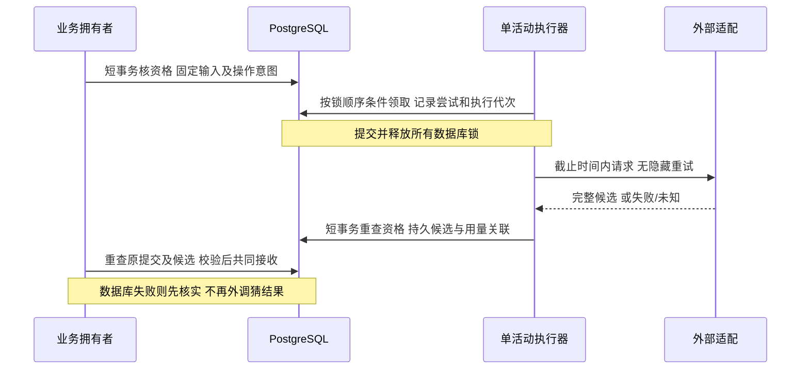

# P3 持久操作与审核知识详细设计

版本：v1.1（首切片实施补记）｜日期：2026-10-31｜状态：P3-DT-01 经用户本轮明确授权，本地实施及适用隔离验证完成，待代码审阅；其余设计建议及任务未实施，不代表完整 P3 已确认或验收。

当前事实见[P3-DT-01实现与验证记录](<P3-DT-01 知识版本审核与来源：实现与验证记录.md>)。设计初稿曾标为待审阅，仓库未找到单独的审阅确认文件；本轮用户明确要求实施首个最小切片，授权仅落到第6.1节及任务清单中的 P3-DT-01，不将其扩大为后续构建/检索/生成方案整体确认。下文原设计时的基线、未实施描述及验证矩阵保留其时点，首切片落地差异集中于第14节。

本设计把已确认的恢复和知识来源规则细化为可实施协议。建议先交付 M-06 知识审核及版本闭环，再以真实知识索引构建用例验证持久操作；生成操作按 M-03/04/05 各自规则落地，不预建统一业务任务平台。首个切片及独立任务见[P3 开发任务](<P3 持久操作与审核知识开发任务.md>)。本文的表、接口、内部状态和实施参数均为建议，不因文档生成自动成为已确认契约。

## 1. 基线与范围

本节基线及结构表为设计初稿时点；本次实施开始时工作区已包含未提交的 P3 设计/任务及三个入口修改，予以保留，不再称本次实施开始时工作区干净。

本轮开始时分支 `p3-01`，工作区干净，HEAD `9f593352ec7333a9b809d6f6dbcc24df027c0739`；经 GitHub 连接器读取[实时 main](https://api.github.com/repos/huangxiao999/ai-interview/git/ref/heads/main)，SHA 相同。该提交为 PR #16 的文档状态同步合并；P2-DT-05 实施合并 `b620804` 仍是历史业务基线，不重写其证据。未切换分支或读取数据库运行状态。

依据：[项目约定](../AGENTS.md)、[开发计划](开发计划.md)、[P2设计](<P2 资料与版本详细设计.md>)、[P2任务](<P2 资料与版本开发任务.md>)、[P2-DT-05核查](<P2-DT-05 资料清理恢复与阶段核查.md>)、[领域职责](轻量领域模型与模块职责.md)、[一致性边界](业务协作与一致性边界.md)、[技术方案](技术方案设计.md)、[技术决策](技术决策记录.md)、[证明计划](实现证明计划.md)、[PRD](产品需求.docx)、[范围](交付范围.docx)、[验收](验收标准.docx)、[产品流程](产品流程与状态设计.md)、[交互设计](页面与交互设计.md)、[设计追溯](需求与设计追溯.md)。Word 为 v0.4；CF-03 对旧开始口径的覆盖仍按技术决策执行。

| 分类 | 本轮采用的事实或处理 |
| --- | --- |
| 已确认规则 | CF-04：仅已审核知识库 RAG 加模型生成评价；无实时搜索、抓取或模型内置联网。TD-03/04 固定输入与原操作恢复；TD-02 短事务/用户锁/受保护数据库受理时刻；TD-05 删除；TD-06 容量；TD-07 人工参考及外部事实 |
| 证明追溯 | PF-02：原操作唯一写入、候选复用、提交未知及晚到拒绝，重点VP-02-B/C/E/F；PF-08：审核知识/引用、外发及真实账号、容量，重点VP-08-C/D/E/F；私有新对象同时继承PF-01/PF-05，P3片段不关闭完整PF |
| 已有代码结构 | `identity`、`material` 包；`AccountWriteGuard.requireCurrent` 与 `lockCurrentAccount`；资料根及版本、上传和清理登记；V1～V6。未见 M-03/04/05/06 业务实现或生成/embedding适配，不把本设计类型当已有代码 |
| 历史证据 | P2-DT-05记录中的17项基础、28项集成、6项持久化及前端check，以及PR CI/机器人审查；本轮不重跑，不升级为P3证据 |
| 设计建议 | 知识状态、集合发布、表/契约、索引构建租约及embedding恢复政策；审阅后逐任务确定 |
| 技术待核实 | 真实PG条件写、并发/恢复、索引原子发布、配置尺寸/分块/token边界、HTTP取消和客户端重试关闭、真实浏览器 |
| 外部依赖 | 维护者审核的实际知识、至少一位Java评审者、100例参考；实际账号地区/端点/配额/费率/留存及调用授权；不要求在聊天提供密钥 |

P3不新增用户私有知识库、完整运营后台、计划调整/面试/评分/报告/额度业务、备份平台或新技术组件。首期仍为单活动应用、JDK21、Spring MVC/JDBC/RestClient、单PG16/pgvector、Flyway、现有Session/CSRF和Vue/Pinia。知识维护入口仅承接 OP-01，不增加维护者读取用户私有正文的权限。

## 2. 业务归属与模块公开能力

| 拥有者 | 唯一可写事实 | 对外提供的能力建议 |
| --- | --- | --- |
| M-01 | 身份、角色、凭证代次 | 用户写事务 `requireCurrent(observedActor)`；已接受后台工作 `lockCurrentAccount(accountId)` 后核实当前角色；不从请求正文认定维护权限 |
| M-02 | 资料版本、归属、删除屏障与删除回执 | 新增窄的公开事实能力：在调用方当前事务中核实并锁定本人有效根，返回指定简历/JD版本及根代次；删除协调调用各拥有者公开终止/清理登记能力 |
| M-06 | 公共知识版本、审核、适用性、索引构建操作及检索证据事实 | 维护版本/审核；构建及核实原索引操作；检索已审核适用片段，返回覆盖/冲突及来源；不写计划、题目、分数或用量 |
| M-03 | 计划生成操作、尝试、私有候选、合法计划修订 | P4首用时实现固定资料/知识输入、生成/原操作查询、计划候选校验及接收 |
| M-04 | 出题操作、场次当前生成许可、题目/回答/封存及期限 | P5/P6实现同场许可和适用操作资格，提供固定上下文；不另存M-05的重试次数 |
| M-05 | 反馈/报告操作、候选、评价及实际引用绑定 | P6/P7校验固定问答/封存输入，接收合法收尾，报告发布与M-04/M-07共同提交 |
| 支撑能力 | HTTP执行、进程执行许可、供应商用量及费用事实 | 不裁决业务成功、不改日权益、不创建通用CRUD/状态机中心 |

现有 `ResumeService`/`ResumeRepository` 是包内类型，不能让M-03/06跨包直接使用仓储。只在首个真实跨模块调用时增加 `MaterialFacts` 等窄接口与独立契约类型，名称待实施固定；它不返回持久对象或隐式启动独立事务。知识审核不需要读取任何个人简历，首切片不为了未来生成提前增加该接口。

**锁的实施差异**：TD-02原方案描述事务级用户咨询锁，现有实现实际以 `identity_account ... FOR UPDATE` 和资料根锁保护资料/重置。P3沿用共同的账号锁入口，禁止仅给新模块加咨询锁却绕过现有行锁。本项为对现有落地的延续建议，需真实PG验证；若未来统一改锁机制，须专项审查所有入口，不在本阶段顺手替换。

锁顺序建议为：需要正式开始预算准入时预算门→账号锁→资料根（多个按稳定ID）→场次/原日权益→所属操作→尝试/候选。M-06维护写为维护账号→知识根→构建操作；集合指针发布在独立短事务中按集合→知识/索引稳定顺序完成，不在已持账号/私有根锁时反向获取集合锁。检索读取固定发布版本，避免将集合锁跨入用户事务。调度领取不得持操作锁再等待账号锁；先读取候选ID释放选择锁，再按规定顺序条件领取，失败重查。

## 3. 三种身份与内部状态

### 3.1 操作、尝试、候选

| 对象 | 固定身份和必要内容 | 状态建议及含义 |
| --- | --- | --- |
| 逻辑操作 | 拥有模块、业务根/步骤、请求UUID、固定输入身份/摘要、处理政策修订、非密钥配置修订；私有操作另有owner/root/generation | `QUEUED`、`RUNNING`、`CANDIDATE_READY`、`WAITING_MANUAL`、`BLOCKED_KNOWLEDGE`、`SUCCEEDED`、`FAILED_FINAL`、`INVALIDATED`；成功只能由业务拥有者共同提交 |
| 尝试 | operationId、attemptId、序号/类别、执行代次、执行者、租约/服务截止、请求关联、用量是否未知 | `DISPATCH_INTENT`、`IN_FLIGHT`、`RESPONSE_STORED`、`FAILED`、`EXTERNAL_UNKNOWN`、`FENCED`；不把本地连接断开写成供应商未执行 |
| 候选 | operationId/attemptId/代次、固定输入身份、完整响应摘要、结构校验结果、来源及用量关联；业务正文在所属模块受控存储 | `STORED`、`REJECTED`、`ACCEPTED`、`PURGED`；STORED不等于业务成功，不对普通用户公开原始候选 |

这些是内部阶段，不替换原I/R/Q状态。`RESULT_UNKNOWN`是调用方无法确认本地提交的事实，不能通过先写一行“UNKNOWN”解决提交本身未知；查询不可用时响应保持未知。`EXTERNAL_UNKNOWN`才是可持久化的外部尝试结果类别。知识不足是独立内容条件，不等同技术失败或真正零分。

同一请求身份不同输入返回 `OPERATION_CONFLICT`；同一业务步骤换请求UUID也不能绕过唯一约束或四次预算。建议唯一约束覆盖 `(owner,kind,requestId)`、业务根/步骤修订、`(operationId,attemptNo)`、`attemptId`候选及已发布结果身份。摘要只用于一致性核对，必须保留可验证固定输入；不凭文本相同合并不同用户或业务对象。

| 转换 | 受保护条件与计数 |
| --- | --- |
| 新受理→QUEUED | 固定输入、请求身份、策略及必要后续意图共同提交；尚未消耗外调尝试 |
| QUEUED→RUNNING | 排队未超过20秒、业务仍有效且取得执行许可；外调前原子记录唯一尝试意图/代次并消耗该次机会 |
| RUNNING→CANDIDATE_READY | 截止前完整候选持久化且当前代次有效；不是业务成功 |
| CANDIDATE_READY→SUCCEEDED | 所属模块校验并与必要业务结果共同提交，唯一接受身份不变；重做本地接收不新增外调 |
| RUNNING→QUEUED / WAITING_MANUAL | 暂时故障且有原自动机会才自动排队；自动用完转等待手动；手动消耗下一原机会且无追加自动 |
| 依据准备→BLOCKED_KNOWLEDGE | 尚未取得充分适用依据；不制造一次模型失败、不耗外调机会，已有有效业务事实保留 |
| BLOCKED_KNOWLEDGE→QUEUED | 显式恢复、原业务仍有效，重新绑定证据修订/代次但沿用步骤预算；已完成不可评结果不走此转换 |
| 非终态→FAILED_FINAL / INVALIDATED | 所属步骤耗尽或资格失效；场次/权益终止仍由M-04/05/07共同处理，M-06构建无日权益；成功业务不因旧失败任务倒退 |

该表的四次计数仅用于四种生成步骤。M-06构建复用身份/领取/候选协议，失败后按第5节维护构建政策进入等待或失效，不复制生成重试计数和场次终态；“同一状态名称”不代表相同业务决定。

读取原结果必须按原operationId和固定业务身份，而非“当前最新版本”。响应丢失后，恢复者先查询业务成功/原候选/有效在途，再判断是否有新尝试资格。404只表示当前不可访问或不存在，不单独证明未接受；私有删除优先核实本人最小删除回执，不能恢复正文或换一个操作ID猜结果。

### 3.2 固定输入时点

| 时点 | 必须固定的内容 |
| --- | --- |
| 知识提交审核 | 正文、来源链接、定位锚点、技术版本/场景、来源可用范围及摘要；编辑产生另一版本，审核不能覆盖正文 |
| 索引操作受理 | 已审核知识版本、分块算法修订、片段清单/摘要、embedding服务/地区/模型/维度/参数修订；不复制密钥 |
| 计划生成受理（P4） | 本人指定简历/JD版本、确认条件、计划需求修订、生成模型/提示词/输出契约修订、知识发布集合和检索政策；结果不得覆盖新资料的计划 |
| 接受开始意图（P5） | TD-03规定的资料/计划/难度/分配及模型快照；正式开始仍由CF-03事务决定，不将P3操作受理当开始 |
| 每个生成步骤 | 当前题/回答或封存输入、所属业务步骤预算身份、实际证据集合及适用条件；一旦外调，重试用原绑定 |
| 收尾与报告（P6/P7） | 先封存问答，再完成必要收尾评价，最后固定有效评价集合、确定性计算及报告输入；禁止先固定空评价再读最新结果 |

发布新知识不覆盖原操作的证据。知识不足暂停后显式恢复需重新检查依据：尚无被接受结果时，可建立新的证据修订并失效旧执行代次，绑定同一逻辑步骤及剩余预算；保留旧输入关系而非原位覆盖。历史已完成的不可评结果不自动补分。新知识集合、旧集合及为何重新绑定必须可追溯，不能以重检索重开四次机会。

## 4. 领取、外调、候选及接收协议

1. 受理和排队意图共同提交；排队不立即消耗模型尝试。取得执行许可后、外调前记录尝试意图并扣该次机会；事务提交结果未知时先核实该尝试，不能直接发请求。
2. 进程内还需绑定正在执行的future/调用句柄。租约到期只撤销本地接收资格，不证明旧调用停止；活进程中先隔离/取消旧句柄后才允许该业务下一有效执行，旧在途计入保守的本地容量占用。无法释放受控资源时显式暂停调度，不能无界增线程。
3. 事务外准备最小必要输入；外发前重新核资格，之后删除仍可发生，因此不能保证撤回已发请求。不得为了阻止竞态持数据库锁等网络。
4. 候选持久化也属于私有写入：账号/根/操作锁内重查归属、角色、根/场次代次、当前步骤、输入、租约/尝试代次及数据库当前时刻。已删除/过期/失效的返回只记无正文错误/用量关联，不保存新正文。完整候选可在短事务内保存，超上限应拒绝，不能溢出未登记临时文件。
5. 发布与候选接受分开；只有所属模块校验通过才接收。已有候选时接收事务失败，重做接收不增加外调或尝试。业务成功及操作成功、必要后续意图共同提交；P6/P7评价/报告及进度/权益仍按CB共同提交。
6. 本地提交结果未知，查询业务唯一结果及候选接收身份。数据库仍不可用则保持未知；不能转成确定失败、再次外调或开放并行提交。数据库明确未提交且候选有效才重做原接收事务。
7. 重启后先核实持久成功和候选，核实租约、服务截止、代次及原请求结果；没有候选的旧在途尝试标外部未知并隔离旧代次，不能清空次数。重启后的进程不能证明供应商物理请求已经停止，真实账号配额/结果查询未核实则明确该限制。

**租约建议**：初始采用本次服务绝对截止作为租约上界，不靠心跳续约延长业务调用；知识构建按批次分别记录截止。排队起点、服务起点/截止、租约、结果接收与业务到期分别存储；领取后锁等待及检索消耗服务剩余时间，不以“HTTP尚未开始”重新给满时长。租约过期时使用 `clock_timestamp()` 核实，旧执行代次只能失效不能复活。具体HTTP连接/读取/总体截止需在实施时核实；任何设置都不得大于剩余服务时间。

截止前已持久并固定的完整候选进入CANDIDATE_READY后，外调租约即完成；后续恢复接收核候选固定身份和业务期限，不仅因外调截止已过就丢弃原候选或再次生成。反之，只有内存响应、在截止后才到达候选持久边界的旧尝试，不宣称已获有效候选；记录外部可能执行的限制。需分别测试“候选已存但业务提交暂不可用”和“候选尚未存就超时”，不混用两者。

## 5. 重试、容量和费用边界

| 场景 | 规则及下一步 |
| --- | --- |
| 计划/出题/反馈/报告 | 已确认单次上限60/30/60/90秒；初始1、自动最多1、手动最多2；手动无追加自动；跨刷新/重领/重启/候选不合规累计最多4次 |
| 排队 | 最多20秒，与服务计时分离；未开始服务不扣模型尝试、不新增日权益；自动阶段排队失败保留原机会，重新受理仍用原操作，不伪报已调用 |
| 暂时服务故障/无效生成候选 | 在原可用预算和当前业务资格内处理；权限、输入、额度拒绝不自动重试；结构无效不能伪作成功 |
| 依据不足/冲突/条件不明 | M-06报告缺口；出题原主题/难度内寻找依据，仍不足暂停；评价保留能判断维度，其余不可评。未外调不消耗生成尝试，不把缺口当四次系统失败 |
| 本地候选接收失败 | 核实原提交，再接收同一候选；0次新增模型调用；执行器仍需有界，不能紧循环无上限重试 |
| 外部已执行、本地响应丢失 | 记录EXTERNAL_UNKNOWN和可能费用；有已核实供应商查询能力才查询，否则撤销旧接收代次，生成按原剩余机会继续；无第5次，不宣称远端恰好一次 |
| embedding构建 | 未有已确认的专属重试次数/超时。建议一批一次显式派发，默认无自动重试；未知批次先核实，维护者明确接受可能重复收费后才建后续有序尝试。不得套生成四次或解析30秒；具体单批截止和构建预算须在首次实现/真实接入前审阅固定 |

生成许可5、解析2，同场有效生成1；查询、等待用户及数据库接收不占模型执行名额。离线embedding也使用有界执行资源，建议共享外部AI执行池上限5、低优先级，单个作业每次最多一个外部请求，避免额外开无界向量线程。此为保守调度建议，不改变生成上限或承诺供应商物理并发。新的维护作业批大小/截止/成本上限须有实际配置用途和核实依据，禁止为未来差异预建大量开关。

费用记录按尝试关联请求ID、输入/输出用量、embedding用量、费用估计及未知标志，真实账单另对账；未知不填0。费用写入预算汇总在独立短事务中处理，不持用户锁反向获取预算门。维护重建可暂停让位；400元停收新面试不扩大为停用所有免费计划生成，500元不作硬封顶。正式开始预算门及日权益由P5/P7证明，P3不模拟扣次。

## 6. M-06知识审核与发布

### 6.1 首切片的可操作闭环

建议维护者通过最小维护页手工粘贴公共技术正文与来源信息，提交不可变待审版本，审核接受或拒绝，再查询该版本和审核凭据。无需文件上传、链接抓取、模型调用、私有资料或完整后台。使用现有登录、`KNOWLEDGE_MAINTAINER`、Session/CSRF，维护账号由现有受控渠道准备，不提供自授角色接口。

每个版本保存：知识根ID、版本ID/序号、标题、原文、规范化/摘要算法修订、来源URL、原文段落/章节锚点、技术产品/版本范围、适用及不适用场景、来源可用范围/许可说明、维护者人工核实说明与核实日期。对URL仅校验 `https/http` 协议和合法结构，禁止 `javascript/data/file` 等；服务器不访问URL，无法核实来源时不能仅凭URL格式通过就批准。

建议生命周期为 `PENDING_REVIEW → APPROVED / REJECTED`；正文从提交起不变，退回修改创建下一版本。审核事实追加保存reviewer/time/reason/内容摘要/适用条件修订，同一版本同一决定幂等；相反决定返回冲突。首期不强加双人复核，审核者可与提交者相同，但必须是明确人工操作，不能由程序自动批准合成资料。

`APPROVED`只代表内容经审核，不等于已完成向量化、来源语义无误或模型评分依据充分。待审/拒绝版本不得由运行时来源读取能力返回；首切片只提供明确版本的已审核来源读取，不伪称已具备相似度检索。

### 6.2 发布集合与知识修订

内容版本、审核事实、索引修订、检索集合是不同身份。索引准备成功后，形成不可变的发布集合：版本/片段清单、审核事实、分块修订、embedding配置身份/维度、检索政策修订及摘要；完成清单和当前发布指针在同一短事务切换，半批成功不能发布。旧集合保留供原操作引用，不因新发布重算旧评价。

知识错误的修正先提交新版本、审核及发布，不自动改旧引用。对于已确认来源失实/危险而不能继续用于新处理的版本，建议追加停止新使用标记；新检索不使用，未发布候选重新核实，旧证据保留原事实/原因。该应急停用与旧操作如何换证据属于需审阅的技术/维护流程，不能默默以最新版本替换旧绑定，也不新增自动追溯改分。

### 6.3 分块、向量与原子构建

按审核原文的章节/段落分块，保留版本ID、章节/原文偏移、片段原文及摘要，不允许模型摘要冒充原文。分块长度/重叠/token计量、Top-K、相似度阈值和上下文预算按真实资料/20例检索参考确定，本文不凭空给质量参数。索引配置基线为 `text-embedding-v4`、1024维，历史供应商规格不冒充本轮实际能力核验。

每个构建批次按固定片段ID/摘要与配置记录完整输入及顺序；响应必须核数量/映射/维度/有限数值/非零向量及配置一致，部分响应不得错位发布。先写不可见候选批次，再在同一PG事务接收整批向量及完成事实；构建末尾核所有片段齐全、审核仍有效，再发布集合。重启复用已持久批次，不重复向量化；批次接收提交未知先核实，不能重发整库猜结果。

先精确向量检索，不默认HNSW。升级向量模型/维度必须独立索引修订和集合，通过检索评审后切换，不混维度或静默重写旧向量。原资料与旧集合仍可追溯；公共知识不因用户删除简历而清除。

## 7. 检索、证据冻结与引用校验

检索输入包括固定集合ID、技术主题/版本/场景和必要问题语义，不发送完整简历给embedding。涉及用户私有语义的检索请求/向量/缓存/候选归私有业务操作，不放入公共知识表；维护探测仅使用公共或合成查询，不允许维护者填他人的资料ID读取正文。

先筛审核与发布资格、配置一致和技术适用条件，再在相同集合中精确检索。对条件未知不默认适用；不同版本结论先区分条件，同条件冲突无法消除不自行加新来源优先级。结果建议为：

| 结果 | 含义及调用方义务 |
| --- | --- |
| `EVIDENCE_AVAILABLE` | 有可核查适用候选证据；不等于每条模型结论已被支持，调用方仍校验引用 |
| `NO_APPLICABLE_EVIDENCE` | 无适用依据或版本/场景信息不够；返回缺口，不凭记忆补齐 |
| `CONFLICT_UNRESOLVED` | 同条件冲突未解决；明确冲突身份，不能强行评分 |
| 服务错误 | 检索/embedding/数据库失败，与内容不足分开；不能静默当无命中 |

冻结证据应记录：query/需求修订、集合/配置/政策身份、实际片段ID/原文定位/适用条件、选择/排除原因及摘要。私有业务拥有者保存本次实际使用集合或受控引用；引用公开知识不使关联的个人题目/回答变成公共资料。

模型输出仅可引用本次允许集合中的片段ID，服务端核实审核/适用版本、锚点、引用片段和结构。链接存在、片段命中或模型声明“已支持”都不能自动证明蕴含关系；结论与片段对应由固定人工参考和引用评审验证，必要的自动约束不能取代语义评审。来源伪造/无法核查/不支持结论不能作为已核实技术评分依据，错误候选按原业务政策处理。

出题不足由M-04保持原主题和难度并暂停；评价不足由M-05保留回答和可判断维度，任一不可评无完整综合分。P3只返回证据及缺口，不另设评分、跳题、场次失败或日权益规则。引用展示通过后续单元反馈/报告入口控制，不能在作答单元完成前泄露答案。

## 8. 私有候选、删除与恢复

所有私有操作在创建时记录owner/root及固定版本关系；私有输入、检索查询/向量、证据绑定、生成候选、供应商原始响应和调试副本均随根删除，不因“只是中间态”例外。尽量保留版本引用而非复制整份简历；必要快照仍属清理对象。

新增拥有者第一次写私有数据时，必须同时接入删除协调：账号/根锁内关闭操作并推进代次、清空可同步清理正文或记录拥有者清理项，与M-02原屏障/唯一请求共同提交。M-02不能直接删M-03仓储；协调者调用拥有者公开能力，均参与同一数据源/事务。文件I/O在外部按原请求续做，24小时期限沿用原受理时间，不为新清理项重置。

当前 `material_cleanup_item.target_type` 受CHECK限制，新增私有对象时追加迁移扩展相应类型，并扩展删除影响/回执汇总、所有完成查询和轮转选取；不能让 `UploadRepository` 仅凭PRIVATE_FILE全部完成就提前把含新项的请求标CLEANED。最小删除凭据、请求/尝试ID和错误/用量身份可保留，但不得保留私有正文或可恢复正文的输入/响应缓存。

删除与结果接收交换先手：结果先合法持久则纳入同一删除范围；删除先则结果不得保存新正文/发布。请求已外发无法撤销不构成允许保存迟到结果的理由；只保留必要无正文用量事实。用户轮询/历史入口/后台重启均重新核实屏障。已经交付的下载或离线屏幕不承诺远程擦除。

备份30天、链外最新删除账本/覆盖水位及恢复开放门禁继续按TD-05、VP-05-C/D/E，恢复前清所有新增私有对象；账本未知保持禁访。M-06公共知识及B用户资料不随A删除；本地删除不证明供应商留存被清除。

## 9. 数据与迁移建议

下表是职责/约束建议，不执行DDL，不预先一次建立所有表。实施时检查实际最高迁移；当前最高为V6，首切片建议追加V7，后续版本按当时主线顺序分配，V1～V6不改。

| 建议持久对象 | 任务与关键约束 |
| --- | --- |
| `knowledge_document`、`knowledge_version` | 首切片；稳定根、不可变版本序号/正文/来源/条件；请求身份唯一；不复用用户资料表 |
| `knowledge_review` | 首切片；版本/审核决定/内容摘要/维护身份/数据库受理时间；重复决定同事实，相反决定冲突 |
| `knowledge_index_build`、`knowledge_index_attempt`、批次候选 | 构建首用；固定版本/分块/embedding配置，租约代次、原尝试身份及结果未知；不存用户正文 |
| `knowledge_chunk`、`knowledge_vector`、发布集合及成员 | 实际构建/检索任务；原文定位及摘要，片段与向量配置唯一，vector(1024)按固定配置，集合齐全才能切指针 |
| M-03/04/05所属operation/attempt/candidate | 到真实生成用例时追加；唯一业务步骤、固定输入、四次累计、当前代次/候选绑定；不先建一张万能跨模块业务表 |
| 配置/费用必要事实 | 首次实际使用时追加不可变非密钥配置身份及用量请求关联；未知成本可空并标未知，不默认0 |
| 私有清理扩展 | 随首个私有新对象同PR追加CHECK/清单/查询/完成汇总，不等到P8再补 |

数据库外键不能阻止后续资料删除清空正文；私有操作留最小原ID时须设计可空引用或无正文墓碑关系，不用外键把根下正文强行留存。JSON输入快照同样是私有正文，需参数化存取和删除，不能因放JSON逃过归属约束。

首切片的同步提交/审核原操作查询可直接由版本的提交请求身份、审核决定请求身份及唯一索引返回对应事实，不为它们另建异步operation表。审核行对versionId唯一，批准/拒绝以版本锁和条件更新共同提交；两个不同维护账号也只能裁决一次，相反决定返回冲突。

## 10. 入口及契约建议

接口为候选，不发布完整OpenAPI，不改既有资料错误码。所有会话写请求保留CSRF、expectedAccountId与当前角色复核、明确DTO、`Cache-Control: no-store`；原始知识/模型文本安全纯文本或禁原始HTML Markdown。

| 入口建议 | 核心输入/结果与限制 |
| --- | --- |
| `POST /api/maintenance/knowledge/documents` | requestId、expectedAccountId、人工粘贴正文及来源/条件；返回根和PENDING_REVIEW版本；仅知识维护者 |
| `POST .../documents/{id}/versions` | 新不可变版本；同requestId不同输入冲突；不覆盖旧审核 |
| `GET .../documents/{id}/versions/{versionId}` | 维护者核对全文和审核事实；普通用户不得读取未审核正文 |
| `POST .../versions/{versionId}/review` | reviewOperationId、expectedAccountId、versionDigest、APPROVE/REJECT与说明；版本摘要不符拒绝，不能静默审核另一个最新版本 |
| `GET /api/maintenance/knowledge/operations/{operationId}` | 查询原提交/审核/构建事实；不按最新版本拼装成功；数据库不可用RESULT_UNKNOWN |
| `POST .../versions/{versionId}/index-builds` | 固定已审核版本/构建政策/配置；未配置外部能力明确拒绝，无假向量、无隐式付费 |
| 维护检索探测（后续） | 仅公共/合成query、明确集合/适用条件；输出证据及缺口，禁止读取用户私有资料；不把探测当完整面试功能 |
| 内部 `KnowledgeEvidence` 能力 | 按固定需求和集合返回片段/来源/缺口；用户只经后续合法反馈/报告查看实际使用来源，不新开任意私有候选下载接口 |
| 后续所属模块原操作查询 | 返回原operationId、固定输入身份、阶段、已使用/剩余次数、原业务期限、可用下一步及已发布结果引用；候选正文和供应商原始响应不直接返回 |

错误沿用已有 `INVALID_INPUT`、`AUTHENTICATION_REQUIRED`、`ACCOUNT_CHANGED`、`OPERATION_CONFLICT`、`RESOURCE_UNAVAILABLE`、`RESULT_UNKNOWN`。知识状态不允许的操作可建议新增 `KNOWLEDGE_STATE_CONFLICT`，外部未就绪建议 `SERVICE_UNAVAILABLE`，在首用任务固定契约并补回归；检索不足用上节业务结果，不能借503混同故障。匿名401、已认证角色不足403、私有他人/不存在统一404；维护者不能查询其他人的私有操作。

最小维护页仅提供版本提交、查看、明确审核及原操作核实；审核前展示原文与来源/适用条件，不默认勾选批准。提交中/未知锁定相冲突操作，允许核实/离开，不显示未经服务端确认的成功。页面仅在维护角色可见，服务端仍独立拒绝。知识正文输入限额需按实际传输/存储资源给出工程保护值并记录依据，不套用简历/JD上限或擅自截断。

## 11. 验证矩阵与证据门槛

本节为设计初稿的验证计划；本次仅执行 P3-DT-01 适用子集，实际命令、结果及未覆盖项见实施记录，其余仍未执行。每个案例调用生产用例/仓储/校验；替身只能控制外部响应，不能替换权限、事务、删除或规则拥有者。保留PF/VP/ACC/DACC原编号，下面不另造“已通过验收”。

| 场景与事件顺序 | 独立预期 | 来源/层次 |
| --- | --- | --- |
| 普通用户/匿名审核；维护者旧会话通过过滤后等待账号锁、密码重置先提交 | 拒绝写入；审核/版本数量不变，不能用维护身份读A私有正文 | ACC-01-04、ACC-06-04/08；VP-01-A/B/D，L3 HTTP |
| 待审/拒绝/已审核三版本；同请求重发、同身份不同正文、旧摘要审核、两维护者相反审核 | 未审不返回运行时来源；只产生一次版本/决定，旧版本不变；冲突不得覆盖 | CB-VERSION、ACC-06-01/04；L3 PG及HTTP |
| 候选写入后发布前中断；接收事务注入失败；成功提交后回包丢失 | 读取原候选/原成功，业务结果唯一，外调计数不增加；无半发布集合 | TD-04、VP-02-B/C/E适用片段；L3重启/PG |
| 外部已执行响应丢失；租约过期旧执行者返回；同操作重领 | 尝试UNKNOWN/旧代次拒绝；不增加机会，不承诺未收费；新有效许可不与旧本地有效处理并存 | TD-04/06、VP-02-E、VP-08-E；可控外部替身+真实PG |
| 固定片段批次部分响应/错序/错维/非有限值；构建提交未知；升级新向量配置 | 不发布半批或混配置；原已接收批次可核实；旧集合与来源仍可查 | TD-03/07、ACC-11-12；真实pgvector/合成向量只证结构 |
| 适用版本差异、同条件冲突、未知条件、伪来源、片段不支持、资料含指令 | 无搜索/执行工具；不强判分；引用对应实际批准片段，语义由人工参考复核 | ACC-06-01～09；DACC-03-05、VP-08-C，L3+L5 |
| 生成4次含无效候选；自动后手动；重启后再试；排队20秒超时 | 生成至多4次，手动无自动，不因重领重置；排队未外调不耗尝试；解析/embedding不套生成策略 | ACC-12-01/02/07/10/11，DACC-03-04；P4首用及后续L3 |
| 私有候选接收与删除双先手、完成汇总故障、真实副本失败及重启 | 无正文迟到写入，无新孤儿；清理与原期限可核查，B和公共知识不受影响；不能提前CLEANED | CB-DELETE/CLEAN、VP-05-A/B片段，L3真实文件；新增私有对象同PR |
| 实际页面响应丢失、刷新核实、切账号和旧响应；来源链接恶意协议 | 等待/未知可核实，旧账号/旧版本响应不覆盖；不执行HTML/危险链接 | PF-01/02片段，L4真实Chrome |
| 生成5/解析2/同场1、用户等待不占用；检索耗时/排队/服务分别计时 | 无隐藏外调重试，实际外调次数可查，取消/重启限制如实记录 | ACC-12-06/10/11、VP-08-E；不声称供应商物理并发绝对受控 |

L3使用新建保留的隔离PG16/pgvector和合成资料，必要真实私有文件；不使用H2或仓储替身。L4需实际浏览器与数据库事实相互关联。L5需实际账号/知识/评审者和调用授权；合成向量及模型故障替身不证明召回、引用支持、供应商费用或留存。证据包按一致性边界第10.2节记录版本/环境、前后状态、故障顺序、操作/尝试/代次、调用次数、持久结果及脱敏证据位置；不得只留成功日志或截图。

## 12. 100例人工参考及外部接入

仍为100个独立案例：评分60（12题×5种质量回答）、检索/引用/冲突/不足20、个性化计划10、安全/无效输入/边界10；从原60中选30各运行3次，不另增独立案例数。需至少一名有Java经验者标注，并对争议复核；本轮未创建或假称已获人工参考。

每例应有稳定ID/修订、问题/回答或简历JD合成输入、技术版本/场景、对应审核知识/锚点、必答点、可接受替代表述、重大错误、四维整数参考/理由、不可评原因、期望缺口/安全结果及评审者/复核记录。分数参考与确定性算法夹具分开；检索20例须包含未审排除、版本差异、同条件冲突、无命中、片段不支持与恶意指令，覆盖原来源要求，不新增比例阈值。

门槛沿用PRD第5节和OP-02：确定性案例全过；固定样例来源伪造/越权披露/关键技术错误判对阻止发布；至少90%有效评分在参考总分±10；至少90%重复案例三次极差≤10；计划关联≥90%；引用支持≥95%。记录实际可评集合、原分母及排除理由，不能丢弃失败样例抬高比例；未评审不得称准确率达标。绑定模型/提示词/知识/检索/量表/样例修订，生成模型变更先评审，向量升级重做检索评审。

真实调用前独立核实并记录生成与embedding各自的供应商/产品/地区/业务空间、端点/模型可用性、维度/输入及批次限制、RPM/TPM、费率/币种/缓存条件、账单延迟、数据训练用途/留存/例外/删除能力及实际设置。历史公开规格是核对线索，不代表本账号可用；政策需适用来源/日期/脱敏配置证据。只发必要去标识输入，原文件不外发，无服务端自动联网抓取。未配置时明确未就绪；不得以mock结果在真实环境伪装成功。

## 13. 开放项与审阅决定

| 开放项 | 实际阻塞 | 可继续的工作 |
| --- | --- | --- |
| DT-02真实跨用户所有权、NTFS符号链接、提交确认与读回同时不可用 | 对应本机受控维护边界的完整证明；沿用该本机开通入口仍保留缺口 | 现有Session/角色下的知识设计及隔离合成验证，不宣称DT-02全过 |
| P2真实24小时耐久/长期文件故障/告警、30天备份/链外账本/恢复 | 完整PF-05及真实试用/恢复开放 | 当前知识设计和受控开发；新私有对象必须立即接删除屏障，不能将其保护推迟 |
| 实际知识/Java评审者/100例 | 语义质量、检索参数定标和真实试用 | 审核工作流/持久协议的合成夹具，不用合成批准冒充实际知识已审 |
| 实际服务授权/账号/费率/留存 | 真实embedding/生成调用及实际质量/费用证明 | 不付费工程验证和故障替身；无真实调用不关闭L5 |
| P4～P7业务尚不存在 | 生成语义接收、同场许可、正式开始/评价/报告/权益的完整PF | 制定契约并在首个真实用例落地，不为证明而伪造场次/额度 |

**建议审阅的取舍**：首切片采用M-06知识版本/审核/来源闭环；持久协议首先由知识索引构建实证。生成操作表与执行代码延到P4第一个真实计划生成用例一并实现，而非P3先造无人使用的通用状态机；任务清单明确该联合门槛，P3不能因此宣称生成四次/私有候选恢复已经通过。embedding专属单批时限、维护重试/费用确认及错误知识停止新使用流程需审阅确定；这些是工程/维护方案建议，不重开CF-04或原业务阈值。

设计初稿停止点：未发现需要改变已确认业务规则的阻塞冲突。若审阅要求P3内先独立完成生成操作实证，应先明确真实业务首用范围及与P4的归属，不建立测试专用“面试生成”接口。当时仅设计推演和必要代码结构核查，所有P3运行结果、PF/VP与产品验收均未执行；本次后续授权和结果见第14节。

## 14. P3-DT-01 实施契约与范围补记

本次仅落实 M-06 公共知识根、不可变版本、一次人工审核及精确版本来源门禁。追加 V7，不预建操作/尝试/索引表；同步短事务的原操作由提交/审核请求身份定位。`KnowledgeService.findApproved(versionId)` 调用真实仓储，仅返回批准版本，适用条件随结果返回；调用方后续仍须核实场景，不代表已检索或已证明语义支持。

写入口采用现有 `X-Expected-Account-Id`、`X-Operation-Id` 请求头和 CSRF；审核为 `POST /api/maintenance/knowledge/documents/{root}/versions/{version}/review`，正文为 `digest/decision/reason`。增加维护者列表 `GET .../documents`；所有成功响应为 200 和 no-store。请求身份按当前维护账号统一比较提交/审核种类、原目标、规范化输入；同一已完成请求重发返回原版本事实，另一请求重复审核返回 `KNOWLEDGE_STATE_CONFLICT`，不把它当自动覆盖或再次批准。审核时间/决定追加在唯一版本审核行，摘要由不可变版本关联，无需复制摘要或适用条件形成第二份可漂移事实。

输入工程上限按 Unicode 码点：标题200、正文100000、来源URL2048、锚点1000、适用条件4000、许可说明/人工核实说明/审核理由各2000，均必填，另需来源核实日期。其目的为限定一次人工粘贴的传输和内存规模，不是已测容量指标或知识质量参数。统一 CRLF/CR 到 LF 并 strip，不截断；v1摘要固定字段顺序、UTF-8长度前缀及SHA-256。来源只校验 HTTP/HTTPS、主机及不含凭证，不自动抓取或判断链接真实性。

锁顺序落地为现有账号行锁 → 知识根行锁；锁内重查凭证/角色、目标、摘要和已有决定。无外调/异步任务，因而本项不引入租约、四次预算或通用重试。页面区分提交中、确定拒绝及结果未知；未知仅核实原操作或在内存仍有固定输入时重发同一请求。刷新只保存账号绑定的操作ID，不保存正文/凭据；查不到不等于未受理。新数据均为公共知识，无用户根/私有候选或文件，不修改 M-02 删除屏障，后续一旦新增私有数据仍须执行第8节。

本地验证已完成的范围、失败修正、源码绑定和未覆盖项以[实施记录](<P3-DT-01 知识版本审核与来源：实现与验证记录.md>)为准；未提交、未推送、无本次PR/CI/独立审查，不继续 P3-DT-02。
