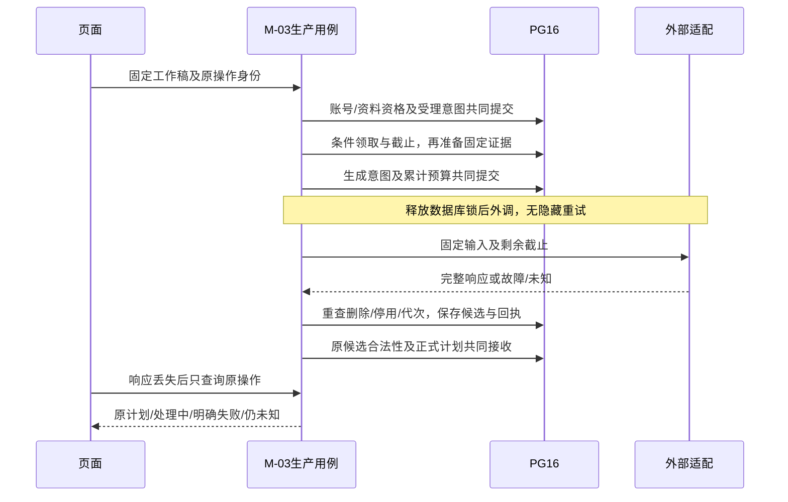

# P4 单场计划与持久生成联合详细设计

DT-03实施契约补充（2026-11-04）：采用任务第4节推荐的创建时间/ID稳定倒序与键集分页，默认20/最多50；列表仅本人有效根的工作稿/原操作/固定资料和计划修订摘要，删除屏障立即排除。固定workspaceId/revisionId导航、历史读取与未知写回执隔离、版本变化只读及原目标恢复详见[DT-03记录](<P4-DT-03 计划历史与页面恢复：实现与验证记录.md>)。不改预算、调用门禁或P5，不以历史发现增加正文/向量副本或预建通用列表平台；原设计和各轮停止点保留历史。

P4-DT-02实施契约补充（2026-11-03）：用户确认只从原固定collection/configDigest的已审核、适用、未停用且无同条件冲突的主题选择，允许增删/替换/排序与题量、难度调整，不猜测自由主题名。服务端使用技术/版本/场景/claimKey及证据身份，保存合计5～15的不可变修订，确认明确指向已保存修订；调整后估时null，不外调更新。CAS、保存/确认提交结果未知、删除及页面证据见[DT-02实现记录](<P4-DT-02 计划调整与确认修订：实现与验证记录.md>)。本地待审阅，真实用途关闭，不自动进入DT-03/P5；原设计建议保留历史，七项已确认规则不重复改为待决。

当前确认补记（2026-11-03）：用户在P4-DT-01执行指令中明确“审阅设计中的七项 按照建议执行”，确认P4-DEC-01～07推荐用于本首片，包含query初始1＋手动2、单次不超过10秒且受计划剩余60秒约束、共享外部AI许可5、原工作稿预算及显式未知费用确认。此确认不授权真实调用、部署、后续任务或P5。下文v0.1“待审建议/未实施/本轮仅设计”为设计时历史；实施契约、实际验证和未覆盖项另见[首片实现记录](<P4-DT-01 默认计划生成与私有恢复：实现与验证记录.md>)，不将设计确认当质量验收。

版本：v0.1｜日期：2026-11-03｜状态：联合设计待审阅；本轮未实施、未测试、未调用供应商。关联任务见[开发任务](<P4 单场计划与持久生成开发任务.md>)。

## 1. 基线、来源和适用范围

本轮用户授权仅为P4与P3-DT-04联合设计及任务拆分。开始时本地为干净的`main@b31efb217c99943f4aff54eaba537bf84e95c7f3`；`git ls-remote origin refs/heads/main`只读核实GitHub实时主线也是该提交，未fetch/pull或改变Git状态。

| 实时核实对象 | 2026-11-03本轮查询结果 | 不能据此推断 |
| --- | --- | --- |
| [PR #20](https://github.com/huangxiao999/ai-interview/pull/20) | 已合并；实施4fd5849，合并4a7a726；[CI #52](https://github.com/huangxiao999/ai-interview/actions/runs/41598030016)成功 | 正式reviews及inline review threads均为空，不等于人工批准、安全专项审查或真实质量通过 |
| [PR #21](https://github.com/huangxiao999/ai-interview/pull/21) | 已合并；实施9fd654b，合并b31efb2；[CI #54](https://github.com/huangxiao999/ai-interview/actions/runs/41604228147)成功 | 文档同步不等于新增产品验证 |
| 代码及迁移 | 当前检出已有M-06集合/停用能力，迁移最高V9；未找到P4实现或已占用的P4-DT编号 | 没有查询运行数据库/镜像，不把仓库V9写成开发库已迁移 |

历史证据：DT-03记录的71基础、17集合、26索引、8审核、Chrome回归与实际JAR启动均保留原源码绑定/时点；本轮没有重跑。详见[DT-03完整记录](<P3-DT-03 集合发布检索与停用：实现与验证记录.md>)及[任务概要](P3-DT-03.md)。

规则来源：[产品需求](产品需求.docx)、[交付范围](交付范围.docx)、[验收标准](验收标准.docx)；[流程](产品流程与状态设计.md)FL-02/03/06/07、[交互](页面与交互设计.md)PG-02/03及IX-03～05、[追溯](需求与设计追溯.md)；[领域](轻量领域模型与模块职责.md)M-02/03/06、BR-02/03/07、UC-01；[一致性](业务协作与一致性边界.md)CB-VERSION/DELETE/CLEAN、SC-03/04/07/08/10；[技术方案](技术方案设计.md)、[技术决策](技术决策记录.md)TD-02～07和CF-04、[证明计划](实现证明计划.md)PF-02/05/08。继承[P3设计](<P3 持久操作与审核知识详细设计.md>)第2～8/18节及[P3-DT-04任务](<P3 持久操作与审核知识开发任务.md#5-p3-dt-04-生成持久协议的首用接入与私有删除联合证明>)。

正文“已确认”仅指上述来源的规则；P4-DEC编号均为本轮设计建议，不替代TD编号或表示用户已批准。T编号为实施待核实，E编号为外部依赖。

## 2. 业务结果及已确认约束

M-03把本人已确认简历/JD转成可调整的考察安排，不生成提前展示的题库、答案、场次或权益。输入确认、技术依据、计划合法性分别由M-02、M-06、M-03决定，模型只返回候选。

| 已确认规则 | 契约及来源 |
| --- | --- |
| 默认与调整 | 默认8道主问题、中等；总数5～15，各主题正整数且合计一致；基础/中等/进阶三档。主题可增删改，零题主题删除，不保留空行。PRD-04、ACC-04-01～03/07、PG-03 |
| 内容 | 展示主题、各主题题数、难度、预计时长及与简历/JD具体关联；不补造经历、不提前展示具体主问题/参考答案；预计时长不触发强制结束。PRD-03/04、ACC-04-05 |
| 版本 | 资料修改需新计划，旧计划/已开始场次不被改写；开始前调整形成新修订。PRD-02/03/09、ACC-04-04、DACC-03-03 |
| 输入资格 | 简历100～20000、JD50～10000 Unicode码点，归一换行去首尾空白；无效/非Java后端需修改，已知冲突先明确优先条件，低匹配/受限覆盖需确认，不替用户编造。ACC-02/03、VP-08-B |
| 生成预算 | 每个计划生成步骤初始1、暂时性失败自动最多1、手动最多2；手动无追加自动；每次最多60秒，排队20秒独立。ACC-12-01/02/07/08/11、FL-06 |
| 权益 | 计划生成和修改不暂占、不扣次；操作耗尽只令计划操作失败，不创建面试终态或调用M-07。ACC-04-06、ACC-11-03、ACC-12-08 |
| 知识 | 仅人工审核且适用、未停用的知识，不联网兜底，不把命中/引用字符串当语义支持。CF-04、PRD-06 |
| 删除 | 删除立即禁访、停止新增私有写入，原时刻起24小时在线清理，备份最多30天并受独立删除账本/恢复门禁约束。PRD-10、TD-05 |

P4不直接完成P5开始协议、M-04问题进度、M-05评价/报告、M-07结算；不能借本轮联合设计提前建这些模块的表或假场次。

## 3. 当前差异、依赖及推荐决定

| 编号/类别 | 当前事实或缺口 | 推荐处理及实施停止点 |
| --- | --- | --- |
| P4-DEC-01，待审建议 | DT-03的维护探测`runtimeReady`始终false，公开DTO大多包内；还没有普通用户的生产知识公开契约 | 增加M-06窄能力及用途资格，保持维护探测false。普通运行生成遇未放行知识必须阻断；工程首用仅在新隔离库使用合成知识和故障适配器，同一生产资格规则、仓储和M-03接收路径执行，结果标ENGINEERING_ONLY，不得用于P5真实开始。有限真实试验与普通运行另分门槛，见第8节；未审定前不编码 |
| P4-DEC-02，待审建议 | 当前M-02已有长度/归属/版本，但没有完整语义问题与确认协议；不能把字符达标当内容有效 | 给M-02增加带版本的内容核对/确认事实；本地明确拒绝先挡住。必要模型发现与计划候选共用一次受控生成响应及原预算，不另开隐藏“分析模型”步骤；已知问题未解决不得接收计划。见第4/6节 |
| P4-DEC-03，待审建议 | 原模型是别名，生成适配未接线；计划尚无场次24小时期限 | 固定可证明的本地非秘密配置修订，不伪称供应商不可变快照；计划不额外引入24小时业务过期。60秒只约束尝试，不让轮询/租约给调用续命 |
| P4-DEC-04，待审建议 | 同步骤换UUID不能获得第五次；需求也允许多次生成计划，未规定每日计划上限 | 一个计划工作稿内只有一个生成步骤/预算。已成功后显式“创建另一计划”、新资料形成新业务身份；失败原稿重试不换身份。耗尽后同输入能否明确另建计划须审阅：建议允许显式新计划意图并提示其为另一操作，禁止自动包装成重试；不新增日限，也不承诺跨所有计划最多4次 |
| P4-DEC-05，待审建议/T-01 | DT-03只接受维护者公共/合成向量；当前embedding为document/dense，私有query语义和计量尚无首用证据 | M-03保存私有查询，调用受控query适配并让M-06执行同一过滤/检索规则；不让客户端上传向量、不从姓名/全文盲发embedding。查询适配、独立预算/截止见第7节；真实query协议未核实不启用真实调用 |
| P4-DEC-06，待审建议 | 接收失败及暂停登记失败保护已有DT-02教训，不能照搬“后台反复接收” | 核实优先，接收故障转持久暂停；暂停也未知时仅核实/登记，阻止自动接收及外调；人工恢复序列防旧暂停覆盖。见第6节 |
| P4-DEC-07，待审建议 | 未定结构上限、计划时长更新及编辑CAS细节 | 单个候选正文上限64KiB、供应商原始响应上限256KiB，均超限拒绝而非截断；只在必要位置使用固定工程常量。时长无结果可空并显示暂不可用；编辑不为估时隐式外调。真实token预算及估时政策仍须核实 |

这些缺口不阻止本轮完成文档。DT-05全部100例、长期备份及账号DT-02全部补证不一概阻塞隔离工程设计；真实调用/运行时放行和完整质量验收有不同前提。

## 4. 计划结构与固定输入

### 4.1 业务身份

| 身份 | 拥有者/内容 | 唯一性和后续处理 |
| --- | --- | --- |
| planWorkspaceId | M-03一份用户明确创建的计划工作稿，owner/resumeRoot固定 | 创建请求按(owner,kind,requestId)唯一；换请求ID仍不能在同一工作稿新开生成步骤。另建工作稿需显式新计划意图，不作为恢复按钮实现 |
| generationOperationId | 工作稿唯一GENERATE_PLAN步骤、固定输入修订及预算 | UNIQUE(workspace,stepKind)；同请求同输入查原结果，不同输入409；受理后修改不能覆盖原输入 |
| inputRevisionId | 资料版本/确认、计划需求、知识/查询/模型/政策等不可变绑定 | 重新核知识或补充确认可追加修订并失效旧代次，但仍沿用同一步骤预算和历史关系 |
| attemptId | 原操作下INITIAL/AUTO/MANUAL及代次、服务截止、请求/费用关联 | UNIQUE(operation,attemptNo)，计次与意图共同提交；重启不重置 |
| candidateId | 原尝试完整、有界私有响应和结构校验结果 | 每attempt至多一份可核实候选；正文不直接公开；接收失败只核实/重接原候选 |
| planId/revisionId | 被M-03接收的计划及不可变调整/确认修订 | 原生成操作至多一个结果身份；保存/确认各自操作回执，expectedRevision实现CAS；已引用修订永不原位改写 |

工作稿是实际计划的业务载体，不是万能任务根。不同计划可拥有不同预算；同一失败工作稿改请求ID、刷新或“重新生成”不得清零。尚有未知/有效在途时不提供绕开该工作稿的新生成入口。

### 4.2 固定输入清单

受理原子固定：owner、resumeRoot、指定resumeVersionId/jdVersionId及摘要、M-02确认修订/优先条件/受限覆盖同意、用户选定目标/技术版本/场景、计划需求修订（默认8/MEDIUM）、操作身份、生成政策、模型配置身份、知识集合及检索政策。M-02只返回调用必需的受控投影，不能让M-03读其仓储。

模型配置固定供应商/北京业务空间的非秘密身份、协议、`qwen3.8-flash`、本地配置修订、参数/输出契约/提示词修订及可证明的远端版本信息。Key不入快照；换Key不改变逻辑配置，换模型/地区/协议须新配置，原操作不静默漂移。计划生成时绑定与未来P5场次绑定是两个时点，P5须重新按TD-03核合法性，不混用两者。

检索准备产生独立证据修订：固定集合/configDigest/政策、最小去标识化query及摘要、query embedding配置/向量、条件、实际命中与排除原因、片段/版本/原文偏移/来源、审核/停用代次、必要原文和摘要。私有查询与使用关系由M-03保存；不写公共知识表，不跟随最新集合指针。需要追加证据时记录原因及新修订，失效原执行代次，不能重新获得四次预算。

建议服务端规范化后构造有版本的稳定输入编码，比对原目标及完整固定字段，不把jsonb格式化文本当原摘要；原请求目标与后来生成的planId不混用。删除后清正文和可恢复的JSON快照，仅留去重必要ID/状态，不保留完整提示词或供应商响应。

### 4.3 输出与确认

PlanRevision建议字段：id/sequence/inputRevisionId、totalQuestions、requestedDefaultDifficulty、topics[]（稳定topicId/order/name/questionCount/difficulty、resume/JD具体定位、安排理由、可追溯evidenceRefs和适用条件）、estimatedMinutes或不可用原因、限制说明、validationPolicy、用途资格、createdAt/confirmedAt。requestedDefaultDifficulty记录生成请求默认值；调整后各主题实际difficulty为权威，总览可显示“按主题查看”，不新增第四档难度或用总览字段覆盖局部选择。预计时长为估计，不用于超时；不返回候选原文/供应商报文。

M-03确定性校验：默认请求8/MEDIUM不得被模型改成另一数量/难度；总数5～15、每主题正整数、和相等、顺序与ID无重复、主题非空且在确认可覆盖范围、难度枚举合法、无提前题面/答案字段、引用属于固定允许集合、背景定位属于本人的固定版本。结构通过不等于理由与经历真的相关，需原10例计划人工量表；≥90%关联及引用≥95%沿用原分母，不用标签相等代替语义判断。

M-02处理空/无关/乱码、岗位超范围、疑似经历矛盾、JD冲突和低匹配/受限覆盖确认。模型仅返回带原文定位的发现，不能自行确认为用户同意。若一次实际模型响应才发现问题，该次外调仍记账并计入已消耗的生成尝试；转WAITING_INPUT、不自动重复。补充确认继续同一预算；实际修改简历/JD产生新资料、新计划，旧操作失效而非原位换输入。语义检查的可靠性列入T-02及安全/计划参考，不能宣称正则已保证。

调整不调用生成模型：校验用户提交主题分配并追加新修订；新增主题需M-06覆盖/适用性核实，未知不默认通过。保存调整与确认分开，可在“保存并确认”同一短事务完成两项事实，固定同一操作身份；未保存不能确认，后续编辑产生另一修订。时长需要重新估计时先显示不可用，不触发暗中模型调用。已被P5引用者只读，后续调整引导另一计划，不改旧场快照；本轮仅设计P5的消费约束，不预建空实现。

## 5. 状态、短事务和锁

操作阶段建议：QUEUED、PREPARING_EVIDENCE、RUNNING、CANDIDATE_READY、WAITING_INPUT、BLOCKED_KNOWLEDGE、WAITING_MANUAL、PAUSED_LOCAL、SUCCEEDED、FAILED_FINAL、INVALIDATED。阶段和reason分列；不替换I/R/Q。外部尝试结果EXTERNAL_UNKNOWN持久化；RESULT_UNKNOWN是客户端对本地提交无法核实的观察状态，不靠再写一行UNKNOWN解决提交未知。

| 转换/路径 | 同一短事务必须提交 | 事务外/禁止行为 |
| --- | --- | --- |
| 受理 | 当前用户资格、资料版本/确认、工作稿步骤防重、固定输入及排队意图 | 202仅代表已受理；未耗生成尝试，不自动开始场次 |
| 领取/准备 | 条件领取、serviceCycleId/失效代次/服务截止；重查当前输入和删除/知识资格 | 先拿有界执行许可，数据库锁释放后query embedding/组装；领取列表不能持操作锁反向等账号 |
| 生成派发 | 重查资格、剩余预算及固定输入，attempt意图、序号/类别和计次共同提交 | 提交可核实后才发一次请求；未知不得按内存猜测派发 |
| 候选保存 | 账号/根/知识/操作保护下核时限和代次，完整有界正文、摘要及原attempt回执 | 删除/停用/迟到不存新正文；有效用量可独立保留，不复活候选 |
| 正式接收 | 校验后共同提交plan/revision、原操作SUCCEEDED及原结果指针 | 原候选本地重接0次外调；失败先核原事实，不伪报成功 |
| 保存/确认 | 当前身份及expectedRevision、合法分配、固定资料、用途资格与新修订/回执 | CAS失败409并保留本地未保存草稿，不写旧修订 |
| 恢复/失效 | 核原结果/候选/有效在途，人工恢复序列或失效代次与原预算 | 不按刷新自动点击重试；不改终态，不把24小时场次期限套到计划 |
| 关联删除 | M-02屏障/回执、M-03全部操作失效及清理清单/汇总一起提交 | 私有大正文清理可异步但持续禁访；不在锁内等文件/网络 |

沿用实际`AccountWriteGuard.requireCurrent`/账号行锁，不另加一套咨询锁绕过它。共同顺序建议：账号→资料根UUID排序→涉及知识根UUID排序→计划工作稿→操作→尝试/候选/修订。纯M-06维护仍账号→知识根→发布指针；M-03固定显式集合ID不拿指针锁，M-06不得反向调用M-03/M-02仓储。不同维护者停用与用户接收竞争必须共用知识根锁；任一跨模块公开能力不得隐式REQUIRES_NEW。

短事务建议沿用5秒上限，并把锁等待限制在剩余服务时间内；锁取得后再用数据库`clock_timestamp()`核截止，不按事务开始旧时间。事务共同成功不是响应必达，数据库时间也不构成跨端原子性。费用汇总不在账号锁内反向拿预算门；P4没有正式开始预算门和日权益写入。

## 6. 四次预算与未知结果恢复

预算绑定工作稿内同一个生成步骤，attempt意图提交即占用机会；不得等供应商成功响应才计次。类别槽位为INITIAL≤1、AUTO≤1、MANUAL≤2、总数≤4，不把未用自动槽悄悄转换为额外手动槽。若初始成功，则无后续自动；若明确暂时故障/无效生成候选且资格有效，可自动一次；自动仍失败转手动。用户主动进入手动后关闭自动资格。四次耗尽只将该计划操作FAILED_FINAL，无场次/释放记录。

| 事实 | 生成预算/下一动作 | 禁止推断 |
| --- | --- | --- |
| 本地确定性输入/权限拒绝、排队20秒未获许可 | 0生成尝试，保留原身份；修输入或原排队动作恢复 | 不算模型失败，不创造日权益 |
| 无适用知识/冲突/未放行 | BLOCKED_KNOWLEDGE，未派发则0生成尝试 | 不凭记忆生成，不自动当四次系统失败 |
| 已提交attempt意图，调用前进程崩溃 | 计入原槽，重启无可靠发送证明则EXTERNAL_UNKNOWN | 不因可能没发出退回次数或自动补发意图 |
| 外部完整响应但结构空/不合规 | 原尝试已耗；REJECTED候选，按剩余自动/手动资格 | 不用修复JSON的额外模型调用绕预算 |
| 已存有效候选，接收回滚 | 原尝试不再计数，重接原候选前先核原结果 | 不重新生成，不因外调60秒过去丢弃已存候选 |
| 外部执行/费用未知 | 隔离旧代次；优先核供应商原请求（仅已核实查询能力）；无候选则等待明确接受可能重复费用 | 不自动补发，不宣称未执行/未收费/外部恰好一次 |
| attempt/候选/plan提交确认丢失 | 按唯一身份查询对应权威行及关联结果；DB仍不可用则保持本地RESULT_UNKNOWN | 不改变请求ID，不将暂时404或连接断开当未提交 |

外部未知的下一次外调建议必须由用户显式确认可能重复执行/收费；原自动槽失去静默派发资格，后续使用MANUAL槽（不额外增加AUTO）。这是P4-DEC-06的保守恢复建议，需审阅其页面次数说明。不能将本地数据库未知混入该费用确认入口：本地事实未核实前禁止再次外调。

同进程首次派发意图确认丢失：执行器知道尚未调用时，在原句柄/许可下先核唯一意图；只能在可证明该句柄未发送时继续一次。重启丢失该证明则按外部未知，宁可耗一次也不猜未发送。候选保存确认丢失时先查candidateId/attemptId；查到原完整候选只恢复接收；查不到且不能证明原事务未提交则保持未知，不能要求供应商再返回相同文本。

接收失败→建议持久PAUSED_LOCAL及failureWatermark，后台不自动接收；用户恢复命令与manualResumeSeq共同提交，只恢复原候选，不消耗手动生成槽。暂停登记也失败时在有界结果接收上下文中保留原身份；建议全进程至多5份待核实身份，达到上限暂停新领取，未知槽位不覆盖或丢弃。该上下文不等于模型执行许可：外部I/O实际结束即释放模型许可，本地接收/查询不占模型名额。调度仅核实/登记原暂停，不继续接收或外调。暂停核实先查成功/已接受的后续人工恢复序列，不能把它们倒退。

重启先查正式成功，其次查原候选/暂停/旧在途；**凡重启发现未接受的完整候选，统一等待显式恢复接收**，不凭“缺暂停行”推断可以自动接收。这覆盖暂停登记一直失败、尚未持久的保护身份随进程丢失的情况，无需虚构本地失败记录一定写成功。未存完整候选的旧意图按EXTERNAL_UNKNOWN核实。该保守重启政策属于DEC-06，须审阅；验证交换人工恢复与旧暂停的提交先后，以及暂停失败后真正杀进程重启，禁止恢复成自动接收。

## 7. 截止、许可、查询embedding与费用

已确认计划服务60秒、排队20秒，查询检索/组装/生成/候选持久化受该次服务剩余时限约束；服务起点为获得有效执行许可并持久领取的数据库受理时刻。不是先检索60秒再给模型60秒。已有候选的本地接收不是新的外部服务尝试，但仍用短事务及有界恢复。

建议serviceCycle独立于生成attempt：领取时开始60秒服务周期，固定知识准备完成、实际生成派发意图才耗生成槽。准备失败不冒充生成请求已发；允许人工重新准备时另记准备周期和排队起点，继承全部原预算，不延长旧周期/旧句柄。

P4-DEC-05建议query embedding另有原步骤累计预算：同一固定query成功向量优先复用；自动最多1次初始派发、无自动重试，明确人工恢复最多2次，总派发≤3；单次≤10秒且≤计划服务剩余时长。该建议是私有查询首用的待审政策，不引用DT-02维护构建三次/60秒作为确认依据。知识内容不足时不循环改写query外调碰运气；query输入变化须新证据修订但预算不清零。未知先确认可能重复费用，缺query能力则阻断，不能伪造向量。

生成5/解析2为已确认本系统有界许可；建议首用将query embedding与生成共用全局外部AI容量上限5，避免额外无界池，query结束释放物理许可再为生成取许可，整个serviceCycle受原60秒约束。两段之间等待许可仍消耗该周期剩余时间，不另给20秒排队或重新领取完整60秒；无法取得则按准备/未派发事实暂停，不伪记生成次数。无场次时以同一工作稿唯一有效步骤限制并发；不凭空限制所有用户只能生成一份计划。不得重建P5的同场许可。持有旧future的许可不因租约到期直接释放；取消/隔离句柄未核实则暂停新派发，重启仍不能证明供应商物理执行已停止。实际全局许可对现有索引单外调许可的组合列T-03，不允许两个独立池各5。

RestClient复用既有JDK传输门禁：启动时固定`jdk.httpclient.redirects.retrylimit=1`、`jdk.httpclient.disableRetryConnect=true`、`jdk.httpclient.enableAllMethodRetry=false`，不得运行中赋值冒充生效；生成适配另补实际发送次数/REFUSED_STREAM等证明，不拿embedding旧成功覆盖新调用路径。连接/读取/请求总体截止和锁等待均不超过剩余时间；本地超时和取消不承诺供应商停止。

非秘密配置建议固定输出token上限4096及工程字节上限，真实服务需T-04核实模型上下文、实际token计数/输出协议/思考模式/用量；5000码点不是token预算。无法证明整个提示词及输出在适用限制内则真实调用不启用，不填伪精确token数。

每个query/生成attempt分别登记供应商请求ID、已报告用量、估价及unknown标志；有效用量回执与候选接收资格独立，迟到可补原未知字段，不覆盖已知矛盾事实/不复活结果。报告Token不等于账单已知。原400元停新面试、500元目标不自动变成停免费计划生成或费用硬封顶；本轮不设计新的每日计划次数限制或通用费用平台。

## 8. 知识放行、外发和工程验证隔离

现有维护探测权限不能直接供普通用户使用，也不能让后台借维护角色读取私有资料。建议M-06提供内部`PlanEvidenceFacts`：固定集合/配置+必要query/条件投影，返回实际片段/不足/冲突、资格摘要及用途；M-03只从M-02取得本人版本，经脱敏后在私有操作内准备query，M-06不落私有query/向量，不跨仓储。

真实用途资格必须包含集合/知识及适用条件、版本停用状态、检索政策和token预算定标、评审/放行记录身份；缺任一所需资格返回KNOWLEDGE_NOT_READY/BLOCKED_KNOWLEDGE，不把维护probe的EVIDENCE_AVAILABLE提升为真实可用。不通过改constant或环境开关把工程集合标true。

**P4-DEC-01推荐的隔离工程方案，须先审定**：证明启动装配必须同时核新建PG16专用库标记、合成资料/人工审核/构建/发布身份、本机故障适配器、真实适配关闭/不取Key、对外网络调用目标限制。用途由服务端受控证明装配固定为ENGINEERING_ONLY，不是API字段或用户可选开关；M-06仍实际核批准/适用/停用/配置，M-03仍实际核所有权/预算/删除及接收。合成query向量仅由外部适配替身返回，不能HTTP直传或数据库绕过规则。

工程计划采用同一M-03结构/事务/恢复及正式结果路径，响应和持久事实携带ENGINEERING_ONLY；只在隔离数据集完成用户生成/查看闭环，不允许进入真实P5/评分。常规local/Docker缺真实放行时保持阻断、0外调；证明模式出现在非隔离库/真实端点应拒绝启动。若该双用途边界未获审阅认可，首切片实施停止，继续非付费设计与材料工作；不能改用测试业务状态机或跳过知识门禁。此建议不是宣称当前已存在隔离能力。

真实放行另走受控人工知识/配置资格，不依赖工程模式；DT-05的全部评分60例不阻塞工程验证，但20例真实检索/适用性/引用、当前计划10例及知识许可/审核/实际账号证据会影响真实用途。原100例、30评分各3次及发布阈值不变，不伪造评审人签字或质量结论。

为避免“必须先通过真实评审才能调用模型做评审”的循环，明确区分三层用途：ENGINEERING_ONLY只用隔离替身；CONTROLLED_TRIAL须单独授权真实调用，已审核/许可的知识、固定试验政策、脱敏合成案例及账号/预算/总派发控制齐备，但可以将真实质量明确记为待验证，其产物不得进入P5；RUNTIME才要求实际适用的质量/放行记录及普通运行条件通过。三者均执行相同归属、审核/停用、预算、接收和删除规则；用途由服务端受控装配决定，不能由普通用户改字段升级。CONTROLLED_TRIAL不是在现有工程模式中放宽本机端点检查；到获授权的DT-05任务才审阅其独立受控装配，不为未来调用提前建设平台或默认启用真实端点。

外发只发业务必要背景投影、明确条件及固定证据；去除非必要姓名、电话、邮箱、证件号，不上传简历原文件，不用知识/资料文本控制工具。最小query不包含整份简历/JD；生成提示词的个人背景仍是私有数据，派发前重查删除并登记内容摘要/用途，不在日志复制正文。默认不启用搜索、工具调用或模型内置联网。

## 9. 私有图、删除清单及恢复

| 私有对象/位置建议 | 最小保留用途 | 删除处置 |
| --- | --- | --- |
| 固定资料引用、确认/问题修订、计划需求和必要背景投影 | 可重建并核实原输入；优先引用不全文复制 | 清投影/问题正文，保留必要无正文ID/状态 |
| query文本/向量、私有证据使用关系、提示词快照 | 原检索及候选恢复；只在M-03私有图 | 清query、向量、证据使用上下文及提示词，不删公共知识原文 |
| 完整候选/供应商原始响应、结构发现 | 有界恢复和错误核实 | 清正文及缓存，保留原attempt最小请求/错误/用量事实 |
| 计划/调整/确认修订、安排理由、时长解释 | 本人查看和未来固定消费 | 清全部私有内容，保留去重必要墓碑，外键不能阻止清除 |
| 进程缓冲/临时文件/日志/浏览器草稿 | 首切片不新增磁盘提示词/候选缓存，不建文件副本 | 有界缓冲随执行结束/取消释放；如实际增加文件，先登记私有目录/清理项，再写入并补真实文件故障证明；日志不能留下正文 |

建议每工作稿登记一个`PLAN_PRIVATE_GRAPH`清理项，targetId为workspaceId，清单覆盖其输入/证据/候选/计划全部表与JSON字段；这是明确M-03拥有者清理目标，不是扫描未知模块的通用清理器。不同workspace逐项可重试/轮转，不用只有一个总“done”标记替代各张表清除核查。

M-02删除协调在同一账号/资料根锁事务中取得实际范围、设屏障、调用M-03公开`invalidateAndRegisterCleanup`、增加原操作代次并登记全部私有图，与原回执共同提交；任何参与者失败全部回滚。取消删除0变化。影响接口增加plan/operation/candidate等明确计数，缺失不能填0；最终范围在确认提交时重算，不能只用弹层旧列表。

当前`ResumeRepository.recordDeletion`会先按已有对象计算CLEANED/PENDING；新增参与者须在同一事务的最终完成判断前登记新项，重新由全部未完成项决定状态。当前`UploadRepository.cleaned`已用“该删除请求任意PENDING项均不存在”作为完成条件，不能误称它现在只检查PRIVATE_FILE；保留并回归这个通用谓词，核其他完成/列表/告警查询也覆盖新类型。CHECK从现有RESUME_VERSION/JD_VERSION/PRIVATE_FILE追加新类型，不能删旧项或重置原请求deadline。

M-03清理器按原请求具体图清payload，候选/计划/向量均无正文后才共同标该图CLEANED；失败保持PENDING/禁访，记录无正文错误及原24小时超期，重启继续。不能把被清掉的payload用不受控日志、事件正文、失败报文或另一个JSON复活。

| 竞争先后（均以受保护提交为准） | 必须可核实的结果 |
| --- | --- |
| 受理/创建先，删除后 | 新工作稿和必要副本在删除实际范围内；全部禁访及清理 |
| 删除先，受理/创建后 | 受理拒绝，0新增私有正文/0派发 |
| 候选保存先，删除后 | 原候选入清单，接收拒绝；清除其JSON和query副本 |
| 删除先，候选保存后 | 只允许无正文原用量回执，0候选正文/0计划 |
| 计划接收先，删除后 | 原成功回执可去重但内容禁访/清理；没有权益退款 |
| 删除先，计划接收后 | 原操作失效，0正式计划；后台不回到QUEUED |
| 清理部分成功/确认丢失/重启 | 从持久清单核具体图，不报提前CLEANED，不加宽限时间，B用户及公共知识不变 |

恢复旧备份仍需最新独立删除账本及覆盖水位，应用删除并核全部新表/字段后再开放；账本未知保持禁访。当前P2备份/24小时耐久开放项不关闭。本系统不承诺清除供应商已收内容或离线屏幕；重连时必须清旧正文及草稿。

## 10. 数据迁移、模块公开能力及API建议

当时主线最高V9；首个实施任务在开工时再核主线并只追加下一版本（若仍V9才用V10）。本轮不创建SQL，不预占后续版本，不改V1～V9、manifest或迁移注释。建议同一首用迁移包含M-03实际私有表及删除CHECK/索引，不能先建私有候选再另一个PR补清理。

建议关系：`plan_workspace`（owner/resume根/步骤身份）、`plan_generation_operation`（唯一工作稿生成步骤、固定修订/计数/代次/暂停序列）、`plan_input_revision`（固定输入及私有准备事实）、`plan_generation_attempt`（种类/意图/截止/请求和用量）、`plan_generation_candidate`（有界payload/摘要/接受身份）、`interview_plan`/`plan_revision`（唯一原操作结果及不可变内容/确认回执）。query准备事实可为inputRevision上的有界结构与序号，不先抽通用attempt平台；若无法原子维护预算再按实际复杂度分表。

约束至少含(owner,kind,requestId)、(workspace,GENERATE_PLAN)、(operation,attemptNo)、candidate.attemptId、plan.operationId唯一；版本属于同一资料根、plan/operation owner一致；payload清除后外键/非空约束仍可满足。预算计数、尝试行和类别合法转换由生产服务在锁内共同维护，DB约束防越界但不取代资格规则。

公开能力建议：M-02 `MaterialPlanFacts`（当前事务固定版本/确认/归属/屏障，只给必要投影）；M-06 `PlanEvidenceFacts`（固定证据及用途资格/停用保护）；M-03 `PlanDeletionParticipant`（在现有删除事务失效并登记清理，不自行提交）。名称待实施固定；首次真实调用才建立接口，不把ResumeRepository设public或预建未来M-04/05空门面。

| 建议API | 契约与结果 |
| --- | --- |
| `POST /api/plan-workspaces` | 本人resumeRoot/指定版本及显式新计划意图，原创建operationId；返回固定workspaceId，不生成模型结果 |
| `POST /api/plan-workspaces/{id}/generation` | 固定版本/确认/计划需求修订、原生成operationId，服务端选并固定配置；202原操作，或原结果；不接受Key、随意模型/向量、人工生成预算 |
| `GET /api/plan-operations/{operationId}?kind=...` | kind明确CREATE_WORKSPACE/GENERATE_PLAN/RESUME/SAVE_REVISION/CONFIRM_PLAN，按(owner,kind,原ID)查对应事实；返回阶段/reason、固定ID、预算/截止、原planId和动作，不返回候选/提示词，不按最新修订猜原结果 |
| `POST /api/plan-operations/{id}/resume` | 原操作、expectedGeneration、恢复类型及明确费用确认（仅外部未知）；幂等resumeOperationId，不能任意重置次数/换输入 |
| `GET /api/plans/{id}`、`GET /api/plans/{id}/revisions/{revisionId}` | 本人有效根下固定结果；资料变更时返回只读/需新计划事实，不拼最新版正文 |
| `POST /api/plans/{id}/revisions` | expectedRevisionId及完整合法调整；追加修订和回执，409不覆盖，0隐式模型调用 |
| `POST /api/plans/{id}/confirmations` | 固定revisionId/digest和操作身份，原确认结果可查；CAS重查已保存/资料/用途合法性 |
| 既有资料删除影响/确认/回执接口 | 扩展实际计划私有图数量与全目标清理汇总，沿用原删除身份，不另造计划独立删除绕过根屏障 |

全部API沿用Session/CSRF及expectedAccount头、原操作头，`Cache-Control: no-store`；未登录401、角色不足403、他人/删除/不存在统一404、输入400、修订或身份冲突409，数据库提交不可核503/RESULT_UNKNOWN。知识不足是操作业务状态，不混成系统故障；当前协议缺少的知识未就绪/恢复拒绝reason在实现前固定，避免各模块另发一套错误语义。

## 11. 页面和恢复契约

PG-02选本人明确简历/JD版本并确认必要条件→PG-03生成/等待→查看默认计划→调整保存/确认。首切片至少真实生成/查看及原操作恢复页面；调整确认在下一独立切片，不用假成功按钮。P5未实现时不提供可点击的假“开始”，页面说明后续能力未开放，不用生成计划冒充开始。

首次请求：固定内存输入→身份me及CSRF预检→真正发POST前保存账号绑定最小回执(owner/workspace/operationId/kind)→发请求。首次预检失败0 POST/不留未知；重发已有未知操作预检失败保留原回执。生成、恢复、保存、确认分别有回执kind，不能将请求目标混为服务器生成后ID。

| 页面观察 | 操作及恢复 |
| --- | --- |
| 未发送/输入需处理 | 保留内存草稿及具体缺项；不显示“后台生成中” |
| 排队/准备/调用 | 展示服务端阶段和本次时限/累计次数；禁止相冲突另交，可离开；刷新只核原操作，不自动派发 |
| 候选已存/本地接收暂停 | 不展示候选或伪报成功；核实后可显式恢复原接收，说明不增加模型尝试 |
| 明确失败/外部未知 | 展示服务端剩余手动机会；外部未知单独说明可能执行/收费，无确认不重发 |
| 本地RESULT_UNKNOWN/404待核 | 继续查原身份及本人删除回执，不能换UUID或清旧回执猜未接受；404不暴露他人存在性 |
| 成功/未保存调整 | 服务端正式计划及修订为准；编辑标未保存，CAS冲突先显示版本变化，草稿不覆盖另一窗口 |
| 登录失效/账号切换/删除 | 清私有展示与对应内存草稿；账号切换清最小回执，旧epoch/目标响应丢弃。原账号重新登录可经本人操作列表核实，不自动重放付费动作 |

不在localStorage/sessionStorage/IndexedDB持久化正文、向量、提示词、候选或凭据；刷新丢失未保存草稿应事先说明，不为保草稿扩大私有副本。路由允许原操作ID作为核实入口，但直接地址仍经服务端归属/删除检查。多窗口焦点/导航重核当前事实，不能依靠按钮禁用维护并发。

## 12. 证明要求及开放项

| 证据层 | 后续必须实际证明 | 不能证明 |
| --- | --- | --- |
| 生产纯规则/固定夹具 | 题数4/5/8/15/16、分配合计、难度、顺序、身份/预算/输出结构独立预期 | 不替代语义个性化或PG事务 |
| 新隔离PG16+生产HTTP/服务/仓储 | 共同回滚、同操作防重、四次类别累计、提交确认丢失、候选接收/暂停失败、真实进程重启、所有删除双顺序及新清理汇总 | 不用H2、仓储替身或测试专用状态机代替 |
| 本机供应商故障替身 | 控制延迟/断连/HTTP2重发、结构无效、用量缺失/矛盾及晚到；断言实际发送数/持久结果 | 不代替账号、收费、供应商是否已物理执行 |
| 真实合成私有文件 | 首用若涉及原PDF/DOCX及新增文件副本，核实际路径/ACL/清理/恢复；纯正文最小片可不造额外文件 | 不因未新建文件就忽略原文件关联删除回归 |
| 实际Chrome | 默认计划及恢复、预检0POST、确认丢失、两窗口CAS、身份切换和删除清屏；页面与PG事实一致 | 不替代预算/并发数据库断言或真实模型质量 |
| 获另行授权的真实供应商/人工参考 | query接口/配置、用量/时限及账号事实；20检索、10计划及安全样例的实际人工支持关系 | 不自动关闭全部100例、完整PF/VP或备份恢复 |

第一条联合实现必须同时获得“真实M-03业务拥有者接收原计划”和“新增私有数据纳入M-02删除”的证据，再登记P3-DT-04相应子集；仅建表/静态构建或只证一次成功不算完成。具体故障矩阵与任务停止条件见开发任务，不在设计阶段填写通过数。

T-01：query类型/参数/配置摘要及与旧document向量兼容条件；T-02：M-02内容发现与用户确认的准确边界；T-03：单活动执行者及全局5许可与索引许可组合；T-04：实际token预算、模型输出/思考/用量/端点及本地截止取消；T-05：新增全部清理目标、外键、完成查询和真实关联规模。均是待实施核实，不伪称已验证。

E-01：知识许可/维护者实际批准、适用版本/场景及集合放行；E-02：生成与embedding各自账号空间/Key权限/适用限额/费率/留存和删除证据；E-03：原100例人工参考（其中20检索、10计划与10安全的适用部分）；E-04：真实调用单独授权。原DT-05“仅embedding最多3请求/5元”的建议不授权生成，生成调用额度不能继承；需实际确认模型/文本/请求总数（含重试）/token/费用/窗口/停止方式，任何未知先停。

P2、账号DT-02专项补证、完整PF/VP、24小时耐久/告警、30天备份/链外删除账本/恢复开放门禁按原状态保留：与本次新增归属/删除直接有关者须随片补证；长期运维和AI质量不一概前置为设计阻塞，也不因工程通过关闭。

本轮停止点：完成本设计及任务/入口检查，P4-DEC-01～07等待审阅，未修改业务代码、配置、迁移或旧证据；未安装、测试、启动、真实调用、提交推送或操作PR。
