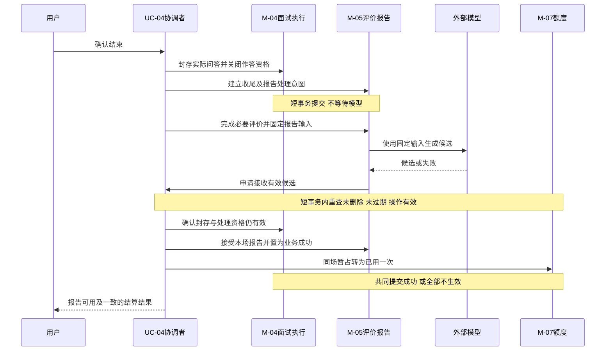

# 业务协作与一致性边界

版本：v0.4｜更新日期：2026-10-28｜状态：已同步已确认CF-04；技术选择已确认；已补自检实现证明要求，实施核实与PF/VP待执行；未编码、未执行产品验收。

依据：[PRD](产品需求.docx)、[SCOPE](交付范围.docx)、[ACCEPTANCE](验收标准.docx) v0.4；[PRODUCT_FLOW](产品流程与状态设计.md)、[INTERACTION_DESIGN](页面与交互设计.md)、[DESIGN_TRACEABILITY](需求与设计追溯.md) v0.4，含CF-01、CF-02、20条DACC及FL-06合法报告接收修正。模块、概念、聚合及规则编号见 [轻量领域模型与模块职责.md](轻量领域模型与模块职责.md)。本次按CF-04同步输入与知识来源边界，不设计数据库表、接口、部署或Java框架。

## 1. 总体原则与协调者

**已确认规则**：回答一旦接受不得因生成失败丢失；重试不重复记录/扣次；正式开始占额，报告成功结算；最终失败、过期、零作答和删除按既定条件释放；结束作答不等于报告失效；删除立即禁访，在线清理24小时、备份最多30天。CF-02同样约束报告待处理。

**推荐设计**：同一应用内，用短本地事务共同维护必须一致的业务事实。模型、文件解析和物理清理在业务事务之外执行；接收结果时重新核实资格，再短事务提交。跨模块由协调者调用原模块规则，不直接篡改另一模块拥有的数据。

“共同成功”指对业务生效的提交；通知、浏览器收到成功响应、列表刷新可能稍后发生，不能把响应丢失当成事务未发生。失败结果必须可核实，不以重发一份作答或重新生成报告来猜测。

| 协调者 | 负责组织的用例 | 各自不能越权的决定 |
| --- | --- | --- |
| UC-01 资料/计划协调 | 确认资料、保存计划修订、生成计划 | M-02决定资料有效版本，M-03决定计划规则，M-01身份及M-02删除资格共同约束 |
| UC-02 开始协调 | 固定本次开始输入、准备首题、确认展示事实及占额 | M-04认定有效正式开始；M-07裁决用户原日名额；展示证据协议见TD-01，不能私换计次事件 |
| UC-03 作答协调 | 提交/跳题、读取本题评价完成、推进下一题 | M-04唯一接受回答与进度；M-05提供有效评价完成事实 |
| UC-04 结束与报告协调 | 封存问答、必要收尾评价、准备报告输入、发布成功与结算 | M-04决定不可再答及处理资格，M-05决定评价/报告条件，M-07决定用量变更 |
| UC-05 失败/过期协调 | 根据权威尝试耗尽或到期条件终止处理并释放 | M-04决定场次终止，M-05更新相应报告状态，M-07只处理尚暂占权益 |
| UC-06 删除协调 | 展示影响、确认禁访、终止关联处理/释放、调度清理及恢复核验 | M-02决定范围和删除资格；各拥有者自行终止/清其数据；M-07不退已结算 |

协调者只是职责名称，不要求六个服务或六套流程引擎。当前操作资格、输入版本、所有者及删除有效性需在实际执行时核实，不能先查一次后在不受保护的旧事实基础上写入。

## 2. 一致性边界矩阵

“强一致/原子”是推荐的提交约束，不表示某个浏览器和本地存储能跨网络原子提交。CB-START特意分开外部展示与服务端事实接收。其他本地事务能否覆盖各模块属于技术设计需要证明的前提。

| 编号/业务操作 | 规则所有者→协调者 | 必须一起变化的事实 | 一致性要求及事务范围建议 | 失败与用户状态 | 来源 |
| --- | --- | --- | --- | --- | --- |
| CB-VERSION 确认资料/计划 | M-02/03→UC-01 | 内容确认与版本身份、计划确认与输入引用/合法主题合计 | 各自短本地事务；开始时固定所用版本，后续编辑不回写旧场 | 保留旧成功版本；新生成失败不冒充成功、不占额 | PRD-02/03/04/09；ACC-02-05、ACC-03-04、ACC-04；DACC-03-03 |
| CB-START 正式开始 | M-04/07→UC-02 | 在展示证据已成立的前提下：本场正式开始、首题身份、开始日期、唯一暂占 | 这些服务端事实共同提交，M-02访问资格与M-03版本受保护校验；浏览器实际呈现不在本地事务内，方案不能跳过第3节 | 无证据或结果未知不宣称成功/扣次；首题前失败不占额；并发最多一个名额 | PRD-11；ACC-11-01～03/07；DACC-01-01；TD-01 |
| CB-QUESTION 接受后续题候选 | M-04，使用M-03分配及M-06证据→UC-03 | 当前主问题位置的唯一题目身份、固定主题/难度绑定、出题操作完成及待呈现阶段 | AG-05内短事务，核实正式位置及主题余量、操作/输入版本、场次仍可出题；接受候选不等于浏览器已展示，实际呈现事实仍需明确确认 | 不合规候选共用原出题重试预算；恢复读取同一已接受题目，不生成第二个位置或把无效候选当用户跳题；后续题不新增暂占 | PRD-04/05/12；DACC-03-01～04 |
| CB-ANSWER 接受回答 | M-04→UC-03 | 唯一已接受回答、主已答数/追问状态、后续阶段、有效操作事实 | AG-05内短事务；核实当前题、身份/删除资格、封存及版本，同一业务位置至多一次接受 | 响应丢失核实原提交；确认未接受且无在途才重交；已保存不丢 | PRD-05/12；ACC-12-03/04；DACC-01-02/03、DACC-02 |
| CB-FEEDBACK 接收本题评价 | M-05/04→UC-03/04 | 固定问答对应的有效评价与本单元可推进事实；场次生成许可完成 | 短事务中验证操作仍有效、问答修订一致；不可评也是带原因的合法结果，不等于系统失败 | 不放出半截分数；临时失败留存回答，耗尽由UC-05处理 | PRD-05/07/12；ACC-05-01/02、ACC-07-04/05；DACC-04 |
| CB-SEAL 结束作答 | M-04/05→UC-04 | 封存问答及原因、关闭新答资格、建立对应收尾处理意图 | AG-05与报告处理意图短事务；有回答则待报告，无回答走CB-ZERO；不等待模型 | 不出现已结束但仍可接新回答；报告依赖的评价尚未完成时明确等待，不伪造成功 | PRD-05/08；ACC-05-05、ACC-08-02；DACC-03-06 |
| CB-REPORT 报告成功发布 | M-05/04/07→UC-04 | 报告有效内容与R-04、场次业务完成、Q-01→Q-02及已用增加1 | 跨这些模块的短本地事务；同时受M-02删除资格、到期、当前有效操作及固定输入约束；不允许先公开成功再异步扣次 | 失败则都不生效；返回结果待确认并核实同一报告，不再次生成/扣次猜测；候选内容不对用户宣称成功 | PRD-08/11/12；ACC-11-04/06、ACC-12-04 |
| CB-TEMP 报告暂时失败 | M-05→UC-04 | 当前尝试失败、自动/手动机会消耗、合法下一步 | 操作内原子更新；I-02/I-03保持封存，Q-01不释放不新增 | 返回可重试R-03、剩余次数及到期时刻；已保存问答可读 | PRD-12、CF-02；ACC-08-05、ACC-11-06、ACC-12-02 |
| CB-STOP 最终失败/过期 | M-04/05/07→UC-05 | I-05或I-06及失效处理许可、未成功报告的R-05/R-07、Q-01→Q-03 | 共用短事务；核实尚未成功结算、实际重试耗尽或当前到期；不能凭旧定时任务直接释放 | 只读记录，禁答且不能重试原报告；暂占释放一次，晚到成功不逆转 | PRD-11/12、CF-02；ACC-11-05/10、ACC-12-07/08；DACC-01-04、DACC-02-04/05 |
| CB-ZERO 零作答结束 | M-04/05/07→UC-04 | 零主回答封存、R-06摘要资格、Q-01→Q-03 | 同一短事务；不调用模型生成数字报告，无已用增加 | 摘要显示作答0/完成率0%/不计次；只能新开 | PRD-08/11；ACC-08-06、ACC-11-05；DACC-04-04 |
| CB-DELETE 删除生效 | M-02/04/05/07→UC-06 | 删除访问屏障与请求、所有关联未结算场次的有效终止/任务失效、Q-01→Q-03；已结算不变 | 推荐在短本地事务中共同生效；只处理资格/状态/权益等必要事实，不在事务里扫描全文或删文件；关联范围与并发新建须序列一致 | 若未提交不宣称删除成功；一旦提交不可取消恢复，所有读写及后台结果禁止；大范围处理能力见TD-05 | PRD-10；ACC-10-01/02/06；DACC-01-05、DACC-02-05 |
| CB-CLEAN 在线物理清理 | 各数据拥有者，M-02汇总→UC-06 | 分项清理完成和可核查进度 | 允许最终一致，但必须自删除生效起24小时内清理原件/正文/版本/快照/计划/问答/报告/临时及副本；不延后禁访 | 保持禁访并重试具体未完成项；不能因失败恢复资格；超时属于验收违约，不称最终一致即可免责 | PRD-10；ACC-10-03；TD-05 |
| CB-BACKUP 备份恢复处理 | M-02政策与备份支撑→UC-06 | 删除记录有效性、恢复后清理校验、开放访问资格 | 备份最多30天；恢复先执行有效删除标记并核验，再开放访问；不是先开放再补偿 | 核验失败不开放恢复数据；删除标记不与正文一并提前丢弃 | PRD-10；ACC-10-04/07 |

单次模型请求和外部费用不可能因本地事务回滚而撤回。生成操作候选成功但提交失败，应保存可核实的操作结果和状态，在仍有效时重试接收同一结果，而不是默认再付费生成；具体提交失败与尝试失效如何分类见TD-04，不新增四次之外的模型机会。

## 3. 首题展示与暂占：早期候选推演

> 本节保留CF-03前的候选与旧业务口径，属于历史分析，不作为当前开始/日期规范。现行CF-03及已确认SD-05、TD-02见 [技术决策记录.md](技术决策记录.md)；实现证明仍待PF-07/VP-07执行。SD-04未采用，不把技术选择已确认写成跨端原子性已获证明。

### 3.1 需要保持的业务事实

计次事件仍是**首道主问题成功展示**。点击开始、模型生成成功、首题保存、成功响应发出，都不能直接替代。正式开始前不得产生Q-01；同一用户原日已用+暂占不超过20；重复开始/回执不产生第二场；开始日期仍按首题实际展示所属UTC+8日期，而非任意后续重试日期。

浏览器呈现和服务端提交之间存在消息丢失、崩溃、跨午夜、重复回执及并发问题。仅写“一个事务里展示并占额”不能证明满足这些条件；浏览器回执也不证明用户真正读懂内容，其可验证对象应是与题目身份对应的呈现事实，证据标准由技术设计说明。

| 候选 | 主要过程 | 好处 | 不足及是否可直接采用 |
| --- | --- | --- | --- |
| SD-01 服务端返回成功就暂占 | 首题生成/保存或响应发出后立即占额 | 实现简单、日额度容易原子更新 | 浏览器可能从未显示，改变已确认事件；**排除作为默认实现** |
| SD-02 先展示再回执竞争占额 | 浏览器展示后确认，服务端再争最后名额 | 比响应发出更接近展示事实 | 两窗口都可能先展示、仅一方取得名额；回执丢失/跨日未解决；单独采用不能满足完整要求 |
| SD-03 展示前直接暂占，再退款补偿 | 先扣一个名额，失败或未显示后释放 | 易阻止超额交付 | 提前产生Q-01改变业务时点；故障期间额度已被占，补偿不能抹去口径变化；**若选需单独变更确认，本轮不采用** |
| SD-04 受控开始许可+展示证据+原场核实 | 先串行协调本次开始交付许可，再确认对应首题呈现；有效证据接收时共同提交正式开始/原日暂占；重复/未知走原场核实 | 可以把“准许交付”与“正式暂占”分开，值得作为首期验证候选 | 许可不得伪装为正式额度暂占；必须证明并发、许可失效、回执永久丢失、展示后服务崩溃及跨日证据处理；没有严格跨端原子性保证，**仅候选，尚未拍板** |

SD-04的临时开始许可属于技术处理资格，不新增用户面试次数、不宣称已经开始、不偷偷扣减已用/暂占。如果它实际长期占住用户可开始名额或改变开始语义，需明确呈现等待/失败出口，并重新检验是否构成业务限制变化；不能以换名字规避确认。

### 3.2 技术设计必须给出的分支

| 事件 | 当前允许的分析结论 | 不能自行假设 |
| --- | --- | --- |
| 两个开始竞争最后名额 | 只有取得有效交付及正式开始资格的一次能对用户确认开始 | 展示后让失败窗口无声承担第二场或超额 |
| 回执重复/响应丢失 | 核实同一开始意图和首题身份，不新建场、不二次占额 | 再点开始就另开一场 |
| 首题从未显示 | 不产生已确认正式开始与暂占 | 以模型费用为由扣用户次数 |
| 已显示但回执未知 | 不能直接认定“没显示”，也不能凭响应发出认定“已显示”；应有可核实的待确认流程 | 任意超时后当作零作答释放，或永远占住资格 |
| 23:59展示、00:00后回执 | 必须证明展示时刻证据及其UTC+8日期能被可信接收，旧日处理不占新日20次 | 无声采用回执收到日、客户端随意日期或当前日 |
| 显示与确认之间删除/过期/许可失效 | 最终写入仍按最新权限和当前有效操作裁决，不能复活已失效场次 | 旧展示回执拥有高于删除的写入权 |

TD-01是编码前的技术决策及验证点，不是本轮追加“按生成计次”的业务结论。当前可继续其他模块设计，不能把此处标成已完成实现证明。如验证后严格规则无法同时满足，应提交具体业务取舍，不静默降级。

## 4. 面试进度与报告的协作

### 4.1 接受回答与本题评价

用户提交触发UC-03。M-01核身份，M-02校验未删除，M-04校验当前题/阶段/未封存/未过期及回答长度。回答和主已答数或追问状态、阶段推进在CB-ANSWER共同提交；其他窗口只能读取同一已接受事实，不能改写。随后再发起需要的追问或评价，不把模型调用包进这个事务。

反馈生成由M-05负责，基于确定的主回答及必要追问版本；M-04发放本场当前操作许可。接收反馈需再次检查同一单元、输入版本及操作仍有效，CB-FEEDBACK将有效评价和可推进事实共同提交。依据不足的合法不可评反馈可完成该单元；技术生成暂时失败不是合法不可评，不得通过填空分数强行推进。

用户先看本题综合反馈，再手动下一题。主回答待追问时不得提前泄露评价和答案。相关来源：PRD-05/06/07/12，ACC-05-01/02、ACC-06-05、ACC-07-04、DACC-02、DACC-04。

### 4.2 结束作答、固定输入与必要收尾

UC-04接到合法结束操作后，M-04封存实际问答、主已答数、追问未完成/跳题及结束原因。封存后没有新回答资格；封存原因只读，之后报告失败也不能伪造为用户从未作答。

已有回答但追问未答时，可依据主回答完成必要评价，不因未答追问自动扣分。此时报告任务可处于原R-01待处理内部的“等待评价完成”阶段；不是新增用户业务状态。先封存问答，再按封存内容完成必要收尾评价，最后固定报告所用评价集合。不能先冻结一份空评价报告，再在重试时悄悄读取另一套数据。

收尾评价与报告必须有明确的当前处理许可和封存版本；普通旧出题/旧作答操作已失效，不能借I-02/I-03还允许报告就继续生成新题或追加回答。收尾评价技术生成若耗尽四次，按整体系统最终失败处理；依据不足产生的合法不可评则照实入报告，两种情况不混用。

报告输入包括封存问答、原资料/计划/模型绑定、被接受的评价及证据引用、实际覆盖、确定性计算结果。报告叙述生成可以重试，但输入集合不随当前简历、计划或最新评价漂移。模型负责叙述候选，不拥有已答数、评分公式或额度状态的决定权。

### 4.3 报告生成与成功发布

序列中的多次本地变更必须处于矩阵所述同一受保护提交范围，不因图上有先后箭头就允许中间状态对外发布。外部调用在事务之外；到达结果时也要重新检查M-02删除资格。重复成功申请返回原报告事实；不能再结算。

CB-REPORT接收条件：存在已正式开始场次和Q-01；主回答数>0；封存问答/评价集合匹配；报告内容有效且实际可追溯；操作仍为当前有效操作；未删除；尚未到期；不存在已最终失败或已释放的互斥结果。若R-04/Q-02已经由同一次业务成功共同提交，重复调用读取该事实即可。

报告候选生成完但本地提交失败，不向用户显示业务成功；若提交结果不明，核实原报告/额度组合，不再次结算。不允许公开R-04、长时间保留Q-01，再靠一个不可靠后台通知补扣。技术方案需保证一致的业务读取，不能把新报告与旧缓存额度拼成“又扣一次”的误导结果。

### 4.4 临时失败、最终失败与过期

临时报告失败保留I-02/I-03封存、R-03和Q-01，显示原剩余尝试及到期时刻。初始1次+自动1次+手动最多2次；手动不再自动追加；原任务重试不另建报告。排队20秒与各生成上限分别计时，排队未入场不伪称已消耗模型尝试。

耗尽四次关键生成或满足24小时过期条件，UC-05在同一提交边界内使场次不能继续处理、报告结果不可再接收、暂占释放。已成功报告及结算不能被一个旧的到期任务转成过期。有效操作延期与过期裁决也必须按最新事实序列判断，不能采用任务入队时的旧期限。

CF-02下，报告待重试也在到期后拒绝原报告重试；只读问答仍可访问，除非之后删除。日期切换本身不是过期，预计时长也不是过期。资料不足暂停不直接等于关键生成最终失败。

真实0分与全部不可评均不自动触发释放：有主回答且报告业务成功仍结算；仅零主回答走CB-ZERO并释放。对照数值0.0、40.0及60%按DACC-04固定夹具核对，不擅自用模型输出代替计算。

## 5. 关联删除：立即资格变化与有时限的清理

### 5.1 确认生效与并发创建

UC-06先读取当前实际范围，展示全部简历版本、原文件/正文/快照、关联计划、场次及报告数量，说明已结算不退和未结算释放。取消无变化。确认后CB-DELETE共同提交删除请求及访问屏障、所有关联未结算场次有效终止和暂占释放；已结算记录保持最小用量事实，不退款。

关联范围必须可验证，不能只拿“用户打开弹层时看到的列表”当成最终范围：在弹层与确认之间新建的关联计划、场次或副本，也必须被纳入删除或因删除屏障而拒绝创建。删除提交与这些创建/结果接收应有明确先后裁决，不允许生成一个未被删除范围识别的孤儿报告。

删除之后，所有普通读取、历史快照读取、后台内容读取、再次外发调用准备及结果接收都要核实资格。已在外部执行的请求不能承诺撤回，但其返回不得存为新的私有结果、对外发布或触发结算；已收到内容不得通过重试、缓存、历史复制重新出现。

在线窗口获知删除状态后清除相关展示与草稿；离线窗口不承诺即时远程抹除屏幕，但服务从删除生效起禁止访问及写入，重连必须核实。读取时只隐藏入口、清理任务稍后才禁访不符合要求。来源：ACC-10-01/02/06、DACC-01-05、DACC-02-05。

### 5.2 延后工作的合法状态和恢复

| 工作 | 延迟期间合法状态 | 重试与重复 | 失败恢复与完成期限 |
| --- | --- | --- | --- |
| 原文件/正文/资料修订清理 | 删除已生效、不可访问，清理待执行 | M-02按同一请求范围处理；已经不存在视为完成该项，不创建新资料 | 记录未完成项，重试具体项，24小时内全部在线清理 |
| 私有计划/问答/评价/报告及快照清理 | 所有相关操作失效，正文即使尚未物理移除也不可读写 | 各数据拥有者核对删除范围并回报完成，不互相直接删未知数据 | 不因失败撤销删除；原时限不重置，不以异步为由无限延长 |
| 临时文件/关联副本清理 | 禁止被任务或历史入口再次使用 | 将所有可追溯副本纳入同一清单；迟到副本写入先被资格检查拒绝 | 24小时内完成并核查，不仅清主记录 |
| 清理进度/通知恢复 | 删除屏障仍权威有效；状态可为清理中/需重试 | 通知丢失时从已确认删除请求核实并续做；通知重复不再释放额度 | 不依赖一次性内存通知；重启后仍能找到未完成项 |
| 备份滚动到期/恢复 | 备份无日常访问；删除标记保留到相关备份全部过期 | 恢复时先执行标记，核实后再开放；重复应用仍不可访问 | 最多30天备份；恢复核查失败不开放，不能在上线后异步补删 |

清理通知仅携带业务身份、范围和必要进度，不复制原正文到所谓事件/失败日志。删除请求、最小日用量/结算标记可为去重与清理核查保留，但不得保留不必要私有正文；不擅自编造未确认的这些最小标记留存天数。

在线清理到24小时仍未完成即违反既定验收，系统应保持禁访、暴露未完成状态给维护核查并继续修复，而不是把“最终一致”当作免责。模型、向量供应商留存按实际地区/产品/配置单独说明，不承诺本系统可强制其24小时清除。

## 6. 业务竞态推演

以下SC为本轮一致性推演编号，不替换ACC/DACC，不增加已确认评审集数量。所有“先”均指经过统一资格核实的业务提交先后，不是客户端发起时间或模型响应到达时间。

| 编号/场景 | 事件顺序推演 | 合法结果与用户动作 | 禁止结果 | 验收来源 |
| --- | --- | --- | --- | --- |
| SC-01 最后名额竞争 | W1/W2均看到余1；UC-02按TD-01确认同一用户正式开始资格，某次先成功 | 最多一场首题正式展示并占原日1次；另一场保留计划、提示未开始，可看已有面试；若跨端未知先核实，不猜成功 | 两场都确认开始；把生成成功当展示；失败窗口扣次；协议尚未验证就声称已保证 | ACC-11-02；DACC-01-01；TD-01 |
| SC-02 同题双提交 | W1/W2持旧进度；W1先在CB-ANSWER提交；W2随后执行 | 唯一回答及已答数+1，W2读原记录/同步最新阶段，草稿不覆盖、不移到新题；若W2先则对称 | 保存两份回答、重复追问/推进；旧题答案附到新题 | ACC-12-04/06；DACC-01-02/03 |
| SC-03 已保存响应丢失 | 回答已提交→成功响应丢失→用户重连核实 | 返回同一次已接受事实，恢复已有追问/反馈/等待，不重新调用模型或再交答案猜测 | 查不到或超时就当未保存；增加第二份回答/已答数 | ACC-12-03/04；DACC-02-01～04 |
| SC-04 核实后终态变化 | 已明确未接受且无在途→允许重交→另一窗口结束/删除或时钟到期先提交→旧提交执行 | 执行时重新裁决：结束/过期只读，删除禁访；若回答先合法提交则封存包含真实先前回答 | 以刚才可答为由向终态追加；删除后保留敏感正文；迟到响应复活 | ACC-09-05、ACC-10-02、ACC-12-08；DACC-02-05 |
| SC-05 报告成功与过期 | A：报告在到期前先完成CB-REPORT；B：报告未完成且当前已到期，UC-05/接收结果检查期限 | A：R-04/Q-02，旧过期任务不再改变；B：I-06/R-07/Q-03，拒绝成功及原报告重试。恰到满24小时即符合到期条件，不能因过期任务迟执行而接受新成功 | 一边结算一边释放；仅看模型返回早于定时任务就无视实际到期；已成功报告闲置后退款 | ACC-11-04/06/10、ACC-12-08；CF-02补充；DACC-01-04 |
| SC-06 报告成功与删除 | A：报告业务成功及结算先共同提交，删除随后生效；B：删除访问屏障/释放先提交，报告结果随后到达 | A：已用1保留但报告从删除生效起禁访并清理；B：不接收/发布报告、不结算，原暂占只释放一次；供应商可能仍收费不影响用户规则 | 删除后报告重新出现；A退已结算次数；B先释放又结算；只比较客户端点击时间 | ACC-10-02/06、ACC-11-04、ACC-12-08；DACC-01-05 |
| SC-07 最终失败后结果迟到 | 同一步初始1+自动1+手动2耗尽且CB-STOP提交→旧尝试返回有效内容 | 保持最终失败及已释放；原记录只读，按条件新开；旧操作不接收结果、不自动开始第5次 | 以结果内容正确为由复活任务、重新结算；用“结束作答”一刀切拒绝仍有效的正常报告 | ACC-12-07/08；DACC-01-04、DACC-03-04 |
| SC-08 重复删除/释放 | 同一简历删除已提交→请求或后台工作重放→再次释放通知；另准备原已结算记录 | 同一删除事实，在线清理续做；Q-03保持、Q-02不退；最小标记无正文；B用户无影响 | 重复增加可用次数、改已结算为释放、扩大删除范围或恢复访问 | ACC-10-05/06/07；DACC-01-05 |
| SC-09 跨天结束结算/释放 | 已确认D日23:50首题展示并占D日；D+1零点独立日额度产生；00:20旧场报告成功或失败/删除/过期 | 成功只将D日暂占转已用；释放也只释放D日权益；D+1独立20次；原权益不迁移 | 旧场再占次日一次、释放时给次日加到21；把00:20收到报告当开始日 | ACC-11-07/08；DACC-01-01、DACC-04-01/04 |
| SC-10 配置变化旧场继续 | S1已固定配置C1→维护者启用通过评审的C2→S1追问/反馈/报告，新开始S2 | S1继续使用C1，同操作不静默换模；S2取其开始所用新配置；旧快照不被维护设置覆盖；准备过程切换点见TD-03 | 旧场故障后偷偷改C2、原场被重新开始；仅换向量配置却不验证检索 | ACC-11-09/12、ACC-09-02；DACC-03-03 |

SC-05的期限判断由当前有效操作事实决定；如果合法显式恢复在到期前先提交，则核实新的期限，不能再用旧期限过期。满24小时之后的“恢复”不得先延期再复活。准确时钟、提交点与并发保护由TD-02证明，不在此选择锁或数据技术。

## 7. 业务结果接收资格与重复处理

| 操作类型 | 可接受的业务上下文 | 必须拒绝的上下文 | 重复/未知处理 |
| --- | --- | --- | --- |
| 计划生成 | 对应资料和计划操作仍有效，访问未删除，版本一致 | 旧资料生成结果企图覆盖新计划、已删资料、已失效尝试 | 读取同一次生成结果；不扣次 |
| 首题正式开始 | 确定首题展示证据、固定输入、有效开始意图及原日名额 | 没有展示证据、已删除、过时意图、重复开始或超额 | 核实原场；证据未知见TD-01，不当新场重试 |
| 接受主/追问回答 | 本人、当前允许作答位置、未封存未到期未删、当前提交有效 | 已结束/过期/最终失败/删除、旧题写入新题 | 查原提交，明确未接受且无在途才重交；DACC-02 |
| 本题评价 | 对应已接受且结束的作答单元；或封存版本的必要收尾评价，操作仍有效 | 对未完成单元提前显示评价；过期尝试、变更问答版本、删除/最终失败/过期 | 同一评价身份和输入版本，不新增第二份生效评价 |
| 报告成功 | 已封存且有主回答，必要评价集合固定，当前有效报告操作、未删未到期，合法权益尚暂占 | 因只看I-02/I-03而拒绝合法报告；或已释放/删除/过期/最终失败仍接收 | R-04/Q-02读取原成功；待确认时核实，不重复扣次 |
| 额度结算/释放 | 对应权威场次/报告/删除条件在共同提交中成立 | 只凭一条可能过时的消息改变用户额度；把已结算当可释放 | Q-02/Q-03单向且幂等；冲突按提交先后核实 |

权限不足、无效输入及额度拒绝不走临时故障自动重试。生成内容为空、结构无效、题目不符计划都不能直接宣布成功；同一出题操作共用四次预算。资料不足按FL-07换题/暂停，不偷偷降难度/换主题。真实0.0分不能被空值过滤；不可评不能以0代替。

## 8. 验收与设计追溯

### 8.1 关键协作到原验收

| 协作 | 模块/规则 | 设计来源 | 验收 |
| --- | --- | --- | --- |
| 身份与私有访问 | M-01及对象拥有者；BR-01 | PRD-01；FL-01/08、IX-01 | ACC-01、ACC-09-04 |
| 资料/计划输入与冻结 | M-02/03/04；BR-02/03/04/12；CB-VERSION | PRD-02、PRD-03、PRD-04、PRD-09；FL-02/03、PG-02/03 | ACC-02/03/04、ACC-09-02 |
| 首题与原日资格 | M-04/07；BR-09；CB-START | FL-01/09、PG-03、RK-01 | ACC-11-01～03/07/08 |
| 回答、追问与反馈 | M-04/05/06；BR-04/06/07/11；CB-QUESTION/ANSWER/FEEDBACK | PRD-05、PRD-06、PRD-07、PRD-12；FL-04/06/07、PG-04 | ACC-05/06/07/12 |
| 封存、报告、结算 | M-04/05/07；BR-05/08/09；CB-SEAL/REPORT/TEMP | PRD-08、PRD-11；ST-I/ST-R/ST-Q、PG-05 | ACC-08、ACC-11-04/06 |
| 最终失败、过期与零作答 | M-04/05/07；BR-05/09/11；CB-STOP/ZERO | FL-05/06/09、CF-02 | ACC-08-06、ACC-09-05、ACC-11-05/10、ACC-12-07/08 |
| 删除、清理与恢复 | M-02/04/05/07；BR-10/13；CB-DELETE/CLEAN/BACKUP | PRD-10；FL-08、PG-08/09 | ACC-10、ACC-01-02/04 |
| 供应商和容量支撑 | BR-12/13/14、OP-01～03 | PRD第5/6节、PG-09 | ACC-10-08、ACC-11-09/11/12、ACC-12-10/11 |

### 8.2 全部20条DACC的落点

| 专项编号 | 一致性/竞态落点 | 约束归属 |
| --- | --- | --- |
| DACC-01-01 | CB-START、SC-01、TD-01 | M-04/M-07；正式开始证据与唯一日资格 |
| DACC-01-02 | CB-ANSWER、SC-02 | M-04；唯一回答/进度，其他窗口不覆盖 |
| DACC-01-03 | CB-ANSWER、SC-02、结果接收表 | M-04；同步真实阶段，不把草稿写入新题 |
| DACC-01-04 | CB-STOP、SC-04/05/07 | M-04/M-05/M-07；终态及合法报告资格分开 |
| DACC-01-05 | CB-DELETE/CLEAN、SC-06/08 | M-02/M-04/M-05/M-07；禁访、释放、迟到结果 |
| DACC-02-01 | CB-ANSWER、SC-03 | M-04；已存响应丢失的原提交核实 |
| DACC-02-02 | CB-ANSWER、SC-03/04 | M-04；明确未接受且无在途才开放重交 |
| DACC-02-03 | CB-ANSWER、结果接收表 | M-04；处理中不并行生成，核实不延期 |
| DACC-02-04 | CB-STOP、SC-03/05 | M-04/M-07；未知不猜失败，过期不恢复 |
| DACC-02-05 | CB-ANSWER/DELETE、SC-04 | M-02/M-04；核实与执行之间重新裁决 |
| DACC-03-01 | CB-QUESTION、BR-03/04/11 | M-03分配、M-04接受题面；无效候选共用原重试预算 |
| DACC-03-02 | CB-QUESTION及M-04正式题数守护 | M-04；展示位置不超配额，追问不占主题 |
| DACC-03-03 | CB-VERSION、SC-10 | M-03/M-04；固定资料、题量、难度和配置 |
| DACC-03-04 | CB-STOP、SC-07 | M-04操作尝试及场次许可、M-07释放；没有第五次 |
| DACC-03-05 | FL-07降级、CB-FEEDBACK、BR-07 | M-06/M-04/M-05；缺依据暂停不等于最终失败 |
| DACC-03-06 | CB-SEAL、CB-REPORT及实际覆盖校验 | M-04/M-05；保留缺陷事实，不补题改分伪造遵从 |
| DACC-04-01 | CB-REPORT、BR-06/08/09 | M-05有效0分参与平均，M-07报告成功结算 |
| DACC-04-02 | CB-REPORT、BR-06 | M-05；有效0和80平均40，已答3/5为60% |
| DACC-04-03 | CB-FEEDBACK/REPORT、BR-06/09 | M-05无总分不是零作答；成功报告仍正常结算 |
| DACC-04-04 | CB-ZERO、SC-08/09 | M-04/M-05/M-07；零作答摘要和一次释放 |

这些映射不表示原116条已执行。SC-05/06给出的并发提交次序验证可以细化成技术测试，不擅自把本轮推演重新计入原ACC、DACC或100例AI评审样例。

## 9. 已确认技术选择及待实施核实

| 编号 | 需要技术设计回答什么 | 本轮建议/边界 | 必须验证的结果 | 是否需要现在重问业务 |
| --- | --- | --- | --- | --- |
| TD-01 首题展示证据 | 已按CF-03选择SD-05，处理确认、丢回执、并发/崩溃、失效及跨日 | 技术选择已确认，见TECHNICAL_DECISIONS；不按点击/生成/响应发出计次 | ACC-11-01～03/07、DACC-01-01按CF-03覆盖，在故障下均有可解释结果 | 无需重复选择；PF-07最小协议与真实故障验证待执行 |
| TD-02 事务与状态裁决 | 同一应用能否共同提交M-04/05/07变化，并与M-02删除/当前期限序列一致；可信时间与读写边界如何表达 | 选择短本地事务方案；不以事后补偿偷换必须一致的成功与结算 | SC-02/04/05/06/08/09；到期后旧恢复不延期，已成功不被旧任务释放 | 技术选择，不新增业务规则 |
| TD-03 固定版本/配置 | 接受开始意图、准备首题和正式开始之间如何固定修订与配置；过时操作如何失效 | 使用明确的本次开始输入身份；不混用旧题和新配置，不覆盖已开始场次；取值点已按TD-03确认，版本能力待验证 | DACC-03-03、ACC-11-09；新配置切换不使旧场漂移 | 选择已确认；若实施需要改变“本场固定”须另提具体业务变更 |
| TD-04 操作恢复与结果核实 | 如何区分未接受/在途/已接受/未知，恢复有效候选及报告提交结果；计数与输入修订如何保持唯一 | 不新增第二份答案/报告猜测；持久化重试不是额外模型生成机会；后台任务重新核资格 | DACC-02-01～05、ACC-12-04/06/07/08；重启及响应丢失不重复操作 | 技术选择，不把未知默认成失败 |
| TD-05 删除执行能力 | 删除关联对象可能很多时，如何让访问/处理资格及未结算权益即时共同生效，同时在线清理可重启、可核查 | 默认短事务只变必要状态，不物理清全文；必须实测关联规模，不能把立即释放拖到24小时。如果同库事务做不到，需重新设计一致性方案而非自行改成异步扣次 | SC-06/08、ACC-10-02/03/06/07、DACC-01-05；新增关联对象不能绕屏障 | 技术验证；若要改变立即终止/释放要求须单独确认 |
| TD-06 容量和费用支撑 | 生成5/解析2、同场1、排队20秒、400元停新及预留如何验证 | 和用户20次独立；不增加支付、硬封顶或供应商保证 | ACC-11-11、ACC-12-10/11 | 实施核实，不重问业务阈值 |
| TD-07 真实依据/评审/留存 | 实际知识、人工题目标签、100例评审、供应商地区政策及备份清理是否就绪 | 不能以本轮文档完成替代事实核查；沿用既定质量门槛与留存承诺 | OP-01～03、ACC-06/07/10-08/11-12及删除恢复演练 | 实施准备；不追加一轮范围确认 |

TD-01～07技术选择已确认，实施核实与PF/VP仍待执行。下一阶段按用户授权开展详细设计及最小验证；本次不进入编码。若验证发现方案不能满足已确认规则，应说明具体冲突、影响与替代方案，不以方案已确认冒充运行通过。

## 10. 自检结论及实现证明要求

本节将原八项“仍需实现证明”细化为PF-01～08：**设计结论是待验证的主张，不能写成已通过的实现结论。** PF是证明要求编号，不新增业务规则，不替换原96条ACC、20条DACC，也不增加100例AI评审集的规模。本轮只补证明计划，没有实现或运行这些场景。

### 10.1 自检与证明总表

| 检查项 | 当前设计结论 | 实现需证明的核心事实 | 证明编号/来源 | 当前状态 |
| --- | --- | --- | --- | --- |
| 规则是否无人负责 | M-01～07、BR-01～14和UC-01～06明确权威及协调 | 所有实际变更入口都经过应有的身份、归属、删除、状态和业务规则检查，不能绕过 | PF-01；BR-01～14、ACC-01/09/12 | 待实现验证 |
| 同一事实是否多写者 | 进度M-04、评价报告M-05、额度M-07、删除资格M-02 | 直接访问、多窗口、后台重试/到期/维护动作都调用唯一拥有者；提交结果未知不会形成第二份业务事实 | PF-02；SC-02/03/04/10、DACC-01/02 | 待实现验证 |
| 结束与合法报告是否冲突 | 封存不再接回答，但有效收尾评价/报告可以继续 | I-02/I-03下合法报告能成功；失效尝试和已删除/过期/最终失败场次不能借此复活 | PF-03；SC-04/05/07、CB-SEAL/REPORT/STOP | 待实现验证 |
| 是否重复扣次/释放 | 成功发布与结算、终止/删除与释放共同提交，权益单向 | 故障和并发下业务事实共同生效或共同不生效；同场至多一次结算或释放，原日归属不变 | PF-04；SC-01/05/06/08/09、ACC-11 | 待实现验证，受TD-01/02约束 |
| 删除后结果是否再出现 | 删除屏障优先，所有接收/读取/创建核实，副本与备份清理 | 删除后立即禁访及拒绝新写，迟到结果/恢复旧备份不能重建正文；清理期限实际落实 | PF-05；SC-06/08、CB-DELETE/CLEAN/BACKUP | 待实现验证 |
| 真零分/无分是否混淆 | 有效0分参与平均，不可评排除，零作答摘要独立 | 确定数据下分数、覆盖数、档位及计次均正确，模型文本不能覆盖确定性计算 | PF-06；DACC-04-01～04、ACC-07 | 待实现验证 |
| 首题确认协议是否满足CF-03 | SD-05/TD-02选择已确认，不以本地事务假称跨端原子 | 呈现声明、服务端确认、并发准入、未知恢复与跨日均符合CF-03 | PF-07；TD-01/02、SD-05、SC-01/09 | **选择已确认，尚无实现证明** |
| 是否范围膨胀 | 本轮不进行实现设计，不新增MVP排除能力 | 交付功能和权限与SCOPE一致；维护支撑不变成私有资料后台或新增商业能力 | PF-08；SCOPE、OP-01～03、ACC-01-04/05 | 待实现验证 |

### 10.2 统一证明口径与证据记录

#### 证明分为三个层次

1. **设计推演**：当前CB、SC、模块图及状态表说明预期，不是运行结果。
2. **实现结构核查**：实现存在后检查实际规则入口、写入所有者、事务范围、外部调用位置和后台任务路径。仅有方法名、注释、注解或“用了事务”不构成完整证明。
3. **运行证据**：在实际业务处理和持久化边界上执行集成、并发、故障及恢复场景，联合观察接受记录、I/R/Q状态、业务日期、用户界面和访问结果。第三方模型可用可控替身制造超时/迟到，但不能把本地事务、重复处理或删除校验也替换成始终成功的模拟结果。

浏览器截图只能证明当时看到了什么，日志中的“成功”也不能单独证明最终业务状态。至少需要把同一业务对象、同一操作的界面、实际持久化结果和服务处理顺序关联起来；证明跨端展示时，还要观察真实浏览器呈现，不能只模拟一个“已展示”回执。

#### 每次证明应记录的证据

| 字段 | 必须记录什么 |
| --- | --- |
| 对象与规则 | PF编号、相关CB/SC、原ACC/DACC编号，以及本次核验的业务约束 |
| 实现版本与环境 | 实际实现版本、适用配置、运行环境及所用时钟/故障控制方式；不能只写“本地测试通过” |
| 前置状态 | 合成用户、场次/题目/操作身份、资料/计划/配置修订、I/R/Q、原日已用/暂占数和到期时刻 |
| 操作顺序 | 两窗口或后台动作何时发起，在哪个业务提交前后中断/重启，何时收到迟到结果；业务先后不能仅用客户端时间猜测 |
| 预期与实际 | 允许的终局和禁止结果；执行后保存记录数量、进度、引用版本、状态组合、用量及界面文案分别是什么 |
| 证据位置 | 对应运行记录、只含必要业务标识的诊断、受控数据核查结果及必要截图/追踪；本轮不虚构文件地址 |
| 结论 | 待验证、已收集待复核、通过或未通过；缺陷与复测记录关联，证据缺失不能标通过 |

使用合成简历/JD/回答作为夹具，证据不保留真实用户正文、凭证或模型密钥。最小业务身份仅用于关联验证，不意味着新增用户可见字段、API或生产日志全文留存。

确定性规则按场景枚举核对，不用“跑了很多次没出错”替代顺序推演；本节不编造压力并发量、重复运行次数或事务耗时阈值。时钟可控测试用于核查24小时/30天边界和调度，实际存储删除及备份恢复仍需真实执行核验，不能仅改一个时间变量宣告已清理。

### 10.3 PF-01 规则归属与入口不可绕过

**责任与来源**：各M模块的规则拥有者负责结构核查，UC-01～06负责协作入口；对应BR-01～14、ACC-01-02～05、ACC-09-04/05、ACC-12-05/06及DACC-02-05。

**证明场景**：

- Given 已存在用户A的资料和场次，When 用户B、未登录身份及仅知识维护身份分别尝试读取/修改，Then 不返回A正文，不改变A任何业务事实，不从错误信息泄露内容。
- Given 同一业务操作可从页面、历史恢复、后台生成回收、手动重试或到期任务进入，When 操作对象已删除/结束/过期或输入版本失效，Then 各路径都执行相同的适用资格检查；维护配置不能绕过私有数据权限。
- Given 技术实现已存在，When 逐一核查实际变更调用路径，Then 进度、报告、用量、删除资格分别由唯一拥有者决定，协调层和供应商回调不能直接另写一套规则。

**所需证据**：实际入口与规则拥有者清单、每条入口对应的资格检查位置、上述请求的拒绝结果及变更前后状态对照。不能仅提交模块目录图或前端隐藏菜单截图。

**通过条件**：所有实际支持的变更路径均有归属和可执行检查；受拒请求没有私有内容返回和业务写入。尚未实现的入口不能标成已核查。当前为待实现验证。

### 10.4 PF-02 唯一写入、回答保存与结果核实

**责任与来源**：M-04/05/07/02各自核验其事实，UC-03/04/06核验跨模块；对应CB-ANSWER/FEEDBACK/VERSION、SC-02/03/04/10、DACC-01-02/03、DACC-02-01～05、DACC-03-03。

**证明场景**：

- Given 两窗口同一题且输入不同，When 同时提交，Then 至多接受一份主回答、已答数只增加1；另一窗口读取真实已接受内容，其草稿不覆盖原记录或填入下一题，不能重复追问/推进。
- Given 主回答或追问已保存但响应丢失，When 页面核实/重连/请求重放，Then 恢复原操作的真实阶段，不能创建第二份答案或重新生成已有反馈。
- Given 原提交仍在处理或核实请求不可达，When 多次查询，Then 不能把查不到当未保存，不能开放另一份作答；核实/轮询不延期、不消耗额外模型尝试。明确未接受且无在途、原题仍可答，才允许重交本次回答。
- Given 核实后刚允许重交，When 另一动作先结束/删除/过期，Then 执行时再次裁决，拒绝向终态追加。若回答先合法提交，则结束封存包含真实先前回答，而非将其抹掉。
- Given 旧场已固定资料/计划/配置，When 修改当前资料或维护配置并在后台重试，Then 旧场处理仍引用原修订，新场独立使用其适用配置。

**所需证据**：同题实际保存记录数量、已答/已处理/追问计数、操作状态和输入修订、两窗口前后视图；响应丢失及进程恢复后的同一业务操作核实结果。还需结构核查证明没有绕过拥有者的第二条写入路径。

**通过条件**：对上述每个顺序都产生唯一合法事实；不重复接受、推进、生成或占额，旧记录/配置不漂移；未知结果未被误判为失败。这里证明的是业务效果去重，不声称网络消息能恰好投递一次。当前为待实现验证。

### 10.5 PF-03 作答封存与合法收尾结果

**责任与来源**：M-04与M-05、UC-04/05；对应CB-SEAL/FEEDBACK/REPORT/STOP、SC-04/05/07、CF-02、ACC-05-01/05、ACC-08-02/05、ACC-11-06/10、DACC-01-04。

**证明场景**：

- Given 主问题已答、追问未答，When 用户提前结束，Then 不再接受新回答，主回答仍计已答，追问标未完成；允许对封存版本进行必要收尾评价，不因未答追问自动扣分；报告只用真实问答。
- Given I-02或I-03、报告尚可处理、Q-01且未到期未删除，When 对应有效报告结果返回，Then 可成功接收并与结算共同提交，不能仅因作答结束而丢弃。
- Given 报告暂时失败，When 合法手动重试，Then 同一任务及固定输入继续，次数不重开；不能恢复作答或读取后来修改的资料。
- Given 满24小时、最终失败、删除，或只是某次尝试已过期失效，When 原操作成功结果迟到，Then 拒绝该失效结果，不能恢复资格或再次结算；未删除的已保存问答仍可只读访问。
- Given 报告已成功结算，When 旧到期任务再执行，Then 不把完成场次改成过期；到期前合法恢复先提交时，应按新期限核实，而不是采用旧任务携带的期限。

**所需证据**：封存前后问答及修订对照、合法/失效操作身份、尝试计数、I/R/Q组合、到期时刻和实际处理先后、报告引用的原问答；包含一条合法结束后报告成功的正向用例和各类迟到结果的反向用例。

**通过条件**：既不误杀合法报告，也不接受无效旧结果；封存后的回答集合不可变，报告输入可追溯，期限及尝试规则按当前事实裁决。只证明“所有已结束结果都拒绝”不能通过。当前为待实现验证。

### 10.6 PF-04 跨模块原子性、幂等与日额度

**责任与来源**：M-04/05/07及M-02删除资格，UC-02/04/05/06；对应CB-START/ANSWER/REPORT/STOP/ZERO/DELETE、SC-01/05/06/08/09、ACC-10-06、ACC-11-01～08、ACC-12-04/08。

**证明场景**：

- Given 一份有效报告候选及Q-01，When 在报告状态、场次完成、额度结算等关键持久化变化之间逐点注入失败/进程中断，Then 要么报告业务成功、场次完成及Q-02共同提交，要么这些新事实都未生效，不能公开R-04却仍Q-01或Q-03。
- Given 提交已成功但响应丢失，When 同一报告成功结果重复到达或重启后核实，Then 返回原成功且仅结算1次；提交未成功则仍能核实原操作，不通过再生成/再扣一次猜测。
- Given 报告成功、过期、删除互相竞争，When 分别控制每一种合法先后及提交中断，Then 只出现第6节对应的合法终局；不能同一权益既结算又释放。到期条件已成立时不能仅因定时任务未运行而接受新成功。
- Given 零作答、最终失败、过期或删除应释放，When 重复请求/通知/重启续做，Then 同场只释放一次；原已结算场次随删除仍不退次数。
- Given 只剩1个日名额，When 两个开始竞争，Then 在TD-01选定并通过证明的前提下至多一个正式占额，已用+暂占≤20，页面锁按钮不能成为唯一保护。
- Given D日23:50已确认展示并暂占，When D+1日00:20结算或释放，Then 只改D日权益，D+1独立20次，不迁日、不出现21次；重复请求结果相同。

**所需证据**：实际事务范围及受保护资格的结构核查、逐个故障点的运行记录、每次执行前后同一场次I/R/Q及原日/次日已用和暂占、成功/释放次数、业务提交先后和界面可见结果。报告候选、文件清理和外部模型请求不应出现在长时间保持的同一业务事务里。

**通过条件**：所有已枚举顺序和故障点均无半提交的业务成功、重复处置或错误跨日；发布成功与结算不可依赖一次不可靠通知事后补齐。若实现选用的存储/事务方式不能满足本边界，结论必须为未通过/需重设计，不能用“最终会一致”替代。首题部分另须PF-07通过，不能由本地占额测试代替。当前为待实现验证。

### 10.7 PF-05 删除屏障、在线清理与备份恢复

**责任与来源**：M-02及各数据拥有者、UC-06与清理支撑；对应CB-DELETE/CLEAN/BACKUP、SC-06/08、TD-05、ACC-10-01～08、DACC-01-05、DACC-02-05。

**证明场景**：

- Given 多资料版本、私有快照、计划、问答、评价、报告及暂占/已结算场次，When 取消删除，Then 均不改变；确认生效后立即拒绝关联读取、追加写入和结果发布，进行中操作失效，未结算权益释放，已结算不退。
- Given 用户打开删除确认后又产生关联计划/场次，When 删除和创建分别先提交，Then 新关联要么纳入同一删除范围，要么因已删而拒绝，不能留下可访问的孤儿计划/报告。
- Given 删除已经生效，When 模型成功迟到、后台任务重启、重复通知、旧历史地址/缓存请求或另一窗口重连，Then 不重新出现私有正文，不重新开放操作；在线获知删除后清除相关展示，离线未获知画面不被虚称已远程抹除。
- Given 清理执行中断或某个原件/副本删除失败，When 重启后续做并重复处理，Then 从同一删除请求找到未完成项，已清项不重建，失败不撤销禁访，原24小时时限不重置。
- Given 删除生效时间T，When 核查T+24小时，Then 原文件、正文、全部版本、快照、关联私有计划/问答/评价/报告、临时文件及副本均已实际清理；不能仅看到“已删除”标记就算通过。
- Given 旧备份仍含已删除数据，When 实际恢复该备份，Then 开放任何用户访问前应用有效删除记录并核验不可读写；核验失败不开放。滚动备份不得超过30天，删除标记保留到所有相关备份过期。
- Given 用户B独立数据及公共技术资料，When A删除简历，Then B与公共知识不受波及；最小用量/删除处理标记不保留原正文。供应商已留存内容按真实说明核查，不伪称本系统已清除。

**所需证据**：关联范围清单及确认时间、立即禁访的访问/写入结果、任务/权益终止结果、各拥有者和副本的实际清理核查、失败续做记录、备份留存配置与实际恢复演练、恢复开放前的删除核验结果。采用合成资料，不在证据中复制真实简历和问答。

**通过条件**：立即访问/写入资格失效与权益处置满足CB-DELETE；24小时在线清理和30天备份上限都有实际结果，恢复先删后开；无孤儿或迟到重建，无跨用户误删。超过期限即未通过，即便随后补删成功也不能把原次验收写成通过，须记录修复与复测。当前为待实现验证。

### 10.8 PF-06 确定性评分与计次结果

**责任与来源**：M-05、M-04计数、M-07结算及UC-04；对应BR-06/08/09、CB-FEEDBACK/REPORT/ZERO、ACC-07-01～06/09、DACC-04-01～04。

**证明场景与精确预期**：

| 夹具/事件 | 必须得到的结果 |
| --- | --- |
| 计划5题，答1题且四维0/0/0/0均有效，提前结束且报告成功 | 单题/整场0.0，有效评分1，已答1/5、20%，需要重点补强；不是暂无总分或零作答摘要；原日结算1次 |
| 计划5题，Q1四维全0有效，Q2四维全80有效，Q3一维不可评，Q4/Q5跳过 | 总分(0+80)/2=40.0，有效评分2，已答3/5、60%；Q3排除且不重分权重，Q4/Q5未作答不记零；不得算成80.0或16.0 |
| 至少1个主回答但全部不可评，报告成功 | 无数字总分和默认档位，有效评分0，保留真实已答数及原因；不是零作答；仍按有回答的既定规则结算 |
| 零主回答结束或全部主问题跳过 | 摘要显示作答0/0%/不计次，无分数及优劣推断，暂占仅释放1次，原场不能恢复 |
| 四维80/60/70/90均有效 | 单题74.5，四维整数、综合一位小数 |
| 有效单题60/75/90，或最终未取整总分89.96 | 前者整场75.0、表现良好；后者显示90.0并按显示分判表现优秀；追问不额外加权 |

再让模型候选叙述含错误总分或错误覆盖数，验证确定性结果不会被该叙述覆盖或作为有效报告发布；无效候选按既定处理，不新增评分公式。

**所需证据**：固定夹具、独立计算对照、实际评价/报告展示、有效评分集合、I/R/Q与日用量；评价原因及引用对应实际回答。纯UI占位值或仅断言模型原样返回不够。

**通过条件**：所有精确结果、不可评原因、有效题集合、档位和用量均一致。该证明不代表模型对任意真实回答打分准确；AI内容质量仍执行原100例、重复30例各3次及既定人工门槛，不改变样例规模。当前为待实现验证。

### 10.9 PF-07 首题展示证据与开始协议

**责任与来源**：UC-02、M-04/M-07及客户端呈现与恢复实现；对应已确认TD-01/02、SD-05及CF-03、CB-START、SC-01/09、ACC-11-01～03/07、DACC-01-01。

**先决条件**：SD-05及TD-02技术选择已确认，按TECHNICAL_DECISIONS的CF-03执行；最小协议实现、真实浏览器/PG环境及故障控制待准备。准备意图不产生Q-01；正式开始时间和日期来自成功提交的服务端受理事实，不能把协议已选定当作实现已通过。

**必须实际验证的事件**：

1. 点击开始后模型失败、首题已生成但浏览器未收到、收到响应但未实际呈现：不能仅据点击/生成/发送响应正式暂占。
2. 首题实际呈现后回执重复、丢失、确认响应丢失，或浏览器/服务在关键步骤崩溃：同一开始意图可核实，不能多场/重复占额，也不能无证据认定未展示后随意释放。
3. 最后一个名额的两窗口竞争：最终至多一场被确认正式开始，失败者不计次；是否可能两方都已看到首题以及如何处置，必须按实际呈现轨迹说明，不能只看用量计数未超20。
4. UTC+8午夜前呈现、午夜后服务端受理确认，按CF-03归属次日；旧日已成功受理、次日收到响应或重复确认仍归属原日。以TD-02锁内数据库受理时刻为准，仅事务成功提交才生效，不取客户端时间或响应返回时间。
5. 显示与确认之间删除、许可失效或其他终止发生：最终接收遵循最新资格，不能用旧回执复活；待确认状态也不能永久占用技术资格而没有用户出口。
6. 回执或证据长期无法取得：必须给出真实可实现的核实及结束规则，并说明哪些约束尚无法同时保证；不能用本地模拟“必定收到回执”跳过。

**所需证据**：选定协议及决策记录、真实浏览器呈现轨迹/必要截图、首题与同一开始意图的关联、服务端接收和正式提交轨迹、故障控制记录、原日/次日用量及待确认恢复结果。证据标准应区分“浏览器已呈现”和“用户已阅读”，后者不作为本项目新增要求。

**通过条件**：协议已明确选择，并能对上述各事件给出符合原业务口径的运行结果；证据缺失或约束冲突被真实记录和处理。仅有模型图、内存演示、后台占额单测或伪造呈现回执不通过。若无法满足严格口径，需先提出具体取舍并获业务确认，不能自行改为点击/生成计次或提前正式暂占。

**当前结论**：TD-01/SD-05及TD-02已确认；尚无实现、浏览器故障验证或运行证据，PF-07仍待执行，不能标通过，也不能因其他本地事务验证通过而跳过。

### 10.10 PF-08 MVP范围、权限和支撑边界

**责任与来源**：各模块实现与产品验收，OP-01～03核查支撑；对应SCOPE、PRD-01/06/10/11、ACC-01-04/05、ACC-10-08、ACC-11-09/11/12、ACC-12-10/11。

**证明场景**：

- 对照实际交付清单与SCOPE，逐一核查用户入口、维护操作及后台能力：没有未确认加入语音、Agent、公众注册、支付、报告导出、个人知识库或跨场趋势。
- 邀请开通、重置、知识审核与模型配置只提供所需维护能力；维护身份不自动获得用户私有正文或改分/改用量权限。
- 模型配置变化不改旧场绑定；生成模型切换先走固定评审，向量模型变更按知识升级验证；供应商适配不能把密钥或完整运行日志开放给用户。
- 用户20次日额度、运营500元预算目标/400元停新及生成5、解析2并发分别有归属和可验证配置；已有合法场次操作不因“停新”按钮一并被禁，不新增绝对费用封顶承诺或付费订阅领域。

**所需证据**：实际功能/入口与范围逐项对照、维护角色运行验证、有效配置及变更评审记录、容量/停新检查和必要供应商留存说明。没有相应功能入口不等于后台一定没有越权路径，需与PF-01联合核查。

**通过条件**：无未经确认的产品能力和权限扩展，支撑事实符合既定要求。本轮“不写API/表/框架/部署”是阶段工作约束，不是禁止下一阶段做必要技术设计；未来实现出现这些必要技术内容本身不算范围膨胀。当前为待实现验证。

### 10.11 证明完成记录与阶段判断

| 阶段 | 可以产出的结论 | 不可以宣称什么 |
| --- | --- | --- |
| 当前文档补充 | PF-01～08已定义验证场景、来源、证据和通过条件 | 不宣称已有实现、测试通过或运行证据 |
| 技术方案评审 | TD-01～05有明确实现选择、前提和故障处置设计，PF-07有具体候选验证计划 | 仅有设计图不能标PF通过；技术冲突不能通过改业务口径隐去 |
| 实现及故障验证 | 对实际实现逐项收集PF证据，关联原ACC/DACC和缺陷复测 | 不能用截图代替持久化核查、模拟结果代替实际事务或删除恢复 |
| 小范围真实试用前 | 适用的确定性规则、并发/恢复/删除证据以及原AI评审和供应商事实完成核验 | 没跑、无证据或仍冲突的项不能因项目赶进度被标通过 |

每项结果应关联10.2的证据字段。当前所有PF均未通过验证，其中PF-07选择已确认、实现证明待执行；这表示尚未验证，不表示已经观察到产品实现失败。没有实现之前本轮不创建虚假的测试报告、日志或截图。

v0.2历史修订只补充本节；本次v0.3按CF-04同步知识来源范围，保留TD/SC/ACC/DACC编号。下一阶段可按TD-01～07形成技术方案和证明计划；本轮不编写业务代码，不执行产品验收，等待审阅。

## CF-04 知识来源范围调整记录

2026-10-28用户确认：采用**已审核知识库的RAG检索 + 大模型生成与评价**，不实时搜索、不自动抓取网页、不使用模型内置联网。知识覆盖不足按FL-07及ACC-06处理；模型自身知识不能冒充已核实技术评分依据。维护者人工更新资料、来源链接查看和本人历史列表搜索保留。

本次同步PRD/SCOPE/ACCEPTANCE至v0.4及关联文档；ACC-06-02/04/09沿用编号替换原搜索案例，其余相关案例同步，仍为96条ACC、20条DACC、100个独立AI评审案例；原联网评审案例改为知识库审核/覆盖/引用场景，质量门槛不变。删除搜索并发2、8秒及搜索自动重试1次、搜索费用/账号/留存核实项；生成并发5、解析2、模型重试和额度/预算阈值不变。

此前“不修改原文档”的文字属于早期任务记录，本次已获文档修改授权。CF-01/02及TECHNICAL_DECISIONS中的CF-03继续适用，本次不合并或改变其余开始/额度规则。上述技术选择现已由用户确认；实施核实与PF/VP仍待执行，产品验收未执行。

## 技术选择确认记录

2026-10-28用户明确确认：“技术选择已确认，实施核实与PF/VP仍待执行”。TECHNICAL_DESIGN和TECHNICAL_DECISIONS中选用的技术栈及TD-01～07方案作为后续详细设计与开发基线；备选方案不因此被采用。尚未锁定的精确补丁、实现参数及实际环境/账号/知识/费用/留存/备份能力仍需实施核实。所有PF/VP保持待执行，方案确认不表示实现或产品验收通过，也不自动授权编码、付费调用或部署。
