# 产品流程与状态设计

版本：v0.4｜日期：2026-10-28｜状态：已同步已确认CF-04；设计初稿，已补风险分支与专项验收，待审阅。

依据：[PRD v0.4](产品需求.docx)、[SCOPE v0.4](交付范围.docx)、[ACCEPTANCE v0.4](验收标准.docx)。本次按CF-04同步已授权的知识来源范围调整，不包含数据库、接口或系统架构设计。

本轮已确认补充：**CF-01** 首期以桌面网页为主；**CF-02** 已结束作答、报告待重试的场次同样适用无有效用户操作满 24 小时过期规则，过期后释放暂占且不能重试原报告。CF-02 是对 PRD-11、PRD-12 的适用范围澄清，CF-02原补充继续适用；本次Word仅同步CF-04知识来源调整，CF-03开始口径仍以技术决策记录为准。

## 1. 目标、约束与一致性检查

目标用户为各经验层级的 Java 开发者，首期训练 Java 后端岗位。核心任务是基于本人简历和目标 JD 完成一次有依据、可恢复的文本面试，获得逐题反馈和在线复盘。

| 检查项 | 结论与处理 |
| --- | --- |
| 需求版本与范围 | 三份需求文档均为 v0.4，12 项 PRD、13 项范围及 96 条验收案例对应完整；未发现需要推翻核心规则的冲突 |
| 使用端占位 | CF-01 已确认桌面网页为主；手机完成整场训练的适配不作为本轮承诺 |
| 报告待重试与过期 | 原文适用范围不够明确，已通过 CF-02 补充；在流程、状态和额度中统一执行 |
| 主动结束与报告重试 | “不能恢复”指不能继续作答；尚未过期且未最终失败时，仍允许既有报告生成任务按规则重试，不能借此追加回答 |
| 正常走完题目但全部跳过 | 已回答主问题为 0 时走零作答结束摘要，不生成数字评分、不计次；不能仅凭走到末题结算 |
| 参考图 | 已逐张查看 REF-01 至 REF-05；只是正常状态及布局参考，差异见交互文档第 3 节 |
| 业务规则与设计建议 | 数值、评分、权限、版本、删除及恢复规则沿用需求；页面命名、按钮位置、手动“下一题”、排序等为本轮设计建议 |

闭环：登录 → 准备并确认资料 → 生成及调整单场计划 → 首题展示并暂占 → 逐题作答/追问/反馈 → 结束作答 → 报告或零作答摘要 → 历史回看/新练习/关联删除。

关键约束：不公开注册；只访问本人数据；用户不配置模型密钥；开始后资料与计划固定；每题最多追问一次；作答单元结束前不暴露评价和参考答案；预计时长不强制结束；RAG 不等于正确性保证。语音、Agent、报告导出、跨场趋势、个人知识库和编程判题不进入 MVP。

## 2. 统一编号与术语

| 类型 | 编号与含义 |
| --- | --- |
| 流程 | FL-01 主流程；FL-02 输入；FL-03 版本；FL-04 作答；FL-05 中断与结束；FL-06 生成恢复；FL-07 检索；FL-08 历史与删除；FL-09 额度 |
| 页面 | PG-01 登录；PG-02 资料准备；PG-03 计划；PG-04 面试；PG-05 结果与报告；PG-06 历史；PG-07 场次详情；PG-08 简历管理；PG-09 数据处理说明 |
| 弹层 | OV-01 离开；OV-02 结束；OV-03 恢复；OV-04 开始受限；OV-05 操作失败；OV-06 删除；OV-07 输入冲突或覆盖缺口；OV-08 无权访问 |
| 维护与验证 | OP-01 维护者操作检查；OP-02 AI 质量评审；OP-03 容量、费用与数据清理核验；它们不是新增普通用户页面 |
| 已回答主问题 | 主问题回答已被系统接受并确认保存；仅在输入框打字、追问作答或按钮请求未确认，不直接增加此计数 |
| 本题作答单元 | 一个主问题及其至多一次追问，共用一份综合反馈和一个评分权重 |
| 结束作答 | 本场不再接收回答；报告可能仍在生成或待重试，不能把报告等待误认为还能继续答题 |
| 已结束场次 | 正常结束、主动提前结束、零作答结束、过期或系统最终失败；仅前两类可能存在尚可重试的报告任务 |
| 暂占/已用 | 暂占为本场保留一次开始日名额；报告成功后转为已用。生成计划不占额 |

## 3. FL-01 从登录到报告

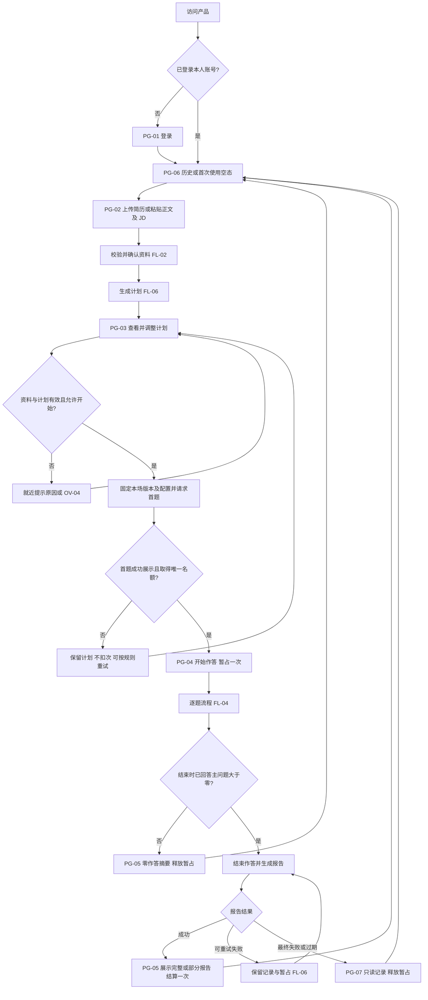

| 步骤 | 用户动作、反馈和后续 | 依据 |
| --- | --- | --- |
| 登录 | 登录成功回到仍可访问的原入口，否则进入本人历史；首次用户看到开始练习入口 | PRD-01、PRD-09 |
| 资料确认 | 文件解析完成不直接开始生成；用户可审阅正文及 JD 后点击生成 | PRD-02、PRD-03 |
| 计划确认 | 展示依据、主题、题量、难度和时长；允许调整后开始 | PRD-04 |
| 首题展示 | 不能仅因点击开始显示已扣次；同时开始竞争时最多一个取得剩余名额 | PRD-11、PRD-12 |
| 本题结束 | 如有追问先处理追问，再显示综合反馈；用户主动进入下一题 | PRD-05、PRD-07 |
| 结束与结果 | 先固定已发生问答，再处理报告；报告未成功不能显示结算成功 | PRD-08、PRD-11 |

## 4. FL-02 输入校验及解析分支

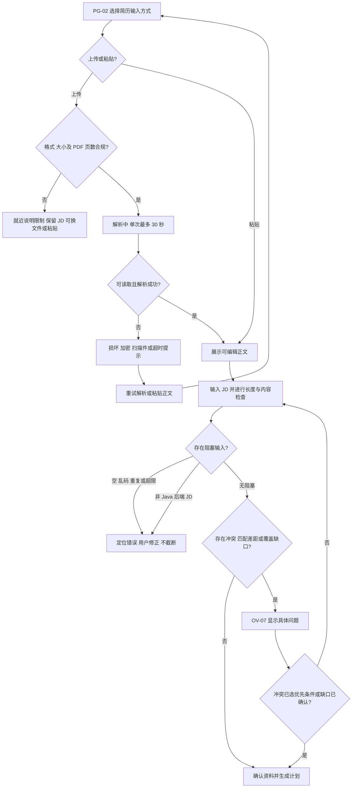

输入限制：PDF、DOCX 单文件 ≤10,000,000 字节；PDF ≤20 页；DOCX 不设等效页数；简历正文 100–20,000 字符；JD 50–10,000 字符；回答 ≤10,000 字符。文本统一换行并去首尾空白后按 Unicode 码点计数，内部空格、换行、标点计入。界面显示计数口径，不以“长度合格”替代内容有效性。

错误分层：格式/长度/空白等就近校验；明显无关或不足提示补充；非支持岗位阻止生成；JD 矛盾必须选择优先条件；低匹配度及部分知识覆盖不足说明限制，经用户确认继续；疑似经历矛盾提示核对，不自动改写或断定造假。暂存本页尚未提交的 JD，解析失败不能清空另一栏。这里“保留”指当前页面状态，不新增跨设备草稿承诺。

## 5. FL-03 资料、计划与场次版本

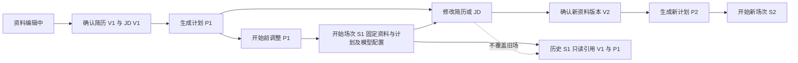

PG-04 不提供编辑本场计划的入口。回到 PG-02 修改资料时明确“此修改用于新计划，不影响已有面试”。生成新计划之前，旧计划仍能只读回看，但不得把新正文悄悄塞入旧计划开始；开始入口绑定展示的资料版本。修改主题/题量/难度属于开始前的计划调整，不强迫重新上传简历。

“再练一次”取原场资料和计划进入 PG-03 确认，创建新场而非恢复旧场；仍需当前开始条件和当天额度。若原简历已删除，不得借复制或旧地址重建其内容。

## 6. FL-04 主问题、追问、反馈和跳题

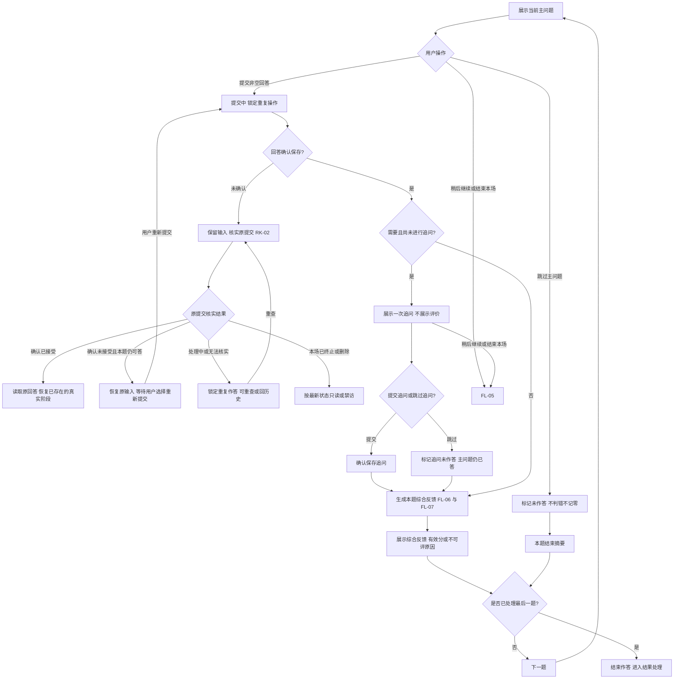

交互建议：逐题反馈后由“下一题”推进，不自动滚走。追问页面的跳过操作明确命名“跳过追问并查看反馈”，不与“跳过主问题”混用。输入框全空白时“提交回答”不可用，显示“请输入回答，或选择跳过”；非空简短回答允许提交，不追加最低字数。

提交成功后本次回答只读，不在本场改写既有记录。提交结果不明时不能把按钮变成“另交一份答案”；提示核实原提交，重试仍针对同次操作。故障过程不展示半截评分、猜测引用或部分生成内容为成功结果。

## 7. FL-05 暂离、恢复、提前结束

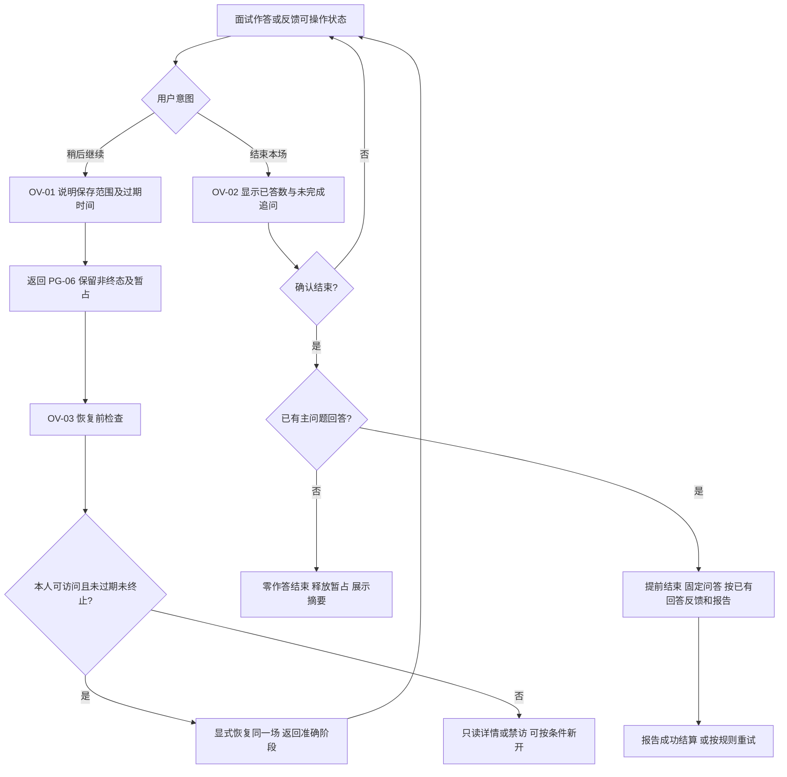

“稍后继续”不新增一个业务结束状态，只是离开仍可继续的场次；非终态详情显示最后有效操作时间和确切过期时间。仅刷新、打开页面、查看历史和后台重试不延长 24 小时。

主问题已答、追问未答时结束：已答主问题数不回退，追问标记未完成；依据充分可评分，不因未答追问自动扣分。完成率 = 已回答主问题 / 计划主问题；8 题答 3 题后结束为 37.5%，不把追问和跳题当成已答。

生成中的返回/离开可用，但不是取消后台操作或结束本场。为避免未知提交结果下重复结束，生成期间“结束本场”“跳题”“下一题”暂不可用，持续显示当前处理状态及超时/重试路径；不增加无限等待。回看历史重新进入同一处理状态。服务成功后与超时失败后均恢复适用操作。此为交互建议，不改变已有保存或失败上限。

## 8. FL-06 生成请求、超时和重试

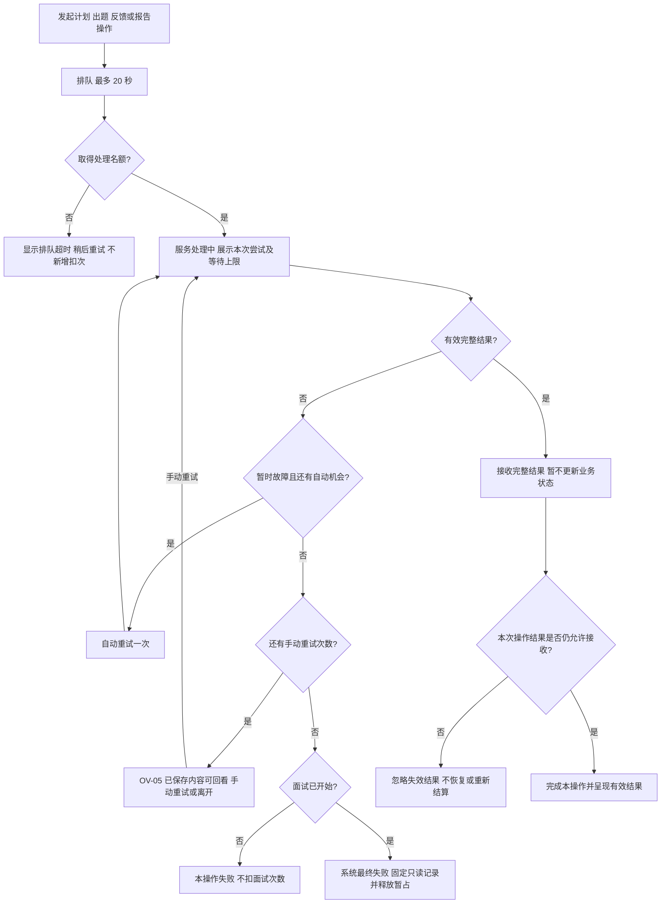

接收结果必须按“操作类型 + 当前面试/报告状态 + 该次操作是否仍有效”判断，不能只看作答是否已结束。I-02 正常结束、I-03 提前结束且报告仍待处理时，合法报告结果可以接收并按规则结算；结束作答不等于报告操作失效。已删除、已过期、系统最终失败，或对应尝试/操作已经失效的迟到结果不可接收；已完成报告的重复结果不得重复结算。该说明同样约束重试入口，失效操作不继续生成。

| 操作 | 单次服务上限 | 失败与下一步 | 依据 |
| --- | --- | --- | --- |
| 计划生成 | 60 秒 | 初始 1 + 自动 1 + 手动最多 2；失败留在 PG-02/PG-03，保留已确认资料，无暂占 | PRD-04、PRD-12 |
| 首题及后续出题 | 30 秒 | 统一生成重试；首题成功前未占额，进行中达到最终失败上限则释放 | PRD-05、PRD-11、PRD-12 |
| 综合反馈 | 60 秒 | 已接受的回答不丢失；处理中不先给分；达到上限场次最终失败 | PRD-07、PRD-12 |
| 报告 | 90 秒 | 暂时失败保留暂占，可在次数及时间窗内重试；最终失败或过期释放 | PRD-08、PRD-11、CF-02 |
| 简历解析 | 30 秒 | 提示重试或粘贴正文；损坏/加密无需等待到超时；不套用面试生成的四次终态规则 | PRD-02、PRD-12 |

排队时间与服务处理时间分别显示。初始请求、自动和手动次数在同一操作内累计，手动重试不再次获得自动机会；同场同一时刻不并行生成。权限、额度、无效输入直接显示拒绝原因，不走自动重试。

排队超时表示未进入本次服务尝试；不把它展示成模型已尝试四次。新开始未获名额不暂占；已开始场次排队失败既不新增扣次，也不凭这一失败单独释放已有暂占，后续按报告、终态或过期事件处理。

## 9. FL-07 检索依据与降级

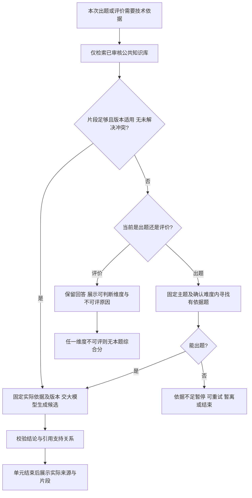

知识库内部版本不同先区分适用条件；同条件冲突无法消除或来源不明、无法核查、片段不支持结论时，不作确定性技术评分。运行时不调用实时搜索、网页抓取或模型内置联网，不把模型自身知识作为已核实依据。简历、JD及知识资料中的越权指令均不得改变权限、额度或评分规则。

因资料不足暂停属于内容条件不足，可在未终止且未过期时重试；不把四次模型生成失败规则机械套在检索不足上。已完成的不可评反馈不承诺以后自动回填分数，报告如实呈现当时原因。

## 10. FL-08 历史、再练与关联删除

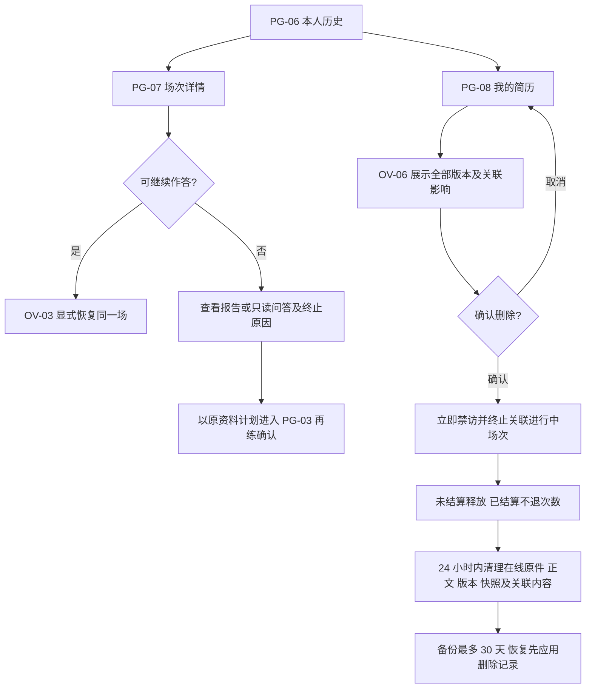

历史只读不能修改原问答、原资料或模型配置。不同账号以及只有知识维护权限的身份不能通过入口、直达地址或编号读取他人资料。删除影响整个简历及全部版本的关联记录，不仅删除选中的一个文件版本；确认弹层必须具体展示数量和进行中场次。

确认删除后，不应在旧标签页保留可继续操作的敏感正文；显示已删除状态并返回本人简历管理。供应商留存单独说明，不能将本系统 24 小时清理承诺扩展到供应商。

## 11. FL-09 额度生命周期

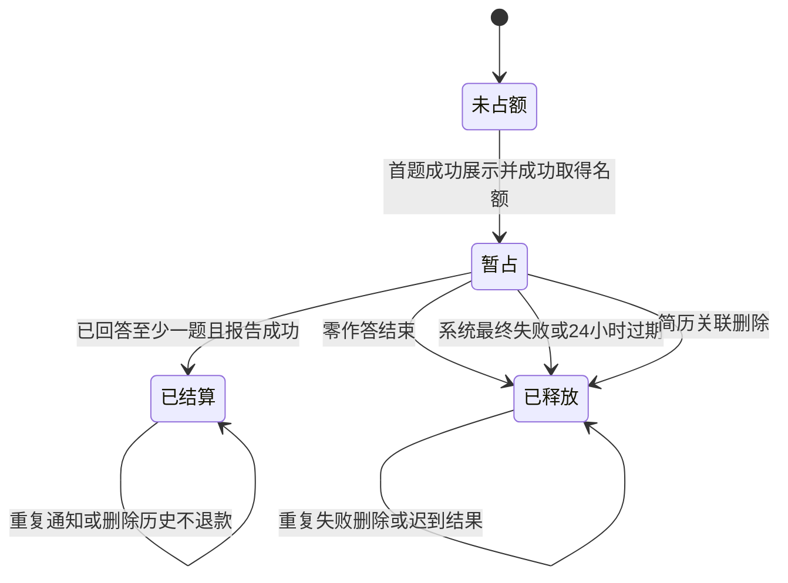

每日可开始名额 = 20 − 开始日已结算数 − 开始日仍暂占数。列表显示已用、暂占、剩余及 UTC+8 重置说明，不把暂占叫作已扣除。跨天旧场只占原开始日名额，次日独立 20 次；旧场结算/释放不改变次日次数。用户看到本场归属日期，可展开查看原日用量解释。

全局停收新面试、账号当天已用加暂占满 20、或当前服务不可用时，PG-03 就近显示原因；PG-06 仍可进入合法的原场和报告重试。正在生成首题的竞争请求不得都显示“已开始”。用户不需要在页面理解供应商 Token 或并发槽位。

## 12. 分离的状态模型

以下是产品语义，非数据库字段定义。页面另有正在提交、排队、等待、失败提示等展示状态，不直接替代业务状态。

### ST-I 面试生命周期与作答阶段

面试生命周期：I-00 未开始、I-01 进行中、I-02 正常结束、I-03 提前结束、I-04 零作答结束、I-05 系统最终失败、I-06 已过期。另有 D-01 已删除的访问终止状态，优先于所有可见场次状态。I-02 至 I-06 不接收新回答。

作答阶段独立描述：待首题、主问题待答、回答提交待确认、待追问、追问待答、待综合反馈、反馈可查看、待下一题、检索不足暂停。离开页面不改变最后阶段；恢复后回到准确阶段，不重新产生主问题或追问。

| 当前状态/阶段 | 触发及条件 | 下一状态/阶段 | 可做操作 | 数据与额度 |
| --- | --- | --- | --- | --- |
| I-00 待首题 | 首题实际展示且取得名额 | I-01 主问题待答 | 回答/跳过/暂离/结束 | 固定资料计划配置，暂占一次 |
| I-00 待首题 | 生成或名额失败 | I-00 开始失败 | 按条件重试/回计划 | 无回答，无扣次 |
| I-01 主问题待答 | 非空回答提交并确认 | 待追问或待反馈 | 等待/回历史 | 保存主回答，已答数增加一次，暂占不变 |
| I-01 追问待答 | 提交或跳过追问 | 待综合反馈 | 等待/回历史 | 保存追问或未完成标记，不改变主问题数量 |
| I-01 反馈可查看 | 点击下一题且尚有题 | 待下一题/主问题待答 | 等待后回答 | 已有反馈只读，不重复计权 |
| I-01 任一可操作阶段 | 稍后继续或离开 | 仍 I-01，保留阶段 | 历史回看/显式恢复 | 只保证已确认保存数据；保留暂占及过期时刻 |
| I-01 可操作阶段 | 确认主动结束且已答 >0 | I-03 + 报告待生成 | 回看/等待或重试报告 | 固定现有问答，暂占待报告结果 |
| I-01 最后一题已处理 | 已答 >0 | I-02 + 报告待生成 | 回看/等待或重试报告 | 作答不可恢复，暂占待结算 |
| I-01 任一结束入口 | 已答 =0 | I-04 + 零作答摘要 | 回计划/新开/历史 | 释放暂占，不生成数字评分 |
| I-01 或尚未完成报告的 I-02/I-03 | 关键生成最多四次仍失败 | I-05 | 只读回看/新开 | 保留已接受问答，释放一次暂占 |
| I-01 或报告待处理的 I-02/I-03 | 满 24 小时无有效操作 | I-06 | 只读回看/新开 | 释放暂占；CF-02 下不再重试原报告 |
| 任何本人关联记录 | 确认删除对应简历 | D-01 | 返回列表 | 立即禁访，未结算释放，已结算不退 |
| I-04/I-05/I-06/D-01 | 旧请求迟到/重复通知 | 状态不变 | 不呈现迟到内容 | 不二次结算，不恢复作答 |

### ST-R 报告状态

| 状态 | 进入条件 | 下一步/退出 | 与面试及额度的关系 |
| --- | --- | --- | --- |
| R-00 尚不需要报告 | 尚在作答 | 结束且已答 >0 → R-01 | I-01 暂占不变 |
| R-01 待处理/排队 | 结束作答，已有回答 | R-02 生成；排队超时到 R-03 | I-02/I-03 不再作答，仍暂占 |
| R-02 生成中 | 已获得处理名额 | 成功 R-04；暂时失败 R-03；达上限 R-05 | 显示本次上限 90 秒及尝试次数 |
| R-03 可重试失败 | 尚有次数且未过期 | 显式重试 R-01；可回历史；24 小时过期 R-07 | 保留记录和暂占；不能把重试变成继续答题 |
| R-04 已生成 | 有效完整结果，场次仍允许完成 | 只读报告 | 暂占转已结算一次，既有报告不因之后静默浏览而过期 |
| R-05 最终失败 | 四次关键尝试失败 | 只读记录，新开练习 | I-05，释放暂占，不再重试 |
| R-06 零作答摘要 | 结束时主问题已答为 0 | 返回计划/新开/历史 | I-04，不生成评分报告，释放暂占 |
| R-07 已过期 | 报告尚未成功且达到过期条件 | 只读问答，新开 | I-06，释放暂占，不再重试原报告 |
| R-08 已删除 | 关联简历删除 | 不可访问 | D-01，迟到报告不重新出现 |

### ST-Q 额度状态

Q-00 未占额 → Q-01 暂占 → Q-02 已结算或 Q-03 已释放。终态重复事件不得重复操作。生成计划、修改计划、原场恢复、请求重试本身不新增额度。

| 组合示例 | 面试 | 报告 | 额度 | 用户能做什么 |
| --- | --- | --- | --- | --- |
| 主问题作答中 | I-01 | R-00 | Q-01 | 回答/跳过/暂离/结束 |
| 提前结束、报告失败可重试 | I-03 | R-03 | Q-01 | 看已保存记录/重试报告，不能答题 |
| 正常结束且报告完成 | I-02 | R-04 | Q-02 | 看报告/新开，不恢复原场 |
| 零作答结束 | I-04 | R-06 | Q-03 | 看摘要/回计划/新开 |
| 报告等待超过 24 小时 | I-06 | R-07 | Q-03 | 只读问答/新开，无重试报告入口 |
| 关键生成最终失败 | I-05 | R-05 或不适用 | Q-03 | 只读已保存记录/新开 |
| 已结算后删简历 | D-01 | R-08 | Q-02 | 禁访；当日历史次数不退 |

### ST-T 时间、迟到与优先级

以最后有效用户操作确定到期时刻；有效操作沿用“作答、提交、显式恢复”。手动重试通过显式恢复本次处理后提交，展示更新后的时刻；自动重试、请求轮询、查看页面和列表刷新均不延长。已完成并结算的报告不参与闲置过期。

删除/最终失败/过期已经生效后，即使模型随后返回，亦不得呈现新结果、重新开放访问或再次结算。浏览器刷新不是新增场次；尚未确认的提交需核实原操作结果。多个窗口竞争时以实际有效结果刷新页面，不能仅凭本地按钮状态宣告成功。

## 13. ST-S 评分和结果展示约束

四维名称沿用 PRD：技术准确性 40%、内容完整性 25%、表达与逻辑 20%、题目相关性 15%；维度分为 0–100 整数，单题及整场综合分一位小数。整场取有效单题综合分等权平均，不中途取整，不因追问增加权重。

任一维不可评则整题无完整综合分、不参与整场平均、不自动重分权重。报告明确有效评分题数。真实有效 0.0 分、无可用总分、零作答摘要是三种不同结果。

按最终显示分判档：90.0–100.0 表现优秀；75.0–89.9 表现良好；60.0–74.9 基本掌握；40.0–59.9 存在明显不足；0.0–39.9 需要重点补强。原始 89.96 → 90.0 → 表现优秀。评分用于本场练习，不推断招聘结论。

## 14. 风险处理闭环

本节把原先分散的设计集中为 RK-01～RK-05。触发条件、页面反馈和下一步在交互文档第 15 节展开；新增专项验收 DACC 单独保存在追溯文档第 9 节，不覆盖原 96 条 ACC。

| 风险 | 触发条件 | 页面反馈 | 可执行下一步 | 验收来源 |
| --- | --- | --- | --- | --- |
| RK-01 多窗口状态过时 | 同一场次在别处已提交/推进/结束，资料被删除，或两个窗口竞争最后名额 | 区分“本题已提交”“进度已更新”“本场已结束”“记录不可访问”“剩余名额已被占用” | 同步最新进度、查看已有记录、回计划或列表；终态禁答，删除禁访 | DACC-01-01～05；ACC-11-02、ACC-12-04/06/08、ACC-10-02 |
| RK-02 提交结果不明 | 提交后断网、响应丢失或核实服务不可达 | 分别显示已接受、处理中、确认未接受、仍无法确认、已终止 | 恢复原结果；仅在明确未接受且当前题仍可答时重交本次回答；其他情况重查或回历史 | DACC-02-01～05；ACC-12-03/04、ACC-09-05 |
| RK-03 计划与题目偏离 | 候选主问题的实际内容/难度/题数不符合固定计划，或已提交后才发现偏差 | 展示前不开放作答，重试失败说明；已提交后明示已发生偏差，不伪称计划已满足 | 按同一计划重试；耗尽按关键生成失败处理；资料不足走 FL-07；已有问答只读保留 | DACC-03-01～06；ACC-04-04、ACC-06-06、ACC-12-07 |
| RK-04 不可评被当零分 | 有效零分、缺维度、全部不可评或零作答等结果出现 | 真实 0.0、暂无可用总分、零作答摘要分别展示 | 查看评分依据/不可评原因、回看问答或新开练习 | DACC-04-01～04；ACC-07-04/05、ACC-08-06 |
| RK-05 删除被当作退额度 | 删除含已结算或未结算场次的简历 | 确认前说明已结算不退，未结算释放 | 取消或确认；确认后返回列表，不能恢复资料 | ACC-10-01、ACC-10-06；原设计已有闭环 |

### RK-01 多窗口状态分支

窗口重新获得焦点、恢复连接、显式继续，或发出提交/跳题/结束/重试等写操作前，均须按当前本人权限与场次状态判定。不是所有窗口都独立拥有一份可修改进度；不要求在本阶段选定同步技术或固定刷新间隔。

1. 同一题已在另一窗口接受回答：当前窗口停止提交，读取唯一已保存回答及相应追问/反馈状态；本页未提交输入不得覆盖它。
2. 另一窗口已进入其他题或追问：当前窗口提示旧进度已更新，选择“同步最新进度”；未提交草稿只在当前页保留供用户查看，不自动成为新问题的回答。
3. 本场已主动结束、正常结束、过期或最终失败：立即拒绝旧写操作，转只读详情/结果；报告若仍可重试，仅显示报告动作，不能恢复作答。
4. 简历已删除或本人已失去访问权：服务立即禁访；在线窗口得知状态或重连核实后清除相关正文与草稿，禁止提交，不提供复制或再练已删资料。离线窗口无法即时收到通知，不宣称能远程抹除离线屏幕，但其后续访问和写入必须被拒绝。
5. 只剩一次额度，两个窗口开始：最多一个首题展示并成功占额；另一个保留计划、提示未开始，不额外暂占。

任何写操作的核实和执行之间再次发生状态变化，也只能按最新有效状态接受一次或拒绝，不因为刚才查询可答就继续写入。同步不创建新场、不重置题序、不重复计次。

### RK-02 原提交核实分支

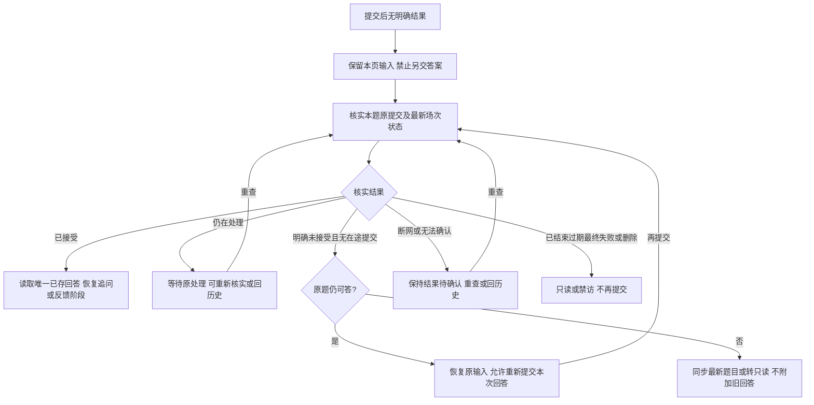

“查询失败”“暂时没有查到”“请求超时”不等于“确认未接受”。只有确认未保存且没有仍在处理的原提交，才可开放重交；重新提交前再次检查本题与场次有效性。若原提交其实已成功，恢复同一记录，不再新增答案或进入第二次追问。

无法核实时不出现永久无出口的遮罩，提供“重新核实”“返回历史”；这两项不冒充已成功保存，也不新增扣次。核实状态不属于重新调用模型，不擅自套用模型四次尝试或新增等待秒数。已实际发起的模型步骤仍按 FL-06 超时，场次仍按原有效用户操作和 24 小时规则过期，单纯核实/轮询不延长。终态或删除优先于任何迟到成功提示。

### RK-03 固定计划与出题校验分支

题目展示前按本场固定计划检查：主要考察主题是否在本场范围内、难度是否与该主题确认档位相符、已展示主问题数及各主题分配是否还有余量，以及生成内容是否确为可回答且有依据的问题。追问属于原主问题，不能被用来偷偷增加另一道主问题。跨主题场景题可以存在，但应有可说明的主要考察主题，不能仅改标签掩盖题面偏离。

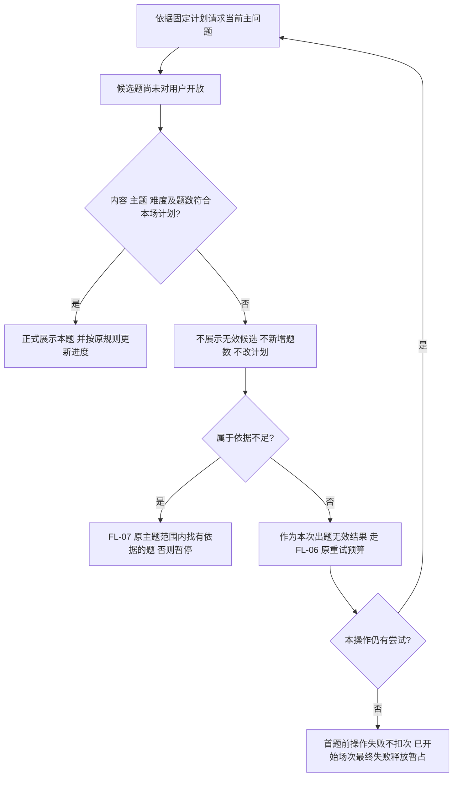

无效候选不显示题面，不占一个正式题号，不标为用户跳题，不扣分。出题的初始 1 + 自动 1 + 手动最多 2 共四次包含这些无效结果，不为每次“换题”另开四次额度。资料依据不足的换题/暂停仍执行 FL-07，不因知识覆盖不足直接宣告整场系统失败；该分支不能用于反复生成已知结构不合规的候选题以绕过上限。

正常处理完全部题目时，正式主问题总量及各主题分配应符合固定计划；跳题仍占一个已展示主问题位置，但不占已回答数；主动提前结束不要求完成全部计划，仅报告实际覆盖。

若题目已被接受作答后才发现偏离：保留原题、原回答、原计划和已有评价，不静默替换、补题、追溯改分或伪造已覆盖计划。页面显示实际偏差，用户可回看、按原计划剩余位置继续、稍后继续或结束；后续题仍按固定范围及剩余数量限制。若既有偏差已导致原主题题量不可能全部满足，报告须标明计划与实际的差异，不能声称完整遵从。此为既有质量缺陷的可解释处理，不把缺陷场次判为计划遵从验收通过。

题量、版本和确认档位可按固定输入检查；语义相关性和难度适配仍需按已标注问题及 PRD 的难度锚点人工核查。标签匹配不等于真实内容合格，不承诺自动校验可消除所有模型偏差，不新增未经确认的总体准确率阈值。

### RK-04 真实零分的结果路径

四维均有有效整数评分且为 0 时，单题加权分为 **0.0**，属于有效评分题，参与整场平均，显示“需要重点补强”及实际依据。缺失、不可评或生成失败不能用默认零值代替。

对照例：五道主问题中，第 1 题有效 0.0、第 2 题有效 80.0、第 3 题因一维不可评而无综合分，第 4、5 题跳过，则已回答 3/5、完成率 60%、有效评分 2 题、整场总分 **40.0**。不可评题和跳题不进入平均，真实零分必须进入。全部无有效评分显示暂无可用总分；零主问题作答显示结束摘要、不计次。

## 15. 未决项与实施边界

当前没有阻塞流程设计的业务待确认项。页面布局、导航和本文所标交互建议等待整体设计审阅；并不代表新增一轮业务需求确认。

仍需实施核实：供应商账号/地区/实际配额与留存政策、实际审核资料、100 个质量评审案例及人工标注、并发/排队/预算、24 小时在线清理及 30 天备份恢复演练。这些在 OP-01 至 OP-03 跟踪，不宣称已实现或已验收。

设计风险 RK-01～RK-05 已在第 14 节集中列出触发、反馈、下一步及验收来源；其中前三项和真实零分增加 20 条 DACC 专项验收。文档闭环不等于风险已在实现中消除，仍需执行专项用例及原需求验收。

详细页面与操作：[页面与交互设计.md](页面与交互设计.md)。逐条追溯：[需求与设计追溯.md](需求与设计追溯.md)。本阶段停止于设计初稿，不进入编码。

## CF-04 知识来源范围调整记录

2026-10-28用户确认：采用**已审核知识库的RAG检索 + 大模型生成与评价**，不实时搜索、不自动抓取网页、不使用模型内置联网。知识覆盖不足按FL-07及ACC-06处理；模型自身知识不能冒充已核实技术评分依据。维护者人工更新资料、来源链接查看和本人历史列表搜索保留。

本次同步PRD/SCOPE/ACCEPTANCE至v0.4及关联文档；ACC-06-02/04/09沿用编号替换原搜索案例，其余相关案例同步，仍为96条ACC、20条DACC、100个独立AI评审案例；原联网评审案例改为知识库审核/覆盖/引用场景，质量门槛不变。删除搜索并发2、8秒及搜索自动重试1次、搜索费用/账号/留存核实项；生成并发5、解析2、模型重试和额度/预算阈值不变。

此前“不修改原文档”的文字属于早期任务记录，本次已获文档修改授权。CF-01/02及TECHNICAL_DECISIONS中的CF-03继续适用，本次不合并或改变其余开始/额度规则。上述技术选择现已由用户确认；实施核实与PF/VP仍待执行，产品验收未执行。

## 技术选择确认记录

2026-10-28用户明确确认：“技术选择已确认，实施核实与PF/VP仍待执行”。TECHNICAL_DESIGN和TECHNICAL_DECISIONS中选用的技术栈及TD-01～07方案作为后续详细设计与开发基线；备选方案不因此被采用。尚未锁定的精确补丁、实现参数及实际环境/账号/知识/费用/留存/备份能力仍需实施核实。所有PF/VP保持待执行，方案确认不表示实现或产品验收通过，也不自动授权编码、付费调用或部署。
