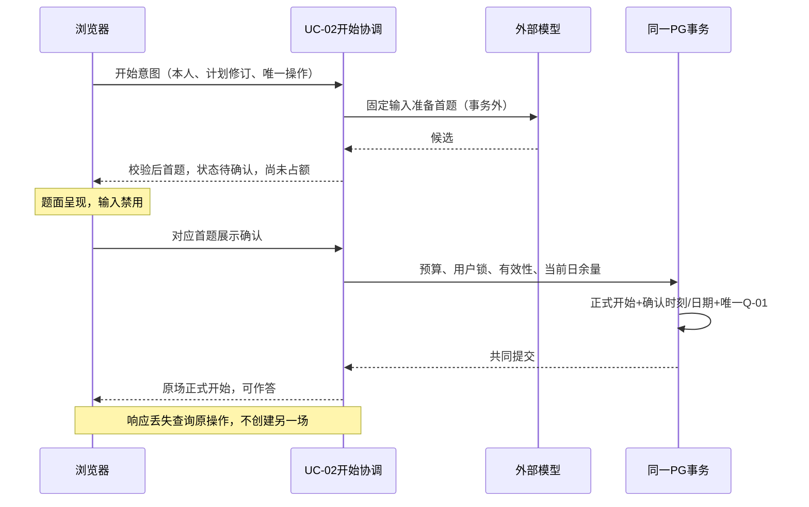

# 技术决策记录

版本：v0.5｜日期：2026-10-28｜状态：原CF/TD及FS-C01/02保持；本轮明确采用并完成DT-01，其他业务实施核实与PF/VP待执行。

当前DT-01迁移/基础仓储结果见 [DT01_VERIFICATION](<DT-01 版本化持久化基础：实现与验证记录.md>)。Flyway/app schema及该任务结构不再待选；正文v0.4及更早未实施描述保留历史，其他建议与业务证明不因DT-01自动确认或通过。

当前环境调整覆盖旧供应商/PG主版本选择，详见末尾v0.4记录及 [ENVIRONMENT_VERIFICATION](开发环境调整与基础验证.md)。首片新增实现建议在 [FIRST_SLICE_DESIGN](首个业务切片详细设计.md) 待审阅，不把它们自动升级为本文件TD已确认内容；原TD业务边界保持。

依据：[需求PRD](产品需求.docx)、[范围SCOPE](交付范围.docx)、[原验收ACCEPTANCE](验收标准.docx)、[产品流程](产品流程与状态设计.md)、[交互](页面与交互设计.md)、[设计追溯](需求与设计追溯.md)、[领域](轻量领域模型与模块职责.md)、[一致性边界](业务协作与一致性边界.md)。技术组件、官方资料及核实日期统一见 [技术方案设计.md](技术方案设计.md) 第2、10节；证明方案见 [实现证明计划.md](实现证明计划.md)。本次按CF-04同步输入基线的知识来源范围；CF-03及其余规则继续适用。

## 1. 事实、变更和决策状态

### CF-03 服务端确认正式开始——已确认业务调整

**确认来源**：用户2026-10-28答复“接受以服务端确认正式开始（推荐，需记录业务调整）”。对应完整提问口径为：服务端成功接受展示确认后，才算正式开始并暂占；此时才能回答，次数归属确认当天。午夜前显示、午夜后确认的场次计入次日。

这一确认解决的是无法可靠获知浏览器实际呈现时间、回执永久丢失与并发准入的业务取舍；不是对下文全部技术选型的批准。浏览器仍须呈现对应首题后发确认，但客户端时间不决定日额度，也不能证明用户阅读或理解。

| 受影响来源 | 原口径及问题 | 本轮执行覆盖 | 后续基线合并建议 |
| --- | --- | --- | --- |
| PRD-11、FL-01/09、CB-START、BR-09 | 实际展示作为开始/原日事实，永久丢回执时不可判定 | 有效展示确认被服务端受理并成功提交后正式开始、Q-01；日期取服务端受理日UTC+8 | 将“开始”定义和状态说明同步，保留调整来源 |
| ACC-11-01～03、DACC-01-01、SC-01 | 最后名额可能要求只展示一份题面，但浏览器与服务端无法原子决定 | 两窗口可出现不可作答的待确认首题；最多一场成功确认并占额，另一场明确未开始 | 保留已用+暂占≤20及不重复；把“最多一份实际显示”改为“最多一场正式开始” |
| ACC-11-03 | 首题展示前失败不占额 | 扩展到正式确认前失败均不占；已展示但未确认也无正式权益 | 增加显示后确认失败案例 |
| ACC-11-07、SC-09 | 原日按浏览器显示日期 | 原日按服务端成功受理确认日期固定；之后结算/释放仍只处置该原日 | 增加23:59呈现、00:00确认，次日归属案例 |
| SD-01～04、PF-07 | 尚待证明严格实际显示/实际日期协议 | 以CF-03为新的验收前提，采用下文SD-05候选；不再声称严格跨端原子 | 原文留作历史候选，不把其未决结论当最新状态 |
| PG-03/04、IX-04/06等开始页面及额度展示 | 题面可见即可能被理解为已开始 | 增加“正在确认开始，确认成功后可作答”，服务端确认之前禁答 | 后续授权更新产品基线时补充，无需新业务页面 |

未变部分：20次/UTC+8、生成计划不计面试次数、失败不扣、重复请求不重复、报告成功才结算、零作答/失败/过期/删除按条件释放、已结算删除不退。此次不覆盖CF-01、CF-02或其他评分规则。

### 技术选择确认范围

2026-10-28用户明确确认：“技术选择已确认，实施核实与PF/VP仍待执行”。TECHNICAL_DESIGN和TECHNICAL_DECISIONS中选用的技术栈及TD-01～07方案作为后续详细设计与开发基线；备选方案不因此被采用。尚未锁定的精确补丁、实现参数及实际环境/账号/知识/费用/留存/备份能力仍需实施核实。所有PF/VP保持待执行，方案确认不表示实现或产品验收通过，也不自动授权编码、付费调用或部署。

已确认范围包含SD-05首题确认协议、TD-02受保护数据库受理时刻及同PG事务/用户锁、TD-03固定输入时点、TD-04持久操作恢复、TD-05删除与恢复屏障、TD-06单活动应用容量/预算方案、TD-07知识/评审/留存核实方案。确认的是选择与边界，实际运行能力及证明结果不在本次确认范围内。

### TD总览

| 编号 | 推荐结论 | 当前状态 | 尚需完成 |
| --- | --- | --- | --- |
| TD-01 | SD-05：首题待确认呈现→服务端确认事务正式开始；不预占日权益 | 业务CF-03及SD-05选择已确认；实现待验证 | PF-07真实浏览器/网络/跨天与最后名额验证 |
| TD-02 | 同PG本地事务、统一用户事务锁、条件写入和唯一操作身份 | 选择已确认；实施与验证待执行 | 事务边界、所有入口及时间裁决验证 |
| TD-03 | 开始意图固定资料/计划/模型；问答封存后固定评价集合和报告输入 | 选择已确认；实施与验证待执行 | 修订、配置迁移、过时候选拒绝 |
| TD-04 | 持久操作/尝试/候选、租约代次和原操作核实 | 选择已确认；实施与验证待执行 | 崩溃/未知/候选复用与四次预算 |
| TD-05 | 同事务删除屏障/权益处置，物理清理异步；恢复前应用最新删除账本 | 选择已确认；能力待实测 | 关联规模、文件终止、24小时/30天及恢复演练 |
| TD-06 | 单活动应用的有界并发、费用事实与预算准入，保留已开始处理 | 选择已确认；费用/账号待核实 | 实际费率、资源/账号限制及故障并发验证 |
| TD-07 | 审核资料、版本化证据、既定100例评审与实际留存核实 | 准备方案已确认；外部事实待核实 | 知识/样例/人工参考、账号政策与恢复证据 |

## 2. TD-01 首题展示证据与正式开始

**问题及约束**：浏览器呈现不能与PG事务共同提交。CF-03允许把可计量的正式开始建立在服务端成功受理展示确认，而不是无法可靠证明的客户端历史日期。不得因生成成功、响应发出或预留技术许可就增加Q-01。

### 2.1 候选比较

| 方案 | 取舍 | 结论 |
| --- | --- | --- |
| SD-01 响应成功即占额 | 未显示也可能占额，缺少展示确认 | 仍排除 |
| SD-02 显示后抢额，严格按客户端显示日 | 并发显示和原日证据仍不可保证 | 不按原定义采用；其后确认思想由SD-05承接 |
| SD-03 先正式暂占再补偿 | 改变确认前无权益的规则 | 仍排除；CF-03没有授权提前暂占 |
| SD-04 交付许可+严格原日证据 | 可控制交付，但永久丢回执和可信跨日仍未完整解决；许可若锁日名额会造成额外限制 | 保留历史推演，不声称已经证明 |
| SD-05 CF-03下待确认呈现+服务端准入 | 放弃把不可验证客户端日期作为计次依据；可见但不可答的预备题不是正式场次 | **本轮推荐**，需PF-07证明；不把CF-03批准等同协议实现通过 |

### 2.2 推荐协议

1. 本人点击开始，UC-02校验身份、资料未删、合法计划及当前预算/可用额度，建立唯一开始意图及固定绑定。此检查只是避免无用准备，不能保证稍后仍有名额；没有Q-01，没有正式开始时间。
2. 外部生成在事务外进行。M-04对题面、主题、难度、位置、版本和操作代次校验后接受唯一候选。使用同一意图恢复首题，不另开场次猜测。
3. 浏览器以首题身份及意图修订呈现题面，显示“正在确认开始，确认成功后可作答”；输入和提交禁用。组件已挂载、题面可见且页面处于可呈现状态后发出带身份绑定的确认。浏览器绘制不是用户已看懂的证明；实现时须做真实浏览器观察，不以收到HTTP内容代替。
4. 确认到达后，先取得预算准入保护，再取得统一用户事务锁，重新核实本人、删除屏障、意图/候选身份和有效代次、当前日名额、预算停新条件。以数据库当前时钟记录受理时刻，UTC+8日期固定原日；M-04正式开始与M-07唯一暂占在同一事务提交。失败全部回滚。
5. 浏览器收到或核实到同一正式开始事实后才开放作答，显示“已开始，暂占1次；报告成功后计次”。提交答案的服务端也核实正式资格，不能只靠禁用按钮。

### 2.3 故障、并发与用户出口

| 触发 | 受保护的处理 | 用户看到及下一步 |
| --- | --- | --- |
| 19已用、两个待确认题同时回执 | 同用户串行检查当前日；最多一个Q-01，另一个无正式场次资格 | 赢者可答；败者“今日名额已用完，本次未开始”，回计划/历史；不可把已见预备题当可答 |
| 确认重复、确认成功响应丢失 | 按同一意图核实；已提交就返回原场/原日/原Q-01 | “开始结果待确认”，可重新核实、回历史；确认后恢复原场 |
| 查询暂时查不到或请求在途 | 不断言失败；核实权威操作及在途资格，保持输入锁定 | 可核实或离开；不能再开一场当恢复 |
| 已证明确认未接受且无有效在途 | 仍满足资格可重发同一确认；执行时重新争当前日额度 | 继续确认；若无额/预算停新/意图失效，明确未开始 |
| 首题已显示但确认永久丢失 | 未提交正式开始就无暂占；不追溯猜测客户端日期，不锁日名额 | 未开始，可离开；后续须核实原意图有效性才继续，失效则回计划重新开始 |
| 显示D日、服务端D+1接受 | 按D+1名额与日期；客户端自带时间不覆盖 | 显示D+1归属；旧日额度不变 |
| D日已成功受理，D+1收到响应/重复确认 | 返回不可变D日接受事实，不重新争D+1 | 继续原场；次日20次独立 |
| 显示后删除、意图被修改失效、预算停新 | 最终事务拒绝；旧确认不能复活资格 | 删除禁访并清当前在线正文；其他失败回计划/历史，不扣次 |
| 服务端在事务提交前/后崩溃 | 前：无正式场次/Q-01；后：重启查询原提交 | 未开始或原场恢复，不能凭网络错误下结论 |

技术开始意图只防重/绑定输入，不预先扣名额、不承诺名额，不要求用户等待另一条未知意图才能使用剩余额度；必须防止把它变成未获授权的每日生成次数限制。准备任务的租约/候选留存参数留详细设计，不将其时间直接当面试24小时规则。

**成立前提/范围**：可信服务端时钟；所有开始写入遵循同一锁/事务；浏览器确认绑定本人及题目，防跨用户/跨修订重放。普通浏览器无法证明物理屏幕像素或阅读行为；协议证明的是可呈现组件的声明与服务端接受事实，不能宣传更强保证。

**归属/追溯**：UC-02；M-01认证、M-02删除、M-03版本、M-04开始事实、M-07日资格；CB-VERSION/START，SC-01/09，PF-04/07，ACC-11-01～03/07/08、DACC-01-01，按CF-03覆盖。**状态：业务调整及协议选择已确认，真实验证待执行。**

## 3. TD-02 事务与状态裁决

**选择**：推荐单PostgreSQL、单事务管理器，协调者通过Spring TransactionTemplate调用模块拥有者；默认READ COMMITTED辅以所有入口统一的事务级用户咨询锁、条件状态变更和逻辑唯一性。仅依靠先查询后写、按钮禁用或模块各自提交不能满足CB；独立消息队列补偿也不能代替报告成功和结算的同一提交。官方能力依据：[PG锁](https://www.postgresql.org/docs/18/explicit-locking.html)、[隔离](https://www.postgresql.org/docs/18/transaction-iso.html)、[Spring事务边界](https://docs.spring.io/spring-framework/reference/data-access/transaction/declarative/annotations.html)。

### 3.1 具体机制和边界

- 全部同用户业务写入（包括后台回调、恢复、过期、删除和关联新建）先取得相同事务级用户锁，提交/回滚自动释放；锁键来自稳定用户身份，散列碰撞至多增加串行等待，绝不能作为鉴权依据。读取仍按所属用户和删除屏障校验；修改时在锁内重查，不能沿用旧查询。
- 统一顺序：需要预算停新裁决的开始操作先预算门、后用户锁；随后资料范围→场次/原日权益→当前操作。费用记账更新预算门在独立短事务执行，不在持有用户锁时反向获取预算门。串行带来的小范围性能代价须实测，不在事务中等待外调。
- 使用业务身份确保同场唯一权益、同答题位置唯一已接受回答、同操作唯一已发布报告；条件变更核实来源状态、当前操作及修订/代次。即使重复唤醒也只能返回同一事实。唯一性约束是第二道防线，不允许它代替业务前置检查。
- 各拥有者共享当前连接和事务，不自行REQUIRES_NEW。事务中只写本地必要事实/后续任务意图；外调和文件删除不在其中。进程崩溃后从持久事实恢复，不能依赖内存回调。

| 操作 | 原子范围/裁决者 | 延后工作与合法状态 | 失败结果 |
| --- | --- | --- | --- |
| 接受回答 | M-04唯一回答、主已答数/追问状态、阶段、有效操作事实及必要后续处理意图 | 已保存等待追问/评价，调度器领取共同提交的意图后执行 | 回滚全部无效；提交未知只核实，不再答一份，不遗漏后续工作 |
| 结束作答 | M-04封存、禁新答、M-05收尾意图；零答还含释放/摘要 | 有回答为I-02/I-03及报告待处理，可合法收尾 | 不出现半封存；结束不等同报告最终失败 |
| 发布报告 | M-05报告内容/R-04、M-04业务完成、M-07原日暂占转已用 | 提交后页面查询/通知可稍后 | 任一点失败全部不发布/不结算；同候选可核实接收 |
| 最终失败/过期 | M-04终态/许可失效、M-05对应报告终态、M-07释放 | 只读与清理不复活；CF-02报告待处理适用 | 若报告已先合法成功，旧失败/过期任务无效 |
| 关联删除 | M-02屏障/删除请求、关联未结算处理资格失效、M-04/05终止、M-07释放 | 24小时物理清理；已结算不退 | 未提交不宣称成功；提交后立即禁访，清理故障不撤屏障 |

### 3.2 时间和竞争裁决前提

推荐以**取得必要锁后、最终受保护条件变更处的数据库当前时间**为逻辑裁决点，只有事务提交成功才成为有效事实；保存该时刻并固定权益日期。不得用请求发起时间、模型完成时间或事务开始时冻结的now()越过过期边界。[PG clock_timestamp说明](https://www.postgresql.org/docs/18/functions-datetime.html)

用户已确认本方案采用以下技术线性化定义：有效条件写入在午夜/期限前，物理提交返回在边界后时，归属该受理时刻；它**不等于数据库物理COMMIT落盘时刻**。若业务要求“物理提交完成必须早于边界”，普通应用事务无法以提交后的时钟重新原子验证此前条件，需重新设计与明确取舍，不能声称本方案已保证。PF-04/07须覆盖锁等待跨边界及提交回包跨边界。该定义的选择已获确认，其实现是否正确仍须PF-04/07提供证据。

报告与删除：谁先共同提交有效业务事实谁先成立；报告先则之后删除禁访但不退已用；删除先则报告候选不得接受。报告与过期：锁内按当前真实期限核实，满24小时即过期，不等定时任务；已先成功的报告不因旧过期任务被释放。有效恢复先于期限则续用新期限，恢复到达时已满24小时不得先延期再复活。客户端点击顺序不裁决。

**追溯/状态**：UC-02～06，M-02/04/05/07；CB-ANSWER/FEEDBACK/SEAL/REPORT/STOP/ZERO/DELETE；SC-01～09；PF-01～05/07；ACC-10-02/06、ACC-11、ACC-12-03/04/08；DACC-01/02。选择及时间裁决前提已确认；真实PG故障验证仍待执行。

## 4. TD-03 固定版本与配置

**取舍**：推荐在服务端接受“本次开始意图”时绑定已确认资料/计划修订与当前已通过评审的模型配置。等首题生成后才绑定可能把旧题关联到新配置；每步读最新配置会破坏旧场。各版本以不可变身份和内容修订区分，不以文件名/当前配置名称推断相同。

| 时点 | 固定对象与拥有者 | 后续规则 |
| --- | --- | --- |
| 资料/计划确认 | M-02简历/JD版本；M-03合法计划及来源版本 | 编辑生成新版本/新计划，不覆盖已有面试快照 |
| 接受开始意图 | M-04绑定资料、计划修订、主题分配、难度、生成模型快照及非密钥配置修订 | 准备中用户改资料/计划：原意图显式失效，重新准备；不能用旧首题冒充新计划 |
| 确认正式开始 | 验证候选与该绑定一致，并固化本场身份/开始事实 | 后续改资料或全局模型配置不修改本场；新意图使用新生效配置，已准备意图仍按原绑定，不静默漂移 |
| 每次主题/追问/评价 | 操作固定当前问题、回答、证据版本及输入身份；M-06给可追溯依据 | 同操作重试不替换输入；输入合法变化须失效旧代次，新操作不得重置原步骤四次预算 |
| 结束作答 | M-04封存真实问答、跳题、结束原因、主已答/实际覆盖 | 旧答题/出题许可失效；只保留针对封存输入的收尾评价/报告资格 |
| 必要收尾评价完成 | M-05固定被接受评价集合、计算结果及报告输入身份 | 报告重试不读最新简历/计划或另一套评价；引用历史依据版本，不能伪装当下知识结论 |

向量配置升级建立独立知识修订并验证检索，不混用旧向量与新维度；场次保留已使用的引用身份/片段及适用版本。因资料错误产生的新版本和重试是不同概念。模型停用/不可用时原场按原错误/重试/最终失败规则，不静默换模型；密钥轮换可以替换认证秘密，但不改变逻辑服务/地区/模型绑定，不复制明文密钥到历史快照。

**恢复/拒绝**：后台接收候选比对场次/逻辑操作/尝试代次/输入身份/封存身份/删除与到期资格。任一不符不发布、不推进、不结算；已结束作答的合法收尾不能仅因I-02/I-03被拒绝。已接受偏离计划的质量缺陷保留真实记录，报告注明偏差，不补题改分遮盖。

**追溯/状态**：M-02/03/04/05/06，UC-01～04；CB-VERSION/QUESTION/SEAL/REPORT，SC-10，PF-02/03/08；ACC-04-04、ACC-09-02、ACC-11-09/12；DACC-03-01～06。固定时点选择已确认；版本能力待实现验证。

## 5. TD-04 操作恢复、尝试与结果核实

**选择**：PG持久任务替代仅内存任务/一次性通知；逻辑操作与调用尝试分开。任务领取使用短事务租约及递增失效代次，释放锁后执行外调，接收时验证当前代次；租约参数属于后续资源/时限设计，不能因过期领新任务就追加第五次调用。

| 身份/状态 | 含义及核实方式 |
| --- | --- |
| 场次身份 | 同一正式练习及其原日权益，不因刷新、重试、重启变化；准备阶段关联唯一开始意图 |
| 逻辑操作身份 | 一次开始确认、某题主/追问提交、某步骤出题/评价/报告；重复请求查同一事实 |
| 尝试身份及代次 | 操作之内每次实际执行的身份，区分初始/自动/手动，包含固定输入绑定；旧执行者不能接收新代次结果 |
| 未接受 | 受保护核实已明确拒绝或未提交，且没有有效在途/未知执行；可按当前合法阶段重试 |
| 处理中 | 存在有效已领取/排队任务；页面等待/核实，不能并行另交或生成 |
| 已接受 | 权威业务事实已提交；返回原回答/阶段/报告，不再改变计数 |
| 结果未知 | 响应丢失、暂不能查询或外部执行不可知；不等同失败/未接受，也不假报成功 |

回答提交携带稳定逻辑身份与输入修订；同身份不同正文拒绝冲突，不覆盖。相同业务位置不同请求身份仍只能接受一份。查不到单条记录不足以证明没保存，必须核实操作资格/在途和权威事实；无法核实持续到原24小时条件，按CF-02及既有终态处理，不凭轮询延期。明确未接受并开放重交后仍在执行时重查终态/删除，不能“刚才允许”就跳过保护。

后续主问题同样区分候选接受、发送和呈现；推荐复用绑定场次/题目/修订的可见确认，幂等登记已展示事实，重复恢复同一题不重复增加已展示数，也不新增日权益。浏览器尚未呈现不伪报已展示；旧题确认不能推进新题。首题仍以CF-03确认正式开始为准，后续确认仅是本场进度事实，不是新的计次事件。必要追问/评价意图与回答、收尾意图与封存同事务保存，领取/唤醒可以延后，不允许任务丢失令已保存回答永远无下一步。

### 5.1 生成、接收与故障分离

1. 持久记录尝试意图、剩余机会及固定输入，领取处理许可；调用前事务结束。
2. 接收完整响应后，先将可恢复候选与来源/用量写入私有操作结果，再尝试短事务校验并发布业务事实。候选本身不是已成功报告，不对用户公开；含私有内容的候选也进入关联删除范围。
3. 候选已持久、业务提交失败：恢复读取同一候选，核实原提交；仍有效则只重做接收事务。**不增加模型调用机会，也不消耗一轮新的生成尝试。**
4. 已提交但响应丢失：查询返回原结果；不能重新生成/结算。提交前崩溃：依持久操作/候选恢复，旧执行者代次失效后不得写入。
5. 供应商已执行但响应在本地持久前永久丢失：除非实际供应商提供且已核实结果查询，无法恢复相同文本；标明该尝试外部结果未知及可能收费，撤销旧接收许可，在既有剩余重试规则内决定下一尝试。不能凭未知再赠一次，也不保证外部调用恰好一次。

初始1+自动1+手动2跨原始/恢复/队列工作累计；任务重领、候选不合规、服务端重启不重置。HTTP库隐式重试禁用，无搜索专属超时/重试；解析30秒终止不冒充生成四次策略。只有已有有效候选的本地发布重试不算再次生成。外部未知状态的处置不得绕过单场当前许可，也不能把无法核实本地提交当成可再生成。

**合法出口**：页面显示当前阶段/已保存与待确认区别、剩余手动机会和原到期时间；可查询原操作、暂离或按规则结束。已结束作答只能重试合法报告，最终失败/过期原场只读，删除禁访。原答案保存后后续生成失败仍保留原回答。

**追溯/状态**：M-04逻辑资格、M-05候选/报告、M-07权益；UC-03～05；CB-ANSWER/FEEDBACK/TEMP/REPORT/STOP、SC-02～07、PF-02/03/04；ACC-12-01～09，DACC-01-02～04、DACC-02-01～05、DACC-03-04。恢复方案选择已确认；外部幂等/查询能力待核实，实际恢复未验证。

## 6. TD-05 删除、清理与备份能力

**选择与取舍**：同用户事务锁和统一资料根屏障让关联创建/删除串行裁决；同一PG事务使禁访、未结算处理终止/任务失效及权益释放共同生效。全文/文件物理删除在事务外按持久清单续做。逐模块先后删再补偿会暴露中间态，全部文件在锁内删除又造成长事务，均不推荐。

### 6.1 删除生效及清理

- UC-06先校验本人和影响范围；锁内重查关联关系，记录唯一删除请求/屏障，各拥有者关闭所有关联未完成资格，M-07仅将Q-01转Q-03，Q-02保持。任何失败全部回滚；不能只写屏障后把释放延后24小时。
- 同锁下关联新建若在屏障前提交即被删除范围包含；屏障后全部拒绝。后台报告、文件元数据接收、资料版本新建也执行该检查，不能只有页面检查。
- 清理任务由各拥有者处理原件、正文、JD及版本、面试快照、计划、问答、评价、报告、候选、临时文件、缓存/副本和检索中的私有副本（首期不建设用户私有知识库）。公共技术知识和其他用户数据不删。最小删除/权益审计不留正文，足以去重与恢复屏障。
- 私有文件先建立受控清理归属再暂存；写入者受有界执行时限/许可约束，删除后不能注册新可访问文件。物理写与PG不是同一事务，需隔离暂存、孤儿对账和已失效写入者的终止/清理证明，不能靠一个“任务完成”标记假设所有文件已删。
- 文件清理失败保持禁访、保存未完成项并重试，重启后续做。自删除生效24小时内清理完整在线范围；超过即失败/告警，不能放宽期限。关联数量是否能在短事务共同处置必须以真实持久化和实际范围测定；本轮不凭空限制用户历史条数。做不到需重设计，不降为异步权益处置。

### 6.2 备份与恢复

推荐PG基础备份+WAL及私有文件清单形成可恢复备份链，滚动保存最多30天；不是仅一份数据导出就宣称完成生产备份。[PG恢复](https://www.postgresql.org/docs/18/continuous-archiving.html)、[pg_dump适用提醒](https://www.postgresql.org/docs/18/app-pgdump.html)

最新删除账本必须能覆盖恢复点之后的删除。推荐同本地事务生成最小删除事实，再将不含正文的删除账本复制到独立于旧数据备份链的受控位置；两处复制**不是原子双写**，可能有延迟。恢复进入隔离环境，在开放访问前验证最新账本覆盖水位、应用全部删除及关联清理、核验后才开放。拿恢复出来的旧删除表当“最新账本”不合格。若原库丢失且独立账本不能证明覆盖最新删除，保持恢复数据禁访；无法证明数据安全时宁可暂不恢复服务，不能先开放等补偿。

30天是含已删除正文的旧备份最长留存，不要求删除账本同正文同时销毁；账本最小信息保留依据需在实施的数据保留配置中记录。日志/下载副本的系统可控范围需列清；用户已自行下载或离线屏幕不可远程清除，不声称能做到。外部供应商已收内容按实际条款/能力说明，不继承本系统24小时承诺。

**追溯/状态**：M-02、各拥有者及UC-06；CB-DELETE/CLEAN/BACKUP、SC-04/06/08，PF-01/04/05；ACC-10-01～08、DACC-01-05、DACC-02-05。删除/恢复方案选择已确认；存储/备份/删除账本与关联规模待实际验证，外部留存未核实。

## 7. TD-06 容量、费用与停新

### 7.1 并发和时间

推荐首期只有一个活动应用执行者，应用有界许可生成5、解析2，同场仅一个有效生成操作；用户思考和数据库查询不占模型许可。任务排队与调用超时分别记录，排队20秒不吞入模型60/30/60/90秒。知识库检索作为本次生成前置步骤须服从剩余时间，不能把检索与模型耗时相加后仍宣称只用模型调用的时限。具体截止传播及取消要通过故障验证。

解析用受控子进程隔离，超时终止实际解析进程并清临时文件；仅中断Java线程不保证停止CPU/解压任务。外部HTTP超时取消本地等待不证明供应商停止执行/停止计费。重启前旧请求可能在外部继续，新进程只可按持久资格/代次控制本地接收和同场新尝试；**不能保证供应商物理并发也绝不重叠**。这里的生成5、解析2按本系统有效执行许可验证；如果供应商要求更严格物理并发，须核实其配额/执行查询或采用保守排空，记录未能核实的调用，不能声称单机信号量解决所有重启场景。

单进程暂停/重启仍可能有旧执行者，因此启动恢复须先核实任务租约、期限和失效代次；新执行者不能与旧持有有效许可者并行处理同一场。多活动实例不在本推荐成立前提内，上线前确认运行方式；若需要多个实例，先补全局许可设计与证明，不能直接复制进程使全局5变10。

### 7.2 费用

| 事实 | 推荐处理 | 不得混用 |
| --- | --- | --- |
| 用户20次 | CF-03确认正式开始暂占，报告成功原日结算 | 不按Token、调用次数或供应商费用扣用户次数 |
| 用量事实 | 分模型输入/输出、embedding及调用状态，保留供应商请求关联；未知用量单列 | 不把失败/超时/未知调用计为0元 |
| 费用估计 | 按已核实地区/币种/阶梯/缓存等计费规则估算；明确更新时间和未知成本 | 不把官网另一地区美元价直接当本项目人民币账单 |
| 实际账单 | 后续与账号账单核对，修正估计并保留差异 | 本地估计不是供应商最终收费证明 |
| 月预算 | 500元目标，观测到400元停新、预留不足可提前停；同预算门与正式开始准入保护 | 不承诺绝对500封顶；停新不终止已有场次 |

新场在准备前及正式确认时都检查停新，最终受保护检查为准；外部费用更新尚未知/迟到仍可能造成预算偏差，故预留要覆盖已开始场次剩余合理调用。具体成本模型须根据实际生成/向量模型费率和样例Token观测形成，不填虚假固定“每场成本”。

**范围缺口说明**：生成计划不计面试额度；目前也没有每天生成计划次数上限。计划生成和embedding仍花钱，既定“400停新面试”不能被静默扩成“所有计划生成也停用”。可停止非必要维护重建以节省费用；若实际观测证明免费计划生成与预算不能共存，需提交明确业务调整，再限制用户能力。本轮不新增此限制，也不对500目标作硬保证。

**外部能力**：百炼限流受实际账号/地区/模型配额约束，[官方限流说明](https://help.aliyun.com/zh/model-studio/rate-limit)不等于本账号有指定RPM/TPM。不接入实时搜索，无搜索账号/QPS/留存待核实项。不能静默切模型来规避限流，因为旧场配置固定。

**追溯/状态**：M-04处理资格、M-07权益；费用/执行器为应用支撑，不成为新额度拥有者；CB-START/TEMP/STOP，SC-01/09，PF-04/07/08；ACC-11-01～11、ACC-12-01/02/07/10/11。容量/费用方案选择已确认；单活动前提、实际费用和资源限制待实施核实。

## 8. TD-07 依据、评审、账号与留存

### 8.1 可先查的公开事实与仍需的材料

公开官方资料核实日2026-10-28，完整来源见TECHNICAL_DESIGN第10节。公开能力是候选条件，不能冒充接入成功。

| 对象 | 本轮公开核实 | 实际接入前所需信息/验证 | 责任与停止条件 |
| --- | --- | --- | --- |
| qwen3.7-plus-2026-05-26 | [官方模型页](https://www.alibabacloud.com/help/en/model-studio/qwen3-7-plus)存在固定快照及结构化输出说明 | 维护者提供账号所属地区/业务空间、可用模型目录/配额、实际端点及结构化参数验证；密钥走本地秘密配置，不在聊天提供 | 未验证模型可用或未通过评分评审，不开放真实试用 |
| text-embedding-v4 | [规格](https://help.aliyun.com/en/model-studio/text-embedding-synchronous-api)有1024维及输入限制 | 实际地区可用性/费用/维度、向量一致性、知识升级重建验证 | M-06负责；不混维度、不因可向量化就认定命中质量 |
| 外部数据留存 | [国际站留存政策](https://www.alibabacloud.com/help/zh/model-studio/data-retention-policy)说明特定范围及条件 | 实际账号/地区/合同、日志与训练用途、ZDR设置适用性、删除能力与例外；保存核实日期/证据 | 国际站非内地ZDR不能外推所有内地请求；不能向用户承诺本系统可删供应商副本 |
| 备份/私有卷 | PG可备份恢复，不代表项目已配置 | 实际持久卷、备份范围/轮转、加密访问、删除账本复制与恢复水位；完成隔离恢复演练 | TD-05/PF-05，没有验证不得写“30天自动清除已通过” |

### 8.2 知识与检索

维护者提供并审核Java后端技术资料，保留来源、许可/可用范围、适用技术版本、审核修订及片段原文。运行时仅检索已审核且适用的知识版本，并交大模型生成与评价；不调用实时搜索、网页抓取或模型内置联网。资料更新由维护者人工收集审核后发布，不自动引入未审核内容。

知识库内部冲突先区分适用版本/场景；同条件冲突无法消除或依据不足时按FL-07处理：能据适用资料完成则继续；不能支持的评价维度标不可评，必要出题依据不足则暂停并提供重试/暂离/结束，不降难度换主题，不凭模型记忆冒充已核实资料，不造引用。

引用必须落到实际已审核片段、适用版本及来源。原文链接供用户主动查看，服务端不自动抓取链接。简历、JD、知识资料及模型候选中的指令按数据处理，不能获得系统规则或维护权限。

### 8.3 既定100例与评分锚点

沿用OP-02，不新增样例数量或质量门槛：100例包含评分60例（12题×5档）、知识库检索/引用/冲突及覆盖不足20例、计划10例、安全10例；其中30条评分样例各重复3次。人工参考应说明技术版本、标准事实、维度锚点、可评/不可评、关键错误、相关证据和参考理由；不只给一个总分。分数仍由四维40/25/20/15%、有效题平均及既定舍入/档位规则确定，模型叙述不能修改。

既定量表执行：确定性功能全部通过；关键安全/严重误判/伪造来源按原阻断项；评分与人工参考±10分内比例≥90%、计划关联≥90%、重复评分差≤10满足比例≥90%、引用支持≥95%，精确分母和量表按原OP-02记录。不得把“生成结构正确”替代语义评审。每轮绑定模型/提示词/知识/量表/样例修订，维护者复核；模型变更先评审、向量升级先验证检索。当前尚未制作评审集或执行评审。

**追溯/状态**：M-01维护授权、M-05评分/报告、M-06知识/依据；CB-VERSION/FEEDBACK/REPORT/BACKUP；SC-10；PF-01/05/06/08；ACC-01-05、ACC-06、ACC-07、ACC-10-08、ACC-11-09/12及DACC-03/04。知识/评审/核实方案已确认；账号/知识/人工参考/留存与备份事实待核实。

## 9. 审阅、实施门槛与后续事项

### 已确认的技术选择及仍待执行的工作

1. 技术栈、单活动模块化单体、单PG本地事务和统一用户锁的组合，以及TD-02逻辑裁决时刻的明确前提。
2. CF-03下SD-05协议、待确认不可答与失败出口；TD-03开始意图固定时点；TD-04操作/尝试/候选恢复方案。
3. 删除即时一致范围、独立最新删除账本与恢复水位失败禁访方案；单活动并发的适用范围和预算非硬封顶限制。

上述技术选择及CF-03/CF-04已确认，无需重复请求确认。下一阶段可按用户具体任务进入详细设计与最小验证；本次仅同步文档状态。TD-01真实浏览器故障证明仍未执行，应先按PF-07完成不付费最小协议验证，再依赖它开展额度主链路实现。

### 实施/试用前必须核实的事实

依赖兼容及安全更新、容器与浏览器环境、实际账号/地区/限额/费率/留存、知识资料/人工量表、资源时限、关联删除规模、备份账本与恢复能力。秘密只在受控环境配置。它们不都需要用户在聊天作业务决策，但必须在真实试用前形成证据；未核实项不得写成已通过。

后续详细设计补持久对象与约束、完整契约、准确依赖锁定、任务失效/恢复参数、时钟注入、文件归属清单和实际备份设置。本轮不输出表结构/DDL/API、不初始化项目、不部署、不执行证明计划。当前无额外业务问题待用户回答；技术选择已确认，实施核实与PF/VP待执行；CF-03向Word等原基线的全文合并另行执行，本次不扩大修改范围。

## CF-04 知识来源范围调整记录

2026-10-28用户确认：采用**已审核知识库的RAG检索 + 大模型生成与评价**，不实时搜索、不自动抓取网页、不使用模型内置联网。知识覆盖不足按FL-07及ACC-06处理；模型自身知识不能冒充已核实技术评分依据。维护者人工更新资料、来源链接查看和本人历史列表搜索保留。

本次同步PRD/SCOPE/ACCEPTANCE至v0.4及关联文档；ACC-06-02/04/09沿用编号替换原搜索案例，其余相关案例同步，仍为96条ACC、20条DACC、100个独立AI评审案例；原联网评审案例改为知识库审核/覆盖/引用场景，质量门槛不变。删除搜索并发2、8秒及搜索自动重试1次、搜索费用/账号/留存核实项；生成并发5、解析2、模型重试和额度/预算阈值不变。

此前“不修改原文档”的文字属于早期任务记录，本次已获文档修改授权。CF-01/02及TECHNICAL_DECISIONS中的CF-03继续适用，本次不合并或改变其余开始/额度规则。上述技术选择现已由用户确认；实施核实与PF/VP仍待执行，产品验收未执行。

## 技术选择确认记录

2026-10-28用户明确确认：“技术选择已确认，实施核实与PF/VP仍待执行”。TECHNICAL_DESIGN和TECHNICAL_DECISIONS中选用的技术栈及TD-01～07方案作为后续详细设计与开发基线；备选方案不因此被采用。尚未锁定的精确补丁、实现参数及实际环境/账号/知识/费用/留存/备份能力仍需实施核实。所有PF/VP保持待执行，方案确认不表示实现或产品验收通过，也不自动授权编码、付费调用或部署。

## v0.4：现有JDK、PG16与账号片补充

用户2026-10-28明确改为使用本机现有JDK21、镜像 `pgvector/pgvector:pg16`，并授权本轮工程/数据库基础检查及账号片设计。实际Oracle21.0.12、PostgreSQL16.15/vector0.8.7及digest见ENVIRONMENT_VERIFICATION。此选择替代早期Temurin/PG18要求，不替换历史引用或冒充旧记录；既有CF-03/04、TD-01～07的规则/一致性边界保持。

TD-02/04/05依赖的PG能力改按PG16实施核实；基础SQL/JDBC已通过，不关闭事务锁、恢复、清理或浏览器证明。PG16当前官方锁/时钟来源见TECHNICAL_DESIGN第11节；正文此前引用的PG18链接保留原核实历史。

用户本轮另确认：FS-C01登录会话空闲30分钟、无记住我、独立于面试24小时；FS-C02密码重置撤销全部已有会话。FIRST_SLICE_DESIGN记录来源、Cookie与受理语义及待执行FS-A计划；本轮不修改Word需求或既有ACC编号。

新推荐而非已确认TD：Flyway/app schema、最小账号及Session结构、表单格式API、版本化密码编码、credential_version逻辑撤销。特别是Session JDBC默认REQUIRES_NEW：不能将其物理清理与改密码说成同事务；推荐账号密码与撤销代次共同提交、每次受保护请求核代次，旧Session延后清理也不能重新授权。它是M-01细化，不授权报告/额度模块独立提交，实施须按FS-A07/08核实。

本轮新增 [DEVELOPMENT_PLAN](开发计划.md)，先审阅首片设计并实施DT-01；PF-07无付费最小协议须在额度主链前形成真实PG/浏览器证据。没有执行FS-A、PF/VP、业务DDL、模型调用或产品验收。

## v0.5：DT-01已采用与局部证明

用户2026-10-28后续授权仅实施DT-01，明确Flyway与独立app schema。已在开发库执行V1/V2，并用独立PG16库核查迁移/约束/Session基础仓储、失败回滚与重试；原文“未执行业务DDL”只适用于当时阶段。完整结果见DT01_VERIFICATION，DT-01完成。

不变项：CF-03/04、FS-C01/02及TD-01～07；未实现账号认证或凭证代次撤销，未关闭完整FS-A12/ACC/PF/VP。会话默认独立事务保留，未授权额度/报告独立提交；下一DT-02须另按明确范围开展。
