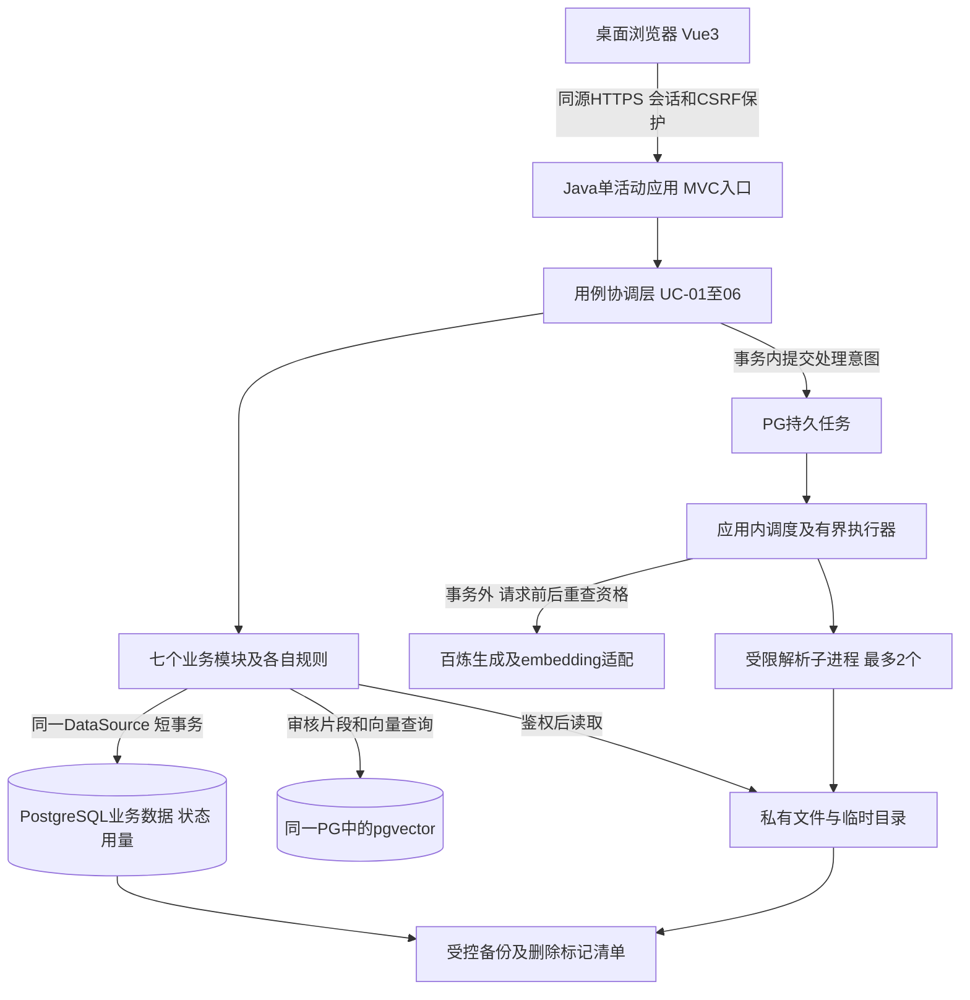
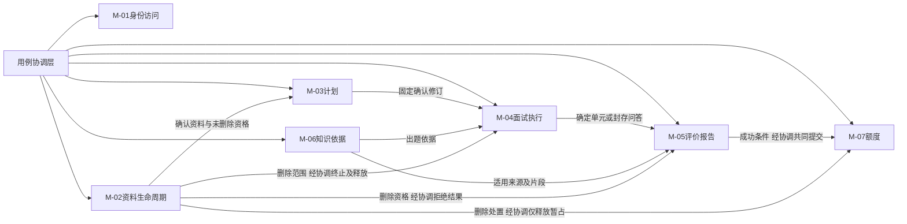
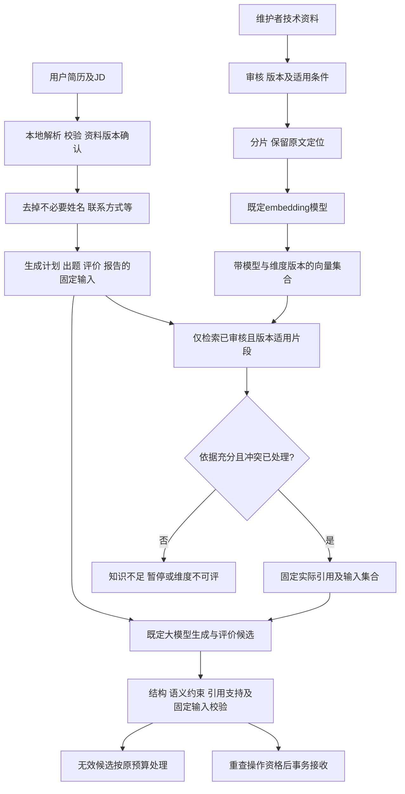
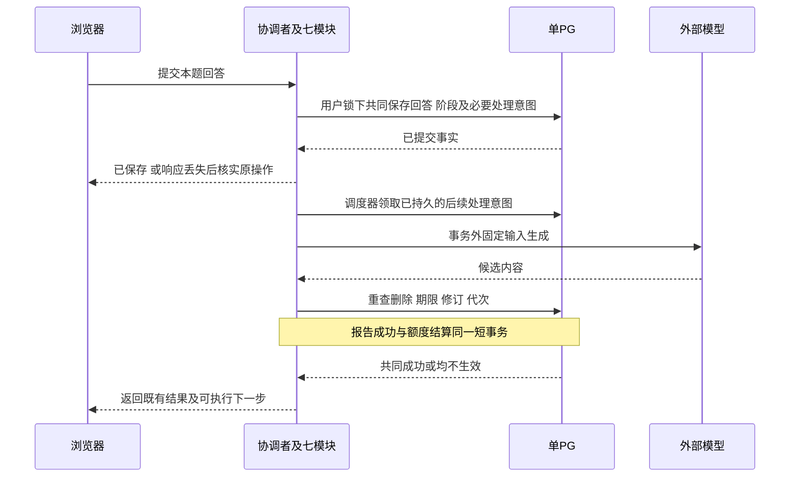

# 技术方案设计

版本：v0.5｜核实日期：2026-10-28｜状态：CF-03/04、JDK/PG16及DT-01方案已确认；DT-01迁移/基础仓储完成，其他业务实施核实与PF/VP待执行；未部署或付费调用。

最新增量：用户已明确采用并授权实施Flyway/app schema及DT-01结构，实际结果见 [DT01_VERIFICATION](<DT-01 版本化持久化基础：实现与验证记录.md>)。下文v0.4记录中的该部分“推荐待审阅”保留为历史；账号接口/编码/撤销等其他建议不因此一并获准，原业务一致性边界不变。

本轮增量只调整已获用户确认的JDK/数据库基线，新增环境与首片设计入口；原v0.3的架构/证明选择及历史官方引用保留，不将基础检查视为业务证明。当前结果见 [ENVIRONMENT_VERIFICATION](开发环境调整与基础验证.md)，首片具体技术推荐见 [FIRST_SLICE_DESIGN](首个业务切片详细设计.md)，任务见 [DEVELOPMENT_PLAN](开发计划.md)。

已读取项目 [AGENTS.md](../AGENTS.md)、[PRD](产品需求.docx)、[SCOPE](交付范围.docx)、[ACCEPTANCE](验收标准.docx)、[PRODUCT_FLOW](产品流程与状态设计.md)、[INTERACTION_DESIGN](页面与交互设计.md)、[DESIGN_TRACEABILITY](需求与设计追溯.md)、[DOMAIN_MODEL](轻量领域模型与模块职责.md)、[CONSISTENCY_BOUNDARIES](业务协作与一致性边界.md)。提示中的PRODUCT_FLOW\.md按实际产品流程与状态设计.md读取。本次按CF-04同步需求、设计、领域和技术文档；其余已确认补充继续适用。

## 1. 约束、确认补充与方案状态

闭环：邀请登录→上传/粘贴简历及JD→生成并调整单场计划→逐题回答/至多一次追问→综合反馈→报告/零作答摘要→历史与关联删除。首期桌面文本练习，语音、Agent、公开注册、付费、报告导出和跨场趋势不加入。

### CF-03 本轮已确认的业务调整

用户于2026-10-28明确接受：**服务端成功接受对应首题的展示确认后，才算正式开始并暂占；此时才能回答，次数归属确认当天。** 因此午夜前浏览器显示、午夜后服务端接受确认，计入次日。浏览器呈现但未确认的题面属于“开始待确认”，不具有可作答的正式开始资格。

CF-03覆盖原PRD-11、ACC-11-03/07、FL-01/09、SC-01/09及PF-07中“以实际展示时点/日期为准”的冲突部分；日已用+暂占≤20、失败不扣、同场唯一、UTC+8、恢复/重试不重复、报告成功结算等不变。原文保留作历史基线，开发与验收须同时引用本轮确认，调整清单见 [技术决策记录.md](技术决策记录.md) 第1节。不能继续把旧日期预期与CF-03混用。

### 其他约束

| 类别 | 已确认事实 |
| --- | --- |
| 输入 | PDF/DOCX≤10,000,000字节，PDF≤20页；简历100～20000、JD50～10000、回答≤10000字符，按统一换行/去首尾空白后Unicode码点计数；无OCR，无静默截断 |
| 计划/作答 | 默认8题，5～15题；基础/中等/进阶，默认中等；开始后固定；追问≤1，不增加主问题配额或评分权重 |
| 评分 | 四维40/25/20/15%，维度整数，综合一位小数；有效0参与平均，不可评整题排除、不重分权重；按最终显示分判档 |
| 用量/时间 | 每人每日20次、UTC+8；报告成功结算，零作答/最终失败/过期/删除按规则释放；CF-02报告待处理也适用24小时无有效操作过期 |
| 处理上限 | 全局生成5、解析2，同场生成1；应用排队20秒；计划/出题/反馈/报告单次60/30/60/90秒；初始1+自动1+手动2；解析30秒，无搜索任务/配额 |
| 数据 | 本人隔离，删除立即禁访/终止相关处理，未结算释放、已结算不退；在线24小时清理，备份最多30天，恢复先删后开 |
| 费用 | 运营目标500元，观测消耗到400元停止新面试，预留不足提前停新；生成/向量计入，服务器与存储另计；不保证绝对硬封顶 |
| 外部配置 | 保留qwen3.7-plus-2026-05-26、text-embedding-v4；不接入实时搜索、网页抓取或模型内置联网；服务可配置不等于账号已验证，旧场不静默换模 |

用户已确认业务约束、Java/RAG方向、外部配置基线，以及本文件选用的技术栈、模块化单体、存储和并发实现方案。正文“推荐”保留为原选型理由，当前采用状态为**技术选择已确认**；备选项未自动采用，精确补丁/依赖组合仍需锁定与核实。官方页面已核实不等于本地组合已构建或供应商账号可调用。

## 2. 技术选型

来源S-01～24为原选型时官方记录，保留在第10节；本轮PG16核实补于第11节。当前确认基线：**本机现有JDK21 + Spring Boot4.1.x + Spring JDBC + PostgreSQL16/pgvector + Vue3桌面SPA + PostgreSQL持久任务**，单活动应用进程。初始化已形成backend/pom、Maven Wrapper、frontend/package-lock；实际锁定版本见 [README](../README.md)，不要继续按早期“尚未生成”描述判断工程不存在。

| 技术需求 | 推荐选择 | 理由 | 关键限制 | 运维/费用影响 | 必需性/备选 |
| --- | --- | --- | --- | --- | --- |
| JDK/后端 | 使用本机现有完整JDK21；本轮Oracle21.0.12、Boot4.1.2 | 用户明确采用现有JDK，不为供应商偏好另下载；满足项目Java21方向 | 本轮基础构建/启动通过，不代表业务/供应商集成；不改全局环境或混拼Spring大版本 | 单应用计算费用另计 | 必需；先前Temurin记录保留为历史，不再自动切换。S-01；ENVIRONMENT_VERIFICATION |
| 构建 | Maven3.10.0、已生成Wrapper3.3.4；Boot依赖管理 | Wrapper固定分发地址/校验和，统一依赖 | 本轮使用当前OracleJDK的verify通过；不选Maven4，不以构建替代业务证明 | 使用既有项目缓存，不改全局Maven | 必需；实际文件和证据见README/ENVIRONMENT_VERIFICATION。S-03 |
| 前端 | Vue3、TypeScript、Vue Router、Pinia、Vite8.3.x、npm锁文件；Node22且≥22.18，补丁见README | 表单、长回答和报告，无SSR需求；已形成精确依赖及锁文件 | 初始化阶段静态/类型/构建通过，本轮未修改前端；浏览器本地状态不是权限/用量权威 | 不需SSR服务 | 必需；不增加其他前端框架。S-04/05/06 |
| 关系存储 | PostgreSQL16，镜像pgvector/pgvector:pg16；本轮实际16.15/vector0.8.7 | 用户明确调整；业务与向量仍共用单PG，不改变原子边界 | 真实JDBC/扩展基础检查通过，锁/事务/恢复证明仍待；pg16标签可更新，记录digest；不得复用PG18目录 | 数据库计算/存储/备份另计 | 必需；同用户锁等机制按PG16重新核实，不能沿用PG18运行证明。第11节 |
| 数据访问/事务 | Spring JDBC、TransactionTemplate，单DataSource/事务管理器 | 明确跨模块同一提交范围，避免隐藏持久化/事务行为 | 不能给额度模块另开独立提交或把外调放入事务 | 无需分布式事务平台 | 必需；JPA可替代，但不能因映射便利牺牲原子边界。S-10 |
| 私有文件 | 单活动实例的私有持久目录，位于Web根目录外；通过鉴权应用读取 | 文件≤10MB，小范围试用可先减少外部存储组件 | 必须有稳定卷、备份/清理清单，不能用临时目录当长期存储；不能暴露长期免校验链接 | 文件卷和加密备份额外成本 | 必需；若运行环境无稳定卷，改私有对象存储并核验版本/留存/费用 |
| PDF解析 | PDFBox3.0.8 | 可读取PDF正文及页数；保留失败正文兜底 | 无OCR，复杂排版不保证完全还原；30秒实际终止需进程隔离验证 | 本地CPU/临时存储 | 必需；不引入通用OCR。S-11 |
| DOCX解析 | Apache POI6.0.0的OOXML文本能力 | 官方已发布且要求JDK17，Java21满足基础要求；只用DOCX所需能力 | 尚未验证完整传递依赖；资源限制、压缩包异常与文本次序需测试 | 本地CPU/临时存储 | 必需；不增加DOC/PPT/Excel输入。S-12 |
| 模型接入 | 独立适配层使用Spring RestClient调用百炼已选接口和固定快照 | 少一层框架隐式重试；清楚控制超时、用量、候选校验及脱敏 | OpenAI兼容不等于所有参数完全相同；地区/业务空间/密钥/接口能力须核实 | 按真实模型账单计费 | 必需；Spring AI为后续统一多供应商时的备选，不作为当前额外依赖。S-13/14 |
| 知识处理/检索 | 审核文档→带版本片段→text-embedding-v4的1024维→pgvector0.8.x，本次项目说明列0.8.7 | 与关系库共存，减少独立向量服务；保留原文片段可追溯 | 不跨向量模型/维度混检；1024维落在该类型HNSW索引限制内；并非据此证明检索质量 | embedding费计运营预算，库资源另计 | 必需；先精确向量检索，数据证明需要时再加HNSW；不默认Elastic/Milvus。S-15/16 |
| 后台恢复 | PG持久操作/尝试状态 + 应用调度器 + 有界执行器，租约与失效代次 | 重启可核实，不依赖一次内存通知；无需先上消息队列 | 租约过期不意味着外部未执行；未知调用可能付费，业务结果须去重 | 使用现有数据库和应用资源 | 必需；无Kafka/RabbitMQ/工作流平台依赖。S-08/18 |
| 认证 | Boot管理的Spring Security、PasswordEncoder、服务端Session及Spring Session JDBC | 邀请账号+同源网页，易撤销登录且无需自建JWT续期体系 | 登录态期限不同于面试24小时；CSRF不能因前后端分离关闭；session不放简历正文 | 复用PG，减少Redis | 必需；不新增公众注册/OAuth平台。S-19/20/21 |
| 并发/费用 | 单活动进程生成许可5、解析许可2、同场许可持久化；独立费用事实与预算准入 | 对齐已定限制，用户答题不占模型执行名额 | 不能直接横向多实例；单机Semaphore不保证多实例全局限额，外部后台执行不可控 | 无新增缓存服务；账单对账仍需实际账号 | 必需；多活动实例须重做分布式全局许可证明 |
| 诊断/验证 | Boot管理JUnit、真实PG/pgvector环境（可Testcontainers）、Playwright、可控HTTP替身及必要诊断 | 不以H2替代PG竞态证明 | 本轮Docker/PG16基础可用，Testcontainers/浏览器与业务故障证明仍未执行 | 测试/浏览器成本另计 | 必需验证能力；Postman未运行，本轮仅形成账号片契约建议。S-22/23 |

不默认引入Redis、独立向量服务、消息队列、微服务、SSR或流式业务文本。操作状态用持久任务及普通轮询反馈；轮询不延长面试期限，未校验完整的生成内容不对用户作为成功结果展示。检索Top-K、分片长度/重叠、相似度阈值和应用Token预算均需真实评审后选定，本轮不编造固定数值。

## 3. 总体架构

图表示职责和数据流，不给出部署资源规格。单活动进程是首期容量方案的成立前提，不是宣称高可用。重启恢复从持久任务核实；同一时刻不得启动第二个活动调度实例来扩展吞吐。多副本属于后续技术变更，必须验证全局限额及任务抢占。

### 七模块落地与依赖

依赖通过模块公开业务能力/只读事实，不允许跨模块直接改仓储。M-04唯一写问答和进度；M-05唯一写评分和报告；M-07唯一处置日权益；M-02唯一决定删除屏障。协调层没有第二套权重、计次或状态机；历史页面只组合这些事实。可通过包可见性/结构检查保护边界，首期不需要额外模块运行平台。

## 4. 数据流、RAG与AI候选校验

1. 简历/JD为个人背景，不能用来证明技术结论正确；只发送当前业务必要内容，原文件留本地解析，不交给外部文件服务建立不受控副本。
2. 公共资料按主题、适用Java/框架版本及审核修订检索；先精确向量检索建立可解释基线，之后是否HNSW由实际数据与质量验证决定。向量维度/模型变更需重建验证，不在一个集合中混用新旧向量。
3. 运行时不接入实时搜索、网页抓取或模型内置联网。原文URL仅用于已审核资料的来源定位及用户主动查看，不触发服务端自动获取网页。仅使用已审核且适用片段；未审核资料、模型自身知识和生成内容不自动成为已核实技术评分依据。
4. 知识库内部版本/场景先核对；仍有无法消除的同条件冲突或依据不足时不编造。已答题保留回答和可判断维度，任一维度不可评则无综合分；出题在原主题/难度内寻找有依据题，仍不足暂停，不擅自换主题或降难度。
5. 结构化输出由服务端再次检查必需内容、数值范围、题量、主题/难度、题序、原回答引用及真实来源集合。仅标签相等不能证明语义符合，语义由预标注样例和人工质量审查验证，不承诺自动规则可消除模型误差。
6. 评分、完成率、有效题集合、档位及额度用确定性业务计算；模型负责评价/叙述候选。模型报错总分或虚构问答的报告不得作为有效成功结果发布。原回答只读，不自动补题或追溯改分。
7. 模型、资料和网页文本只能作为数据；首期没有自主工具执行。候选结果按纯文本或禁用原始HTML的安全Markdown呈现，引用链接校验协议，不把返回内容当作可执行页面。

## 5. 本地事务与并发保护方案

推荐单PG数据源、TransactionTemplate组织短事务，各模块同步参与同一提交；额度/报告不可使用独立事务提前生效，也不以异步事件补扣替代共同提交。[Spring事务说明](https://docs.spring.io/spring-framework/reference/data-access/transaction/declarative/annotations.html)同时提醒代理自调用等陷阱，故必须执行回滚证明而非只检查注解。

**统一互斥**：首期同一用户所有业务写入、后台结果接收、期限裁决与删除，都先取得同一PG事务级咨询锁；使用当前用户业务身份派生稳定锁键，碰撞只增加串行化，不能授予权限。锁内再校验身份、归属、删除屏障、修订、操作代次、题位、期限与权益。该方案是试用规模下的简单保守选择，同用户不同简历也暂时串行提交，不把模型执行串行锁住。[PG锁说明](https://www.postgresql.org/docs/18/explicit-locking.html)

准入/预算全局门闩仅在新开始时需要，锁顺序统一为：全局准入门闩（如需）→用户事务级锁→简历范围→场次/日权益→当前操作及结果。同一批对象按稳定顺序处理。费用归集等全局维护不在持用户锁时反向拿全局门闩，防止锁顺序循环。后台任务抢占是另一短事务，抢到后释放数据库锁再执行；不能持任务行锁等模型。

数据库唯一性/条件变更作为第二道保护：同一用户逻辑操作、同一题位回答、同场正式报告和同场日权益不能产生两个生效事实。此处仅说明业务唯一约束，不输出表或DDL。仓储变更仅由模块拥有者发起，所有同用户写路径必须遵守上述互斥，否则默认READ COMMITTED不保证本方案成立。事务死锁/连接失败不触发额外模型调用；先核实本地操作结果再重试短提交。

**时间**：后续细化采用数据库时钟作为业务裁决时钟，全部关键锁取得后采样当前时间；不使用事务开始时冻结的now()来判断排队后的到期，PG提供clock_timestamp()。[PG时间函数](https://www.postgresql.org/docs/18/functions-datetime.html) 推荐把最后受保护条件变更的时间记为受理时刻，仅事务成功提交才生效；该线性化点与物理COMMIT返回的区别在TD-02列为审阅前提，不能悄悄以请求发起时间延期。

| 边界 | 本地共同提交内容 | 事务外工作 |
| --- | --- | --- |
| CB-START | CF-03确认成立、正式场次、固定输入绑定、确认日与唯一暂占 | 生成/传输/浏览器呈现及确认请求网络往返 |
| CB-ANSWER | 唯一接受回答、计数/阶段及必要后续处理意图 | 追问/反馈模型调用 |
| CB-FEEDBACK/SEAL | 单元评价与可推进资格；或封存问答、禁止新答及收尾意图 | 必要收尾评价、报告候选 |
| CB-REPORT | 报告成功、场次业务完成、同场Q-01→Q-02与已用增加1 | 生成叙述；提交后响应/刷新可能丢失 |
| CB-STOP/ZERO | 失败/过期/零作答、相关操作失效、尚暂占权益释放 | 只读回看、后续新场生成 |
| CB-DELETE | 删除请求/屏障、关联未结算场次有效终止、任务失效与释放；已结算不退 | 原件/正文/副本清理及备份恢复核验 |

## 6. 关键时序及恢复

操作身份、尝试身份及输入修订必须持久化。用户回答的接受与后台模型生成分开，回答事务成功后即可核实，不靠模型是否返回推断回答保存。必要的追问/评价处理意图随回答及阶段共同提交；结束作答的收尾意图随封存共同提交，避免提交后进程崩溃而遗漏后续任务。调度器只领取已提交意图，重复唤醒不创建另一业务操作。

后台从PG抢占已提交意图，使用租约和递增失效代次；每次返回接收匹配当前操作、尝试及输入版本。恢复先查已接受结果/有效候选，再考虑剩余尝试；旧Worker即使稍后返回也无资格写入。租约长度和心跳间隔属于待实测内部参数，不新增用户等待承诺；租约失效不是凭据“外部一定没执行”。

HTTP层关闭额外隐式自动重试，只有业务重试协调器发起初始/自动/手动尝试。收到候选后先形成可核实的有效处理结果再发布，发布失败重试接收该候选，不再次生成猜结果。若进程恰在外部返回与本地记录间崩溃且供应商无结果查询，不能保证外部恰好执行一次：该尝试标为结果未知/失效，按原剩余机会恢复，费用按可能已发生记录，业务结果仍至多接受一次；不虚构供应商幂等能力。

同场生成许可覆盖出题、追问、反馈和报告，操作之间不并行。同一次操作的知识库检索与模型调用共享该次服务截止时间，不能把检索耗时排除在单次上限外；子任务受剩余时间约束。排队独立20秒，未进入服务不伪增模型尝试。嵌套依赖不得重复申请同一生成许可造成死锁。解析用受限子进程，超时终止并清临时文件；仅中断Java线程不宣称已停解析。

## 7. 删除、备份与私有数据

所有关联创建、处理意图、结果接收和私有读取都校验M-02删除屏障。删除与同用户业务操作共用锁：先成功报告结算再删除，已用保留但内容禁访；删除先提交，晚到报告不接收、不结算，未结算只释放一次。确认弹层之后新增的关联对象由同一屏障防遗漏。

删除短事务只改变必要资格、任务和权益，物理文件/大正文不在锁内清理。各数据拥有者持久记录清理进度，重启继续、已不存在视为该项完成；24小时内实际删除在线内容及副本，不能只有软删除标记。大量关联未结算状态的原子处置是否足够短需专项实测，不能改为24小时后才释放。

推荐受控加密基础备份与WAL恢复链配合私有文件清单，落实每日备份与最多30天保留；归档、旧版本和临时备份也计入留存盘点，不把单次pg_dump直接当成已证明的完整生产备份。[PG恢复机制](https://www.postgresql.org/docs/18/continuous-archiving.html)

删除标记须有独立于被恢复旧备份的最新可核查副本/水位。删除事务记录待复制意图，复制可以恢复重做，但异步副本不保证灾难时零丢失；如果无法证明最新删除清单覆盖恢复范围，就不开放私有数据访问，先恢复/核实删除事实。禁止直接恢复旧库中的旧删除表后宣称已应用全部删除。文件备份与数据库恢复要按一致清单核查，不能恢复一个可访问的孤儿文件。

认证使用服务端会话和安全Cookie，密码单向编码；同源网页保留CSRF，包括上传/删除/登录操作。会话只保存身份等必要信息，不放简历正文；登录失效后重新核身份再回原场，不因此新建场次或重置24小时。私有文件无公共地址，模型内容不执行脚本，诊断不记录正文或密钥。[Session](https://docs.spring.io/spring-session/reference/configuration/jdbc.html)、[CSRF](https://docs.spring.io/spring-security/reference/servlet/exploits/csrf.html)、[密码](https://docs.spring.io/spring-security/reference/features/authentication/password-storage.html)

## 8. 容量、费用及服务事实

首期单活动应用以有界执行器/许可控制全局5生成、2解析，模型作业内同时最多一个外部AI请求，离线向量处理也纳入可控许可，不能另启无限制调用。用户输入、只读浏览和轮询不占生成执行许可。应用控制的是自身受控在途处理，不能承诺供应商在连接中断后后台已经停止。

本系统并发不等于百炼账号RPM/TPM；429等拒绝仍在单次截止和原重试机会内处理，不能叠加SDK的隐藏重试，也不按供应商文档建议静默切模型。[百炼限流](https://help.aliyun.com/zh/model-studio/rate-limit)

费用事实独立于面试次数：按生成输入/输出Token、embedding输入及配置单价估算，记录真实用量与未知用量，实际账单后续对账。计费失败/未知不能填成0，退款或免费额度不能未经账号核实直接扣减预算估算。公开页面美元报价、促销或其他地区价格不直接换成项目人民币费率；本轮不填写未经账号核实的单价或“每场成本”。

观测累计费用达到400元关闭新正式开始，预留不足提前关闭；已有合法场次继续原流程，不在预算停新时一并禁止报告重试。费用账单延迟、已发生外部请求及免费生成计划仍可能带来支出，因此500元仍是目标而非硬封顶。原需求未限制计划生成次数，本轮不偷偷加配额或将生成计划改为计次；若要进一步限流/停用计划生成以控费，另列业务变更。

已核到百炼固定快照与结构化输出说明、embedding规格；实际地区/工作空间/密钥、账号额度、付费状态、响应延迟及真实留存均未调用验证。CF-04已移除实时搜索服务，不再核实搜索账号、价格、QPS或留存。[模型](https://www.alibabacloud.com/help/en/model-studio/qwen3-7-plus)、[向量](https://help.aliyun.com/en/model-studio/text-embedding-synchronous-api)

## 9. 审阅、验证与后续详细设计

本方案经用户确认作为技术基线；初始化及后续Oracle/PG16已有基础构建、健康和真实JDBC证据，见ENVIRONMENT_VERIFICATION。业务账号/外部服务、性能、事务竞态、浏览器和清理恢复仍未验证，PF/VP保持待执行。TD逐项状态和CF-03验收覆盖见 [技术决策记录.md](技术决策记录.md)，PF与故障证明计划见 [实现证明计划.md](实现证明计划.md)。

后续需逐片细化持久化、契约、任务失效参数、资源限制和运维。本轮仅对账号片形成FIRST_SLICE_DESIGN的表/契约/迁移建议，未执行DDL或业务实现；FS-C01登录空闲30分钟、FS-C02重置撤销已由用户确认。其余技术细节不能擅改业务阈值。CF-03继续覆盖旧ACC-11-07等冲突部分，不在此次环境调整中顺带改Word基线。

## 10. 官方来源与核实范围

统一核实日期2026-10-28。表中“已核实”只指已读取公开官方内容；补丁、服务可用性和集成效果仍需锁定与验证。推荐架构、锁顺序、任务恢复及CF-03流程是本项目技术推导，不是下列文档对项目正确性的保证。

| 编号 | 官方来源 | 本轮使用的事实及核实边界 |
| --- | --- | --- |
| S-01 | [Spring Boot系统要求](https://docs.spring.io/spring-boot/system-requirements.html) | 页面列4.1.2、Java17～27及Maven≥3.6.3；Java21在范围内，第三方仍需验证 |
| S-02 | [Temurin支持](https://adoptium.net/support/) | Java21为LTS，有后续维护；不承诺商业SLA |
| S-03 | [Maven下载](https://maven.apache.org/download.cgi) | 3.10.0稳定、3.9.x仍维护，4.x预览；选用3.x |
| S-04 | [Vue快速开始](https://vuejs.org/guide/quick-start.html) | 官方Vue/Vite应用路径及Node前提^22.18.0或≥24.12.0；本轮不执行初始化 |
| S-05 | [Vite发布](https://vite.dev/releases) | 本次8.3常规维护；插件和具体补丁仍需锁定 |
| S-06 | [Node发布](https://nodejs.org/en/about/previous-releases) | 22、24处LTS；推荐22满足所用工具前提，不选EOL系列 |
| S-07 | [PG版本政策](https://www.postgresql.org/support/versioning/) | 18、17受支持；采用稳定18系列，不选19 RC |
| S-08 | [PG锁](https://www.postgresql.org/docs/18/explicit-locking.html) | 行锁及事务级咨询锁；项目锁协议需所有写路径参与验证 |
| S-09 | [PG事务隔离](https://www.postgresql.org/docs/18/transaction-iso.html) | READ COMMITTED不自动排除序列化异常，不能只靠默认隔离 |
| S-10 | [Spring事务](https://docs.spring.io/spring-framework/reference/data-access/transaction/declarative/annotations.html) | 事务拦截及代理自调用限制；本轮选择显式协调，仍需实测回滚 |
| S-11 | [PDFBox下载](https://pdfbox.apache.org/download.cgi) | 3.0.8及最低Java要求；非项目解析质量证明 |
| S-12 | [POI发布记录](https://poi.apache.org/changes.html) | 6.0.0于2026-10-22发布，要求JDK17；DOCX仍需实际样例验证 |
| S-13 | [Spring REST客户端](https://docs.spring.io/spring-framework/reference/integration/rest-clients.html) | RestClient同步、WebClient非阻塞；首期选RestClient有界作业 |
| S-14 | [百炼兼容接口](https://help.aliyun.com/zh/model-studio/compatibility-of-openai-with-dashscope) | 地区/业务空间域名及密钥地域匹配；实际端点不凭旧示例硬编码 |
| S-15 | [embedding规格](https://help.aliyun.com/en/model-studio/text-embedding-synchronous-api) | v4默认1024维、最多10条/批、单条8192Token；实际地区/费率仍核实 |
| S-16 | [pgvector项目](https://github.com/pgvector/pgvector) | 0.8.x、支持PG13+及PG18示例；精确/近似查询；索引维度约束不是检索质量保证 |
| S-17 | 编号保留，原搜索供应商资料已退出当前方案 | CF-04不接入实时搜索；此来源不再是接入依赖或待核实项 |
| S-18 | [PG SELECT](https://www.postgresql.org/docs/18/sql-select.html) | SKIP LOCKED可用于队列类消费，不能拿它跳过业务资格锁而绕过约束 |
| S-19 | [Spring Session JDBC](https://docs.spring.io/spring-session/reference/configuration/jdbc.html) | JDBC持久会话能力，不代表项目已初始化其结构 |
| S-20 | [Spring CSRF](https://docs.spring.io/spring-security/reference/servlet/exploits/csrf.html) | 会话网页的写操作保护及上传注意事项 |
| S-21 | [PasswordEncoder](https://docs.spring.io/spring-security/reference/features/authentication/password-storage.html) | 单向密码存储能力，不能保存明文；参数需实际环境核验 |
| S-22 | [Testcontainers PG](https://java.testcontainers.org/modules/databases/postgres/) | 可提供真实PG集成环境，容器运行能力未验证 |
| S-23 | [Playwright网络](https://playwright.dev/docs/network) | 网络控制和浏览器故障验证能力；本轮未运行 |
| S-24 | [Model Studio留存](https://www.alibabacloud.com/help/zh/model-studio/data-retention-policy) | 国际站适用范围及ZDR条件，不能外推中国内地账号或默认API零留存；实际配置须核实 |

补充官方资料：[PG当前时间](https://www.postgresql.org/docs/18/functions-datetime.html)、[备份与WAL恢复](https://www.postgresql.org/docs/18/continuous-archiving.html)、[模型快照](https://www.alibabacloud.com/help/en/model-studio/qwen3-7-plus)、[模型公开计费](https://www.alibabacloud.com/help/en/model-studio/model-pricing)、[账号限流](https://help.aliyun.com/zh/model-studio/rate-limit)。本次范围调整未重新核实这些公开版本/服务事实，不将历史核实记录升级为实际账号验证。

## CF-04 知识来源范围调整记录

2026-10-28用户确认：采用**已审核知识库的RAG检索 + 大模型生成与评价**，不实时搜索、不自动抓取网页、不使用模型内置联网。知识覆盖不足按FL-07及ACC-06处理；模型自身知识不能冒充已核实技术评分依据。维护者人工更新资料、来源链接查看和本人历史列表搜索保留。

本次同步PRD/SCOPE/ACCEPTANCE至v0.4及关联文档；ACC-06-02/04/09沿用编号替换原搜索案例，其余相关案例同步，仍为96条ACC、20条DACC、100个独立AI评审案例；原联网评审案例改为知识库审核/覆盖/引用场景，质量门槛不变。删除搜索并发2、8秒及搜索自动重试1次、搜索费用/账号/留存核实项；生成并发5、解析2、模型重试和额度/预算阈值不变。

此前“不修改原文档”的文字属于早期任务记录，本次已获文档修改授权。CF-01/02及TECHNICAL_DECISIONS中的CF-03继续适用，本次不合并或改变其余开始/额度规则。上述技术选择现已由用户确认；实施核实与PF/VP仍待执行，产品验收未执行。

## 技术选择确认记录

2026-10-28用户明确确认：“技术选择已确认，实施核实与PF/VP仍待执行”。TECHNICAL_DESIGN和TECHNICAL_DECISIONS中选用的技术栈及TD-01～07方案作为后续详细设计与开发基线；备选方案不因此被采用。尚未锁定的精确补丁、实现参数及实际环境/账号/知识/费用/留存/备份能力仍需实施核实。所有PF/VP保持待执行，方案确认不表示实现或产品验收通过，也不自动授权编码、付费调用或部署。

## 11. v0.4开发环境调整及首片补充记录

2026-10-28用户随后明确要求：使用当前JDK，不再强制便携Temurin；数据库使用 `pgvector/pgvector:pg16`。当前方案按此覆盖第2节原Temurin/PG18选择，**不是重新采用未确认备选**。第10节S-02、S-07～09等历史官方链接及当时版本事实不批量替换，不能据其中“18”判断当前仍要求PG18。

- 本轮Oracle21.0.12的Wrapper构建及3项基础测试通过；PG16.15/vector0.8.7真实连接、向量常量、local JDBC通过，应用表0；运行证据/digest/当前进程范围见ENVIRONMENT_VERIFICATION。原Temurin检查不改写成Oracle检查。
- PG16使用独立卷挂载 `/var/lib/postgresql/data`，保留既有卷及其他项目容器；不做物理降级。官方当前依据：[镜像数据目录](https://hub.docker.com/_/postgres)、[pgvector的pg16标签](https://github.com/pgvector/pgvector#docker)、[PG16锁](https://www.postgresql.org/docs/16/explicit-locking.html)、[PG16时钟](https://www.postgresql.org/docs/16/functions-datetime.html)。已核实能力存在，不代表TD-02/04/05已实现证明。
- 用户本轮明确确认FS-C01：登录会话连续30分钟无请求失效、无记住我，与面试24小时独立；FS-C02：密码重置撤销全部已有会话。来源及精确语义见FIRST_SLICE_DESIGN第1节。这不是把旧需求缺失项假写为早已明确。
- Flyway12.4.0、app schema、账号/Session结构及凭证代次撤销是首片**推荐待审阅**。当前未加入依赖或迁移；官方Session默认REQUIRES_NEW不能被拿来冒充账号与全会话删除的共同提交，也不改变原CB边界。具体取舍见FIRST_SLICE_DESIGN。
- v0.3为CF-04/技术选择确认阶段；v0.4为本次环境与首片设计增量，原领域、产品、原验收与VERIFICATION_PLAN不改写、不关闭案例。

## 12. v0.5：DT-01实施记录

2026-10-28用户明确采用Flyway及独立app schema，实际接入Boot管理Flyway12.4.0、Session JDBC4.1.1和PG JDBC42.7.14。local使用Hikari schema=app，Flyway单独管理V1账号/权限、V2官方Session结构；bootstrap不连接数据库。4项基础/6项独立PG集成及开发库打包双模式启动通过，证据见DT01_VERIFICATION。

只完成结构和仓储。不存在登录、账号开通/重置/撤销实现，未将Session默认REQUIRES_NEW当成业务共同提交，也未关闭FS-A12全案例或原ACC/PF/VP。其他技术推荐和实施门槛按各任务继续，不自动进入DT-02。
