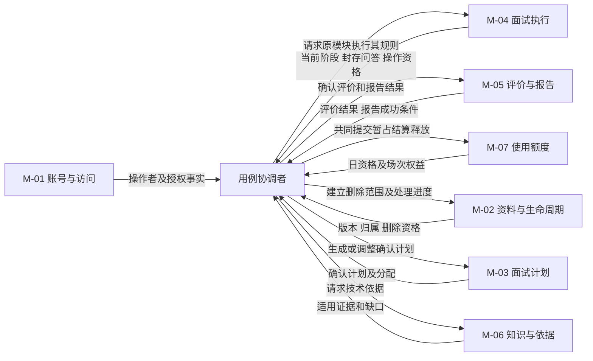

# 轻量领域模型与模块职责

版本：v0.3｜日期：2026-10-28｜状态：已同步已确认CF-04；建模建议，待审阅；未进入编码。

输入已读取：[PRD v0.4](产品需求.docx)、[SCOPE v0.4](交付范围.docx)、[ACCEPTANCE v0.4](验收标准.docx)，以及 [PRODUCT_FLOW v0.4](产品流程与状态设计.md)、[INTERACTION_DESIGN v0.4](页面与交互设计.md)、[DESIGN_TRACEABILITY v0.4](需求与设计追溯.md)。用户提示中的 PRODUCT_FLOW\.md 按实际文件 产品流程与状态设计.md 读取。本次输入文档按CF-04同步知识来源调整，既有CF-03仍按技术决策记录执行。

## 1. 建模结论与适用边界

**已确认事实**：Java 后端岗位的文本面试；邀请账号及数据隔离；简历/JD→单场计划→逐题回答与至多一次追问→反馈→报告；每天 UTC+8 零点重置20次；首题成功展示暂占，报告成功结算；失败/过期/零作答/删除按规则释放；开始后固定资料、计划及模型配置。CF-01 桌面网页为主；CF-02 报告待重试同样适用24小时无有效操作过期。

**建模建议**：七个职责模块、少量业务聚合及统一用例协调。聚合守护自身业务约束；跨模块原子性由短本地事务协调，不要求一个事务只能包含一个聚合。模块划分不等于数据库、微服务或部署单元。正文中的模块名、聚合名、协调者和业务标识均是分析语言，不是代码类、表或接口定义。

**实施待核实**：首题展示确认协议、共享事务与并发保护方案、外部账号/地区/配额/留存政策、真实知识及100例人工评审集、备份恢复清理、容量和预算。既有96条 ACC、20条 DACC、100个 AI 评审样例是三种不同产物；本轮不改其规模，也未执行产品验收。

训练的主要语义边界包括：训练过程、技术依据、使用额度和身份访问。训练过程内部再划分资料、计划、执行、评价报告四类职责；不强行宣布每一模块都是独立限界上下文。今后是否进一步拆分，要有独立业务规则和演进压力作为依据。

## 2. 业务词汇表

业务身份表示“同一业务对象”，不指定数据库主键格式；版本表示已确认内容的一个不可变修订。所有私有对象归属于用户，并沿简历关联范围参与删除。

| 编号/概念 | 含义、身份及版本 | 生命周期与关键状态 | 业务约束、变更权与来源 |
| --- | --- | --- | --- |
| G-01 用户 | 邀请开通的账号主体，账号业务身份区别于显示名 | 开通→可登录；维护者重置凭证，不新增公开注册/账号注销规则 | M-01 唯一拥有身份及授权事实；维护身份不自然获得用户私有内容。PRD-01；ACC-01-01～05 |
| G-02 简历 | 用户的一份逻辑简历，区别于上传的某个文件和某个修订 | 输入/解析→正文确认→产生修订→删除禁访→清理 | M-02 拥有资料及整份简历删除范围；文件PDF/DOCX≤10MB、PDF≤20页、正文100～20000字符。PRD-02/10；ACC-02、ACC-10 |
| G-03 JD | 用户提供的目标岗位要求，不是公共职位目录或技术正确性证据 | 粘贴/校验→确认修订→被计划引用 | M-02 负责50～10000字符、岗位范围及冲突确认；修改后需新计划，不能覆盖历史。PRD-03；ACC-03 |
| G-04 资料版本 | 某份简历或JD的已确认内容版本；内容相同不意味着不同用户共享私有身份 | 编辑草稿→确认版本；确认后不原地改写 | M-02 创建版本，旧版本仍可被原计划/场次引用；草稿不是已保存事实。PRD-02/03/09；ACC-02-05、ACC-03-04 |
| G-05 面试计划 | 一次训练的安排，引用明确简历/JD版本；不是完整题库或多日日历 | 生成中/失败→可调整→确认修订→被场次固定引用 | M-03 唯一修改计划；默认8题，5～15题，主题题数总和一致，默认中等；生成调整不占额。PRD-04；ACC-04 |
| G-06 考察主题 | 计划内的主要考察范围及分配数量、难度；同名主题在不同计划中不共享可变配额 | 随计划编辑→随场次固定→被实际题目覆盖 | M-03 拥有分配；M-04 只记录本场实际消费，不回写计划。追问不消费主问题配额。PRD-04/05；DACC-03-01～03 |
| G-07 面试场次 | 一次开始意图到训练结果的业务身份；恢复/重试不是新场，再练是新场 | 未开始→进行中→结束作答；后续成功结算/最终失败/过期；删除使访问终止 | M-04 唯一变更场次及进度事实；原场不被后来的资料和配置覆盖。PRD-05/09/11/12；ACC-09、DACC-01 |
| G-08 主问题 | 当前场次的一个正式题目位置，具有稳定序号、题面、主要主题、难度和适用条件 | 候选→校验→正式展示→待答/已答/跳过→本单元处理完成 | M-04 接受正式题目；无效候选不占正式序号，题量/主题受计划限制。PRD-05；DACC-03-01～06 |
| G-09 追问 | 某主问题内的一次补充提问，身份依附于该主问题 | 不需要/待生成→待答→已答或未完成 | M-04 管理次数和阶段，每主问题最多一次；无独立主问题配额及评分权重。PRD-05；ACC-05-01/02/05 |
| G-10 回答 | 用户对指定主问题或追问的一次已接受提交；文本草稿不是回答记录 | 草稿→提交待确认→已接受；明确未接受才能重交；已接受不可覆盖 | M-04 唯一接受；最长10000字符，无非空最低字数；重复请求返回同一事实，不新增答案。PRD-05/12；DACC-01-02、DACC-02-01～05 |
| G-11 本题评价 | 某个主问题及其可选追问的综合评价，绑定确定问答版本与依据 | 前置作答未完→待评价/处理中/可重试→有效评价或有原因的不可评；生成最终失败另走场次失败 | M-05 拥有评价与分数，不修改原回答；四维完整才有综合分。PRD-07/12；ACC-07、DACC-04 |
| G-12 引用依据 | 支持某项结论的真实来源、版本/条件及相关片段；检索命中不自动等于已支持结论 | 检索候选→适用性核对→与本次评价绑定→只读留存 | M-06 决定来源政策和适用性事实，M-05 决定评价具体引用绑定；不能伪造。PRD-06；ACC-06-01/03/07 |
| G-13 报告 | 一个场次封存问答及有效评价的在线复盘结果，不是重新生成问答 | 待处理→生成中→可重试失败→已生成，或最终失败/过期/删除；零作答仅摘要 | M-05 拥有报告内容/状态；作答已结束仍可接收合法报告，不增加回答，不覆盖原评价。PRD-08/12、CF-02；ACC-08、ACC-11-06 |
| G-14 日额度 | 某用户、某UTC+8业务日期的20次开始资格，区别于供应商费用 | 每个业务日期独立；通过暂占/结算/释放改变可用量，历史日期仍可接受归属旧日的结算 | M-07 唯一裁决；已用+暂占≤20，不能在跨天时给旧场换日期。PRD-11；ACC-11-01/02/07/08 |
| G-15 暂占 | 某场次保留的一次开始日名额，身份关联场次和固定业务日期 | 未占额→暂占→已结算或已释放 | M-07 只能在首题成功展示事实成立时正式暂占；开始准备许可不冒充暂占。PRD-11；ACC-11-03；CB-START 见一致性文档 |
| G-16 结算 | 有主问题回答且报告业务成功时，将同一暂占转为已用1次；不是支付结算 | 暂占→已结算；重复处理仍已结算 | M-07 拥有用量变更；M-05 提供报告成功条件，用例协调共同提交；删除不退已结算次数。ACC-11-04/06、ACC-10-06 |
| G-17 释放 | 零作答、最终失败、过期或删除使未结算暂占不再占名额 | 暂占→已释放；已释放重复不变；已结算不能转释放 | M-07 执行，不能自行宣布报告失败或删除；原因来自其权威模块。PRD-10/11；ACC-11-05、ACC-10-06 |
| G-18 过期 | 需继续作答或报告待处理时，满24小时无有效用户操作形成的业务结果；不是浏览器关页或模型超时 | 未过期→已过期；不复活，已有成功报告不因闲置过期 | M-04 裁决场次期限，M-05 随之使报告失效，M-07 释放；核实/轮询不延时。CF-02；ACC-11-10、DACC-02-04 |
| G-19 删除请求 | 对整份简历及全部历史版本、关联私有记录的删除意图及执行进度 | 展示范围→用户确认→禁访生效/终止相关处理→在线清理→备份约束核实 | M-02 拥有删除范围和请求状态；各模块只清自己拥有的数据。取消不产生删除事实。PRD-10；ACC-10、DACC-01-05 |
| G-20 历史场次快照 | 场次固定的资料、计划和模型配置及实际问答关联，不是当前资料的动态视图 | 场次开始固定→只读回看→受关联删除清理 | M-04 拥有本场绑定；M-02/M-03 仍拥有原资料/计划；复制件同样归入删除范围。PRD-09/10；ACC-09-02、DACC-03-03 |
| G-21 生成操作及尝试 | 计划、出题、反馈、报告各自一个业务操作及其尝试；重试不是新操作/新场 | 待处理/排队→某次处理中→成功/可重试/耗尽/已失效 | 操作所属模块拥有次数和结果；场次绑定操作须获得M-04当前处理许可；同场最多一个生成。PRD-12；ACC-12-01/02/06/07 |
| G-22 封存问答 | 结束作答时确定的实际题目、已接受回答及未答/跳过状态的稳定版本 | 作答中→一次封存→只读 | M-04 拥有；正常/提前/零作答结束原因不因之后报告失败而伪造改写。PRD-05/08；ACC-05-05、ACC-08-02、DACC-03-06 |
| G-23 模型配置快照 | 本场固定的生成模型及适用配置身份，不是可被用户更改的密钥 | 开始准备时选取候选配置→正式开始固定本场绑定→只读 | M-04 拥有本场绑定；维护配置是支撑能力，新配置不改旧场，不静默换模型。准备到正式开始间的精确取值时点由TD-03核定。ACC-11-09/12、DACC-03-03 |
| G-24 公共知识资料 | 维护者审核的技术资料及不可变版本；未审核内容不能成为运行时依据 | 提供→审核→可检索版本；变更不覆盖历史引用证据 | M-06拥有公共知识生命周期；不开放个人知识库上传或实时搜索，不自动入库。PRD-06；SCP-07；CF-04 |

## 3. 计数与终态的严格区分

| 概念 | 判断条件 | 不等于 | 所有者/来源 |
| --- | --- | --- | --- |
| 已展示主问题数 | 正式题目已呈现，排除生成候选；首题涉及展示证据协议 | 已回答、有效评分或生成成功数 | M-04；FL-04、DACC-03-02 |
| 已回答主问题数 | 主问题回答被接受；每题只增加一次 | 在输入框打字、追问回答、跳题 | M-04；ACC-05-06、DACC-01-02 |
| 已处理主问题数 | 已答单元完成反馈或合法不可评反馈，或明确跳过主问题，已可推进下一位置 | 每题都有评分、每题都回答过 | M-04 记录推进事实；评价结果来自M-05；FL-04 |
| 有效评分题数 | 本题四维全部有效并有综合分，包括真实0.0 | 非零分题数、已回答数、全部四维有部分结果的题数 | M-05；ACC-07-04/05、DACC-04-01～04 |
| 完成率 | 已回答主问题数/计划主问题数 | 已处理数/计划数、追问完成率 | M-04 提供权威计数，M-05 只按这些事实展示；ACC-05-06 |

“结束作答”只关闭接受新回答的资格；“报告已成功”是结果可用事实；“额度已结算”是用量事实。I-02/I-03仍可能对应报告待重试和Q-01，绝不能仅看I编号判报告迟到。模型建议分别保留封存原因、处理结局和访问资格，投影到原I/R/Q页面状态，不另改用户业务状态。

临时失败只终止某次尝试；四次关键生成失败耗尽才可能使已开始场次系统最终失败。知识覆盖不足按FL-07暂停或不可评，不自动导致整场失败；不配置实时搜索。过期与主动结束也不是同一种失败：它们都禁止继续作答，但合法的报告后续处理资格不同。依据 FL-05/06/07、ST-I/ST-R/ST-Q、CF-02。

## 4. 七个模块的责任与变更权

### M-01 账号与访问

- 目的：认定操作者及是否具备用户或维护身份；拥有账号、登录身份、维护授权事实。
- 只允许本模块决定登录身份及维护权限；开通/重置不等于获得用户正文访问权。
- 提供业务事实：当前操作者身份、授权范围；私有对象的归属事实由其所属模块提供并共同校验。
- 依赖：操作对象的用户归属，以及M-02的删除访问资格；不复制拥有这些事实。
- 不承担：生成内容、判断技术答案、修改额度、读取所有用户资料或复杂组织管理。
- 依据：PRD-01，ACC-01-01～05、ACC-09-04。

### M-02 资料与生命周期

- 目的：维护本人简历/JD版本，决定简历关联删除范围与不可访问状态；拥有资料、修订、删除请求。
- 唯一决定资料新版本是否确认、整份简历是否已删除；不能直接改其他模块的题目、报告和额度。
- 提供：确认版本、所有者、删除范围及当前访问/写入资格；删除确认后使所有关联读写、后台任务结果接收失去资格。
- 依赖：M-01操作者；M-03/04/05/07通过协调者提供关联对象和清理/额度处理事实。
- 不承担：替用户补经历、删除公共知识库、删除其他简历独立JD、直接承诺清除外部供应商留存。
- 首期建议每份已确认JD修订明确归属本次简历资料组合，删除范围可追溯到其相关JD正文和副本；不引入跨简历共享同一JD实体的能力。用户另行独立输入的相同文本仍是另一份业务资料，不因文本相同而被本次删除波及。这是资料归属建议，不新增JD共享或独立管理页面。
- 依据：PRD-02/03/10，ACC-02/03/10、DACC-01-05。

### M-03 面试计划

- 目的：把确定资料版本转成一次可调整的考察安排；拥有计划及其确认修订、主题分配。
- 唯一修改计划的主题、题数、难度和时长估计；已被场次引用的确认版本不再被改写，调整产生新的计划修订供后续场次使用。
- 提供：固定资料引用、合法分配、安排依据及计划版本；M-04获取的是确认版本，不能随用户编辑漂移。
- 依赖：M-02有效资料、M-06适用知识/覆盖信息及维护配置支撑；自身计划生成操作拥有自己的重试进度。
- 不承担：正式出题、作答进度、扣次、将生成计划视为已开始。
- 依据：PRD-04，ACC-04-01～07、DACC-03-03。

### M-04 面试执行

- 目的：维护一个场次的有效操作资格、题目、回答、进度、封存原因和处理结局。
- 唯一接受正式题、主/追问回答、跳题、推进、结束、过期或最终失败；拥有本场版本/配置绑定、场次级生成许可和当前操作引用。
- 提供：首题展示确认上下文、接受回答事实、固定计划实际消费、封存问答、结束/过期/失败资格；不直接改报告状态或额度内部记录。
- 依赖：M-01身份、M-02访问资格、M-03固定计划、M-06题目依据、M-05本题评价完成事实、M-07开始资格。
- 不承担：四维评分权重、供应商费用裁决、报告成功与否、单独宣布额度已扣。
- 出题操作的尝试数归M-04；反馈/报告操作的尝试数归M-05。M-04场次许可仅指向正在处理的操作，不另存一份竞争的重试计数。
- 依据：PRD-05/09/11/12，ACC-05/09/12，DACC-01/02/03。

### M-05 评价与报告

- 目的：基于确定问答与实际依据产生本题评价和报告；拥有评价单元、评分结果、报告处理任务及报告内容。
- 唯一决定四维有效性、综合分、有效评分集合、报告内容与R状态；评分计算是本模块确定性规则，不采信模型自行算出的总分为权威结果。
- 提供：单元评价完成/不可评、报告已满足业务成功条件、重试耗尽事实；通过协调者请求M-04/M-07完成各自的状态变更。
- 依赖：M-04封存/当前单元问答和处理许可、M-02访问资格、M-06真实证据；成功发布需M-07结算共同完成。
- 不承担：改写回答、追加主问题、使过期场次复活、直接改每日次数或因无法评分就自动宣告系统失败。
- 依据：PRD-07/08/12，ACC-07/08、CF-02、DACC-04及DACC-03-06。

### M-06 知识与依据

- 目的：管理已审核技术资料及来源适用性，为出题/评价提供证据；拥有公共资料版本和检索证据事实。
- 唯一决定资料审核/可检索资格、适用版本与场景、来源冲突和检索不足；仅已审核知识可作运行时依据，不以模型自身知识代替可核查资料。
- 提供：适用的已审核片段与来源版本、覆盖缺口及冲突说明；资料不足按FL-07处理，无外部搜索调用或搜索专属重试。
- 依赖：M-01维护权限、技术检索需求及向量服务支撑；维护者人工更新并审核知识，用户简历/JD不作为技术事实依据。
- 不承担：用户评分、用户私有知识上传、将网页默认入库、接受正文中的越权指令或获取用户全部私有记录。
- 依据：PRD-06，ACC-06-01～09、DACC-03-05。

### M-07 使用额度

- 目的：守护用户某业务日的20次限制及每场唯一暂占处置；拥有日额度和场次额度权益。
- 只允许本模块改变暂占、已用及释放；不能仅凭用户请求、报告失败文案或后台事件名就自行推导业务成功。
- 提供：业务日剩余资格、某场次权益当前状态、幂等处理结果；接受权威业务条件后原子处置，不将失败供应商费用计为用户面试次数。
- 依赖：M-04正式开始、零作答/失败/过期事实，M-05报告成功条件，M-02删除资格；通过协调者验证且共同提交。
- 不承担：改写场次状态、报告内容、日历月运营预算、支付订阅或供应商账单。
- 依据：PRD-11及PRD-10额度规则，ACC-11-01～08、ACC-10-06、DACC-01-01、DACC-04。

### SP 支撑能力与协调层

维护者模型配置、供应商适配、生成并发/排队、月预算停新及备份执行属于必要支撑，不为它们扩展新的付费/运营领域。配置当前值与本场固定绑定分开；OP-01～03核实实际配置、500元目标/400元停新、生成5/解析2、同场1、队列20秒及留存政策。

用例协调者负责读取权威事实、调用各模块业务能力、组织短事务和外部调用，不自己定义第二套评分、额度或终态。它不是“万能面试聚合”，也不是自主Agent。

## 5. 模块业务协作图

箭头表示业务协作及事实传递，不是网络调用、部署拓扑或代码包依赖。历史页是这些事实的只读组合，不新增一个可写的“历史模块”。删除范围由M-02定义，各模块自行处置其私有数据；公共技术资料不因某用户删简历而删除。

## 6. 必要实体、值对象与候选聚合

### 6.1 候选聚合及约束

| 编号/聚合根建议 | 所属模块及内部对象 | 本聚合必须守护什么 | 边界取舍与外部引用 | 来源 |
| --- | --- | --- | --- | --- |
| AG-01 用户身份 | M-01；账号主体、授权范围 | 凭证与身份匹配；维护权限不越界 | 不容纳简历/场次集合；引用对象归属校验 | ACC-01 |
| AG-02 简历资料 | M-02；逻辑简历、资料版本、有效/删除访问资格 | 已确认版本不覆写，删除资格优先；输入合法 | 文件本体不要求在短事务内处理；关联其他聚合按业务身份可追溯 | PRD-02/10 |
| AG-03 JD资料 | M-02；JD版本及冲突确认 | 版本和确认条件一致，不能静默清除冲突 | 不擅自把独立JD与所有简历合成一个巨型用户资料聚合 | PRD-03、ACC-03 |
| AG-04 面试计划 | M-03；主题条目、题数、难度、确认修订 | 合计5～15、默认8、中等；绑定确定资料；确认修订只读 | 场次引用固定修订，编辑不广播改旧场；不包含具体未来题面 | ACC-04、DACC-03 |
| AG-05 面试场次 | M-04；主问题位置、至多一次追问、已接受回答、进度、封存、当前处理许可 | 同一题不重复接受/推进；最多15道主问题；结束不加回答；配置固定；过期/失效操作不复活 | 最多15个作答单元、30份主/追问回答，适合一起守护顺序；不包含长报告、公共知识库、全部历史或所有日额度 | ACC-05/09/12、DACC-01/02 |
| AG-06 本题评价 | M-05；问答版本引用、四维结果、实际证据绑定 | 评价对象固定；四维有效才有综合分；0.0是有效值；引用可追溯 | 一题一评价业务身份，重试不生成第二个对用户独立生效的评价；不拥有回答文本的写权 | ACC-07、DACC-04 |
| AG-07 报告任务 | M-05；封存输入引用、所用评价集合、尝试、报告内容及R状态 | 不追加未发生问答；只接收有效操作结果；同场报告唯一业务身份；成功不可重复结算 | 报告正文与任务可同根处理；不同尝试不等于多个独立报告；结算需与AG-08/M-04协调 | ACC-08/11-06、CF-02 |
| AG-08 日额度 | M-07；用户+UTC+8业务日，场次权益/暂占结算释放记录 | 已用+暂占≤20，同场只能从暂占到结算或释放一次 | 跨天按原日操作，不把所有用户/所有日期塞一根；最小历史用量标记不带正文 | ACC-11-01～08、ACC-10-06 |
| AG-09 公共技术资料 | M-06；文档身份、审核/适用版本、检索片段 | 仅审核通过且版本适用的片段进入依据集合，历史引用可追溯 | 引用证据可作为值对象/处理结果，不建立临时网页或搜索聚合 | ACC-06；CF-04 |
| AG-10 删除请求 | M-02；简历范围、确认时间、各拥有者清理进度 | 一次删除意图可重复执行但不扩大范围、不恢复资格，24小时/备份约束可验证 | 与AG-02删除屏障共同提交；其他模块对象仍各自拥有；清理进度不保存原正文 | ACC-10、DACC-01-05 |

根的数量是当前建议，不要求十个独立服务。AG-05守护回答和推进；AG-06/07守护长生成结果，两者分开可避免把长模型调用误做成场次内事务。AG-08可以与场次/报告在同一本地事务协作，不因分根就必须异步。

### 6.2 值对象建议

| 值对象 | 业务含义与约束 | 所有者/来源 |
| --- | --- | --- |
| 资料版本引用/本场资料快照 | 逻辑资料身份+确认修订及必要只读内容，归属和删除范围可追溯 | M-02提供，M-04固定本场绑定；ACC-09-02/10-03 |
| 主题分配/难度档位 | 主题、正整数题数、基础/中等/进阶；题数合计按计划校验 | M-03；ACC-04-01～03/07 |
| 评分结果 | 四维各自有效/不可评及原因；整数0～100，综合精确计算、显示一位小数 | M-05；ACC-07、DACC-04 |
| 来源片段及适用条件 | 来源身份、版本、相关片段、已审核/临时类别、支持关系 | M-06提供事实，M-05绑定实际结论；ACC-06-01/03/07 |
| 业务日期 | 由已确认首题展示时刻对应UTC+8日期，原场不换日 | M-07固定权益归属，展示证据见TD-01；ACC-11-07 |
| 重试策略 | 计划60秒/出题30/反馈60/报告90，初始1+自动1+手动2；不是每次重试重新建任务 | 各操作拥有者使用同一策略定义，不复制相互冲突的政策；ACC-12-01/02/07 |
| 场次处理许可 | 当前操作类型、对应业务对象、输入修订及是否仍有效，避免并行/迟到结果冒充当前 | M-04；ACC-12-06/08、DACC-02-05 |
| 封存问答与报告输入引用 | 结束时问答固定；收尾评价完成后固定评价集合，不在重试时读“最新资料” | M-04/M-05分别拥有自身版本；ACC-08-02/03 |
| 模型配置快照 | 适用生成配置身份及维护版本，不把密钥带到普通用户页面 | M-04本场绑定；ACC-11-09 |

暂占、结算、释放是额度权益的状态变化，不需要把每个动作都单独建聚合；过期是业务条件与结果，不需要单独“过期实体”。

## 7. 业务规则归属清单

| 编号 | 规则与唯一权威拥有者 | 协作而非重复拥有 | 来源 |
| --- | --- | --- | --- |
| BR-01 | M-01拥有身份与维护授权；对象模块拥有用户归属 | 访问时同时满足身份、归属及M-02未删除，不靠菜单隐藏 | PRD-01；ACC-01 |
| BR-02 | M-02拥有输入校验、资料版本及冲突确认 | 解析服务仅返回结果，不替用户改经历；精确Unicode/MB口径统一 | PRD-02/03；ACC-02/03 |
| BR-03 | M-03拥有计划题量、主题分配、难度及资料引用 | M-04只消费固定修订，不写回计划 | PRD-04；ACC-04 |
| BR-04 | M-04拥有本场快照、题目接受、追问/回答顺序和进度 | M-05不能修改问答；模型只是候选生成者 | PRD-05/09；DACC-01/02/03 |
| BR-05 | M-04拥有结束封存、有效操作期限、场次处理许可及I状态 | M-05拥有R状态；不能用I-02/I-03一概拒绝报告 | FL-06、ST-I/ST-R、CF-02 |
| BR-06 | M-05拥有四维评分、有效题集合、整场均分与显示档位 | M-04提供回答/完成率事实；模型不得替代确定性计算 | PRD-07；ACC-07、DACC-04 |
| BR-07 | M-06拥有知识来源政策、适用性及检索不足判断 | M-05拥有结论与实际引用绑定；不能只凭命中片段宣称已支持结论 | PRD-06；ACC-06 |
| BR-08 | M-05拥有报告内容、输入集合、操作尝试及报告成功条件 | 协调者把成功发布与M-07结算共同提交；不自行修改额度 | PRD-08/11；ACC-08、ACC-11-04/06 |
| BR-09 | M-07拥有20次、原日暂占/结算/释放和幂等事实 | 开始、失败、删除、报告条件分别来自权威模块；不自行猜测 | PRD-10/11；ACC-10-06、ACC-11 |
| BR-10 | M-02拥有简历删除范围、禁访生效及清理期限 | M-04/05/07在协调中终止/释放；清理执行各自内容 | PRD-10；ACC-10、DACC-01-05 |
| BR-11 | 各生成操作拥有者拥有自己的尝试与成功/失效状态 | 统一策略为值对象，场次级同时只生成一个由M-04许可守护 | PRD-12；ACC-12、DACC-03-04 |
| BR-12 | M-04拥有同场模型绑定，维护支撑拥有新配置 | M-05/06只用适用快照，不在故障时静默切换；换模需固定评审 | PRD-11；ACC-11-09/12 |
| BR-13 | M-02拥有私有数据生命周期约束；各拥有者落实清理与最小传输 | 支撑适配层不记录全文；M-06仅检索已审核资料，模型仅接收必要内容，外部留存单独核实 | PRD-10、PRD第6节；ACC-10-08 |
| BR-14 | 容量/月预算停新由支撑准入能力裁决 | 与M-07用户日额度分开，报告成功不等于供应商账单成功 | PRD第6节；ACC-11-11、ACC-12-10/11 |

## 8. 关键事实、协调与历史读取

业务事实示例：资料版本已确认、计划修订已确认、主回答已接受、作答已封存、本题评价已完成、报告成功已提交、场次已最终失败、场次已过期、简历删除已生效、场次额度已结算/已释放。这些只在相应权威变化提交后成立，不因收到某条异步消息就自动成立。

事实通知不携带完整简历/问答/报告正文；后台处理确需内容时必须重新验证访问资格和输入版本。通知可以重复，接收者依据同一业务身份核实当前事实，不能再次扣次或重开已失效任务。此处不要求引入消息队列或事件平台。

历史列表/详情是只读组合：M-04提供场次、原资料/计划绑定与问答；M-05提供已提交的评价/报告状态；M-07提供必要用量解释；M-02先守护关联资料是否仍可访问。读取组合可刷新，不能用旧缓存授予写权限，也不能经由“历史模块”覆写任何事实。依据 PG-06/07、ACC-09、DACC-01/02。

## 9. 与需求及验收的追溯

| 需求/范围 | 模块及规则落点 | 产品流程 | 验收 |
| --- | --- | --- | --- |
| PRD-01 / SCP-01 | M-01、BR-01 | FL-01/08、IX-01 | ACC-01 |
| PRD-02 / SCP-02 | M-02、G-02/04、BR-02 | FL-02/03 | ACC-02 |
| PRD-03 / SCP-03 | M-02、G-03/04、BR-02 | FL-02/03 | ACC-03 |
| PRD-04 / SCP-04 | M-03、AG-04、BR-03 | FL-03、RK-03 | ACC-04；DACC-03-01～06 |
| PRD-05 / SCP-05/06 | M-04/05、AG-05/06、BR-04/05 | FL-04/05 | ACC-05；DACC-01/02/03 |
| PRD-06 / SCP-07 | M-06/05、BR-07 | FL-07 | ACC-06；DACC-03-05 |
| PRD-07 / SCP-08 | M-05、BR-06 | ST-S、RK-04 | ACC-07；DACC-04-01～04 |
| PRD-08 / SCP-09 | M-05、AG-07、BR-08 | FL-01/06、ST-R | ACC-08；DACC-03-06、DACC-04 |
| PRD-09 / SCP-06/10 | M-02/03/04/05、G-20、BR-04/05 | FL-03/05/08 | ACC-09；DACC-01/02 |
| PRD-10 / SCP-11 | M-02/04/05/07、BR-09/10/13 | FL-08/09 | ACC-10；DACC-01-05、DACC-02-05 |
| PRD-11 / SCP-12/13 | M-07/04/05、BR-08/09/12/14 | FL-09、ST-Q | ACC-11；DACC-01-01、DACC-04 |
| PRD-12 / SCP-13 | 操作所属模块、M-04、BR-11 | FL-06、RK-01/02/03 | ACC-12；DACC-01/02、DACC-03-04 |
| CF-01 | 桌面交互，不决定服务拆分 | PG-01～09 | 既有交互设计审阅 |
| CF-02 | M-04期限、M-05报告失效、M-07释放 | ST-T、ST-R | 追溯文档CF-02补充；一致性文档SC-05 |

## 10. 自检与后续决策

| 检查 | 结论 |
| --- | --- |
| 规则无人负责 | BR-01～14均有权威拥有者；跨模块协作由用例协调，不能让后台任务绕过 |
| 同一事实多处可写 | 进度只M-04、评价报告只M-05、用量只M-07、删除资格只M-02；其他处是引用/只读组合 |
| 聚合过大或过细 | 场次不含全部资料、报告、知识与额度；没有给每个名词建根；检索片段和过期无需独立聚合 |
| 终态错误恢复 | 结束作答不复活回答；已结束的合法收尾报告仍可完成；删除/过期/最终失败及过期尝试不接收新结果 |
| 评分与计次混淆 | 有效0分参与平均；不可评不自动失败；有回答且报告成功仍结算；供应商收费另算 |
| 删除后重新出现 | 所有写入/结果接收重新检查删除资格，历史副本归清理范围；公共知识不误删 |

当前无需新增业务范围确认。TECHNICAL_DESIGN/TECHNICAL_DECISIONS中的技术选择及SD-05首题确认方案已获确认，实施核实与PF/VP仍待执行；不把确认等同严格跨端原子性已证明。候选聚合的详细落地仍在后续详细设计中细化，不把每个名词强行建成实体。确认范围及实施项见 [业务协作与一致性边界.md](业务协作与一致性边界.md) 第9节及技术决策记录。

本文件不定义数据库表、接口、Java框架或部署结构；不引入微服务、消息平台、支付或自主Agent。完成领域建模初稿后停止，等待审阅。

## CF-04 知识来源范围调整记录

2026-10-28用户确认：采用**已审核知识库的RAG检索 + 大模型生成与评价**，不实时搜索、不自动抓取网页、不使用模型内置联网。知识覆盖不足按FL-07及ACC-06处理；模型自身知识不能冒充已核实技术评分依据。维护者人工更新资料、来源链接查看和本人历史列表搜索保留。

本次同步PRD/SCOPE/ACCEPTANCE至v0.4及关联文档；ACC-06-02/04/09沿用编号替换原搜索案例，其余相关案例同步，仍为96条ACC、20条DACC、100个独立AI评审案例；原联网评审案例改为知识库审核/覆盖/引用场景，质量门槛不变。删除搜索并发2、8秒及搜索自动重试1次、搜索费用/账号/留存核实项；生成并发5、解析2、模型重试和额度/预算阈值不变。

此前“不修改原文档”的文字属于早期任务记录，本次已获文档修改授权。CF-01/02及TECHNICAL_DECISIONS中的CF-03继续适用，本次不合并或改变其余开始/额度规则。上述技术选择现已由用户确认；实施核实与PF/VP仍待执行，产品验收未执行。

## 技术选择确认记录

2026-10-28用户明确确认：“技术选择已确认，实施核实与PF/VP仍待执行”。TECHNICAL_DESIGN和TECHNICAL_DECISIONS中选用的技术栈及TD-01～07方案作为后续详细设计与开发基线；备选方案不因此被采用。尚未锁定的精确补丁、实现参数及实际环境/账号/知识/费用/留存/备份能力仍需实施核实。所有PF/VP保持待执行，方案确认不表示实现或产品验收通过，也不自动授权编码、付费调用或部署。
