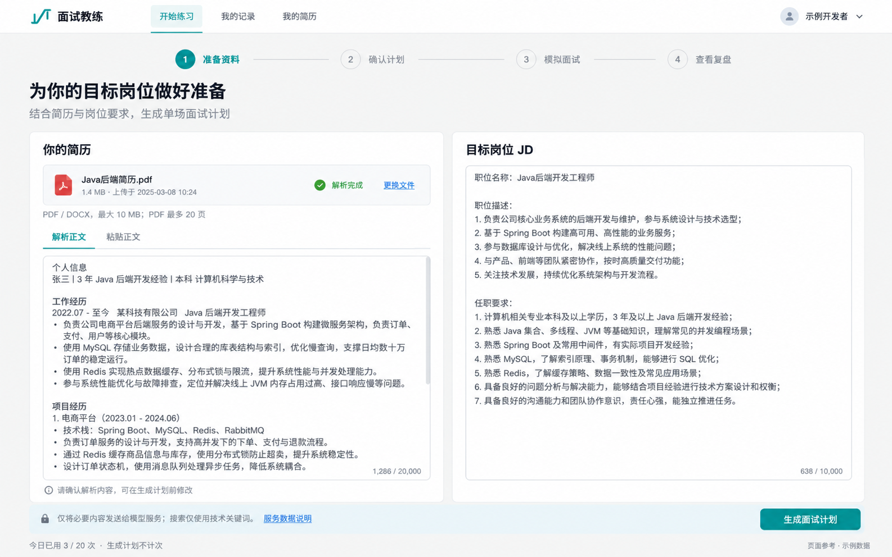
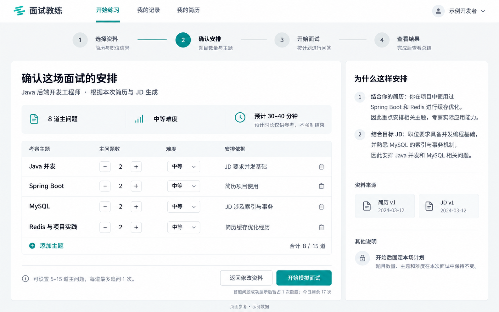
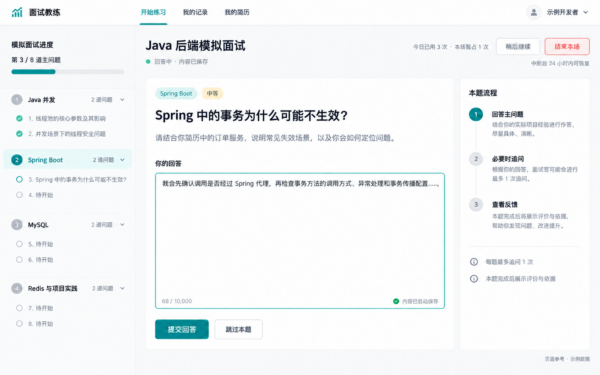
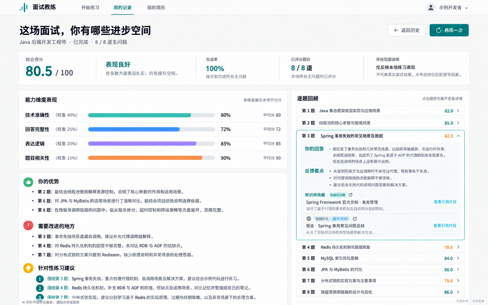
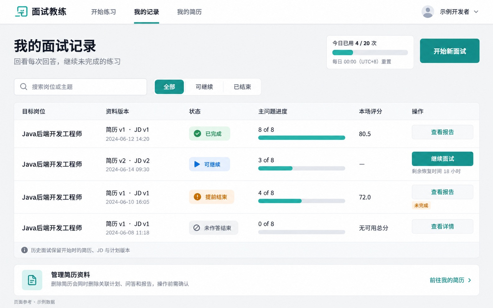

# 页面与交互设计

版本：v0.4｜日期：2026-10-28｜状态：已同步已确认CF-04；低保真设计初稿，已补风险分支与专项验收，待审阅。

依据：[PRD](产品需求.docx)、[SCOPE](交付范围.docx)、[ACCEPTANCE](验收标准.docx)，均为 v0.4；流程与状态见 [产品流程与状态设计.md](产品流程与状态设计.md)。本轮已确认桌面网页为主（CF-01），报告待重试也适用 24 小时过期（CF-02）。本次按CF-04同步需求及设计，不输出业务代码或高保真新稿。

## 1. 页面结构、入口和出口

全局导航建议：开始练习、我的记录、我的简历；账号菜单仅含退出登录和数据处理说明。邀请开通与密码重置由维护者完成，不出现公众注册、用户密钥设置或付费入口。所有私有内容均要求本人身份和有效访问权，隐藏按钮不能代替访问校验。

| 页面 | 目的与主要内容 | 入口、出口及返回行为 | 权限 | 来源 |
| --- | --- | --- | --- | --- |
| PG-01 登录 | 账号、密码、错误提示、邀请与重置说明 | 未登录入口；成功回到仍有权访问的原入口或 PG-06；无记录显示空态 | 未登录可用；不能因此读取资料 | PRD-01；ACC-01-01～05 |
| PG-02 资料准备 | 简历上传/正文确认、JD、校验、版本提示 | 开始练习、PG-08 新资料、PG-03 返回；生成后 PG-03；未提交修改离开先 OV-01 | 本人资料 | PRD-02/03；ACC-02-01～08、ACC-03-01～06 |
| PG-03 单场计划 | 主题、各主题题量、难度、时长、安排依据 | PG-02 生成成功、PG-07 再练；返回 PG-02；成功开始到 PG-04 | 本人计划；只允许开始前调整 | PRD-04/11；ACC-04-01～07、ACC-11-01～03 |
| PG-04 模拟面试 | 当前主问题/追问、输入、提交、逐题反馈、进度 | PG-03 首题成功、PG-06/07 恢复；暂离到 PG-06；结束到 PG-05 | 本人非终态；资料计划固定 | PRD-05/06/07/12；ACC-05-01～08、ACC-06-01～09、ACC-12-01～11 |
| PG-05 结束与报告 | 生成状态、完整/部分报告、零作答摘要 | 结束作答、历史查看报告；返回 PG-06，详情到 PG-07，再练到 PG-03 | 本人可访问记录；不能借此追加回答 | PRD-07/08/11；ACC-07-01～11、ACC-08-01～06、ACC-11-04～06 |
| PG-06 历史记录 | 本人场次、题量、状态、评分、恢复与重试入口 | 登录、全局导航、暂离；详情 PG-07、报告 PG-05、继续 PG-04、新练 PG-02 | 仅本人 | PRD-09/11；ACC-09-01～05、ACC-11-07/08/10 |
| PG-07 场次详情 | 原版本、原计划、实际问答、评价、结束原因 | PG-06、失败/过期结束页；返回保留列表筛选；报告 PG-05、合法恢复 PG-04、再练 PG-03 | 仅本人；历史快照只读 | PRD-05/08/09；ACC-05-04～06、ACC-08-02～05、ACC-09-01～05 |
| PG-08 简历管理 | 本人简历、版本、关联计划与面试数量、删除 | 我的简历；新增/修改到 PG-02；查看关联到 PG-06；删除 OV-06 | 仅本人；维护者不自动有权 | PRD-02/09/10；ACC-02-05、ACC-10-01～08 |
| PG-09 数据处理说明 | 实际外部服务与留存边界、删除说明 | 登录页、PG-02、账号菜单、OV-06 的说明链接；关闭回原页，不丢表单 | 通用说明不含用户正文；私有数据仍隔离 | PRD-06/10；ACC-06-02、ACC-10-08 |

PG-05 统一承载结果的不同状态，不额外创建“失败中心”等平台能力。OV-01～OV-08 是原页面内弹层或状态面板，不是独立业务模块。

## 2. 共用交互规范

### IX-01 导航、读取与访问

顶部保持导航和当前位置；长页面保留明确返回入口。所有私有页初次读取先显示不含旧用户内容的加载态，退出登录后清除当前展示。已删除、无权访问或不存在记录统一显示“不存在或无权访问此记录”，不透露他人记录名称、账号、题目或是否存在。返回本人历史入口保留可用。

直接访问旧场地址先核实状态：可恢复、只读、报告待重试、已过期或已删除分别呈现；不能仅靠地址相同恢复终态。登录失效后引导重新登录，重新校验归属；不向未登录页透出私有内容。

### IX-02 反馈、焦点与可用性

主操作每区最多一个；按钮使用动作结果，如“生成面试计划”“提交回答”“下一题”“重试报告”。校验失败聚焦首个错误并保留输入；错误不只依赖颜色，搭配文字及图标。键盘能到达输入、下拉框、弹层和返回入口，弹层关闭后焦点回触发按钮。长文本可滚动，不让重要操作被侧栏遮挡。

桌面布局建议以 1280px 及以上工作区优先验证，长内容允许换行/滚动；这属于布局建议，不建立新的手机全流程验收承诺。低保真使用等宽文字表达层级，最终尺寸、字体和品牌标志待视觉阶段统一。

### IX-03 保存与草稿

始终区分“编辑中的草稿”“提交中”“提交结果待确认”“已保存回答”。只在确认接受后展示“回答已保存”。不沿用参考图中输入时即出现的云端自动保存承诺。

本轮不新增跨设备草稿同步能力。未提交输入离开时提示“当前输入尚未提交，离开可能丢失”；用户可返回继续或确认离开。断网/提交错误时尽量保留当前页面输入，不能将其计为已回答。刷新或重新登录后，保证恢复的是已确认保存记录；未提交草稿不作持久化保证。

资料在点击生成前仍是编辑态，校验和必要确认通过后保存本次资料版本并用于生成；计划生成失败不清空已确认资料。计划调整用“保存调整”确认，再按已保存版本开始；离开未保存调整时 OV-01 提醒。版本状态可见，不能静默混用资料和计划。

### IX-04 防重复与结果不明

生成/提交发出后锁定同一操作按钮及会冲突的下一步，不锁定只读回看和返回历史。显示当前步骤、排队或处理中、尝试序号。请求结果不明显示“正在核实刚才的提交，请勿重复操作”，先恢复原操作结果；重试不创建第二份回答或新场次。

多窗口不以本地显示作为最终成功依据。剩 1 个名额时竞争失败者回到原计划，提示“剩余名额已被占用，本次未开始”；不得出现两场都成功暂占。已终止/删除后迟到内容不闪现，不重复扣次。

多窗口的其他状态变化及提交核实的分支，按第 15 节 RK-01、RK-02 执行：明确已保存、仍在处理、明确未接受、无法核实与已终止，不能统一提示“请重试”后开放另一份提交。

### IX-05 等待、故障与重试

计划/出题/反馈/报告单次分别 60/30/60/90 秒，排队另计最多 20 秒。文案示例：“正在生成本题反馈｜第 2/4 次尝试（自动重试）｜本次等待上限 60 秒”；到自动重试结束仍失败，显示手动剩余 2 次，之后 1 次、0 次。手动不再追加自动尝试。

排队失败写“当前处理繁忙，请稍后重试”，不伪称已消耗一次模型尝试；开始前不占额，已有暂占按本场状态保留。空结果、生成中断和服务错误均不得显示成功。权限、输入和额度拒绝直接给解决入口，不自动重试。

最终失败：“本场因系统问题未能完成，不计次数。已保存问答可回看，原场不能继续。”展示查看记录和按条件重新练习，不再提供原任务重试。具体模型、密钥、内部错误堆栈不进入用户错误信息。

### IX-06 额度和过期

共用展示：“今日已用 3 次｜暂占 1 次｜可新开 16 次；每日 00:00（UTC+8）重置”。计划生成/调整旁注明不计次；首次出题等待说明“首题成功展示后暂占 1 次”。结算说明“正常结束或至少回答一题后提前结束，报告成功后计 1 次”。

满额或全局停收只阻止新面试，保留已有场次继续和合法报告重试入口。全局停收文案“暂时无法开始新面试，你仍可查看历史并继续已有面试”，不承诺恢复时刻或绝对完成保障。

本场显示开始日和“可恢复/重试至 YYYY-MM-DD HH:mm（UTC+8）”。跨天旧场暂占单独标注原日期，不从今日独立 20 次再减。仅浏览/刷新不延时；显式恢复后更新过期时刻。报告待重试同样适用 CF-02：过期后禁用原报告重试，释放一次暂占，保留只读问答。

## 3. 参考图使用与差异记录

已实际查看五张图片，采用浅色背景、青绿色主操作、简洁导航及相应信息层级；不把其中的资料、日期、题目、分数、用户姓名或来源链接作为真实内容。图片原件作为历史参考保留。CF-04后，REF-01中有关搜索的说明、REF-04中的“联网补充·临时资料”区域均已失效，不得按图实现；仅保留已审核知识库引用。后续再生成图片的提示词已同步，图片本身未重新生成。

| 参考图 | 保留的方向 | 修正/补充 | 性质 |
| --- | --- | --- | --- |
| REF-01 | 简历和 JD 双栏，底部生成入口 | 加入错误/解析中/覆盖不足；隐私说明在调用前可见；不把两种输入方式同时保存为两份事实 | 需求落地 |
| REF-02 | 可编辑主题表、右侧安排依据 | 删除主题图标必须有可访问名称；同步题数合计；限制总数 5–15；步进器统一名称 | 交互建议，数值来自需求 |
| REF-03 | 左进度、中问题与输入、右流程说明 | 取消输入时“内容已保存”承诺；只在接受后展示已保存；未来题只显示待开始；补追问/反馈/恢复状态 | 保存规则和逐题规则落地 |
| REF-04 | 顶部结果摘要、逐题回顾、关联训练建议 | 统一维度名为“内容完整性”“表达与逻辑”；图中的“能力维度表现”改为“本题四维评价”，展示选中题的整数分，避免引入未定义的跨题维度平均指标；补无分、部分和失败状态 | 需求落地；图中统计仅为示例 |
| REF-05 | 状态过滤、记录表、继续与查看入口 | 进度用“3 / 8 题”；区分已用和暂占；提前结束标为“部分完成”避免与可继续混淆；补报告重试和过期状态 | 交互建议及状态澄清 |

五张图标志样式有细微差异，最终视觉阶段统一一个标志，本轮不扩展品牌设计。步骤名称统一为“准备资料 → 确认计划 → 模拟面试 → 查看复盘”。

## 4. PG-01 登录（新增设计建议）

```text
面试教练                                      数据处理说明

                  登录你的练习空间
                  账号 [________________]
                  密码 [________________] [显示]
                  [就近错误提示]
                  [         登录         ]
                  本产品采用邀请试用，不开放注册。
                  未开通或忘记密码？请联系邀请你的维护者。
```

优先级为凭证、登录、错误及帮助。密码默认遮挡，可显式显示；不预设密码长度或登录锁定数值。输入为空就近提示，提交中按钮显示“登录中”，错误凭证统一提示“账号或密码不正确”，不泄露账号是否存在。

等待态不显示旧账号资料；失败保留账号但不宣告登录成功，可重新提交。首次登录进入 PG-06 空态；有历史进入列表或合法原入口。没有“立即注册”和自动找回密码流程，维护者联系方式由实际邀请渠道提供，不虚构邮箱。离开登录页不保存密码草稿。依据 PRD-01、ACC-01-01～05。

## 5. PG-02 简历与 JD 输入



REF-01：采用双栏结构和底部主操作。图片未覆盖解析失败、输入冲突及版本变更，以下线框和状态说明补齐；图片中的“张三”等资料仅示例。

```text
[准备资料] ─ 确认计划 ─ 模拟面试 ─ 查看复盘
为目标岗位准备资料
┌ 简历 ───────────────────┐ ┌ 目标岗位 JD ────────────────┐
│ [上传 PDF / DOCX] [粘贴正文]│ │ [粘贴岗位要求             ]│
│ 文件名 / 解析中或成功       │ │                           │
│ [可编辑简历正文          ]│ │ [就近校验或内容问题       ]│
│ 计数 / 20,000             │ │ 计数 / 10,000              │
│ [格式限制及错误修正入口]   │ │                           │
└─────────────────────────┘ └───────────────────────────┘
必要数据会发往外部模型服务 [查看实际数据处理说明]
修改既有资料将生成新版本；原面试保留原资料。
生成计划不计次                             [生成面试计划]
```

主操作只在简历正文、JD 长度和已知阻塞项均通过时可用；若内容审核在生成前处理，按钮显示“检查资料”，问题解决后才继续生成，不把检查中当作生成成功。计数按统一 Unicode 码点口径；超限仍展示完整待修改文本及超出量，不截断。文件恰好 10,000,000 字节和 PDF 20 页可接受；21 页、超大小拒绝，DOCX 不设等效页数。

上传与粘贴是同一份简历的两种输入方式；更换方式已有内容时先提示替换影响，确认后以当前确认正文为准，不拼接冲突内容。解析成功必须展示可审阅正文。解析中保留 JD，不提前开放使用空正文生成计划。

| 状态/异常 | 呈现与文案 | 可用操作与返回 |
| --- | --- | --- |
| 首次空态 | 提示上传或粘贴；JD 标明仅粘贴文本 | 填写；生成禁用并说明缺项 |
| 格式/大小/页数不支持 | “请上传 PDF/DOCX，最大 10 MB；PDF 最多 20 页” | 换文件或粘贴，不清 JD |
| 解析中 | 文件名、处理状态，单次 30 秒说明 | 留在页等待或离开；不能重复发起同一解析 |
| 损坏/加密/扫描/超时 | 具体可理解原因；“可以粘贴简历正文继续” | 换文件、重试解析或粘贴；不强加四次终态规则 |
| 正文/JD 长度不符 | 显示合法区间、当前计数、定位输入 | 修改；生成不可用 |
| 空白/乱码/纯重复/明显无关 | 指出需要补充可分析资料，不判断技术能力 | 修改，不凭字数达标放行 |
| 非 Java 后端 JD | “首期支持 Java 后端岗位，请更换 JD” | 改 JD；不生成跨岗位计划 |
| JD 明显冲突 | OV-07 列出原文冲突并选择优先条件 | 返回修改或确认条件继续；未选不生成 |
| 低匹配/部分知识覆盖不足 | 说明差距或缺口，“继续将基于可覆盖范围生成计划” | 确认继续或修改；不补造经历 |
| 疑似简历矛盾 | “以下经历信息可能需要核对”及对应文本 | 核对确认或修改；不指控造假 |
| 计划生成中/失败 | IX-05 状态及尝试次数，显示已确认版本 | 自动/手动重试按规则；返回不丢已确认资料 |

生成前由用户确认当前正文与 JD；不增加不必要的独立确认页。资料变化后 PG-03 必须重新生成计划。未提交离开按 IX-03/OV-01 处理；已确认资料可在本人历史与简历管理回看。参考来源 PRD-02/03/06/10/12。

## 6. PG-03 单场计划查看与调整



REF-02：保留主题表和右侧解释；总题数同时展示实际合计与合法区间，不能把“8 / 15”解释为已完成 8 题。补充保存、失效、额度不足及失败状态。

```text
准备资料 ─ [确认计划] ─ 模拟面试 ─ 查看复盘
Java 后端开发工程师              简历 v1 / JD v1
主问题合计 8 道｜默认中等｜预计约 XX 分钟（不强制结束）
┌ 考察主题       主问题数       难度        安排依据 ┐
│ Java 并发      [-] 2 [+]    [中等 v]    JD 要求… │
│ Spring Boot   [-] 2 [+]    [中等 v]    简历项目…│
│ …                                               │
│ [添加主题]      合计 8 道，允许 5–15 道           │
└─────────────────────────────────────────────────┘
[保存调整]   [返回修改资料]           [开始模拟面试]
开始后固定计划与资料；首题成功展示后暂占 1 次。
```

主题可编辑、添加、删除，题数为正整数；零题主题用删除明确移除，不能保留无实际问题的空行。总题数由各主题计数自动合计，避免两个互相矛盾的输入；若未来额外设置独立总数，必须校验总和一致。本轮低保真采用单一合计。4 和 16 均阻止确认，5 和 15 可用；主题不得空白或超出已确认可覆盖范围。

默认 8 题、中等；难度下拉只提供基础/中等/进阶，不按年限锁定，不因选择进阶加分。改动即显示“未保存调整”，保存成功后刷新预计时长；预计时长是估计，更新失败显示暂不可用与重试，不编造新时间或偷偷改题数。开始前确保调整已保存并通过校验。

右侧说明安排与具体简历经历、JD 要求的对应关系，不提前展示具体主问题和参考答案。资料已改动时显示“资料已更新，需要生成新计划”，旧计划只读，“开始”不可使用混合版本。

开始请求中禁用重复开始和编辑；首题成功才进入 PG-04 并暂占。失败保留本计划与调整。满额/全局停收显示 OV-04，仍允许查看和调整计划但不能新开面试；可跳转已有场次。已开始场次查看计划时只读，修改引导创建新计划，不能写回原场。来源 PRD-04/09/11/12。

## 7. PG-04 模拟面试的四个主要视图



REF-03：保留三栏布局及不泄露未来问题的进度。图片中“内容已保存”在输入时出现，本设计改为“尚未提交”；真正接受后才显示已保存。未来题只显示主题/序号/待开始，不预先生成整场题目清单供阅读。

### IX-07 主问题与追问作答

```text
Java 后端模拟面试       本场状态 / 过期时间 [稍后继续] [结束本场]
┌ 进度 ──────────┐ ┌ 当前问题 ─────────────────┐ ┌ 本题流程 ────┐
│ 已回答 2 / 8   │ │ 第 3 道主问题 · Spring Boot│ │ 回答主问题   │
│ 第 3 题进行中  │ │ 问题及必要场景/版本条件   │ │ 必要时追问   │
│ 已完成题目     │ │ [回答输入区             ]│ │ 综合反馈     │
│ 后续题待开始   │ │ 尚未提交 / 字符数        │ │ 最多追问一次 │
│                │ │ [提交回答] [跳过主问题]   │ │ 无答案提示   │
└────────────────┘ └─────────────────────────┘ └──────────────┘
```

“当前第几题”和“已回答几题”分开，不能拿主问题序号冒充完成率。显示主题、难度和必要适用版本；没有强制倒计时。已处理题可只读回看，不开放改答；进度不提供未来问题文字。

空输入只能跳题，非空回答不设最低字数；10000 字符可交，10001 不可交。提交中禁用重复提交与相冲突操作，当前文本保留；确认保存后只读，才更新已回答数与时间。主回答已保存后，显示“正在判断是否需要追问”，不能先展示反馈或引用答案片段。

追问视图保留主问题及已保存回答，另加“追问 1 / 1”与新输入框。操作为“提交追问回答”“跳过追问并查看反馈”；跳过追问不增加/减少主问题已答数，也不因这一动作自动扣分。无第二次追问入口。

### IX-08 本题综合反馈

```text
第 3 题反馈                           [查看本题原问答]
主问题：已作答｜追问：已作答 / 未完成 / 无追问
本题综合分：74.5 / 100（或“暂无本题综合分”及原因）
技术准确性 80 ｜内容完整性 60｜表达与逻辑 70｜题目相关性 90
做得好的地方：对应回答片段…
需要改进：具体遗漏/错误、原因、可执行改进…
依据：[已审核知识库] 来源名 [展开相关片段]
                                      [下一题 / 结束并生成报告]
```

反馈仅在主回答及必要追问完成/明确跳过后出现。四维整数、单题一位小数、权重可展开说明。来源只列实际使用且可核查者，显示名称、版本或适用条件、相关片段和可访问链接；不能捏造引用。点击外部原文新开页面，保留当前练习位置；无法访问时保留实际片段并提示限制，不伪装验证成功。

不可评维度显示“无法评价：原因”，其他维度可显示已确定的评价；综合分显示“暂无本题综合分”，说明“不参与整场平均，未重分配权重”。跳过主问题展示“未作答，不评分”，不显示 0。全部不可评仍保留可用建议，不声称评分客观可靠。

已显示反馈后点下一题推进；下一题出题中不自动重复上一题。末题结束按钮根据是否已回答任何主问题转报告或零作答摘要。对“有回答但未完成追问”的主动结束，在报告注明仅据已有回答评价。

### IX-09 知识库检索、版本冲突及依据不足

| 状态 | 界面和下一步 |
| --- | --- |
| 检索中 | 中性提示“正在检索已审核技术依据”，沿用当前操作等待规则；没有搜索8秒或搜索自动重试状态 |
| 已审核知识依据充分 | 继续本题，展示实际适用知识库来源及片段；不展示临时联网来源 |
| 知识库内部冲突 | 先核对版本和场景并说明采用依据；同条件冲突仍无法消除时标注限制，不强行给分 |
| 条件不清或来源不可核查 | 说明不足，不作确定性评分；本题不可评规则见 IX-08 |
| 已答题缺依据 | 保留回答；显示能判断的反馈和知识覆盖不足原因，不生成完整综合分、不造引用 |
| 下一题缺依据 | 同主题换有依据的问题；仍不可出题显示“当前主题依据不足，练习已暂停”及重试、稍后继续、结束本场 |

暂停不允许自行扩展到计划外主题或静默降难度；也不自动结束计次。内容资料中的越权指令不呈现为可执行按钮，不触发改变权限、额度或访问他人数据。

主题、难度或题量偏离计划不等于单纯检索不足，按第 15 节 RK-03 拦截无效候选，并共用原出题重试上限。已提交后才发现偏离不得静默替换原题和回答。

### IX-10 离开、恢复、结束及故障

稍后继续进入 OV-01；已保存内容可恢复，未提交草稿明确提示丢失风险。恢复 OV-03 展示岗位、已答数、最后有效操作、过期时刻及“继续本场”；点击是显式恢复，回到原主问题/追问/反馈/失败阶段，不新建另一场，不再暂占。

结束 OV-02 先展示实际已答数与未完成追问，确认后不可恢复作答。生成期间离开仅回列表，不能用“离开”伪装取消操作；结束按钮按 IX-04 暂禁并解释原因，超时路径按 IX-05 解锁为相应失败操作。

断网时明确“连接中断，已确认保存的回答仍保留”；本页输入保留但不冒充已提交。未确认结果先核实原请求，再恢复适用操作。过期后进入 PG-07 只读，不能借重连追加回答。模型服务故障与知识覆盖不足分别呈现，后者不自动等于整场失败。来源 PRD-05/06/07/11/12。

## 8. PG-05 复盘、等待和零作答结束



REF-04：保留结果摘要、逐题回顾和建议关联。采用“本题四维评价”替代示例图中跨题维度平均；维度名称、评分覆盖、不可评原因及早停状态按需求统一。

```text
本场复盘｜已完成 / 提前结束（部分完成）   [返回历史] [再练一次]
目标岗位 · 资料版本 · 本场计划
总分 75.0 / 100｜表现良好｜已回答 3 / 8｜完成率 37.5%
有效评分 3 题；其余：未作答或不可评（可查看原因）
┌ 优势 / 薄弱项 / 对应练习建议 ┐ ┌ 逐题回顾 ───────────────┐
│ 每条关联第 N 题及实际回答     │ │ 问题、主回答及追问状态 │
│ 建议说明行动与目标           │ │ 综合分 / 不可评原因    │
│                              │ │ 本题四维整数评价       │
│                              │ │ 实际引用及片段         │
└──────────────────────────────┘ └────────────────────────┘
评分只描述本场练习，AI 评价可能有偏差，请结合依据复核。
```

上例为结构演示，不作为真实训练数据。总分仅对有效单题综合分等权平均；追问不额外计权。档位按最终一位小数显示分判定。所有题的整数维度、单题分、整场分可查看计算说明。若展示本题四维，必须明确当前选中第几题，不能误称整场能力。

| 视图 | 核心呈现 | 主操作/次操作与限制 |
| --- | --- | --- |
| 等待报告 | “作答已结束，正在生成复盘”；展示已保存问答入口、排队/尝试序号及 90 秒本次上限 | 等待、查看记录、返回历史；不能继续答题或重复生成 |
| 可重试失败 | 报告未生成、已保存问答仍在、手动剩余次数、确切过期时间、本场暂占状态 | 重试报告、查看记录、返回历史；不能重新作答 |
| 完整报告 | 岗位、主题、计划/已答/有效评分题数、完成率、问答追问、反馈、分数或原因、建议及来源 | 查看逐题记录、再练一次；无导出按钮 |
| 提前结束报告 | 明确“提前结束，未完成整场”，只分析已发生回答；未答追问单独标记 | 同上，不对未发生问答给优劣结论 |
| 有回答但全部不可评 | “暂无可用总分”；已答数、完成率、有效评分 0、逐题不可评原因 | 看问答与已有反馈、再练；不显示 0.0 或默认档位 |
| 有效评价确为零分 | “0.0 / 100 · 需要重点补强”，关联实际评价依据 | 与无分状态区分，不用缺省值冒充真实零分 |
| 零作答摘要 | “本场已结束，未提交主问题回答，本场不计次”；计划题数、作答 0、完成率 0% | 返回计划、重新开始、查看历史；无数字总分、优劣推断或原场恢复 |
| 最终失败 | 系统最终失败、不计次、已保存内容范围 | 只读问答、按条件再练、返回历史；无原报告重试 |
| 已过期 | “本场已过期，暂占已释放；原场无法继续或重试报告” | 只读记录、再练；CF-02 同样覆盖报告待重试 |
| 删除/无权访问 | OV-08，不显示正文和报告 | 返回本人列表；不能复制原数据再练 |

零作答补充线框（新增设计建议）：

```text
本场已结束
你尚未提交任何主问题回答，本场不计次数。
计划 8 题｜作答 0 题｜完成率 0%
[返回计划] [重新开始] [查看历史]
原场已结束，不能恢复；重新开始将创建新场次。
```

“再练一次”及零作答“重新开始”都先进入 PG-03 确认原计划和当前开始资格，不点击即扣次。不能在报告页用重新生成回答改变原评价对象。来源 PRD-07/08/09/11/12、CF-02。

## 9. PG-06 历史记录



REF-05：采用记录表和状态过滤；补充报告待重试、生成中、最终失败及过期的差异。图片中“未完成”标签改为“部分完成”，避免暗示已提前结束还能继续。

```text
我的面试记录                   今日已用 / 暂占 / 可新开 [开始新面试]
[搜索目标岗位或已保存主题] [全部] [可继续作答] [报告待处理] [已结束]
岗位 | 资料版本 | 状态 | 已回答/计划 | 评分或原因 | 操作
…    | v1/v1    | 进行中 | 3/8      | 待结束    | 继续面试 / 详情
…    | v1/v1    | 报告待重试 | 8/8 | 暂无报告  | 重试报告 / 问答
…    | v2/v2    | 提前结束 | 4/8    | 72.0     | 查看报告
```

默认按场次开始时间从新到旧排序；同时间按稳定顺序展示，不因列表刷新随机跳动。此排序与关键词/状态筛选均属设计建议。列表搜索仅本人岗位及已保存主题，不跨用户或默认检索回答正文。无场次与筛选无结果分开：前者显示开始练习，后者显示清空筛选。

| 场次状态 | 列表操作 | 禁止误导 |
| --- | --- | --- |
| 进行中且未过期 | 继续面试、详情；显示到期时刻 | 不另建场次、不再次占额 |
| 本场正在生成 | 查看处理进度、详情 | 不显示可并行发起第二次生成的按钮 |
| 已结束作答、报告可重试 | 重试报告、查看问答及剩余时间 | 不写“继续面试” |
| 已完成/提前结束且报告成功 | 查看报告、详情 | 不恢复作答；部分完成与已结束同时可见 |
| 零作答/过期/最终失败 | 查看详情、按条件再练 | 不显示原场继续或报告重试 |
| 已删除或他人记录 | 不出现在本人列表；旧地址拒绝 | 不保留敏感摘要或恢复入口 |

返回列表保留本次筛选和阅读位置；切换账号必须重新加载，不沿用旧用户结果。失败显示列表读取失败及重试，不把失败冒充“没有记录”。新面试满额时禁用开始并说明，已有合法恢复/报告重试不跟着禁用。来源 PRD-09/11/12。

## 10. PG-07 场次详情（新增设计建议）

```text
[返回历史]  Java 后端练习｜状态｜开始日期｜过期时间（如适用）
简历 v1 [只读正文]  JD v1 [只读原文]  本场计划 [只读]
已回答 3 / 8；有效评分 N；未答追问及跳题分别标明
实际发生的主问题 → 回答 → 追问 → 回答 → 综合反馈
报告状态：已生成 / 待重试 / 最终失败 / 已过期 / 零作答摘要
[合法的继续面试或重试报告] [查看报告或摘要] [再练一次]
```

优先展示状态、可执行下一步和原资料版本，再展示实际问答。只能读取已发生内容；没有问答的计划也可只读回看，不生成虚构问题。模型配置保持原场关联，不提供用户修改开关或服务密钥。

报告失败不影响已保存问答可读。详情入口本身不延长到期时间；只有点击适用的显式恢复/处理动作才更新有效操作。终态没有改答/继续按钮；旧链接请求追加回答仍拒绝。再练创建新场，采用旧资料计划前先确认，不覆盖当前新资料。删除后所有旧标签页进入禁访态。

空态文案按事实区分“尚无已保存回答”“尚未生成报告”“报告无法生成”，不统一写“数据为空”。读取失败保留非敏感页面结构和重试，不能显示他人内容或上一次缓存内容。来源 PRD-05/08/09/12。

## 11. PG-08 简历管理及 OV-06 删除（新增设计建议）

```text
我的简历                                         [新增简历]
简历名称｜当前版本｜更新日期｜关联计划/面试数｜[查看] [用于新计划] [删除]
说明：修改用于新计划；历史面试保留原版本。
```

查看展开本人正文和版本清单；用“修改并生成新计划”进入 PG-02，不原地修改历史面试快照。空态引导添加资料，列表失败提示重试而非展示空列表。删除按钮作用于整份简历及全部版本，不在单个版本旁放含义不明的垃圾桶。

OV-06 删除确认线框：

```text
删除这份简历及全部关联记录？
影响范围（以当前实际记录为准）：
简历名称及全部历史版本、原文件、正文和快照
关联计划 N 份、面试 M 场、其中进行中 K 场、报告 R 份
确认后立即终止相关面试并禁止访问；在线数据 24 小时内清理。
备份最多保留 30 天，恢复后仍执行删除。外部服务留存另见说明。
已结算次数不退；未结算暂占释放，不重复释放。
[查看数据处理说明]                  [取消] [确认删除全部关联数据]
```

数量加载失败不编造“0 条”，提示无法确认影响范围，允许重试或取消。确认发送中防重复；响应未知不能立即当成取消或删除失败，先核实是否已禁访。成功后列表不再展示正文与训练记录；若仍在清理只显示必要状态“已禁止访问，数据清理中”，不提供恢复按钮。

取消完全不变更资料。账号 B 的独立记录不受 A 删除影响。旧地址、只读快照、后台迟到响应均不可恢复已删除资料。已结算额度不退，最小用量标记不带正文；备份和供应商边界在 PG-09 进一步说明。来源 PRD-10、ACC-10-01～08。

## 12. PG-09 数据处理说明（新增设计建议）

采用可返回原操作的说明页或宽侧栏，入口固定且不丢表单。优先说明发送什么、给谁、为何需要、留存多久、如何删除，使用真实已核实配置，不展示密钥。

```text
数据处理说明                                      [返回]
1 本系统保存：简历、JD、计划、问答与报告，仅本人可访问
2 模型处理：必要内容；发送前去除不必要个人标识
3 技术依据：仅检索维护者已审核知识库，不进行实时搜索、网页抓取或模型内置联网；引用可查看保存片段及来源链接
4 外部服务：供应商 / 服务 / 地区 / 内容 / 留存及例外 /
   训练用途 / 删除能力 / 政策链接 / 核实日期
5 删除：立即禁访，在线 24 小时内清理；备份最多 30 天
6 外部供应商留存单独适用，不能承诺本系统直接清除其全部副本
```

本轮不编写未经核实的供应商法律承诺或固定留存天数。实际说明尚未核实时标为实施待核实，不在真实用户试用前用占位内容替代。运行日志不默认保留全文的要求在 OP-03 核验；普通用户页面不提供运行日志或内部服务调试入口。

## 13. 共用弹层与提示文案

| 编号 | 触发 | 标准内容与动作 |
| --- | --- | --- |
| OV-01 离开 | 未提交输入/未保存计划，或稍后继续 | 分别说明草稿可能丢失、已提交内容已保存和到期时刻；“返回继续”“确认离开”；不是结束作答 |
| OV-02 结束 | 点击结束本场 | 显示已答 X / 计划 Y、追问是否未完成、不可再答；有回答说明报告成功计次，无回答说明不计次；“继续练习”“确认结束” |
| OV-03 恢复 | 合法非终态继续入口 | 岗位、准确阶段、已答数、到期时间；“继续本场”；到期后替换为只读和再练，不保留无效按钮 |
| OV-04 开始受限 | 当日满额/并发竞争失败/全局停收 | 给出对应原因、“查看已有面试”“返回计划”；只有日额度说明 00:00 重置，全局停收不虚构恢复时间 |
| OV-05 故障 | 生成、提交、解析、读取失败 | 区分请求结果不明/可重试/最终失败；显示已保存范围、适用次数及下一步，不泄露凭证 |
| OV-06 删除 | 删除整份简历 | 见第 11 节，具体关联范围、立即禁访与清理、额度影响、取消及明确确认 |
| OV-07 输入差异 | JD 冲突/低匹配/覆盖不足 | 列具体问题；冲突需明确优先条件；差距或缺口可确认继续，不能同一个“知道了”掩盖规则差别 |
| OV-08 无权访问 | 他人地址/未授权维护身份/已删除 | “不存在或无权访问此记录”，不透露对象内容；返回本人列表或登录 |

## 14. 非页面验收的设计承接

| 编号 | 产品层面承接 | 不伪装成普通用户交互 |
| --- | --- | --- |
| OP-01 维护者检查 | 邀请账号开通/重置，公共资料审核，生成与向量模型配置；新配置仅影响新场，旧场固定；生成模型切换前评审、向量切换按知识库升级验证 | 不在用户页出现注册、密钥输入或访问私有资料按钮；不建设完整管理后台，不在此设计配置接口 |
| OP-02 AI 质量评审 | 100 独立案例：评分 60、检索 20、计划 10、安全边界 10；其中 30 个评分案例各 3 次；人工量表、引用支持与重大错误检查 | 页面有引用和解释入口只是可核查条件，不等于已经达到质量门槛 |
| OP-03 容量与数据核验 | 全局生成 5/解析 2，同场生成 1，排队 20 秒；预算目标 500、400 停新；清理及备份恢复核验；供应商实际政策记录 | 用户只看到适用的排队/停收/数据说明；不能用 UI 文案证明并发、预算或后台清理已生效 |

OP-02 门槛：确定性业务全通过；固定样例伪造来源、越权披露或关键错误判对即阻止发布；有效评分与人工参考偏差 ±10 分内至少 90%；引用支持至少 95%；至少 90% 重复案例三次最大分差 ≤10；至少 90% 计划有可说明的简历/JD 关联。尚未准备或执行该评审集，不在界面承诺总体准确率。

## 15. 风险专项交互补充

本节对应 [产品流程与状态设计.md](产品流程与状态设计.md) 第 14 节 RK-01～RK-04，验收见 [需求与设计追溯.md](需求与设计追溯.md) 第 9 节 DACC。RK-05 删除额度误解仍沿用 PG-08、OV-06 和 ACC-10-01/06，无需新增业务能力。

### RK-01 多窗口同步与冲突

触发点：窗口重新获得焦点、恢复连接、显式恢复或提交/跳题/结束/重试等操作前，若当前权限、场次、题目或额度与已展示状态不同，按以下分支反馈。同步方式与频率留给技术设计，不承诺所有离线窗口即时接收通知。

| 最新状态 | 界面反馈 | 下一步与禁用项 | 数据和计次 |
| --- | --- | --- | --- |
| 当前题已在另一窗口提交 | “本题已在其他窗口提交，以下是已保存回答。” | 原输入只读；显示已保存回答及合法的追问/反馈状态；本页未提交草稿可查看但不得覆盖原记录 | 唯一回答；不再加已答数或暂占，不再次追问 |
| 已进入不同题/追问/反馈阶段 | “本场进度已在其他窗口更新，请同步最新进度。” | 提供“同步最新进度”“返回历史”；同步前禁用旧题提交、跳题和结束；草稿不自动填入新题 | 回到同一场准确阶段，不重复生成或重置进度 |
| 已正常或提前结束 | “本场已结束作答，不能继续提交。” | “查看本场记录”“返回历史”；报告可重试时仅显示合法报告入口 | 拒绝旧回答；现有报告和结算规则不变 |
| 已过期或系统最终失败 | “本场已过期/因系统问题结束，无法继续作答。” | 只读记录、按条件再练；无原场继续或报告重试 | 暂占按终态已释放，不重复释放 |
| 简历已删除或无权访问 | “不存在或无权访问此记录。” | 得知状态后清空相关正文和草稿，停止提交；仅返回本人列表，不开放复制或再练被删内容 | 立即拒绝后续访问/写入；已结算不退、未结算只释放一次 |
| 最后一个新面试名额被另一个窗口占用 | “剩余名额已被占用，本次未开始。” | 回计划或查看已有面试；保留本人合法计划 | 失败窗口不创建成功开始的场次、不额外暂占 |

重新核实之前按钮保持待确认状态，不将本地旧数据当作成功。即使核实时可答、执行时已被另一窗口结束或删除，也必须拒绝这次旧提交。删除后的禁访优先于任何迟到成功内容；离线画面不可被承诺即时远程清除，但重连后不能继续读取或写入。

### RK-02 提交后断网或响应丢失

适用于主回答及追问回答。进入此状态保留本页输入，显示“提交结果待确认”，不增加已回答数，不展示猜测的反馈；原提交确认已接受时再恢复真实计数和阶段。

| 原提交核实结果 | 文案 | 可执行下一步 | 明确禁止 |
| --- | --- | --- | --- |
| 已接受，响应丢失 | “回答已保存，已恢复本题进度。” | 展示唯一已保存内容，进入已存在的追问/反馈/等待状态 | 另存第二份答案、重复追问、重复扣次 |
| 确认未接受且没有在途提交，原题仍可答 | “刚才的回答未保存，你可以重新提交本次回答。” | 恢复原输入为可编辑；主操作“重新提交本次回答”，提交前再校验当前阶段 | 把查不到、查超时直接当作未保存；把草稿挪到新题 |
| 原提交仍在处理 | “刚才的提交仍在处理中，请勿重复提交。” | 等待原处理、“重新核实”“返回历史” | 新增另一份作答或并行生成；清空草稿并显示成功 |
| 核实失败/仍断网/结论未知 | “暂时无法确认是否已保存，请恢复连接后重新核实。” | “重新核实”“返回历史”；离开时提示未确认范围 | 开放重新作答、伪称已保存或已失败、把核实次数算成模型生成次数 |
| 场次已结束/过期/最终失败 | 说明对应状态及不可再答 | 只读查看已保存记录；合法报告入口独立判断 | 为了补交旧答案恢复终态 |
| 已删除/无权访问 | 统一禁访提示 | 清除相关展示，返回本人列表 | 复制/提交或恢复已删资料 |

“核实状态”不延长有效用户操作时刻，不重新占用额度；恢复的是原操作。确认未保存后再提交属于本次题目的一次有效提交，成功时只增加一次已回答数。若核实期间状态又变化，按 RK-01 最新状态处理。

页面始终有重查或返回出口，不用永久遮罩困住用户。保留输入只保证当前仍打开页面的草稿；刷新后不宣称未提交内容一定存在。原模型生成的单次上限、四次尝试与场次 24 小时过期仍按既有规则，状态核实不新增一个未经确认的秒数承诺。

低保真补充：

```text
第 N 题｜提交结果待确认
你的本页输入仍保留，尚未确认是否保存。
正在核实刚才的提交，请勿重复操作。
[重新核实] [返回历史]        [提交回答：禁用]
核实为已保存 → 读取原回答和真实阶段
核实为明确未接受且本题可答 → [重新提交本次回答]
```

### RK-03 题目与固定计划不一致

触发：候选题面/主要考察主题/难度/正式题数分配与本场已确认计划不符。校验不能只看模型自行写的标签；题面实际考察和版本条件也要可核查。正常题按 PRD 难度锚点与已标注样例评审，自动校验不能被描述为语义绝对正确保证。

| 检测阶段与结果 | 界面反馈 | 下一步与限制 | 进度、数据和额度 |
| --- | --- | --- | --- |
| 正式展示前发现主题或难度不符 | “本次题目未符合已确认计划，正在重新准备。”；无效题面不显示 | 初始/自动/手动共用原出题最多四次；仍有手动机会时“重试出题”“稍后继续”“结束本场” | 不增加正式题数、已答数，不记录用户跳题，不修改计划或扣分 |
| 主题配额已满或总题量将超限 | “正在按本场计划核对下一题。” | 不开放多余题，重试仅请求原计划仍需的题；计划全部处理完转既有结束流程 | 不出现第 9 / 8 题；追问不占主问题数 |
| 重试得到合规题 | 显示原序号、确认主题和难度 | 正常作答；不提前显示候选题或答案 | 首题成功才暂占，已开始场次不新增暂占 |
| 同一步四次均为无效生成结果 | 首题前：“未能生成符合计划的首题，本次未开始”；进行中：“本场因出题失败结束，不计次数” | 首题前回计划；已开始场次只读回看或按条件再练 | 前者无暂占；后者最终失败并释放，已有回答保留 |
| 本质为缺少适用依据 | “当前主题依据不足，练习已暂停。” | FL-07 同主题、同确认难度内寻找有依据题；不能擅自换主题/降难度；仍无依据可重试/暂离/结束 | 不把知识覆盖不足自动判整场失败，不另开无限候选重试额度 |
| 已接受回答后才发现偏离 | “本题与本场计划存在偏差，已保存的问答保持原样。”并展示计划主题/难度及已发生偏差 | 可查看原记录、继续原计划剩余位置、稍后继续或结束；不提供替换已答题、自动补题和重算按钮 | 不抹除已有回答或评分，不改固定计划，不加总题数；报告如实展示偏差，不能宣称全部主题分配已满足 |

正式结束时的实际覆盖与计划并排说明；提前结束只报告已发生覆盖，不标成全部完成。已答后发现偏差是实际质量缺陷，不作为计划遵从验收通过，不能用改题目标签或覆盖旧记录消除缺陷证据。此处不新增用户纠错平台、人工客服流程或新的评分权重。

### RK-04 真实 0.0 分与无分对照

触发：有效维度分确为零、某维不可评、全部不可评或零作答。界面采用以下互斥表达：

| 数据条件 | 本题/整场呈现 | 下一步 | 专项验收 |
| --- | --- | --- | --- |
| 四维均有效且均为整数 0 | 本题 0.0，参与平均；若唯一有效题则整场 0.0，档位需要重点补强；显示实际依据 | 查看四维/依据、再练；不显示无分占位 | DACC-04-01 |
| 有效零分与其他有效题混合 | 真实零分仍计入有效评分题数与平均，不被误当空值过滤 | 查看有效题明细和计算说明 | DACC-04-02 |
| 已回答但全部不可评 | 暂无可用总分、有效评分 0、具体不可评原因；无数字零分和默认档位 | 查看问答/原因、再练 | DACC-04-03 |
| 没有主问题回答 | 零作答结束摘要、作答 0、完成率 0%、不计次；无分数和优劣推断 | 返回计划、重新开始、历史 | DACC-04-04 |

RK-04 不新增 AI 打分规则：专项计算案例使用明确标为有效的固定四维数据验证展示和运算；由模型产生的分数是否合理，仍需 OP-02 的人工样例评审，不能因 UI 能展示 0.0 就认为模型评价正确。

## 16. 审阅结论与下一步边界

当前无业务阻塞问题。需要审阅的是本轮交互建议：导航和页面归并、主问题反馈后的手动下一题、历史排序与过滤、未提交草稿提示、报告选中题四维展示、维护能力不建设完整后台。

v0.2 已补 RK-01～RK-04 的明确分支和对应 DACC；RK-05 沿用删除确认及额度验收。专项验收尚未执行，不以设计完成代替实现验证。

手机完整使用、高保真视觉、点击原型、领域建模和开发均未交付。供应商事实、真实评审集及清理演练属于实施核实项，不要求用户重新选择已确认业务规则。需求到设计和验收的逐条对应见 [需求与设计追溯.md](需求与设计追溯.md)。

## CF-04 知识来源范围调整记录

2026-10-28用户确认：采用**已审核知识库的RAG检索 + 大模型生成与评价**，不实时搜索、不自动抓取网页、不使用模型内置联网。知识覆盖不足按FL-07及ACC-06处理；模型自身知识不能冒充已核实技术评分依据。维护者人工更新资料、来源链接查看和本人历史列表搜索保留。

本次同步PRD/SCOPE/ACCEPTANCE至v0.4及关联文档；ACC-06-02/04/09沿用编号替换原搜索案例，其余相关案例同步，仍为96条ACC、20条DACC、100个独立AI评审案例；原联网评审案例改为知识库审核/覆盖/引用场景，质量门槛不变。删除搜索并发2、8秒及搜索自动重试1次、搜索费用/账号/留存核实项；生成并发5、解析2、模型重试和额度/预算阈值不变。

此前“不修改原文档”的文字属于早期任务记录，本次已获文档修改授权。CF-01/02及TECHNICAL_DECISIONS中的CF-03继续适用，本次不合并或改变其余开始/额度规则。上述技术选择现已由用户确认；实施核实与PF/VP仍待执行，产品验收未执行。

## 技术选择确认记录

2026-10-28用户明确确认：“技术选择已确认，实施核实与PF/VP仍待执行”。TECHNICAL_DESIGN和TECHNICAL_DECISIONS中选用的技术栈及TD-01～07方案作为后续详细设计与开发基线；备选方案不因此被采用。尚未锁定的精确补丁、实现参数及实际环境/账号/知识/费用/留存/备份能力仍需实施核实。所有PF/VP保持待执行，方案确认不表示实现或产品验收通过，也不自动授权编码、付费调用或部署。
