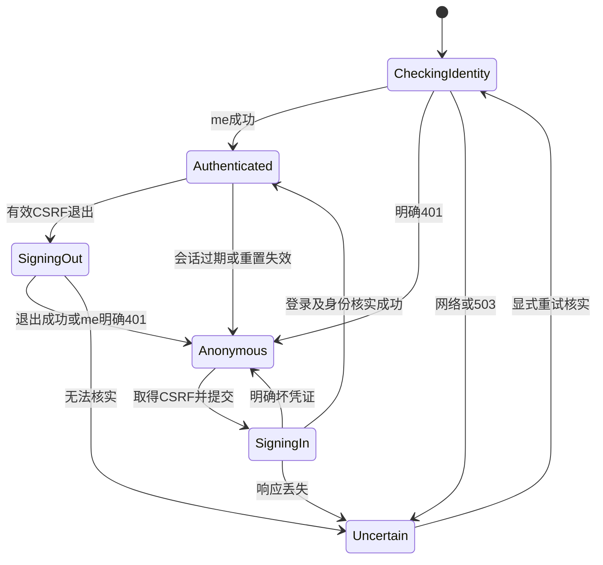

# 首个业务切片详细设计：账号与会话

版本：v1.3｜日期：2026-10-28｜状态：FS-C01/02、DT-02输入与凭证规则已确认；DT-01持久化和DT-02受控开通已实施，后者两项审核修复待独立复审；登录及产品业务验收未执行。

依据：[PRD](产品需求.docx) PRD-01、第3节，[SCOPE](交付范围.docx) SCP-01，[原验收](验收标准.docx) ACC-01-01～05；[交互设计](页面与交互设计.md) PG-01、IX-01；[领域模型](轻量领域模型与模块职责.md) M-01/AG-01/BR-01；[一致性边界](业务协作与一致性边界.md)、[技术决策](技术决策记录.md) TD-02及 [证明计划](实现证明计划.md) PF-01。当前环境见 [ENVIRONMENT_VERIFICATION](开发环境调整与基础验证.md)。

## 1. 事实、补充确认与范围

| 分类/编号 | 内容 |
| --- | --- |
| 已确认基线 | 邀请试用、账号密码登录；维护者开通和重置；不公开注册、不提供自动找回密码；只能访问本人私有对象；公共知识维护权限不授予查看用户资料的权限 |
| FS-C01，本轮用户明确接受 | 连续30分钟无请求后登录失效，不提供“记住我”；面试24小时期限独立计算 |
| FS-C02，本轮用户明确接受 | 维护者重置密码，撤销该账号全部已有会话，要求重新登录 |
| 技术选择已确认 | Spring Security、服务端 Session、Spring Session JDBC；同PG、MVC/JDBC、Vue/Pinia；本轮环境调整为现有 Oracle JDK21、PG16 |
| DT-01本轮明确采用并实施 | Flyway、独立app schema、本文账号/权限及官方Session结构；迁移/仓储基础结果见[DT01_VERIFICATION](<DT-01 版本化持久化基础：实现与验证记录.md>)，不代表账号业务已完成 |
| DT-02本轮确认并实施 | 登录名按原样区分大小写精确匹配，仅3～64位ASCII字母、数字、`.`、`_`、`-`；系统生成随机初始密码并经受控线下渠道交付。密码编码采用带版本标识的PBKDF2-SHA256；证据见[DT-02记录](<DT-02 账号与受控开通：实现与验证记录.md>) |
| DT-02审核修复待复审 | 本机开通要求项目所有者及私有 Windows ACL，预检在 Spring 数据库初始化和 Flyway 前执行；仅为当前 Windows 本地维护入口，生产授权另行设计。拒绝及隔离库证据见[DT-02记录](<DT-02 账号与受控开通：实现与验证记录.md>) |
| 其他技术推荐待审阅 | 登录接口、撤销协议、Cookie及前端实现；DT-02不代表这些方案已落地 |

FS-C01 的“无请求”对应服务端会话的最后访问；该浏览器会话的有效访问可刷新登录空闲时间，包括已认证轮询，**不等于**面试有效操作，不延长场次24小时。无其他请求且已满1800秒时失效；清理行的定时任务迟执行不延长登录有效性。前端不为维持登录主动发心跳。有效期依据服务端，不信任客户端倒计时。Cookie 不设置持久 Max-Age；浏览器会话恢复可能保留会话 Cookie，因此不承诺关闭窗口即可立即注销；显式退出才撤销对应会话。

本切片闭环为已有试用账号登录→查询当前身份→进入受保护前端入口→退出。受保护服务端入口直接复用身份查询，不新增假资源或测试API。登录后暂用受保护的工程工作区占位，明确其他业务未开发；后续 PG-06 历史真实完成后再接产品既定落点，不展示虚构历史。

包含必要的受控开通/重置运维方式设计，以满足 ACC-01-05；不建设运营后台、公开账号操作API、OAuth、JWT、注册、找回密码或账号注销。资料/计划/问答/报告的对象隔离只能在相应模块存在后验收，不能本片完成即关闭 ACC-01 全组或 PF-01。

## 2. 规则与模块所有权

| 事实或操作 | 唯一所有者/边界 |
| --- | --- |
| 账号业务ID、登录凭证、凭证代次、授权事实 | M-01；业务ID是稳定UUID，登录名不是外部模块关联主键 |
| 认证/当前操作者 | M-01 提供不可变 `Actor`（accountId、当前权限、凭证代次）；不把 HttpSession 暴露给领域模块 |
| 会话创建/固定攻击防护/过期/单会话退出 | M-01协调 Spring Security/Session 基础设施；会话ID是秘密，不是用户ID、场次ID或幂等键 |
| 私有资源归属及删除屏障 | 归属由对象模块提供，M-02守护资料删除；不能在 M-01 再建一套资源拥有权/删除表 |
| 开通/重置 | 受控维护入口调用 M-01用例；操作授权独立于知识维护授权，不能因为能审核知识就能读取或重置他人账号 |

对外能力建议：认证凭证、核实会话身份/凭证代次、得到当前权限、受控开通/重置。仓储只由 M-01 写；后续协调者先获得 Actor，执行写入时在 TD-02 用户锁内重查身份代次与对象归属/屏障，不用 Controller 早先的检查作永久许可。

业务账号与会话状态区分：账号已开通表示存在可认证主体；错误密码不把账号变成终态，也不影响面试。会话可为匿名CSRF上下文、已认证、空闲过期、已退出或因重置失效。本片不新增冻结/锁定账号状态及阈值；账号停用若有需求另定义，不能偷偷通过一个状态字段扩展运营能力。

## 3. 必要持久化设计（DT-01已采用并迁移）

### 3.1 M-01账号结构

| 表/字段 | 类型、约束与用途 |
| --- | --- |
| `identity_account.id` | UUID，主键；应用生成，稳定业务身份，不循环利用 |
| `login_name` | TEXT，NOT NULL、UNIQUE、非空白；本片无公开修改登录名功能 |
| `password_hash` | TEXT，NOT NULL、非空；仅编码结果及算法标识，不保存明文、可逆密文或密码提示 |
| `credential_version` | BIGINT，NOT NULL、初始1、CHECK >0；重置时在同一事务递增，是所有旧会话逻辑撤销屏障 |
| `created_at`、`updated_at` | TIMESTAMPTZ，NOT NULL；服务端记录，创建后不改创建时间 |
| `identity_account_authority.account_id` | UUID，NOT NULL，FK→account.id；与authority组成主键 |
| `authority` | TEXT，NOT NULL，非空；首片只用 `TRIAL_USER` 与 `KNOWLEDGE_MAINTAINER` 表达现有试用/公共知识身份；不实现角色管理界面或通用权限平台 |

登录名唯一索引支持查凭证；权限联合主键支持按账号加载。无列表需求不增加时间索引。知识维护身份不自动包含 TRIAL_USER，更不能拥有他人数据；兼有试用身份仍只可访问本人的私有资料。开通/重置由实际维护操作授权，不从 `KNOWLEDGE_MAINTAINER` 推定。

**账号匹配已确认**：按开通值区分大小写精确匹配，不折叠大小写、Unicode归一或截断；登录名仅允许3～64位ASCII字母、数字、`.`、`_`、`-`，服务端开通入口拒绝其他值。初始密码由系统随机生成并经受控线下渠道交付。后续登录时密码按原样校验，不 trim；HTTP请求体资源限制仍须在DT-03核实。TEXT 是物理设计，不表示允许无限HTTP报文。

### 3.2 Spring Session JDBC官方结构

设计阶段读取Boot4.1.2管理的 `spring-session-jdbc:4.1.1` JAR中的 `org/springframework/session/jdbc/schema-postgresql.sql`。DT-01已将其作为V2执行，并以忽略空白的内容比对验证与上游一致；以下字段语义不变，原设计阶段“未执行”状态由本轮证据覆盖。

| 表/字段 | 类型、约束与含义 |
| --- | --- |
| `spring_session.primary_id` | CHAR(36) PK，仓储行身份；不同于浏览器Cookie里的 session_id |
| `session_id` | CHAR(36)，NOT NULL、独立唯一索引；轮换会话标识时保持官方仓储语义 |
| `creation_time`、`last_access_time`、`expiry_time` | BIGINT，NOT NULL，epoch毫秒；expiry_time有索引供过期清理 |
| `max_inactive_interval` | INT，NOT NULL，秒；本片1800 |
| `principal_name` | VARCHAR(100)，可空、有索引；匿名CSRF会话为空，认证后采用稳定 account UUID 的字符串 |
| `spring_session_attributes.session_primary_id` | CHAR(36)，NOT NULL，FK→primary_id、ON DELETE CASCADE |
| `attribute_name` | VARCHAR(200)，NOT NULL；与session_primary_id组成PK |
| `attribute_bytes` | BYTEA，NOT NULL；框架会话属性序列化内容，不是用户正文存储 |

PostgreSQL未加引号的官方大写标识最终为小写名称，不创建一套大小写不同的重复表。不要给可空 principal_name 添加强制账号FK，否则破坏匿名CSRF会话及框架清理生命周期；它与账号的关联由 M-01稳定 principal 约定和认证验证保证。

会话 principal 只保存 accountId、认证时credentialVersion及框架所需最小信息；不保存密码/密码散列、资料、答案、报告或模型密钥。Spring Security身份名称及Session索引解析须固定为UUID，不能误用可变登录名。实现时核对实际 `Authentication#getName`/索引解析器、凭证擦除、序列化版本兼容；本轮未伪称已经实现。

## 4. 已采用的迁移方案与责任

**DT-01用户明确采用Flyway**：本片主要为PostgreSQL SQL、明确主外键和官方Session脚本，版本化SQL足够，不同时引入Liquibase。实际接入Boot4.1.2的 `spring-boot-starter-flyway` + `org.flywaydb:flyway-database-postgresql`，Boot BOM管理Flyway12.4.0及JDBC42.7.14，不拼装更新大版本。

2026-10-28原设计阶段只核实公开资料及元数据；后续DT-01已增加依赖、构建并在真实PG16执行首次/重复迁移、失败回滚与恢复，范围见DT01_VERIFICATION。不能将此局部基础结果外推为认证、撤销或其他业务已验证。

建议后续迁移顺序：V1创建账号及权限结构；V2原样纳入所用Session版本的PostgreSQL结构；后续增量只追加新迁移。迁移历史表由Flyway管理。本轮的向量扩展只用于开发基础环境，未来知识切片再用版本迁移核实/创建扩展并记录最低版本；不把开发初始化脚本视为正式升级机制。

当前实际配置：`spring.sql.init.mode=never`、`spring.session.jdbc.initialize-schema=never`；Flyway单独管理结构，Session/Compose不重复建表；bootstrap不连接数据库且禁用Flyway。Boot的Session数据库初始化依赖检测器保证仓储依赖flywayInitializer，本轮真实上下文已验证该依赖。

首次迁移已核实目标库/所有者及public的vector，创建独立app schema，Flyway default-schema/schemas=app，账号与Session使用同一DataSource。实际通过Hikari schema=app设置连接schema，而不是改写用户DB_URL的currentSchema；这是等效接入选择，已有.env保持不变。vector留在public，应用显式限定类型及运算符；本轮已实际验证。

已有未知业务结构不能开 `baseline-on-migrate` 静默接管；先盘点与校验再给出显式baseline步骤。迁移失败停止业务启动，检查事务及版本历史；不手改已应用文件校验和，不自动 `clean`/`repair`，不执行降级删库。迁移权限与后续运行权限可分开配置，具体权限授予属于详细实施，不把当前开发容器超级用户当生产授权方案。

## 5. 认证、会话与重置撤销协议

### 5.1 登录与身份

推荐复用 Spring Security 表单认证过滤链，在API路径接收 form-urlencoded，成功/失败处理器返回JSON，避免自行在Controller里写 Session。用户仍通过 Vue 页面登录，不生成框架默认登录页或使用HTTP Basic。

DT-02已采用 Spring `Pbkdf2PasswordEncoder` 的版本化SHA-256配置，配合 `DelegatingPasswordEncoder` 标识 `{pbkdf2-sha256-v1}`；16字节随机盐、310000次迭代、256位输出，不使用自制散列。实际机器上的编码、匹配与随机盐测试已通过，见DT-02记录；未对试用负载作性能承诺，也不把框架参数当业务密码长度政策。

登录名不存在与密码错误统一401及文案。不存在账号也执行匹配的哑散列校验路径，减少明显的处理分支时间差；不承诺消除所有时序差异。未知故障与坏凭证分开，不吞数据库异常返回“密码错误”。不设置未经确认的失败N次锁定或验证码功能。

登录过程：读取账号及代次→锁外验证昂贵密码散列→同用户事务锁下重读凭证代次及授权、确认未被并发重置→认证成功策略轮换sessionId并保存SecurityContext。认证principal不带password_hash。重置在最终核实后发生时，此次认证也会成为已被撤销的旧代次，后续身份查询应能识别，不能因登录响应晚到而复活旧身份。

### 5.2 FS-C02的立即逻辑撤销

**重要：Spring Session JDBC默认使用REQUIRES_NEW。** 不能调用其普通 `deleteById` 后就声称账号修改、所有会话删除同一本地事务；也不能把该默认行为扩展到报告/额度等必须共同提交的业务边界。

推荐用账号credential_version作为撤销权威：

1. 受控重置先在事务外编码新密码，避免持有用户锁执行慢计算。
2. M-01在TD-02相同用户锁下，**共同提交**新password_hash、credential_version+1、updated_at。事务失败两者都不生效。
3. 所有已认证请求重新读取当前账号代次，不能只信任会话中旧的SecurityContext和权限。版本不等即清身份、失效该会话、返回401；DB不能核实时返回503并禁止私有访问，不能按缓存放行。
4. 后续业务写入在自身用户锁保护范围再次核实代次；重置先提交则旧会话的写入不允许提交。私有读取也在实际受理时核身份/归属，不因页面此前已通过检查放行。
5. 依据稳定UUID索引尽力清理旧代次Session；并发新登录可能已有新代次，**不能盲删该账号所有当前Session**。即使清理失败、旧请求在REQUIRES_NEW中再次保存旧属性，版本仍旧，不能重新获权。过期清理和下一次旧会话访问负责收敛残留行。

“立即撤销”指重置共同提交后，旧代次不再获得新请求/受保护业务提交资格，不保证撤回已经发出的网络内容或离线屏幕。已受理请求和重置的先后依锁/受理点裁决。会话记录的物理清理可以晚于逻辑撤销，但不能将权限失效推迟到清理时或30分钟后。

单会话退出使用框架POST logout、失效对应Session/清SecurityContext/清Cookie，不递增账号credential_version，不把一次退出偷换成所有设备退出。必须验证与在途Session保存竞争时旧会话不会复活；如果实际框架组合无法保证，先补具体协议并验证，不以“注销接口已返回”代替证明。

### 5.3 Cookie、CSRF与请求边界

推荐会话Cookie `SESSION`、HttpOnly、Path=/、SameSite=Lax、无Domain、无持久Max-Age；本机HTTP开发 Secure=false，未来HTTPS Secure=true。浏览器和代理统一使用127.0.0.1，避免与localhost混用造成Cookie差异。无remember-me，不把SessionID或CSRF token存localStorage。

采用HttpSessionCsrfTokenRepository及专用GET token接口；前端保存返回的当前token到内存，以返回的headerName发送写请求。沿用框架XOR令牌语义，前端把接口返回的token原样发送，不自行实现混淆或凭Cookie猜token。登录与退出都受CSRF保护；认证成功/退出会清旧token，下一次写请求前显式重新获取。不能复制cookie-CSRF教程后同时保留另一套不匹配的token解释器。

默认同源访问，开发仅通过Vite代理，不增加宽泛CORS规则。后续实现时将 `/api` 代理到与 `/actuator` 相同后端；本轮未增加尚无服务端实现的业务路由。API返回JSON状态码，不302跳转到后端登录页；敏感响应 `Cache-Control: no-store`，不记录凭证、token、Cookie或完整请求体。

## 6. 最小接口建议（尚未实现）

统一错误体建议为 `{"code":"...","message":"..."}`；必要诊断关联ID可通过响应头提供，但不带私有正文或内部堆栈。请求体类型与错误语义在此切片统一，不顺带建立覆盖全产品的契约平台。

| 接口 | 输入/权限 | 成功 | 主要失败与行为 |
| --- | --- | --- | --- |
| GET `/api/auth/csrf` | 同源，允许匿名；不接收用户ID | 200 JSON：`token`、`headerName`；按需建立匿名CSRF会话，no-store | 503 `SERVICE_UNAVAILABLE`，不返回假token |
| POST `/api/auth/login` | form-urlencoded：`username`、`password`；携带有效CSRF；原样密码 | 200 当前身份最小JSON，轮换SessionID；前端随后重新GET csrf和me | 400 `INVALID_INPUT`（空字段/畸形）；401 `INVALID_CREDENTIALS`；403 `CSRF_INVALID`；415格式不支持；503服务失败；不返回账号是否存在 |
| GET `/api/auth/me` | 已认证且代次匹配，是本片的真实受保护入口 | 200：`accountId`、`loginName`、`authorities`；不暴露代次、密码散列和SessionID | 401 `AUTHENTICATION_REQUIRED`，含过期/退出/重置失效；503无法核实当前身份；不伪装成匿名成功 |
| POST `/api/auth/logout` | 有效CSRF；登录时注销本会话；匿名但token有效时也可幂等返回 | 204，无正文；Cookie失效，原会话不可再访问 | 403旧/缺token；503未能核实注销结果；不通过GET退出、不影响其他独立会话 |

登录校验顺序：报文/方法边界→CSRF→凭证校验，因此未携带token的空密码请求可以先403；前端先取token后才能进入业务字段校验路径。普通受保护GET缺登录401；具有有效身份但无某维护功能权限时403 `ACCESS_DENIED`。未来私有对象缺失、被删或不属于本人统一404/“不存在或无权访问此记录”，不泄露记录存在性；这不是把所有401/403都改成404。

账号切换建议先显式退出再登录；已登录页面不自动发起另一账号的登录，防止旧响应混入新身份。不同标签共享同一Cookie，不承诺同一浏览器内两个标签保持不同账号。其他浏览器/设备的独立会话允许并存，不新增单设备登录限制。

## 7. 前端状态、异常与恢复

- Vue登录组件只处理表单/焦点/显示密码/提交状态；Pinia拥有当前身份与核实状态；api层处理Cookie、CSRF及错误类型；组件不直接fetch。路由守卫仅改善导航，服务端始终重新鉴权。
- 初始Checking不展示旧身份内容，服务失败不能当成未登录或“没有历史”。密码不持久化；成功或离开页清除；坏凭证可重新输入，不显示自动找回/注册入口。
- 登录/退出期间禁重复按钮；响应丢失先GET me核实，不自动重发写请求。无法核实显示“暂时无法确认登录状态，请重试”，遮蔽私有区；不立即宣告退出成功或重新登录成功。
- 清身份或切账号时先递增前端身份请求代次，清除所有私有store与进行中的展示；旧请求完成后仅在身份/代次匹配时接收。密码重置导致下一请求401，同样清理；离线画面不能承诺远程即时抹除。
- 可使用BroadcastChannel发送不含正文的“重新核实身份”通知，接收方仍查me，不把广播当服务端授权事实；不依赖它保持安全，浏览器不支持时在聚焦/下一操作核实。禁止为维持会话增加心跳。
- 登录过期后保留经过校验的本站相对返回路径，拒绝外站、协议相对地址或脚本URL；重新登录后重新校验原资源，不能据旧地址恢复终态面试。未提交草稿不承诺跨登录持久化；登录失效不新增场次、不重置24小时或额度。
- 默认消息：“账号或密码不正确”“登录已失效，请重新登录”“页面安全凭据已更新，请重试”“暂时无法核实登录状态”。CSRF失败可刷新token供用户再次操作，不能自动重放将来的回答/删除等业务写请求。

## 8. 设计验收计划（业务待执行，DT-01基础证据单列）

测试资料为合成账号A、B、仅公共知识维护身份K，以及两个独立浏览器上下文；密码运行时生成，不写入文档。以下 FS-A 编号仅是切片测试设计，不替换96 ACC、20 DACC或100个AI样例。

| 编号 | Given / When / Then摘要 | 方法及证据 | 来源/覆盖边界 |
| --- | --- | --- | --- |
| FS-A01 | A已开通；正确凭证登录并查me；返回A身份、轮换会话ID，无密码/散列/token泄露 | 真实PG+浏览器；会话行、Cookie安全属性、脱敏响应 | ACC-01-01，PG-01 |
| FS-A02 | 不存在账号/错误密码/空字段；按契约返回，坏凭证文案一致，不产生已认证会话 | HTTP+真实PG；空字段在有效CSRF前提下测试，确认未放行保护入口 | ACC-01-01/03 |
| FS-A03 | 未登录及已失效会话请求me；401而非302/匿名200；无私有内容 | 真实会话HTTP、前端清身份 | ACC-01-03，IX-01 |
| FS-A04 | 登录、退出分别缺失/伪造/跨会话CSRF；403且不产生认证或注销副作用；合法token可完成 | 浏览器+真实PG；登录前/后/退出后的新token与旧token对照 | ACC-01，PF-01相关前提；不关闭整个PF |
| FS-A05 | 无请求至1800秒边界前后；到期前有效、满1800秒失效；已有请求刷新Session但不改面试时钟 | 可控会话时间+真实仓储+浏览器；不依赖定时删行才失效 | FS-C01；面试关联能力在后续验证 |
| FS-A06 | A两个独立会话；退出其一；旧ID拒绝，另一会话仍有效，无自动“全部退出” | 真实PG；重复退出、回包丢失后me核实；在途保存晚于退出不复活 | 本切片退出契约、ACC-01-03/09-01的会话前提 |
| FS-A07 | A多个旧会话；重置共同提交；旧代次全部拒绝，新密码可登录，旧密码失败；B不变 | 双连接/真实PG；分别在重置事务前后失败，核查hash和version同时成功/回滚 | FS-C02，ACC-01-05 |
| FS-A08 | 校验旧密码后暂停，重置先提交，再继续登录；不建立有效旧代次；旧Session保存迟到不复权；新代次会话不被清理误删 | 真实PG屏障与Session仓储；不是仅伪造内存版本 | FS-C02、TD-02原则，切片新增竞态 |
| FS-A09 | 登录/退出成功响应丢失，me分别返回身份/401；前端核实唯一当前身份；查询失败维持未知 | 真实浏览器网络控制；禁重复与代次日志；不重放写请求猜结果 | IX-01、TD-04恢复原则；不是全部DACC提交证明 |
| FS-A10 | 同浏览器多窗口切账号/退出，A响应晚于B登录；不将A内容写入B store，不保留旧私有页 | 浏览器+脱敏响应顺序；不声称离线远程擦除 | ACC-01-02/09-04、IX-01的前端前提 |
| FS-A11 | K只有公共知识身份；身份可识别，不能凭该角色访问用户私有入口；维护者仅按受控方式开通/重置 | 首片权限事实/无注册入口可查；真实私有对象直接读写须等M-02等完成后补验 | ACC-01-04/05，PF-01；后续补齐不是本片全过 |
| FS-A12 | 独立空PG16库首次/重复及故障恢复；结构/约束/Session保存可用，无重复建表，失败拒绝启动 | DT-01已完成适用基础部分，见DT01_VERIFICATION；不关闭整个FS-A12或认证相关验证 | 迁移/仓储实施证据，业务范围仍待 |
| FS-A13 | 受保护访问时DB不可用、未知权限或失效代次；503/拒绝访问，不按旧Session缓存放行，不改变面试权益 | 真实PG断连/恢复、后端边界与浏览器状态；不记录秘密 | ACC-01-02～04，BR-01 |

验收分层：纯输入/映射可单测；会话持久化、重置原子性和竞争必须真实PG；Cookie/CSRF/多窗/回包丢失必须浏览器。A/B真实资料、历史和删除访问验证在资源切片补齐 ACC-01-02/04、ACC-09-04、DACC-01-05/02-05；当前不伪造资源来提前关闭这些案例。所有源PF/VP继续待执行。

## 9. 审阅点与实施核实

FS-C01/02已确认，Flyway/app schema与DT-01结构已采用；DT-02账号匹配、随机凭证发放和版本化密码编码已确认并实施。后续接口/稳定UUID principal与撤销、Cookie/前端仍按相应任务审阅。登录报文边界由DT-03按已确认规则落实。

DT-01已验证Starter组合、迁移初始化依赖、基础仓储索引/保存、重复启动和迁移失败路径。DT-02已验证密码编码参数与受控开通；仍须核实真实认证principal索引、CSRF轮换、重置/退出与迟到保存等业务组合。基础仓储及开通测试不代替这些证据。不得新增公网认证平台或私有查看权，不改变面试规则。

## 10. 官方来源与读取边界

核实日期2026-10-28。以下是公开能力；本项目方案是推导，不是供应商对本项目正确性的保证。

- [Boot 数据库初始化](https://docs.spring.io/spring-boot/how-to/data-initialization.html)：Flyway及数据库模块接入，避免多种自动建表机制混用。
- [Flyway PostgreSQL模块](https://documentation.red-gate.com/flyway/reference/database-driver-reference/postgresql-database)、[数据库支持](https://documentation.red-gate.com/fd/supported-database-versions-143754067.html)、[Java API前提](https://documentation.red-gate.com/flyway/reference/usage/api-java)：PG16及Java前提的资料核实，不是迁移实测。
- [Spring Session JDBC](https://docs.spring.io/spring-session/reference/configuration/jdbc.html)：持久会话/索引/REQUIRES_NEW；[4.1.1发布JAR](https://repo.maven.apache.org/maven2/org/springframework/session/spring-session-jdbc/4.1.1/spring-session-jdbc-4.1.1.jar)的schema已与V2核对并在PG16执行。
- [认证与会话](https://docs.spring.io/spring-security/reference/servlet/authentication/session-management.html)、[表单认证](https://docs.spring.io/spring-security/reference/servlet/authentication/passwords/form.html)：认证持久化和会话保护；应用仍须正确接入。
- [CSRF](https://docs.spring.io/spring-security/reference/servlet/exploits/csrf.html)：登录/退出保护，认证后重新获取token；[PBKDF2 API](https://docs.spring.io/spring-security/reference/api/java/org/springframework/security/crypto/password/Pbkdf2PasswordEncoder.html)：DT-02编码与匹配已在本机验证，登录契约仍待DT-03。

## 11. DT-01实施记录与实际差异

2026-10-28后续任务明确采用并实施本文第3/4节，记录见DT01_VERIFICATION。结构命名/字段及业务边界不变；新增数据库检查具体使用PG空白类约束非空白账号/权限、密码散列非空、正credential_version，并为创建/更新时间提供数据库默认值；没有新增账号状态、输入长度政策、权限平台或账号数据。

唯一接入方式细化为Hikari schema而非URL参数，以保留现有.env；同一app schema和初始化顺序的约束不变。Spring Session仍采用官方默认独立事务，本轮未实现本文第5节撤销方案。本文其余业务设计/验收不因DT-01完成而整体确认或通过。

## 12. DT-02实施记录与实际差异

2026-10-28用户确认登录名字符集、精确匹配和系统随机初始密码经受控线下渠道交付。实现采用 M-01 包内的账号仓储、密码编码、`Actor`、短事务开通服务及需要交互控制台的本地命令；未新增注册、登录、重置接口或维护者读取私有资料能力。隔离PG测试及实际命令证据见[DT-02记录](<DT-02 账号与受控开通：实现与验证记录.md>)。此处仅更新本切片已落地状态，不提前宣告后续认证、会话、权限及浏览器验收通过。
